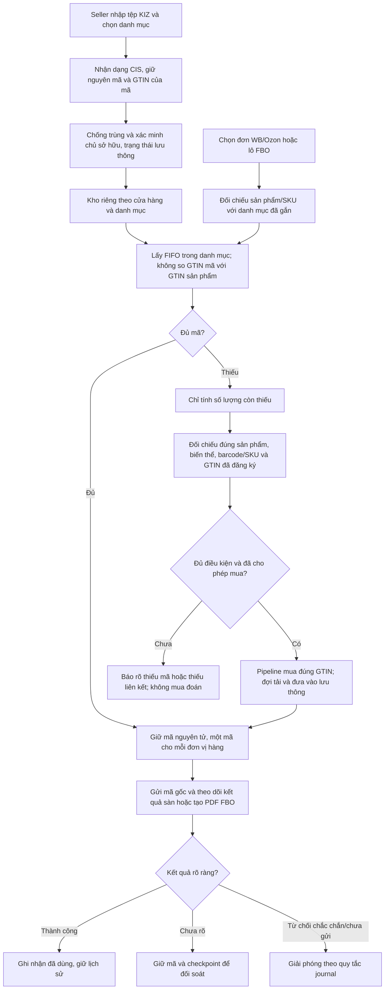
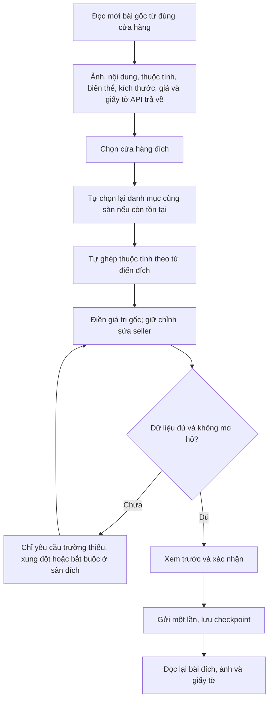

# VNCode 1.4.12 — kho KIZ theo danh mục và sao chép dữ liệu bài gốc

## Kho KIZ

Danh mục là nhóm do seller tự đặt, giống kho WCode 1.0.27; không mặc định đồng nhất với TN VED hoặc danh mục của sàn. Mỗi nhóm thuộc đúng cửa hàng và chủ tài khoản. Seller tạo nhóm, nhập/chuyển mã chưa dùng vào nhóm, rồi chọn các sản phẩm sử dụng nhóm đó. Các biến thể của sản phẩm có thể dùng cùng nhóm.

Mã được phân loại không còn xuất hiện trong nhánh tồn kho dự phòng theo GTIN của sản phẩm khác. Nhánh dự phòng giữ mã tự mua và mã nhập chưa phân loại; phần mua mới phải có chứng cứ GTIN của đúng sản phẩm/biến thể, không chỉ quy tắc danh mục/article cũ. Tùy chọn tự mua phải được seller bật; FBO giữ màn xác nhận mua thiếu riêng.

WB giữ chống trùng đơn/CIS, checkpoint và cơ chế đối soát cũ. Ozon phân biệt SKU trong posting với native product ID trong catalog: chỉ SKU có đúng một sản phẩm hoạt động mới được dùng để tìm danh mục. Việc giữ và liên kết exemplars diễn ra trong cùng transaction; journal lưu danh mục, sản phẩm và token để lần chạy lại không đổi mã vì GTIN khác. Readiness mô phỏng FIFO cho cả lô, không tính một mã nhiều lần cho nhiều posting. FBO lấy barcode của đúng sản phẩm trên sàn khi dùng kho danh mục; không biến GTIN của KIZ thành GTIN đã xác minh của sản phẩm.

Yêu cầu không so GTIN khi chọn kho không đồng nghĩa sàn chắc chắn chấp nhận mọi KIZ trong danh mục. VNCode giữ nguyên mã; không sửa GTIN/CIS hoặc che lỗi từ sàn. Kho vẫn riêng từng máy, chưa phải kho dùng chung qua website license.

## Sao chép bài đăng

Trên cùng sàn và cùng danh mục, ID thuộc tính được giữ nếu có trong từ điển đích. Khác sàn/danh mục chỉ tự ghép khi tên/ngữ nghĩa tương ứng duy nhất và cấu trúc/đơn vị phù hợp. ID từ điển giá trị vẫn tra lại ở sàn đích. Không chuyển raw KIZ, nmID/chrtID/product ID nguồn thành ID của bài đích.

Article gốc được điền sẵn khi sang cửa hàng khác; sao chép trong cùng cửa hàng có hậu tố tránh dùng ngay article đang tồn tại. Xung đột thật vẫn được báo để sửa. Giá nguồn đọc từ API giá WB/Ozon khi tài khoản có quyền; WB giữ giá khác nhau theo size. Không tự quy đổi tiền tệ, không suy đoán giá khi API không trả. Nhánh giá WB hiện dùng RUB; nguồn có tiền tệ khác phải được sửa/xác nhận giá phù hợp trước khi gửi, không dùng nguyên số tiền ngoại tệ thành RUB. Size Nga có sẵn trong thuộc tính Ozon được đưa về biến thể và chuyển đúng cấu trúc size của WB/Ozon, không yêu cầu nhập lại như một thuộc tính chưa ánh xạ. Không chép tồn kho hoặc chỉ số vận hành giữa cửa hàng.

Barcode gốc được sao chép như dữ liệu bài đăng mới đọc; điều này không cấp chứng cứ Catalog/KIZ để mua mã. Cùng một bài WB giữ danh sách barcode theo từng size. Giấy tờ giữ metadata; API chỉ trả metadata mà không trả tệp gốc thì không thể tự tạo tệp PDF/ảnh thay thế. Những trường hợp đó được báo cụ thể trong xem trước. Nhóm thuộc tính phức hợp có thứ tự không rõ vẫn cần xử lý riêng.

Sao chép hàng loạt lấy dữ liệu riêng của từng bài, không buộc mở lại từng bài để điền các giá trị đã có; không lấy tiêu đề/giá sửa tay của bài đầu áp sang mọi bài khác. Danh mục đích chỉ kế thừa giữa các bài có cùng danh mục nguồn; bài khác loại phải được đối chiếu riêng.
