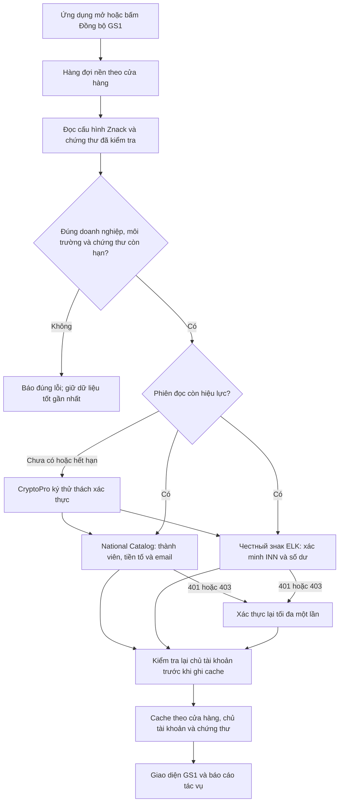

# GS1 trong VNCode 1.4.12

Yêu cầu đã được chủ ứng dụng chấp thuận: đọc GS1 bằng thông tin trong **Cấu hình Znack**, tự xác thực qua CryptoPro, gọn giao diện và không mở trình duyệt để đăng nhập.

WBCode Latest được kiểm tra lại trên GitHub ngày 15/10/2026 là [1.3.8](https://github.com/rupphi/relatest-wcode/releases/tag/v1.3.8). Đối chiếu sử dụng nội dung phát hành, ảnh do chủ ứng dụng cung cấp và mã WCode công khai ở commit `8f7c3d1ac8598158029b8d037e2d3c128e240727`. Không có mã nguồn nội bộ hoặc phiên đăng nhập seller của WBCode 1.3.8; không coi mã WCode cũ là chính bản 1.3.8.

Phiên Catalog dùng cookie/CSRF riêng; phiên ELK dùng token riêng và luôn kiểm tra lại INN. Không lấy Gmail đăng ký license để điền làm email doanh nghiệp. Token và cookie chỉ nằm trong bộ nhớ; cache SQLite chỉ giữ kết quả và mã lỗi an toàn. Phiên được giới hạn thời gian và số lượng theo cấu hình 10 cửa hàng.

Xác thực đọc dùng context ký thử thách riêng, không cấp quyền ký hồ sơ hoặc tiếp tục các lần mua mã đang dở. Thông tin cấu hình phải được xác minh trước, chứng thư phải còn hạn và CMS được kiểm tra đúng chứng thư/doanh nghiệp. Nếu CryptoPro yêu cầu PIN thì hộp thoại của CryptoPro vẫn có thể xuất hiện; đăng nhập trình duyệt không cần thiết. Sau khi hủy hoặc lỗi ký, lịch nền giữ trạng thái dừng để tránh lặp hộp thoại; kiểm tra lại chứng thư/chọn cửa hàng là thao tác rõ ràng của người dùng.

Giao diện gồm thẻ tài khoản/thành viên, sáu mục kiểm tra, bảng GCP/GLN/hạn/số GTIN còn lại và khung thư từ. Chỉ giữ một nút **Đồng bộ GS1**; các nút đăng nhập/kiểm tra thành viên trùng lặp được gom vào cùng luồng. Trạng thái chưa biết được giữ là chưa xác minh, gồm thỏa thuận chưa có bằng chứng API.

Xin tiền tố, ký/gửi đơn, email, đối soát hóa đơn và thanh toán vẫn là thao tác riêng có xem trước. Không có gửi đơn, gửi thư hay mua mã trong lượt đồng bộ đọc. Khi một dịch vụ lỗi, báo cáo chỉ rõ phần lỗi; không biến lỗi kết nối thành “không phải thành viên” hoặc số dư bằng không.

Kiểm thử: `Gs1AutomaticSyncServiceTest`, `Gs1AutomaticSessionTest`, `ZnackSigningSessionTest`, `NationalCatalogGs1ClientTest`, `ChestnyZnakBalanceClientTest`, `Gs1PaneTest`. Các transport là máy chủ giả lập, dữ liệu và chữ ký đều tổng hợp; CryptoPro thật, chứng thư seller và API production cần kiểm tra trên máy Windows của seller.
