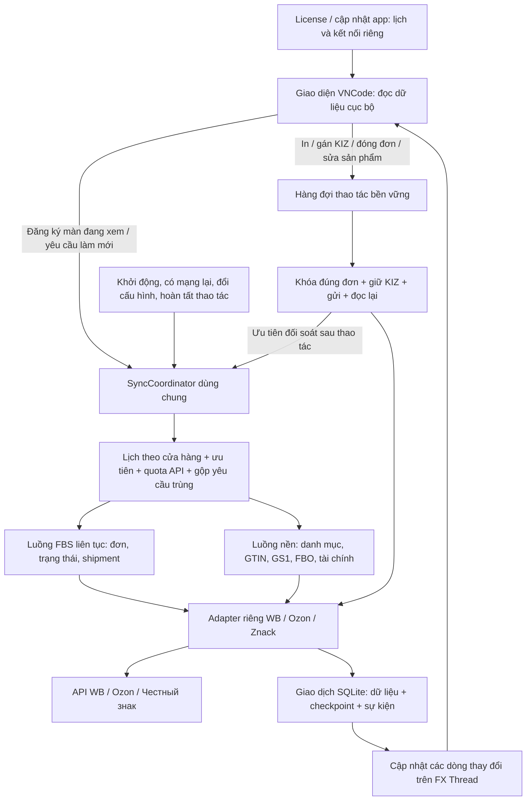
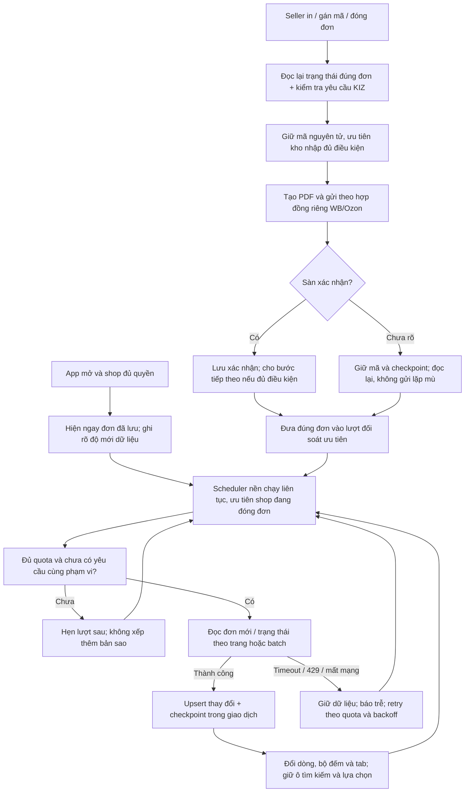
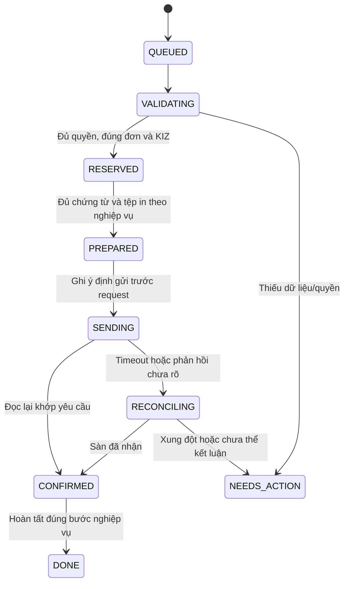

# Đề xuất cấu trúc đồng bộ toàn bộ VNCode

Trạng thái: **đã được chủ ứng dụng duyệt, đang triển khai và kiểm thử trong VNCode 1.4.12**. Nền Published vẫn là VNCode 1.4.11, kế thừa 1.4.10. Đây là thiết kế mục tiêu; phạm vi đã thực hiện và giới hạn được ghi riêng trong [báo cáo triển khai](../validation/2026-10-15-vncode-1412-implementation.md).

## 1. Nền đối chiếu và giới hạn bằng chứng

Kiểm tra lại GitHub ngày 15/10/2026:

- [WBCode Latest 1.3.8](https://github.com/rupphi/relatest-wcode/releases/tag/v1.3.8). Thời điểm phát hành API: `2026-10-12T21:14:49Z`, tương ứng 13/10 lúc 00:14 giờ Moscow. Chưa có bản stable mới hơn trong danh sách phát hành tại thời điểm rà soát.
- Bằng chứng giao diện chạy Windows đã lưu: `docs/research/vncode-wbcode-2026-10-14/evidence/wbcode-observation.json`. Quan sát trước đây chưa đăng nhập seller và chưa kích hoạt WBCode. Không coi là đã thử luồng đơn thật.
- [Mã WCode công khai mới nhất](https://github.com/rupphi/test-wcode/tree/8f7c3d1ac8598158029b8d037e2d3c128e240727): commit `8f7c3d1ac8598158029b8d037e2d3c128e240727`. Đã đọc lại 8 tệp, liệt kê trong tài liệu bằng chứng đi kèm. Đây là WCode 1.1.32, không phải mã nguồn nội bộ WBCode 1.3.8.
- Kho mã nhập đối chiếu thêm [WCode 1.0.27](https://github.com/rupphi/test-wcode/tree/457a6113301978454f244248956962ab1fcdeb7e), theo nghiên cứu Catalog/KIZ đã có.

Nền áp dụng từ các nguồn kiểm chứng được: workflow riêng WB/Ozon; dữ liệu cục bộ hiển thị trước; đường làm mới đơn nhẹ riêng; gán KIZ chạy nền; thẻ GTIN cũ tiếp tục phục vụ cho tới khi thẻ mới thực sự được xác nhận trên sàn. VNCode giữ và củng cố journal/đối soát đã bổ sung ở các bản hiện tại; không suy ra độ bền lưu trữ của WBCode mới từ coordinator chỉ lưu bộ nhớ trong WCode công khai. Bộ điều phối chung và đồng bộ FBS liên tục bên dưới là **thiết kế mới cho VNCode**, không khẳng định WBCode có cùng mã nội bộ.

## 2. Những điểm hiện tại cần sửa

| Điểm trong VNCode | Bằng chứng mã | Hướng sửa |
|---|---|---|
| Ozon làm mới tổng quan lần lượt tải đơn hiện hành, lịch sử, từng chi tiết đơn rồi toàn bộ danh mục | `OzonSyncWorkflow.syncOverview`, dòng 19–28 | Tách stream FBS, lịch sử, danh mục và làm giàu chi tiết; không chờ toàn bộ danh mục để thấy đơn |
| Làm mới FBS phụ thuộc controller/mở tab/bấm nút | `OzonDashboardController.sync/refreshPostings`, `HomeController.startShopSync` | Scheduler sống theo vòng đời ứng dụng, giữ chạy khi chuyển trang hoặc thu nhỏ |
| Timer 5 giây trong màn Ozon hiện làm mới bảng kho GTIN cục bộ | `OzonDashboardController.setupGtinInventory`, dòng 884 | Không nhầm timer này với polling đơn trên sàn |
| WB overview chủ yếu tải shipment; làm mới từng shipment lại gọi cửa sổ lịch sử đơn | `WbSyncWorkflow.syncOverview/syncSupplyOrdersAndStatuses` | Một stream khám phá đơn + stream trạng thái/lô đang hoạt động; chia sẻ kết quả, gộp yêu cầu |
| Ozon làm giàu mọi chi tiết đơn đang hoạt động theo vòng lặp | `OzonPostingSyncService.refreshActiveDetails`, dòng 130 | Ưu tiên đơn được chọn/đổi trạng thái; đọc theo nhu cầu và TTL, chia lượt hữu hạn |
| Có nhiều executor và bộ chống lặp riêng | `AppTaskExecutor`, `ShopReadCoordinator`, `SellerMutationExecutor`, `FinanceSyncScheduler`, `ZnackPipelineQueueExecutor` | Một chính sách phân phối công việc và ngân sách; giữ worker chuyên dụng khi cần |
| Seller mutation dùng một worker toàn ứng dụng | `SellerMutationExecutor`, dòng 5 | Cho phép số ít thao tác độc lập chạy song song giữa cửa hàng; tuần tự theo đúng đơn/shipment và quota chung |
| `withActiveShop` giữ read lock để ngăn xóa shop | `ShopOperationCoordinator`, dòng 19 | Giữ bảo vệ vòng đời; bổ sung khóa nghiệp vụ và fencing. Read lock này không phải khóa loại trừ gán KIZ |
| GTIN tự đồng bộ tối đa một lần/shop/phiên | `ZnackGtinAutoSync`, dòng 12–24 | Cache có hạn và sự kiện làm mất hiệu lực; thất bại không bị coi là đã đồng bộ thành công |
| Rate limiter có chờ ngủ trên worker | `OzonApiRateLimiter`, `WbMarketplaceApiRateLimiter` | Scheduler lên lịch `nextEligibleAt`; endpoint vẫn giữ kiểm tra giới hạn cuối cùng, tránh worker ngủ dài |

Các giới hạn trên xuất hiện cả ở một phần mã WCode công khai. Không sao chép lại các điểm gây tải nặng chỉ vì chúng có trong nguồn tham khảo.

## 3. Kiến trúc tổng thể đề xuất

### Phân lớp mã dự kiến

- `features/sync`: `SyncCoordinator`, `SyncPlanner`, `SyncPolicy`, `SyncScope`, `SyncHealth`, vòng đời start/stop, đăng ký nhu cầu giao diện.
- `features/sync/state`: checkpoint, lease có fencing token, lịch retry, nhật ký và transactional outbox. Không dựng hệ thống lưu job mới song song với các journal nghiệp vụ đã có; dùng adapter cho journal hiện hữu.
- `integration/{wb,ozon,znack}/sync`: adapter đọc từng trang, batch trạng thái, kết quả có loại rõ `Success/Deferred/AuthRequired/Indeterminate`.
- `features/fbs`: mô hình hàng đợi WB/Ozon chung, giữ ID/trạng thái riêng của từng sàn, luồng đóng đơn và điều kiện chuyển bước.
- Các module `gtinsync`, `catalogsync`, `finance`, `fbosupply`, `gs1`, `kiz`, `print` giữ quy tắc nghiệp vụ; chuyển lịch chạy và gộp yêu cầu về coordinator.
- `ui/...`: đăng ký quan sát, truy vấn trang từ DB và áp dụng delta; không trực tiếp sở hữu scheduler mạng.
- `features/license` và `integration/update` là phần cấp ứng dụng, không mang `shopId` giả. Có ngân sách HTTP riêng để tải bộ cài hoặc mất kết nối license không chiếm worker FBS.

Đọc đồng bộ là nhận trạng thái từ API vào máy. Gửi GTIN, mua KIZ, gán mã và đóng đơn là thao tác nghiệp vụ có quyền/ý định rõ ràng, không biến thành tác dụng phụ của một lần polling.

## 4. FBS liên tục trên cả WB và Ozon

**Định nghĩa realtime được duyệt:** VNCode tự theo dõi liên tục khi ứng dụng còn chạy và có mạng, kể cả đổi màn hình/thu nhỏ; các shop được bật đều được cập nhật. Không cần liên tục bấm “Đồng bộ”. Khi đóng hẳn ứng dụng, tác vụ dừng và lần mở tiếp theo bù dữ liệu còn thiếu.

API hiện được tích hợp theo kiểu request/response, chưa xác minh hợp đồng push/webhook cho luồng này. Do đó đề xuất mặc định là **gần thời gian thực bằng polling thích ứng**, không cam kết mọi thay đổi xuất hiện tức thì. Chỉ thêm push khi có tài liệu chính thức và kiểm thử xác thực; push sẽ kích hoạt đọc lại, không trực tiếp coi payload thông báo là dữ liệu đã được xác minh.

| Dữ liệu | Lịch đề xuất khi mạng/API bình thường |
|---|---|
| Shop và shipment đang đóng đơn | Lượt đọc nhẹ mục tiêu mỗi 5–15 giây, theo ngân sách endpoint và tổng số shop |
| Các shop còn lại đã bật tự đồng bộ | 30–60 giây, chia lượt công bằng; thao tác đang dở được nâng ưu tiên |
| Sau gán KIZ/đóng đơn/chuyển shipment | Ưu tiên đối soát ngay khi quota cho phép; bỏ backoff cũ nếu có lý do hợp lệ, không vượt `Retry-After` |
| Chi tiết đơn | Trước thao tác quan trọng; sau sự kiện thay đổi; TTL cho dữ liệu nền |
| Danh sách đầy đủ/đơn rời hàng đợi | Quét chia trang theo vòng; đối chiếu lịch sử/chi tiết để tìm trạng thái kết thúc |

5–15 giây là mục tiêu điều phối, không phải SLA đã đo hoặc giới hạn API chính thức. 1.000 đơn cần nhiều trang; không hứa mỗi chu kỳ ngắn đã quét xong mọi đơn. Phải hiển thị độ trễ thực tế và tuổi lần quét hoàn chỉnh.

### Quy tắc bắt buộc cho FBS

1. Tách **đơn mới**, **đơn đang xử lý**, **lịch sử**, **danh mục/ảnh**. API danh mục lỗi không làm biến mất đơn. Chỉ tải chi tiết nặng cho đơn cần xử lý hoặc dữ liệu thiếu.
2. Ozon tiếp tục dùng unfulfilled v4 để khám phá hàng đợi, lịch sử cửa sổ chồng lấn để bắt chuyển trạng thái và detail để quyết định exemplar/KIZ. Một đơn không còn xuất hiện trong unfulfilled phải được xác minh; không tự gán “đã hủy”.
3. WB tách khám phá đơn mới, batch trạng thái và thành viên shipment. Không quét lịch sử toàn shop cho từng shipment trong mỗi tick. Không đánh mất đơn chưa vào shipment.
4. Mỗi kết quả mang `shopId`, sàn, môi trường, INN/owner đã xác minh, credential generation, stream và request generation. Scope thay đổi thì bỏ kết quả cũ trước khi ghi DB; chuyển màn hình chỉ hủy đăng ký UI, không hủy thao tác đã nhận.
5. Dữ liệu remote và trạng thái thao tác local được lưu riêng. Poll không ghi đè job `SENDING/AWAITING_CONFIRMATION`, không giải phóng mã đang giữ vì một lần đọc cũ hoặc thiếu dữ liệu.
6. Nút làm mới đẩy ưu tiên yêu cầu đang có; 20 lần bấm không tạo 20 lần quét. Các vòng quét snapshot giống nhau phải được tuần tự hóa để phản hồi cũ không ghi đè phản hồi mới.
7. Chỉ khóa/không cho thao tác các đơn có xung đột. Không khóa cả màn hình trong lúc đồng bộ tự động. Giữ tìm kiếm, bộ lọc, vị trí cuộn, dòng chọn và sửa đang dở; báo rõ khi đơn được chọn đã thay đổi/hủy trên sàn.
8. Trước giao hàng đọc lại điều kiện sàn. Ozon chỉ cho ship sau exemplar `ACCEPTED`; PDF mở/in xong không đồng nghĩa gán mã thành công. WB phải xác nhận metadata/điều kiện shipment trước giao.
9. Đơn hủy trong khi gán mã: dừng các lệnh chưa gửi, đối soát lệnh đã gửi. Không tự dùng lại KIZ chỉ vì seller bấm hủy hoặc request timeout.

## 5. Áp dụng cho toàn bộ module

| Module | Cách đồng bộ mới | Điều kiện bảo toàn |
|---|---|---|
| Danh mục WB/Ozon, ảnh, biến thể | Cache trước; tăng dần/chia trang nếu API hỗ trợ; fallback vòng quét hữu hạn; ảnh hàng đợi riêng | Giữ barcode cũ, không ghép chỉ theo tên; không tải lại toàn bộ khi mở FBS |
| FBS, shipment và bộ đếm | Luồng liên tục ưu tiên; cùng bộ điều phối, adapter riêng từng sàn | ID đúng sàn/shop; hàng đợi thiếu trang không được coi là đầy đủ |
| National Catalog, GTIN, TN VED, giấy tờ, chất liệu | Đọc theo batch và TTL; tự nối GTIN sau Znack khi ghép đã xác minh; xử lý ngoại lệ ngay trong Znack | Đúng INN/biến thể; gửi thuộc tính → đọc lại → GTIN → đọc lại; giữ GTIN cũ tới khi mã mới thực sự hoạt động |
| Kho KIZ và mua KIZ | Import/kiểm tra chạy nền; giao dịch giữ mã; journal mua và kiểm tra trạng thái dùng lịch chung | Chống trùng CIS; mã nhập đã xác minh trước; mua phần thiếu chỉ khi seller bật; không tự mua lại sau timeout |
| GS1, chứng thư, số dư Znack, thư | Cache có hạn, làm mới khi đến hạn hoặc có thay đổi liên quan | CryptoPro chạy worker riêng; gia hạn/gửi đơn có kiểm soát, không phát sinh thư từ polling |
| In và lịch sử | PDF theo lô hữu hạn, atomic file publish; tiến độ qua DB/sự kiện | Giữ KIZ/job sau sự cố; reprint có ý định riêng, không cấp KIZ mới mặc định |
| FBO/FBW | Lịch nền theo độ mới và trang đang xem | Không chiếm ngân sách FBS; giữ khác biệt hợp đồng từng sàn |
| Tài chính/quảng cáo | Hợp nhất điều phối, giữ các checkpoint/dữ liệu analytic riêng | Phân quyền và quota riêng; được chạy khi FBS nhẹ, không bị đói vô hạn do app luôn có polling |
| License/tài khoản | Lịch cấp ứng dụng, cache quyền đã ký và offline grace đang có; trạng thái mạng riêng | Không gọi server license mỗi tick FBS; không gắn quyền vào IP/Wi-Fi/múi giờ; kiểm tra UTC |
| Cập nhật phần mềm | GitHub Published/Latest, lịch riêng và nút kiểm tra | Tải nền không chiếm toàn bộ kết nối FBS; giữ kiểm tra SHA-256/dung lượng; seller chủ động cài |

## 6. Lịch chạy, bộ nhớ và lưu trữ

- Một vòng điều phối dùng deadline theo đồng hồ monotonic. Thời điểm lưu/log dùng UTC; hiển thị theo múi giờ người dùng. Không lấy giờ hệ thống thay đổi để phá lịch retry/lease.
- Phạm vi quota theo danh tính credential/endpoint thực tế của nhà cung cấp. Hai cấu hình shop dùng cùng credential phải chia cùng bucket, không nhân quota. Lưu hash mật mã nội bộ thay vì khóa API hoặc `String.hashCode()`; không đưa hash/secret vào UI/log xuất ra.
- Ưu tiên: thao tác/đối soát đang dở → FBS đang thao tác → FBS shop nền → danh mục/GTIN → lịch sử/tài chính/ảnh. Dùng trọng số và aging để không bỏ đói công việc nền; không dùng điều kiện “toàn app không có task mới chạy tài chính”.
- Khởi điểm cấu hình để đo: tối đa 4 request đọc sàn đang bay (dành ít nhất một slot FBS), tối đa 2 thao tác ghi độc lập, 1 worker PDF, 1 worker ký số và 1 writer/DB. Kết nối license/update riêng nhưng vẫn chịu ngân sách mạng toàn máy. Đây là cấu hình đề xuất, phải đo trên Windows trước chốt.
- Không tạo một executor không giới hạn cho mỗi shop. Hàng đợi có trần và backpressure; tick bị dồn được gộp. Job đã nhận lưu DB trước, không bị loại khỏi bộ nhớ rồi thất lạc.
- Chia công việc đến cấp trang/batch/đơn; sau mỗi batch trả lượt cho shop khác. Batch size theo endpoint, không dùng một số cố định sai hợp đồng mọi API.
- DB dùng WAL nếu điều kiện lưu trữ phù hợp, giao dịch ngắn và truy vấn phân trang/index. Không giữ transaction SQLite trong khi gọi mạng, chờ ký số hoặc dựng PDF. Analytics DB giữ writer/checkpoint riêng nếu đang tách DB.
- Ghi dữ liệu trang + cursor tiếp tục trong cùng giao dịch. Watermark “đồng bộ hoàn chỉnh” chỉ tăng khi hết trang. Phản hồi lỗi/thiếu trang không được làm mất dữ liệu hoặc đánh dấu thành công toàn phiên.
- Scheduler đọc `nextEligibleAt`/cooldown và bỏ qua luồng chưa tới giờ. 401/403 cần phân biệt sai quyền/token với lỗi mạng; chỉ làm mới xác thực khi có cơ chế hỗ trợ, không retry vô hạn. 429 tôn trọng `Retry-After`, 5xx/timeout backoff có jitter theo stream. Một shop lỗi không tạm dừng các shop khác.
- Health gồm `lastAttempt`, `lastSuccess`, `lastFullSweep`, `nextRetry`, cursor, số trang, số request/429, queue wait, API latency, DB time, UI apply time. Đồng hồ timer đang chạy không đủ để báo “Đã đồng bộ”.

## 7. Thao tác bền vững và nhiều máy

Tên trạng thái trên là mô hình tổng quát; dùng adapter đến journal WB/Ozon/Catalog hiện có, không ép mọi nghiệp vụ gửi/in theo cùng thứ tự. Ozon giữ hợp đồng validate → tạo/mở PDF hoàn chỉnh → set/status nền; cờ `PDF_READY` và `REMOTE_ACCEPTED` riêng. Khi khởi động lại, khôi phục lease/job và đối soát trước khi thử tiếp; chỉ recovery một lần theo phiên engine.

Khóa nghiệp vụ theo shop + sàn + order/shipment/variant; command có idempotency key gắn thao tác và phiên bản dữ liệu. Hệ thống local đảm bảo không chạy trùng trong cùng DB; không hứa “exactly once” trên mạng nếu API không có idempotency. Đối soát remote là bắt buộc sau kết quả chưa rõ.

Giữ mô hình đã chọn: mỗi seller chạy trên máy riêng, website chung quản trị license. SQLite và kho KIZ vẫn cục bộ. Nếu hai máy cùng xử lý đúng một shop/đơn, cần chia trách nhiệm và kho mã; readback trước thao tác chỉ giảm rủi ro, không thay thế khóa liên máy. Muốn phối hợp tự do nhiều máy trên cùng kho/đơn phải duyệt riêng một backend phối hợp dùng chung; website license hiện tại chưa cung cấp chức năng đó.

## 8. Giao diện đồng bộ đề xuất

Thanh trạng thái FBS:

`● Tự đồng bộ đang chạy | Cập nhật thành công 8 giây trước | Đối soát KIZ: 3 đơn | Làm mới`

Khi có vấn đề:

`● Dữ liệu đang trễ 48 giây | Ozon giới hạn API | Thử lại sau 12 giây | Xem chi tiết`

Không xóa hàng hoặc thay toàn bộ TableView mỗi tick. Bảng đọc phân trang, áp dụng delta có gom nhóm trên FX Thread; danh mục và ảnh đến sau không chặn việc xem đơn. “Đang chạy” và “Dữ liệu mới” là hai chỉ số khác nhau. Hiện rõ tổng shop bật, shop tạm dừng và lý do.

Trung tâm đồng bộ chung có từng dòng shop/module, tiến độ, độ trễ, lỗi dễ hiểu và nút thử lại. Nút “Đồng bộ tất cả” lập lịch theo mức ưu tiên, không bật một tác vụ khổng lồ khóa app.

## 9. Chuyển đổi từ 1.4.11

1. Thêm coordinator và observability, bọc workflow hiện tại bằng adapter. Giữ các bảng nghiệp vụ, journal, license và DPAPI đã có.
2. Chuyển FBS đọc trước: tách Ozon full overview, WB discovery/status/shipment, thêm delta UI và lịch liên tục; chỉ một engine sở hữu mỗi stream. Tắt trigger/timer cũ của stream đã chuyển để tránh chạy đôi.
3. Chuyển điều phối ghi theo scope; giữ các guard ownership, GTIN proof, batch size, KIZ reservation và readback. Giữ ngân sách giao dịch nhỏ và giới hạn concurrency.
4. Chuyển danh mục, Catalog/GTIN/KIZ, GS1, FBO và tài chính; license/update vẫn lịch độc lập, cùng health dashboard.
5. Migration additive, snapshot trước khi nâng schema; thử nâng cấp từ đúng 1.4.11 và 1.4.10. Nếu cần trở lại engine cũ, dùng bản có schema tương thích; không khởi chạy binary cũ trên DB schema mới hoặc phục hồi snapshot một cách làm mất thao tác đã gửi ra sàn.
6. Chỉ tạo/publish bộ cài sau khi sơ đồ được duyệt và kiểm thử đạt. Bản Published 1.4.11 hiện tại giữ nguyên.

## 10. Bộ kiểm thử phải có khi triển khai

Đây là **kế hoạch kiểm thử**, chưa phải kết quả chạy của kiến trúc mới.

- Scheduler với clock giả: gộp yêu cầu, không chồng cùng stream, deadline/aging công bằng, giới hạn queue, đổi giờ hệ thống, cooldown và restart.
- Adapter HTTP: pagination/cursor lặp/thiếu trang, 429/`Retry-After`, timeout, mất mạng rồi có lại, 401/403, dữ liệu thay đổi khi đang quét. POST đọc Ozon phân loại theo ngữ nghĩa đọc, không chỉ dựa vào HTTP method.
- FBS realtime: đơn mới đến từ ngoài app; chuyển new/packing/delivering/hủy; đơn mất khỏi unfulfilled; cập nhật ngay sau thao tác; không bỏ sót trang hoặc đơn chưa có sản phẩm.
- Race: poll cũ sau mutation mới; đổi credential/INN/shop khi request đang bay; xóa shop; chuyển màn hình; hủy đúng lúc gửi KIZ; hai thao tác cùng đơn; khởi động sau crash giữa gửi và lưu xác nhận.
- Giữ mã: không lặp CIS, imported-first, tồn kho không đủ, True API chưa rõ, mua đang dở và fee opt-in; không giải phóng mã khi chưa kết luận được remote.
- Tải mô phỏng: 10 shop hỗn hợp WB/Ozon và 10 Ozon, mỗi shop ít nhất 1.000 đơn; shipment 100/500/1.000 đơn. Đo trên Windows 2 core/4 GB và cấu hình phổ thông; ghi CPU/RAM/GC, số request, queue wait, poll age, PDF và thời gian gán mã.
- Mục tiêu để đo: UI thao tác p95 dưới 250 ms trong tải chuẩn; delta UI p95 dưới 1 giây sau DB commit; không queue tăng vô hạn, không shop bị đói. Không tính thời gian từ sàn thay đổi đến API phản ánh như thời gian xử lý nội bộ; báo riêng.
- JavaFX: không mạng/DB/PDF trên FX Thread; giữ filter/selection/scroll; độ trễ hiển thị đúng; DPI 100/125/150, 4 ngôn ngữ và 2 theme.
- Native Windows: MSI cập nhật tại chỗ, giữ cửa hàng, mã, mẫu in, lịch sử và khóa được bảo vệ; một registration; kiểm tra updater và public asset sau khi thực sự phát hành.
- Thử seller thật ở giai đoạn nghiệm thu phải được phân biệt với MockWebServer/tải mô phỏng. Không dùng mã KIZ thật hoặc gọi API ghi chỉ để rà soát thiết kế.

## Nội dung cần duyệt

Duyệt kiến trúc chung + FBS tự theo dõi liên tục khi app mở trên cả WB/Ozon, polling thích ứng theo quota, ưu tiên đóng đơn, giữ dữ liệu local và các journal đang có. Sau khi duyệt mới triển khai mã theo các giai đoạn trên và đo kiểm; chưa gọi thiết kế này là đã vận hành realtime trên tài khoản seller.

## Bổ sung yêu cầu Znack và GTIN

Xem [luồng tự động Znack → WB/Ozon, xác minh SKU và báo cáo tác vụ](2026-10-15-znack-marketplace-pipeline-proposal.md). Phần này thay phương án mở công cụ GTIN riêng: bỏ hoàn toàn mục GTIN WB/Ozon trong Công cụ, giữ backend và tự tiếp tục sau đồng bộ Znack cho các dòng đủ bằng chứng; dòng xung đột được sửa trong Znack.
