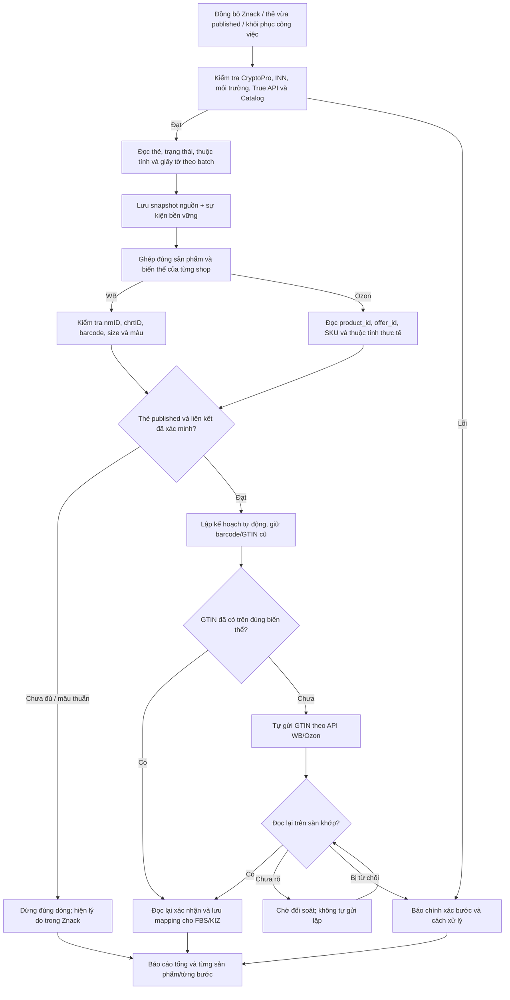

# Bổ sung thiết kế: Znack → GTIN WB/Ozon → báo cáo tác vụ

Trạng thái: **đã được chủ ứng dụng duyệt, đang triển khai trong VNCode 1.4.12**, nối tiếp kiến trúc đồng bộ chung ngày 15/10/2026. Bản Published vẫn là 1.4.11. Đối chiếu [báo cáo triển khai](../validation/2026-10-15-vncode-1412-implementation.md) để phân biệt thiết kế mục tiêu và hành vi đã được kiểm thử.

Yêu cầu mới thay thế cách mở công cụ GTIN riêng: sau đồng bộ Znack hoặc khi một thẻ được xác nhận published, ứng dụng tự tiếp tục cập nhật GTIN lên đúng sản phẩm WB/Ozon rồi đọc lại. Trường hợp thiếu dữ liệu hoặc ghép không chắc chắn cần xử lý ngay trên dòng sản phẩm trong Znack, không tạo lại công cụ GTIN ở mục Công cụ.

## 1. Kết quả rà soát hiện trạng

| Phát hiện | Bằng chứng | Kết luận có thể xác nhận |
|---|---|---|
| Đồng bộ Znack và gửi GTIN là hai thao tác rời | `ZnackCardRegistrationController.onSyncZnack/onUpdateWb`, `OzonRegistrationPane.syncCatalog` | Nút đồng bộ chỉ gọi RegisteredGtinSyncService; nút GTIN mở màn riêng, chưa có chuỗi tự động sau đồng bộ |
| Workflow WB dừng ở published; Ozon publish lưu thẻ nhưng không tự gọi marketplace adapter | `ZnackCardRegistrationWorkflow` đoạn sau moderation; `OzonCardRegistrationWorkflow.publish` | Cần sự kiện bền vững ở backend nối bước tiếp theo, không dựa vào callback của màn hình |
| Dữ liệu Znack được đọc/lưu qua nhiều đường | `ZnackProductService`, `NationalCatalogGtinSource`, `GtinSyncRepository`, repository đăng ký | Cần một snapshot nguồn và projection dùng chung, không coi cập nhật một bảng là mọi màn đã đồng bộ |
| Một thẻ thiếu trong phản hồi có thể làm dừng toàn lượt đọc | `NationalCatalogGtinSource.read`, dòng 100–115 | Phải phân biệt lỗi toàn phiên và lỗi từng GTIN/batch; giữ dữ liệu trước đó, báo partial và tiếp tục phần độc lập đã xác minh |
| Ozon có article rule áp dụng cho nhiều SKU cùng article, sau đó ghi đè bằng mapping đã xác minh | `OzonProductGtinMappingRepository.findResolvedBySku` | Article rule chỉ là gợi ý. Không dùng làm chứng cứ cho auto-send hoặc kết luận một SKU đã có thẻ |
| Ozon kiểm tra xung đột GTIN bằng quét danh mục trong adapter | `OzonGtinAdapter.conflicts` | Tránh quét toàn danh mục một lần cho mỗi GTIN; lập chỉ mục theo snapshot có độ mới và độ đầy đủ rõ |
| Trung tâm tác vụ chỉ có shop/kind/state/count | `JobCenterRepository.Row`, truy vấn GROUP BY và `JobCenterDialog` | Không có job ID, sản phẩm, bước cụ thể, lý do lỗi và lịch sử; không thể drill-down đúng tác vụ |
| SUCCEEDED và PRINTED bị phân loại là running | `JobCenterRepository.state` | Đã kiểm tra trực tiếp hàm trong JAR 1.4.11: `SUCCEEDED → running`, `PRINTED → running`; đây là lỗi phân loại đã tái hiện |
| GTIN job chỉ lưu trạng thái và remote task ID, mất chi tiết exception ở một số nhánh | `GtinSyncCoordinator.runItems/reconcile`, `GtinSyncSchema` | Phải lưu error code có cấu trúc, bước, nguyên nhân và cách xử lý; không chỉ đổi sang FAILED/RECONCILE_REQUIRED |

Không có phiên đăng nhập seller để tái hiện lỗi API Znack/WB/Ozon thật trong lần thiết kế này. Các phát hiện cấu trúc trên không đủ để khẳng định nguyên nhân cụ thể của mọi lần “không đồng bộ được”; bước kết nối và báo cáo mới phải chỉ đúng nơi hỏng.

Đối chiếu: WBCode Latest 1.3.8, bằng chứng UI đã có và WCode công khai commit `8f7c3d1ac8598158029b8d037e2d3c128e240727`. Đã đọc thêm `ZnackProductService`, `OzonProductGtinMappingRepository`, `ZnackCardRegistrationWorkflow` trong nguồn WCode. Workflow WCode đó ghi rõ phạm vi thử nghiệm dừng trước khi ghi GTIN lên WB; không sao chép giới hạn này sang luồng tự động VNCode. Giữ hành vi WBCode 1.3.8: GTIN/thẻ cũ còn hoạt động cho tới khi thẻ mới được xác nhận trên sàn.

## 2. Một chuỗi tự động duy nhất



- Mặc định thực hiện tự động phần **thêm GTIN đã xác minh** sau đồng bộ Znack theo yêu cầu của chủ ứng dụng. Không yêu cầu seller mở công cụ khác hoặc xác nhận từng dòng ghép chắc chắn.
- Việc tự động không bỏ qua kiểm tra quyền GTIN/SELLER_API, owner, môi trường production, chữ ký và độ mới của dữ liệu.
- Chỉ tiếp tục cho các shop thuộc phạm vi phiên đồng bộ và có quyền/cấu hình hợp lệ. Không gửi sang mọi shop chỉ vì cùng INN.
- Không tự xin GTIN mới, tạo/ký lại thẻ, mua KIZ hoặc thay barcode cũ vì một phép ghép thất bại. Các hành động đó vẫn thuộc quy trình đăng ký/mua đã có.
- TN VED, giấy tờ, chất liệu và thuộc tính đi theo chính sách trường đã chọn. Thiếu điều kiện bắt buộc thì dừng đúng dòng; không tự ghi đè thông tin seller chưa chọn hoặc bịa giấy tờ để gửi GTIN.
- Nếu batch độc lập đã xác minh đầy đủ, có thể tiếp tục batch đó khi một batch khác lỗi. Phiên tổng phải báo `PARTIAL` và không tuyên bố toàn Catalog đã tải đủ.
- Một product WB có nhiều size dùng cùng payload thẻ phải phối hợp khóa và merge ở cấp nmID; không để hai dòng size ghi đè nhau. Không cập nhật nửa thẻ khi payload chung chưa đủ điều kiện.

## 3. Kiểm tra riêng Ozon để không báo nhầm “chưa tạo thẻ”

### Danh tính phải giữ riêng

```text
Cửa hàng + Client ID đã xác minh + môi trường
    └── product_id: sản phẩm Ozon
         ├── offer_id: mã seller, không đồng nhất với article trong mọi trường hợp
         ├── SKU hoặc tập SKU được API xác nhận thuộc đúng sản phẩm/biến thể
         ├── thuộc tính: article, size, màu, thương hiệu, loại sản phẩm...
         └── GTIN đăng ký: INN + good_id/feed_id + biến thể + trạng thái published
```

SKU không phải product_id; SKU không phải GTIN. Article, offer_id và tên sản phẩm không được dùng thay nhau. Nhiều SKU chỉ được dùng chung liên kết khi API xác nhận chúng thuộc đúng một biến thể, không suy từ cùng article.

### Thứ tự ghép và xác minh

1. Ưu tiên provenance đăng ký trong app: product_id + offer_id + SKU tại thời điểm đăng ký + GTIN + good_id/feed_id + owner/scope. Đọc lại danh tính hiện tại để phát hiện seller đã đổi sản phẩm/offer/SKU.
2. Đọc product info và attributes theo API được hỗ trợ. Lấy size, màu, article, thương hiệu và các trường phân biệt biến thể từ dictionary/attribute ID theo category; không chấp nhận dữ liệu trống như đã kiểm tra.
3. Đọc thẻ Catalog theo GTIN để xác nhận published, trade-unit, owner và các chi tiết biến thể tương ứng. Không chỉ tin vào checkpoint local `PUBLISHED` cũ.
4. Thẻ có sẵn ngoài app: ưu tiên barcode GTIN đã tồn tại trên đúng sản phẩm và proof Catalog hiện tại; nếu chưa có liên kết, chỉ tự ghép khi bộ thuộc tính đủ phân biệt cho loại hàng và có đúng một ứng viên, không có thông tin mâu thuẫn. Lưu lý do và bằng chứng ghép. Thiếu size/màu không áp đặt cho loại hàng không có biến thể đó; hàng may mặc phải có dữ liệu phân biệt size/màu khi chúng là đặc tính biến thể.
5. Cùng article nhưng khác size/màu phải phân biệt được. Chuẩn hóa theo từ điển có kiểm soát; không tự coi `XL = 50`, hoặc hai màu gần tên là một. Tên/ảnh chỉ hỗ trợ hiển thị và đề xuất.
6. Khi nhiều ứng viên hoặc có chi tiết mâu thuẫn: `NEEDS_REVIEW`, hiện so sánh ngay trong Znack. Mapping được seller xác nhận phải gắn revision/scope; thay đổi danh tính thì kiểm tra lại.
7. Trước gửi, đọc lại product_id/offer_id/SKU, barcode hiện có và phiên bản dữ liệu. Dùng endpoint thêm barcode đang tích hợp; không xóa barcode cũ, không import lại cả thẻ để né giới hạn.
8. Đọc lại sau gửi: đúng product_id, offer_id, SKU/tập alias đã xác minh và GTIN đúng biến thể; barcode cũ vẫn được bảo toàn. Kết quả API nhận request không đủ để báo thành công.
9. Sau readback mới công bố mapping cho FBS/KIZ. SKU lấy từ posting được resolve qua cùng IdentityResolver; không dùng một bảng article rule khác để kết luận “chưa tạo thẻ”.

### Phân biệt trạng thái rõ ràng

| Thực tế | Thông báo đúng |
|---|---|
| Chưa tải hoặc không đọc được thẻ | Chưa xác minh được dữ liệu Znack; hiện lỗi kết nối/quyền và lần thử tiếp |
| Có thẻ published nhưng chưa ghép SKU | Đã có thẻ Znack; chưa xác minh liên kết SKU/biến thể |
| Có nhiều GTIN cùng ứng viên | Cần chọn đúng GTIN/biến thể; hiện bảng đối chiếu |
| Đúng liên kết nhưng đang kiểm duyệt/ký | Thẻ đang chờ duyệt/chờ ký; chưa gửi GTIN lên sàn |
| Published và đúng liên kết, sàn chưa có GTIN | Đã có thẻ; đang/chờ cập nhật GTIN Ozon hoặc WB |
| Có GTIN nhưng chưa readback | Chờ sàn xác nhận; đang đối soát |
| Phản hồi đầy đủ, đúng scope xác nhận không có thẻ tương ứng | Chưa tìm thấy thẻ Znack tương ứng; kiểm tra hồ sơ trước khi tạo mới |
| GTIN thiếu giấy tờ/giấy tờ hết hiệu lực | Có thẻ, chưa đủ giấy tờ phù hợp; không gộp thành “chưa tạo” |

GTIN so sánh theo chuẩn độ dài/check digit được hỗ trợ, giữ bản gốc và canonical để xử lý tương đương số 0 đầu. Không dùng contains chuỗi thô hoặc bỏ mọi số 0 mà không kiểm tra cấu trúc.

## 4. Khắc phục đồng bộ Znack theo từng tầng

Mỗi tầng có một kết quả đọc được, không ném chung “không đồng bộ được”:

1. **Cấu hình và chứng thư:** chứng thư chọn, private key khả dụng qua CryptoPro, thời hạn UTC, INN/owner/participant, môi trường và cấu hình OMS nếu bước đó cần. Không yêu cầu OMS cho một request đọc Catalog vốn không cần OMS.
2. **Xác thực True API:** challenge/CMS, INN tham gia thực tế, hạn token. Không xóa chữ ký/metadata hợp lệ chỉ vì một request mạng lỗi.
3. **Kết nối National Catalog:** API key đã bảo vệ bằng DPAPI, scope và quyền endpoint. Nếu luồng/endpoint yêu cầu key mà thiếu thì báo đúng `CATALOG_KEY_REQUIRED`, không thử như đã cấu hình rồi kết luận không có thẻ. Chế độ xác thực lựa chọn theo endpoint đã kiểm chứng, không tự bỏ TLS/chữ ký.
4. **Đọc danh sách/trạng thái thẻ:** pagination, batch, trùng/thiếu phản hồi và pending moderation. Kiểm tra kỳ quét đầy đủ; không xóa hoặc chuyển thẻ sang chưa tạo vì request lỗi.
5. **Đọc chi tiết/giấy tờ:** batch feed-card theo hợp đồng đang có, registry theo GTIN khi cần. Kết quả không xác định phải giữ bản trước cùng độ mới; không cấp quyền gửi bằng proof cũ quá hạn.
6. **Lưu snapshot:** chuẩn hóa nguồn đọc cho `znack_products`, kho GTIN đã đăng ký và trạng thái đăng ký bằng projection chung. Mỗi consumer có version/checkpoint; ghi snapshot + outbox nguyên tử để không mất bước GTIN khi app tắt.
7. **Tự chạy phần tiếp theo:** consumer xử lý mỗi event với dedup key chứa shop, owner/scope, product/variant, GTIN và thao tác. Khi restart nhận lại event nhưng không gửi lại tác vụ đã ở trạng thái chưa rõ; đọc lại trước.

Phiên xác thực hoặc owner sai là lỗi phạm vi toàn phiên; lỗi một GTIN/biến thể được cô lập nếu còn đủ bằng chứng để xử lý các dòng độc lập khác. Không nới guard `unverified_catalog_owner` để làm đồng bộ có vẻ thành công.

## 5. Làm lại Trung tâm tác vụ

### Danh sách mỗi dòng là một tác vụ

Cột: **Mã tác vụ · Cửa hàng · Sàn · Loại tác vụ · Bước hiện tại · Trạng thái · Tiến độ · Thành công/lỗi/chờ · Bắt đầu · Cập nhật cuối**.

Không chỉ hiển thị “shop A — GTIN — running — 200”. Một phiên đồng bộ có parent job; từng sản phẩm và lệnh sàn là child job/item. Giữ liên kết đến các journal hiện tại bằng source kind + source ID, không nhân đôi hai nguồn quyết định kết quả.

Trạng thái cấp tác vụ: `QUEUED`, `RUNNING`, `WAITING_REMOTE`, `RECONCILING`, `NEEDS_ACTION`, `PAUSED`, `SUCCEEDED`, `PARTIAL`, `FAILED`, `CANCELLED`.

Bước hiện tại: kết nối → tải Znack → đọc chi tiết → ghép biến thể → chuẩn bị cập nhật → gửi WB/Ozon → đọc lại → công bố mapping → báo cáo.

Trạng thái parent được tính từ item và bước chờ thực tế; còn lịch đối soát tự động thì giữ WAITING_REMOTE/RECONCILING, không ghi “hoàn tất” sớm. PARTIAL dùng khi lượt đã dừng ở kết quả hỗn hợp, không còn child tự chạy. Mỗi item chỉ thuộc một nhóm kết quả hiện tại, lần retry được đếm riêng; task hoàn tất có dòng lịch sử, không bị lọc mất. Có bảng ánh xạ enum riêng cho từng nguồn; không dùng tìm chuỗi `contains(READY/FAIL)` hoặc mặc định mọi trạng thái lạ là running. Task cũ không có dữ liệu lỗi chi tiết phải ghi rõ “Bản cũ không lưu chi tiết”, không bịa lịch sử.

### Mở chi tiết tác vụ

- Tổng quan, phạm vi, bắt đầu/kết thúc, heartbeat/lease, lần thử và lịch tiếp theo.
- Danh sách sản phẩm: product_id/nmID, offer_id/chrtID, SKU, article, size, màu, GTIN cũ/đề xuất/thực tế; ba trạng thái Znack/mapping/sàn độc lập.
- Timeline từng bước, mã lỗi, lý do an toàn dễ hiểu, HTTP status/provider code nếu có, request ID an toàn, khả năng retry và cách xử lý.
- Số lượng request thực tế, batch, trang và số dòng còn cần làm; không gắn progress vào ước lượng timer.
- Bấm “Mở sản phẩm” đến đúng item và tab, không chỉ mở một màn bất kỳ của shop.
- Hành động theo trạng thái: thử lại bước đọc/known-unsent bị lỗi; đối soát lệnh chưa rõ; sửa liên kết/dữ liệu; tiếp tục; tạm dừng; hủy phần chưa gửi. Không có nút retry mù cho mutation chưa xác định kết quả.
- Cập nhật tự động khi dialog đang mở, truy vấn phân trang; lỗi tải báo cáo cũng có thông báo và nút thử lại, không làm mất trạng thái job.

### Ví dụ báo cáo — dữ liệu minh họa

```text
Tác vụ ZS-EXAMPLE — Shop Ozon A
Bước: Chờ sàn xác nhận · Trạng thái: Đang chờ kết quả
100 dòng = 72 đã xác nhận + 10 đã đúng sẵn + 8 chờ sàn + 6 cần ghép + 4 lỗi

Sản phẩm | SKU | Size/Màu | Znack | GTIN trên sàn | Lý do / Hành động
Áo A     | ... | L/Đen    | Published | Đã xác nhận | Hoàn tất
Áo A     | ... | XL/Đen   | Published | Chưa gửi    | Không khớp size; xem đối chiếu
Quần B   | ... | M/Xám    | Published | Chờ xác nhận | Đối soát, không gửi lại
Váy C    | ... | S/Trắng  | Chưa đọc được | Chưa gửi | Catalog timeout; sẽ đọc lại
```

Báo cáo tổng và từng sản phẩm mở lại được sau khi thoát app. Xuất CSV UTF-8 BOM cho Windows và JSON hỗ trợ chẩn đoán; không xuất API key, token, private key, CMS, mật khẩu, KIZ đầy đủ hoặc nguyên request/response chưa lọc. GTIN và định danh sản phẩm được hiển thị vì cần đối chiếu nghiệp vụ; dữ liệu nhạy cảm khác theo allowlist.

## 6. Bỏ hoàn toàn công cụ GTIN WB/Ozon riêng

- Xóa nút `gtinSyncButton` khỏi Công cụ và handler/binding/i18n/kiểm thử UI liên quan đến điều hướng độc lập.
- Bỏ nút mở cửa sổ GTIN riêng trong màn đăng ký WB/Ozon; thay bằng trạng thái chuỗi, “Xem báo cáo” và hành động sửa lỗi ở đúng dòng.
- Loại route `gtin-sync` khỏi điều hướng độc lập. Deep link/job cũ chuyển đến **Znack → Tiến độ & kết quả → đúng tác vụ/sản phẩm**, có migration link, không mở màn rỗng.
- **Giữ backend** GTIN adapter, journal, bằng chứng đã xác minh và dữ liệu mapping; bọc chúng trong pipeline. Xóa chức năng riêng trên UI không đồng nghĩa xóa kho bằng chứng hoặc lịch sử.
- Màn Znack có thông tin “Đồng bộ xong sẽ tự cập nhật GTIN WB/Ozon”; các trạng thái và báo cáo luôn xem được. Người dùng không phải đi hai màn hình để hoàn thành một lượt.

## 7. Hợp đồng hoàn tất và phục hồi

- “Đồng bộ Znack thành công” chỉ nói phần nguồn đã đạt; toàn chuỗi chỉ `SUCCEEDED` khi tất cả dòng thuộc phạm vi đã xử lý đúng hoặc đã đúng sẵn, không còn chờ/sai/thiếu proof.
- Dòng chờ moderation/readback giữ trạng thái chờ và lịch chạy tiếp; không `FAILED` chỉ vì hết một vòng poll ngắn.
- Timeout trước gửi và lỗi validation cần mã lỗi riêng. Timeout sau dispatch là `RECONCILING`; giữ remote task ID/checkpoint và đọc lại. Không tái cấp GTIN, ký lại hoặc gửi thay thế mù.
- Job lưu error code/message an toàn/cause category/step/attempt/nextRetryAt/remote state và các revision. Không cố lưu nguyên exception có thể chứa token hoặc payload.
- Thẻ thay thế: `activeGtin` và `candidateGtin` riêng; chỉ đổi active sau publication + đúng biến thể + marketplace readback. Nếu fail giữ thẻ cũ còn đủ điều kiện cho FBS/KIZ.
- Các tác vụ trong chuỗi chịu lịch nền chung; FBS realtime được ưu tiên. Không để một chuỗi Catalog 1.000 GTIN giữ worker/DB transaction suốt vòng lặp.

## 8. Kiểm thử và điều kiện nghiệm thu khi viết mã

1. Kết nối: chứng thư, UTC, INN, Catalog key thiếu/sai, True API 401/403, timeout/429; từng trường hợp xuất hiện đúng bước trong báo cáo.
2. Một thẻ lỗi trong batch không làm mất thẻ tốt; thiếu trang không xóa cache; giữ trạng thái partial và retry phần đọc còn thiếu.
3. Đồng bộ Znack hoàn tất tự enqueue đúng child GTIN, không cần mở công cụ; thẻ vừa published, app restart và event lặp không tạo gửi trùng.
4. Ozon cùng article khác size/màu/offer; SKU đổi; alias SKU hợp lệ; nhiều ứng viên; thẻ ngoài app; product archived; giấy tờ lỗi; dữ liệu thiếu. Không báo “chưa tạo thẻ” cho lỗi kết nối hoặc mapping.
5. WB đúng nmID/chrtID, merge nhiều size, barcode cũ giữ nguyên. Ozon đúng product_id/offer_id/SKU, thêm GTIN không xóa barcode; GTIN đã có thì readback + no-op, không gửi lại.
6. Chỉ cấp mapping cho FBS/KIZ sau readback; GTIN đề xuất và article rule không trở thành bằng chứng tự động.
7. Timeout sau gửi, eventual consistency, thẻ bị từ chối, hủy/đổi shop/credential khi job đang bay, crash giữa snapshot/outbox/send/readback.
8. Job center ánh xạ SUCCEEDED/PRINTED đúng; giữ lịch sử thành công/thất bại/cancel; parent/child không đếm lặp; drill-down đúng tác vụ, bộ lọc và export không lộ secret.
9. UI không còn nút/route/cửa sổ công cụ GTIN độc lập; old deep link chuyển đúng Znack; report cập nhật nền không đọc Task.getValue trên worker.
10. Tải 10 shop × 1.000 đơn và Catalog lớn; index xung đột dùng chung theo snapshot, không O(n) scan toàn danh mục cho từng GTIN; không ảnh hưởng lịch FBS.

Lỗi ánh xạ trạng thái JobCenter được tái hiện trên JAR 1.4.11 ở giai đoạn rà soát. Chuỗi mới và kiểm thử đã được bổ sung sau khi chủ ứng dụng duyệt; kết quả thực tế, các điều kiện chưa nghiệm thu trên tài khoản seller và trạng thái bộ cài nằm trong báo cáo triển khai liên kết ở đầu tài liệu. Danh sách nghiệm thu bên trên là mục tiêu, không phải tuyên bố mọi mục đã qua.
