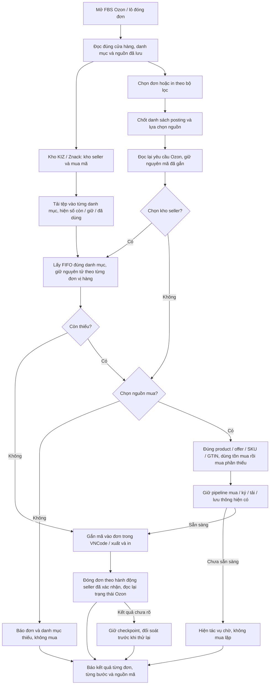
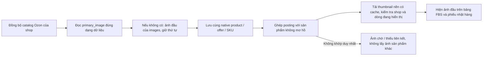

# Mục 3 — FBS Ozon, nguồn KIZ và ảnh sản phẩm

Trạng thái: **đang trình sơ đồ riêng của mục 3** theo yêu cầu duyệt từng
công việc. Người dùng yêu cầu làm mục 3 trước mục 7; sơ đồ mục 7 đã được
duyệt. Chưa thay mã nghiệp vụ trong lượt rà soát này. Nền mã:
`19479388f50ab8e97c3bfba2ad726ab5e8523e46`.

## Căn cứ và lỗi còn thiếu trong mã hiện tại

- Mục 2 đã có `WbShipmentKizPane`/`WbShipmentKizRepository`: nguồn kho nhập
  và mua lưu theo shop/chủ cấu hình/shipment; danh mục theo native ID;
  nhập tệp và phân nhóm cùng transaction. Dùng hành vi đã duyệt này làm
  căn cứ cho Ozon, không dùng subject ID của WB cho sản phẩm Ozon.
- Ozon đã có `OzonCategoryStock`, FIFO và reservation bền trong
  `OzonExemplarJobRepository`, nhưng `OzonPrintReadinessService`,
  `OzonStockReplenishment` và `OzonExemplarService` chưa nhận cùng một
  `KizSourceSelection` từ giao diện FBS. Không thể coi bộ chọn nguồn của
  WB đã được áp dụng cho Ozon.
- `OzonCatalogSyncService` đọc description category ID/type ID nhưng DTO
  và bảng sản phẩm hiện chỉ giữ tên danh mục để hiển thị. Cần giữ thêm cặp
  native ID cho kho Ozon, tránh trộn hai danh mục trùng tên. Giữ nguyên
  nhóm và liên kết thủ công cũ; không tự chuyển các mã đã phân nhóm.
- `OzonJson.parseProductInfo` đang đọc `primary_image` qua hàm đọc chuỗi.
  Bộ đọc ảnh của mục sao chép (`OzonListingImages`) đã xử lý chuỗi, mảng,
  object và thứ tự ảnh nhưng chưa được dùng cho đồng bộ ảnh FBS.
- Màn FBS đã có các tab trạng thái, phân trang, chọn theo bộ lọc và in lô.
  Thiếu khối nguồn/kho theo danh mục trong ngữ cảnh đóng đơn Ozon; cần
  thống nhất bố cục với WB mà vẫn giữ các trạng thái riêng của Ozon.

Đối chiếu: [mục 2](../validation/2026-10-16-item-2-wb-shipment-kiz.md),
[WCode nguồn công khai](https://github.com/rupphi/test-wcode/tree/457a6113301978454f244248956962ab1fcdeb7e)
và [WBCode v1.3.9](https://github.com/rupphi/relatest-wcode/releases/tag/v1.3.9),
là bản Latest được kiểm tra gần nhất. Mã engine WBCode 1.3.9 không công
khai; không tuyên bố đã sao chép hoặc chạy luồng đã đăng nhập của bản đó.

## Bố cục Ozon cần bổ sung

```text
FBS Ozon                 Cửa hàng · Đồng bộ · Lần cập nhật
[Tìm kiếm / Bộ lọc]                         [Trạng thái]
[Đơn mới] [Đang đóng] [Đang giao] [Kho KIZ / Znack]

Ảnh đầu | Đơn / hạn giao | Sản phẩm, SKU, màu/size | KIZ | Thao tác
                  bảng cuộn / phân trang
Đã chọn · Đang xử lý · Xong · Lỗi          [Đóng đơn] [In]

Kho KIZ / Znack:
  [✓] KIZ do seller nhập       [ ] Mua KIZ
  Danh mục Ozon | Sản phẩm | Còn / Giữ / Đã dùng | [Tải tệp]
  ... một hàng riêng cho mỗi cặp category ID / type ID ...
  Kho mã mua theo GTIN mở khi seller chọn nguồn mua.
```

Ozon dùng native `posting_number` làm định danh đơn. Lựa chọn nguồn lưu
riêng theo shop, chủ cấu hình và ngữ cảnh FBS/lô trong VNCode. Khi bắt đầu
thao tác, chốt danh sách posting và nguồn cho toàn lượt; đơn mới đồng bộ
đến không tự nhập vào lô đang in. Không tạo hoặc gửi một shipment ID giả
lên API Ozon.

## Sơ đồ nguồn mã và đóng đơn



Quy tắc đã có ở mục 2 được áp dụng cho Ozon:

| Lựa chọn | Phân bổ mới |
| --- | --- |
| Chỉ kho seller | Mã hợp lệ theo định dạng, FIFO đúng danh mục; không gọi Znack/Catalog hoặc ép trùng GTIN sản phẩm. Thiếu thì báo rõ, không mua. |
| Chỉ mua | Loại toàn bộ mã nhập khỏi tồn nguồn mua. Dùng mã mua sẵn đúng GTIN, chỉ mua thiếu qua pipeline hiện tại. |
| Cả hai | Kho seller trước, chỉ phần thiếu đi vào nguồn mua đúng sản phẩm/GTIN. |
| Không chọn | Yêu cầu chọn nguồn trước khi cấp mã mới. Mã đã gắn không bị thay vì đổi ô tích. |

Không thay các bước mua trong `ZnackPurchaseCoordinator`,
`ZnackKizOrderService`, `ZnackKizCodeService`. Không tự mua từ worker đồng
bộ hoặc từ việc mở bảng kho. Giữ yêu cầu đánh dấu hàng của Ozon; danh mục
trống vừa phát hiện không tự làm mọi sản phẩm trở thành hàng cần KIZ.

Một lượt kiểm tra sẵn sàng và lượt cấp mã thật phải dùng cùng bản chụp
nguồn. Reservation giữ theo shop/chủ cấu hình/đơn/đơn vị hàng, chống cùng
một mã cho hai đơn. Thử lại/in lại dùng mã đã giữ; timeout của thao tác
ghi chưa rõ không được giải phóng mã để đơn khác lấy. Thiếu trước khi
hoàn thành một đơn thì rollback mã mới của đơn đó; chỉ chạy phần đơn đủ
khi seller chấp nhận danh sách đủ/thiếu đã hiển thị.

Trong mã hiện tại, bước in Ozon giữ và gắn mã cục bộ; entry point production
không gọi luồng gửi exemplar legacy. Giữ hợp đồng đó trong mục 3. Báo cáo
phải phân biệt **đã giữ/gắn trong VNCode**, **PDF đã tạo**, **đơn đã chuyển
trạng thái trên Ozon** và **KIZ đã được Ozon xác nhận**; không suy diễn
một trạng thái thành trạng thái khác. Không bật lại endpoint legacy chỉ
để hiển thị trạng thái thành công.

## Luồng ảnh đầu



## Kiểm thử sau khi được duyệt

- Lựa chọn bốn trạng thái nguồn trên đúng đường readiness, cấp mã, in đơn
  và in lô; không mua khi chỉ chọn kho seller, không đọc Catalog cho nguồn
  kho seller, chỉ mua phần thiếu khi chọn cả hai.
- Cùng tên khác category/type ID; đổi tên; dữ liệu cũ chưa có ID; nhóm thủ
  công không bị ghi đè; sai shop/chủ cấu hình; một SKU nhiều sản phẩm.
- Nhập trùng, rollback import, nhiều đơn vị hàng, hai lượt đồng thời,
  thiếu giữa lô, in lại, khởi động lại, timeout và trạng thái chưa rõ.
- Ảnh scalar/array/object, primary khác ảnh đầu trong images, ảnh thiếu,
  SKU trùng, đổi shop và callback ảnh trả về muộn.
- FXML thật với tab kho, upload từng hàng, số lượng, trạng thái và nút
  luôn thao tác được; bảng dài không tạo toàn bộ node ảnh cùng lúc.
- Đo cục bộ bằng dữ liệu tổng hợp: lô 100/500/1.000 đơn và 10 shop, tách
  thời gian API khỏi thời gian SQLite/render. Chạy hồi quy Java sau thay
  đổi. Thử thật trên Windows/API seller được ghi riêng; kiểm thử giả lập
  không thay cho giao dịch mua/gán thật.

Sau khi xong và báo cáo mục 3, tiếp tục mục 7 đã duyệt. Chưa tạo bộ cài,
đổi Latest hoặc phát hành seller trong bước trình sơ đồ này.
