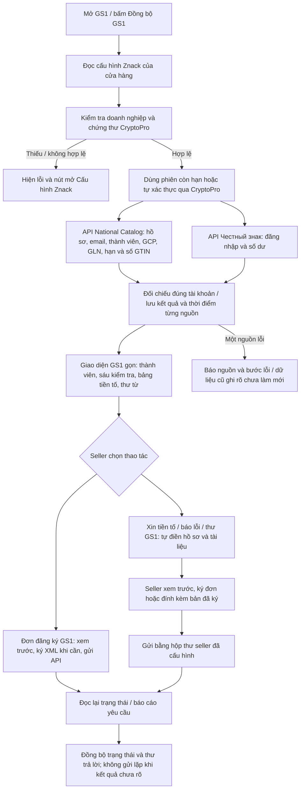

# Sơ đồ đã duyệt mục 5 — GS1 qua cấu hình Znack

Trạng thái: **người dùng đã duyệt sơ đồ và cho phép triển khai mục 5 ngày 16/10/2026**. Kết quả thực hiện và kiểm thử nằm trong [báo cáo mục 5](../validation/2026-10-16-item-5-gs1.md).

## Phạm vi

Gom GS1 vào luồng tự xác thực bằng cấu hình Znack của cửa hàng. Seller không cần mở trình duyệt để đăng nhập GS1. Giữ xác thực CryptoPro/chứng thư; khi thiết bị yêu cầu PIN, ứng dụng hiển thị đúng yêu cầu của nhà cung cấp chữ ký.

WBCode Latest kiểm tra ngày 16/10/2026 vẫn là [v1.3.9](https://github.com/rupphi/relatest-wcode/releases/tag/v1.3.9), phát hành `2026-10-15T16:56:43Z`. Đối chiếu bố cục dùng ảnh GS1 do người dùng cung cấp; ghi chú 1.3.9 bổ sung yêu cầu hộp thoại ổn định khi cửa sổ nhỏ. Mã nội bộ bản mới nhất không công khai. Ảnh quan sát tự động màn GS1 bản 1.3.8 trong repo chỉ có khung trống nên không dùng làm bằng chứng giao diện thành viên đã đăng nhập.

## Luồng đã duyệt

## Phạm vi đã duyệt

| Phần | Hành vi đích |
| --- | --- |
| Kết nối | Một luồng dùng chung cho nút đồng bộ, tác vụ nền và thao tác GS1; tự làm mới phiên hết hạn, không hiện bước đăng nhập trình duyệt riêng. |
| Theo cửa hàng | Gắn dữ liệu/phiên/tác vụ với đúng cửa hàng, tài khoản và chứng thư. Đổi cửa hàng hoặc cấu hình không để kết quả tác vụ cũ ghi đè giao diện mới. Máy khác xác thực bằng cấu hình/chứng thư của chính máy đó. |
| Trạng thái | Phân biệt đang chờ, xác thực, đọc Catalog, đọc số dư, hoàn tất, hoàn tất một phần và lỗi. Một nguồn lỗi không biến thành không phải thành viên, hết hạn hoặc số dư bằng 0. |
| Giao diện | Theo bố cục người dùng gửi: thành viên phía trên; sáu kiểm tra; bảng GCP/GLN/hạn/số mã còn lại; thư từ bên phải. Gom nút kiểm tra trùng thành Đồng bộ GS1; hộp thoại cuộn ổn định ở cửa sổ nhỏ. |
| Sáu kiểm tra | Chữ ký số, đăng nhập Честный знак, thỏa thuận, số dư, thành viên GS1, mã GTIN còn lại. Mục không có bằng chứng API phải hiện chưa xác minh. Không suy ra đã đóng phí từ ngày không giới hạn. |
| Hồ sơ | Lấy tên doanh nghiệp, INN, email, điện thoại và GCP từ tài khoản đã xác thực. Không dùng Gmail đăng ký license làm email GS1. Trường API không có được ghi rõ để seller bổ sung khi cần. |
| Thao tác | Dùng API đã xác minh cho đơn đăng ký GS1. Xin tiền tố 999/99.999 mã và thư báo lỗi dùng luồng email hiện có, có xem trước tài liệu và xác nhận gửi. Mẫu Word/PDF do seller tải lên vẫn giữ theo doanh nghiệp. |
| Thư | Cấu hình Znack/Catalog không cấp quyền đọc hay gửi hộp thư. Nếu hộp thư chưa cấu hình, cho xem trước/lưu nháp và báo thiếu cấu hình. Thư trả lời không tự trở thành bằng chứng thành viên đã được duyệt hoặc đã thanh toán. |
| Tác vụ | Dùng worker/executor có giới hạn hiện có, kiểm tra timeout, gộp lần đọc trùng và báo lỗi từng bước. Tránh để một cửa hàng giữ khóa đọc của cửa hàng khác; không thay kiến trúc FBS hoặc luồng mua KIZ. |
| Kiểm thử | Phiên hết hạn, thiếu cấu hình, đổi cửa hàng/chứng thư, đọc một phần, mất mạng, hai cửa hàng cùng đồng bộ, gửi chưa rõ kết quả, kích thước cửa sổ và điều kiện thao tác theo trạng thái. |

## Ranh giới API đã có trong mã

`NationalCatalogGs1Client` có đọc `gs1/gcp-gln`, `gs1/form`, lưu đơn và đọc/gửi `gs1/sign-form`. `Gs1MailClient` gửi SMTP và đọc IMAP bằng hộp thư seller đã cấu hình. Trong các hợp đồng đang có không có API công khai đã xác minh thay thế toàn bộ thư GS1. Sơ đồ này không giả định có endpoint gửi/đọc thư hoặc thanh toán chỉ bằng khóa Catalog.

Không gửi thư, tạo đơn, ký hồ sơ, mua mã hay phát hành bản cập nhật trong giai đoạn đề xuất sơ đồ.
