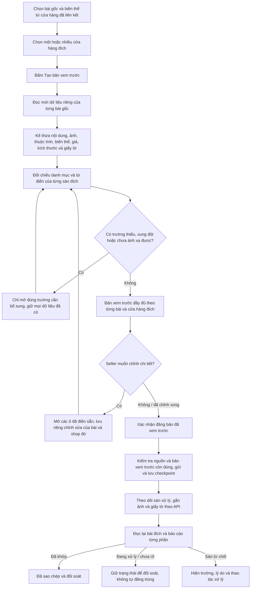

# Mục 6 — sơ đồ đã duyệt cho sao chép bài đăng gốc

Trạng thái: **người dùng đã duyệt và cho phép triển khai mục 6 ngày 16/10/2026, giờ Moscow**. Người dùng yêu cầu: “thực hiện từng công việc mỗi khi thực hiện công việc nào vẽ sơ đồ luồng hoạt động sau đó hỏi tôi để phê duyệt”. Phạm vi là công cụ sao chép bài đăng. Kết quả thực hiện nằm trong [báo cáo mục 6](../validation/2026-10-16-item-6-listing-copy.md).

## Kết quả rà soát ngày 16/10/2026, giờ Moscow

Nền mã đang ở commit `8e1f6c2a1ad1f91bb44d810b1a0cd01a6d3f02e5`. `CopyDefaults` đã kế thừa tiêu đề, mô tả, thương hiệu, thuộc tính, ảnh, barcode, biến thể, kích thước và giấy tờ; `ListingCopyService` đã có xem trước, xác nhận, lưu checkpoint và đối soát. Không cần thay toàn bộ nền tảng này để bắt seller nhập lại dữ liệu.

| Điểm trong mã hiện tại | Cần xử lý ở mục 6 |
| --- | --- |
| `ListingCopyPane` đặt toàn bộ cấu hình, trường nhập và ánh xạ trước nút xem trước | Luồng chính gọn: chọn bài → chọn cửa hàng đích → Tạo bản xem trước. Đưa các ô đã điền vào phần Chỉnh chi tiết, mặc định thu gọn; có thể mở bất cứ lúc nào. |
| `CopyDefaults.category` chỉ tự chọn cùng ID khi cùng sàn | Cùng sàn ưu tiên danh mục gốc còn hợp lệ. Khác sàn dùng ánh xạ đã được xác nhận hoặc kết quả tương ứng duy nhất đã kiểm tra; nếu không chắc thì chỉ hỏi danh mục đích, không yêu cầu nhập lại nội dung. Không dùng chung ID giữa hai sàn. |
| `OzonListingAdapter.preview` đòi một `targetPrice` và dùng giá đó cho mọi item; nguồn WB có thể có giá khác nhau theo size | Giữ giá từng biến thể khi sao chép sang Ozon; ô giá chung chỉ ghi đè khi seller thực sự sửa. Giá thiếu hoặc tiền tệ chưa chuyển được phải chỉ rõ từng biến thể. |
| `loadAttributes` tạo lại các ô nhập/ánh xạ bất đồng bộ; `editorOptions` ghi giá trị từ các control vào cấu hình | Tách dữ liệu kế thừa và chỉnh sửa chủ động. Đọc lại dictionary hoặc đổi cửa hàng đích không làm mất chỉnh sửa; mặc định UI không trở thành ghi đè rỗng hoặc giá chung ngoài ý muốn. |
| Xem trước đã có diff, lỗi và request JSON nhưng ít diễn giải theo trường sản phẩm | Bản xem trước hiển thị dữ liệu bài đích, ảnh đầu/thứ tự ảnh, bảng biến thể và giá, giấy tờ, các trường được giữ/thay đổi/cần bổ sung; chi tiết kỹ thuật thu gọn. |
| Đã có chống gửi trùng và `RECONCILE_REQUIRED` khi kết quả gửi chưa rõ | Giữ checkpoint; bổ sung trình bày trạng thái/kết quả theo từng bài và shop. Chỉ báo thành công sau khi đọc lại các phần đã chọn ở bài đích. |

## Đối chiếu WBCode/WCode

Latest công khai kiểm tra lại vẫn là [WBCode v1.3.9](https://github.com/rupphi/relatest-wcode/releases/tag/v1.3.9), phát hành 15/10/2026 lúc 19:56:43 Moscow. Ghi chú phát hành không nêu thay đổi sao chép bài đăng; mã nội bộ bản này không công khai.

Đã đọc lại cây [WCode công khai, commit 457a6113](https://github.com/rupphi/test-wcode/tree/457a6113301978454f244248956962ab1fcdeb7e): 308 đường dẫn, cây không bị cắt; không tìm thấy module listing/copy/clone/duplicate theo đường dẫn. Không có căn cứ khẳng định đã sao chép engine sao chép bài đăng của WBCode mới nhất. Thiết kế mục 6 dựa trên yêu cầu người dùng và adapter/hợp đồng Seller API đã có của VNCode; mở rộng endpoint chỉ sau khi kiểm tra hợp đồng thực tế.

## Sơ đồ đề xuất

## Quy tắc dữ liệu đề xuất

- Hỗ trợ các hướng đã có của VNCode: WB → WB, Ozon → Ozon, WB → Ozon và Ozon → WB. Chỉ hiện cửa hàng đã liên kết và có cấu hình truy cập phù hợp.
- Mặc định giữ các dữ liệu bài đăng mà API nguồn trả về và API đích cho phép tạo: tên, mô tả, thương hiệu, TN VED, chất liệu, thuộc tính đơn/phức hợp có cấu trúc xác minh được, màu/size/size Nga, article/offer, barcode, giá/tiền tệ từng biến thể, kích thước/khối lượng, ảnh đúng thứ tự, metadata/tệp giấy tờ nếu có quyền lấy và gửi.
- Ảnh đầu phải giữ vai trò ảnh chính. Video/rich content hoặc trường ngoài hợp đồng adapter hiện tại phải được kiểm tra API và báo rõ khả năng sao chép trong xem trước; không âm thầm bỏ rồi ghi “đầy đủ”. Không tự tạo tệp chứng nhận nếu nguồn chỉ có metadata.
- Cùng sàn/cùng danh mục giữ ID thuộc tính khi dictionary đích cho phép; khác sàn tra ID và giá trị tại sàn đích. Chỉ ghép tự động khi tương ứng duy nhất, đúng kiểu dữ liệu/đơn vị/cấu trúc. Trường không hỗ trợ không bị đổi thành giá trị trống hoặc đoán.
- Giá riêng theo size không bị biến thành giá chung. Không tự quy đổi ngoại tệ. Trường thực sự bắt buộc mà API nguồn không trả mới cần seller bổ sung.
- Article/offer được kế thừa nếu shop đích cho phép. Nếu trùng, đánh dấu riêng và đề xuất article mới để seller xem trước. ID hệ thống của bài đích do sàn cấp. Tồn kho, đơn hàng, đánh giá và mã KIZ đã cấp không phải dữ liệu bài đăng để chuyển shop.
- Barcode gốc không bị đổi thành chứng cứ GTIN Catalog hoặc quyền mua KIZ. Mục 6 không thay luồng đăng ký Znack/GS1 hay mua/gán KIZ đã được duyệt.
- Mỗi bài, biến thể và shop đích có dữ liệu/chỉnh sửa riêng. Bài chưa mở trong batch vẫn lấy dữ liệu của chính nó, không lấy tên/giá/giấy tờ của bài đầu áp cho cả lô.
- Xem trước không đăng bài. Thay đổi dữ liệu làm vô hiệu xác nhận cũ; đăng theo nội dung đã xem trước. Đã gửi nhưng chưa rõ kết quả thì đọc lại để đối soát trước khi cho phép thử gửi.
- Tác vụ đọc và ghi dùng executor có giới hạn hiện có, chạy ngoài JavaFX; có tiến độ/timeout và bỏ callback cũ khi đổi shop. Không nâng kiến trúc toàn app trong mục này; nếu cần thay đổi kiến trúc lớn sẽ trình sơ đồ riêng.

## Kiểm thử sau khi sơ đồ được duyệt

1. Bốn hướng sao chép với đầy đủ nội dung, thuộc tính, ảnh chính/thứ tự ảnh, nhiều biến thể và giấy tờ; không bắt nhập lại trường nguồn đã có.
2. Giá khác nhau theo size WB → Ozon; chỉnh một biến thể không làm thay đổi các biến thể khác. Giá nguồn thiếu/quyền giá không đủ phải báo đúng phần thiếu.
3. Cùng sàn tự giữ danh mục; khác sàn chưa có ánh xạ chỉ yêu cầu đúng danh mục/trường còn thiếu. Dictionary không còn giá trị hoặc tên mơ hồ không tự ghép sai.
4. Thuộc tính phức hợp, trường không được hỗ trợ và giấy tờ không lấy được tệp phải được báo trong xem trước; không được thành công giả do bỏ dữ liệu.
5. Đọc lại thuộc tính, đổi shop đích, đổi bài rồi quay lại không mất chỉnh sửa. Các bài trong batch không lẫn tên/giá/size/giấy tờ.
6. Xem trước không gửi mutation; xác nhận hash thay đổi, owner/cấu hình thay đổi và source revision thay đổi ngăn đăng sai bản đã duyệt.
7. API từ chối/timeout sau gửi, khởi động lại và đối soát không tạo bài trùng; không báo “đã sao chép” khi ảnh/giấy tờ còn đang xử lý.
8. Giao diện 1366×768 và 1024×600; batch đọc chậm vẫn phản hồi, nút Chỉnh chi tiết mở được, trường lỗi dễ tìm. Chạy hồi quy Java toàn app sau khi hoàn tất sửa mã.

Ở bước trình sơ đồ chưa sửa mã ứng dụng hoặc gửi đăng bài thật. Người dùng sau đó đã duyệt triển khai; kết quả kiểm thử và giới hạn nghiệm thu được lưu trong báo cáo mục 6 ở trên.
