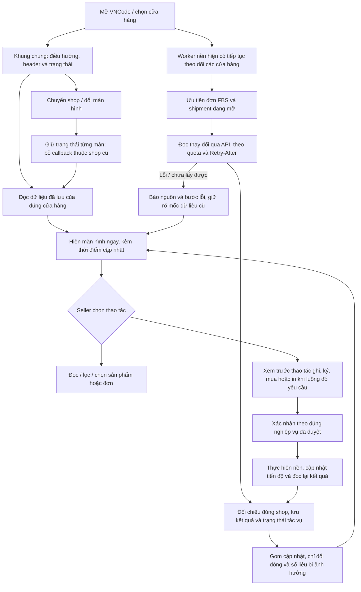

# Mục 7 — đề xuất thống nhất giao diện toàn bộ VNCode

Trạng thái: **người dùng đã duyệt mục 7**, đồng thời yêu cầu **làm nốt mục 3 trước, sau đó mới triển khai mục 7**: “duyệt làm nốt mục 3 trước rồi đến mục 7”. Không cần hỏi lại việc duyệt mục 7. Người dùng yêu cầu vẽ sơ đồ và duyệt từng công việc; nếu cần nâng kiến trúc app thì phải hỏi riêng. Phạm vi đề xuất dựa trên mã đã hoàn tất mục 6 tại commit `19479388f50ab8e97c3bfba2ad726ab5e8523e46`.

## Bằng chứng đối chiếu ngày 16/10/2026, giờ Moscow

- WBCode Latest kiểm tra lại vẫn là [v1.3.9](https://github.com/rupphi/relatest-wcode/releases/tag/v1.3.9), phát hành ngày 15/10/2026 lúc 19:56:43 Moscow. Ghi chú có sửa hộp thoại bị nhảy khi cửa sổ nhỏ. Mã engine/giao diện nội bộ bản này không công khai.
- Bộ ảnh desktop chính thức 1.3.8 đã lưu trong [báo cáo cũ](../research/vncode-wbcode-2026-10-14/REPORT.md) xác nhận thanh icon điều hướng gọn, menu cài đặt và khung ứng dụng. Nội dung các trang nghiệp vụ không tải được khi chưa có shop/license: ảnh trống không phải bằng chứng của bảng nghiệp vụ đã đăng nhập.
- Ảnh người dùng gửi là căn cứ cho bố cục đăng ký Znack, cấu hình Znack và GS1 đã đăng nhập. Mục 4–6 hiện có [ảnh kiểm chứng mới](../validation/) của VNCode bằng dữ liệu tổng hợp.
- VNCode hiện có 19 tệp FXML và các màn dựng bằng Java, điều hướng tái dùng view trong `WorkspaceNavigator`. Sidebar đang có khung cố định 224 px; header chứa chọn shop, số dư, sức khỏe đồng bộ, tác vụ, đồng bộ, cập nhật, tin tức và hỗ trợ. Nhiều nhóm điều khiển cần được gom lại khi cửa sổ hẹp.
- `SyncRuntime`/`SyncCoordinator` đã tách worker FBS khỏi tác vụ nền và registry. `HomeController` gom sự kiện cập nhật UI bằng debounce 400 ms. Không cần mặc định thay nền tảng này để làm giao diện thống nhất.
- Nhịp hiện tại trong mã: FBS queue 10 giây ở shop đang chọn/45 giây ở shop khác; trạng thái FBS 15/60 giây; nội dung shipment 10/45 giây. Đây là polling hiện có, không phải push tức thời từ sàn.

## Bố cục đề xuất

```text
┌───────────────┬────────────────────────────────────────────────────────────┐
│ VNCode        │ Shop / WB–Ozon │ Đồng bộ và lần cập nhật │ Tác vụ │ Cập nhật│
│ Icon + tên    ├────────────────────────────────────────────────────────────┤
│ Có thể thu gọn│ Tên màn hình                         Thao tác chính       │
│               │ Tìm kiếm │ Bộ lọc │ Trạng thái │ Xóa lọc │ Số kết quả    │
│ Tổng quan     ├────────────────────────────────────────────────────────────┤
│ Sản phẩm      │                                                            │
│ Đóng đơn FBS  │ Bảng hoặc nội dung chính có cuộn riêng                     │
│ FBO           │ Danh sách dài dùng hàng ảo / đọc từng trang                │
│ Đăng ký Znack │ Giữ lựa chọn, bộ lọc và vị trí cuộn khi dữ liệu đổi        │
│ GS1 RUS       │                                                            │
│ Cấu hình Znack├────────────────────────────────────────────────────────────┤
│ Lịch sử in    │ Đã chọn / Đang chờ / Thành công / Lỗi │ Thao tác theo lô    │
│ Thiết kế mẫu  └────────────────────────────────────────────────────────────┘
│ Công cụ       Thanh tác vụ dưới luôn thao tác được ở cửa sổ nhỏ.
│ Cài đặt       Chi tiết nâng cao nằm trong tab/khối mở rộng.
└───────────────
```

Sidebar mở rộng khi đủ chỗ, có chế độ icon với tooltip và trạng thái mục đang chọn ở cửa sổ hẹp. Header giữ chọn shop, đồng bộ và tác vụ; các thông tin/thao tác phụ được gom lại thay vì liên tục xuống dòng. Nhận diện VNCode, cỡ chữ, khoảng cách, màu trạng thái và kiểu nút dùng chung trên toàn app.

## Sơ đồ mở màn hình và đồng bộ



## Phạm vi các màn hình

| Nhóm | Tinh chỉnh trong mục 7 |
| --- | --- |
| Khung chung | Sidebar mở/thu gọn, shop đang chọn rõ ràng, header gọn, tên màn hình và thao tác chính thống nhất; hỗ trợ 1024×600, 1366×768 và màn lớn. |
| Tổng quan / màn đầu | Thẻ tóm tắt vừa đủ; dữ liệu thật có thời điểm cập nhật. Chưa có shop/dữ liệu thì hướng dẫn hành động tiếp theo, phân biệt đang tải, rỗng, lỗi và chưa cấu hình. |
| Sản phẩm / sửa hàng loạt | Thanh lọc gọn; ảnh đầu, tên/article, màu/size, barcode/GTIN và giấy tờ dễ đọc; chọn theo đúng tập kết quả, giữ bộ lọc/cuộn khi cập nhật. Chi tiết dài mở riêng. |
| Đóng đơn FBS WB/Ozon | Cùng cách bố trí tiêu đề, bộ lọc, danh sách shipment/đơn, trạng thái KIZ, tiến độ và thanh in/gán mã. Ảnh, bảng và thao tác không giãn mất kiểm soát. Trong mục 7 chỉ chuẩn hóa phần trình bày và cập nhật UI; quy tắc nghiệp vụ Ozon của mục 3 vẫn chờ phê duyệt riêng. |
| FBO / lô hàng | Bố cục bảng, chọn sản phẩm, rà soát thiếu mã và kết quả nhất quán với FBS; giữ các bước xác nhận của luồng hiện có. |
| Đăng ký Znack / GTIN | Giữ kết quả mục 1 và 4; chuẩn hóa thanh nút, bộ lọc, cột trạng thái/thao tác, chi tiết lỗi và báo cáo. Không đưa lại công cụ GTIN độc lập đã bỏ. |
| GS1 | Giữ luồng đã duyệt ở mục 5; đồng bộ kiểu thẻ thông tin, bảng tiền tố, thư từ, cửa sổ nhỏ và trạng thái từng nguồn với giao diện chung. |
| Cấu hình Znack / CryptoPro | Gom nhóm rõ: tài khoản, kết nối, Catalog, chứng thư, giấy tờ và cài đặt nâng cao. Giá trị đã lưu, nút Lưu và kết quả kiểm tra được thể hiện rõ; không lộ secret trên bảng/báo cáo. |
| Kho KIZ | Chuẩn hóa nhóm danh mục, nút nhập file, số mã, trạng thái nhập và lỗi. Các nguồn kho/mua trong shipment hiển thị theo những chức năng đã được triển khai, không báo đã có phần nghiệp vụ Ozon chưa làm. |
| Công cụ sao chép | Giữ kế thừa/xem trước/giá biến thể của mục 6; đưa vào cùng hệ thống cỡ chữ, nút và nhóm chi tiết. |
| Lịch sử in / thiết kế mẫu | Bộ lọc và lịch sử gọn, trạng thái xuất/in lại rõ; vùng thiết kế và preview co giãn, giữ nút lưu/xuất dễ tiếp cận. |
| Tài chính / hướng dẫn / tin tức | Cùng cách trình bày bảng, thẻ, trạng thái rỗng/lỗi và nguồn dữ liệu; tin cập nhật app và thao tác xem/tải giữ rõ nội dung phát hành. |
| License / tài khoản / cài đặt | Giữ mô hình Gmail → admin duyệt → nhập key, ô nhập key luôn có thể truy cập; hiển thị trạng thái mạng/license rõ. Sắp xếp mục ngôn ngữ, giao diện, cập nhật và thông tin ứng dụng nhất quán. |
| Hộp thoại / báo cáo tác vụ | Có bước hiện tại, tiến độ đúng số đã xử lý/tổng số, thời điểm, lý do lỗi và hành động tiếp theo. Nội dung cuộn độc lập, nút xác nhận/hủy không trôi khỏi màn hình hoặc làm cửa sổ nhảy. |

## Hiệu năng và ranh giới kiến trúc

1. Dùng runtime/executor, dữ liệu local và journal hiện có. Mở màn hình không chạy đồng bộ toàn bộ danh mục trước khi cho xem đơn. Không tạo vòng polling mới cho mỗi view.
2. Bảng dùng hàng ảo/phân trang, ảnh tải qua cache với giới hạn đồng thời; lọc và truy vấn SQLite nặng chạy ngoài JavaFX. Áp dụng thay đổi theo đợt nhỏ; giữ checkbox, bộ lọc và cuộn.
3. FBS chạy khi app đang mở, kể cả seller chuyển sang trang khác. Ưu tiên shop/shipment đang thao tác, tiếp tục phục vụ các shop còn lại; lỗi một shop không chặn toàn bộ giao diện.
4. Trạng thái phân biệt đang theo dõi, đang gọi API, đang chờ sàn, dữ liệu đã cũ và lỗi. Hiện thời điểm thành công và lần kiểm tra tiếp. Một request hoàn tất không tự đồng nghĩa toàn bộ lượt đồng bộ thành công.
5. Giữ quota, `Retry-After`, backoff và gộp request trùng. Chỉ điều chỉnh nhịp polling sau khi đối chiếu hợp đồng API và đo tải; không mặc định giảm mọi shop về một nhịp vài giây hoặc gọi đó là push realtime.
6. Đổi shop/màn hình bỏ kết quả UI cũ nhưng không hủy tác vụ ghi đã bắt đầu; thao tác ghi không bị tự gửi lại vì giao diện được dựng lại.
7. Mô hình đã chọn vẫn là mỗi seller chạy VNCode trên máy riêng và dùng chung website license. Đề xuất này không yêu cầu máy chủ dữ liệu seller mới, đồng bộ kho giữa nhiều máy hoặc đổi framework.
8. Nếu đo thấy phải tăng/đổi các pool, chia tiến trình, thay cơ sở dữ liệu hoặc chuyển nghiệp vụ lên server, sẽ trình rõ điểm nghẽn, sơ đồ mới và ảnh hưởng để người dùng duyệt trước. Không coi việc duyệt giao diện là cho phép mọi thay đổi kiến trúc lớn.

## Kế hoạch triển khai sau khi duyệt

1. Khung chung, thành phần dùng lại và quy tắc giao diện: sidebar/header, toolbar, bộ lọc, bảng, thẻ, badge, trạng thái rỗng/lỗi và hộp thoại.
2. Áp dụng lần lượt vào đóng đơn FBS, sản phẩm, Znack/GS1, các công cụ và cài đặt; lưu ảnh so sánh để kiểm tra không mất chức năng đã duyệt.
3. Rà đường cập nhật UI từ runtime, tránh thay toàn bộ bảng và mất lựa chọn; kiểm tra khả năng chuyển shop khi nguồn API khác đang chậm.
4. Kiểm thử giao diện các ngôn ngữ Việt/Anh/Nga/Trung, độ rộng 1024/1366/màn lớn và các tỷ lệ hiển thị Windows có thể nghiệm thu. Các nền tảng chưa chạy được phải ghi rõ.
5. Hồi quy luồng đã duyệt; kiểm thử scheduler/đổi shop/đóng mở view; mô phỏng 10 shop × 1.000 đơn và shipment 100/500/1.000 đơn. Ghi thời gian hiển thị từ cache, độ trễ UI, thời gian từ DB commit đến bảng, bộ nhớ và hàng chờ; tách khỏi thời gian mạng/sàn.

Mục tiêu đo nội bộ đề xuất: phản hồi UI p95 dưới 250 ms và hiển thị delta p95 dưới 1 giây sau DB commit trong tải mô phỏng. Đây là tiêu chí nghiệm thu cần đo, chưa phải kết quả hiệu năng đã đạt trên Windows. Mục 7 chưa có sửa mã, bộ kiểm thử mới, bộ cài hoặc Release ở bước trình sơ đồ này.
