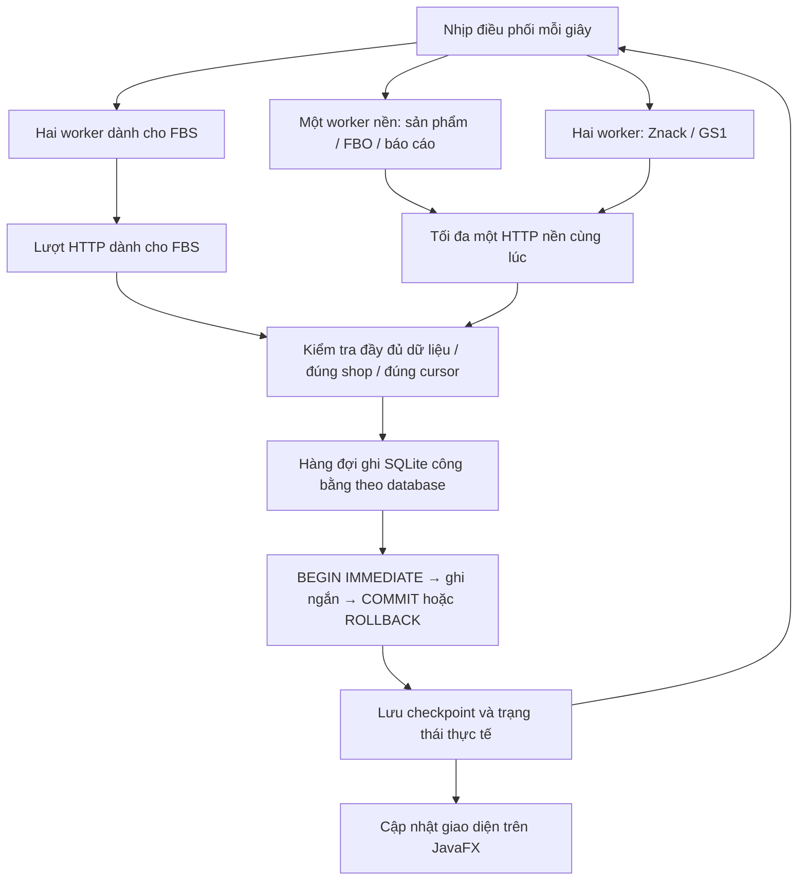

# Đồng bộ liên tục, ưu tiên FBS — VNCode 1.4.14

Chủ ứng dụng yêu cầu kiểm tra toàn bộ luồng đồng bộ trước khi phát hành, đồng thời nhấn mạnh FBS phải tiếp tục chạy liên tục. Luồng FBS dùng API polling theo giới hạn của sàn; đây không phải webhook hay cam kết cập nhật tức thì từ máy chủ sàn.

- Shop đang chọn: đọc đơn mới và nội dung shipment mỗi 10 giây, trạng thái đơn mỗi 15 giây, danh sách shipment mỗi 30 giây. Lượt nhiều trang tiếp tục sau 1 giây; các shop còn lại vẫn được phân lượt. `429`, timeout và lỗi xác thực được báo rõ, tuân thủ thời gian chờ của API.
- Shipment đang mở được đọc ưu tiên lại khi đủ 10 giây hoặc đổi lựa chọn, kể cả khi việc quét các shipment khác chưa xong. Lượt ưu tiên giữ nguyên vị trí quét nền.
- Các lượt đã tới hạn của shop đang mở được ưu tiên theo thứ tự: đơn mới → trạng thái → nội dung shipment → danh sách shipment. Backlog quá hạn của shop khác không được đẩy đơn mới đang xem xuống cuối hàng; thời gian chờ / cooldown vẫn được giữ và các shop khác vẫn nhận lượt còn lại.
- Worker điều phối và tác vụ đọc Catalog từ giao diện dùng giới hạn kết nối nền riêng, để việc đọc nền không chiếm cả hai lượt HTTP của sàn. Giới hạn tổng vẫn là hai yêu cầu HTTP cùng lúc.
- Những callback ghi SQLite không được gọi HTTP, CryptoPro hoặc máy in. Hàng đợi có thời gian chờ hữu hạn; connection chỉ được tái sử dụng giữa các caller đang chờ, đóng khi hết việc. Không giữ connection toàn cục sau lượt ghi.
- Một trang trạng thái WB dùng một giao dịch thay cho commit từng dòng. Metadata giấy tờ/giới tính/size của Catalog ghi theo nhóm tối đa 100 thẻ, trả lượt ghi giữa các nhóm để FBS không phải chờ cả kho. Lỗi giữa nhóm rollback toàn bộ giấy tờ và nhãn trong nhóm; thay chứng thư giữa chừng chặn metadata cũ.
- Giữ nguyên WAL, foreign keys, `synchronous=FULL` của các connection ghi, commit/rollback và cơ chế không phát lại giao dịch đã commit. Lỗi constraint, owner hoặc thao tác bên ngoài không được tự phát lại.
- Dữ liệu trả thiếu, cursor lặp, sai posting hoặc thiếu quantity là lỗi; không được dùng chúng để xóa cache hoặc ghi mốc hoàn tất. Việc đọc dữ liệu cũ và gọi API diễn ra ngoài lượt ghi.

Kiểm chứng: `SyncCoordinatorTest`, `FbsSyncServiceTest`, `MarketplaceRequestBudgetTest`, `SqliteWriteTransactionTest`, `SyncRunRepositoryConcurrencyTest`. Bài kiểm thử 10 shop giữ nguyên timeout 30 giây, số sự kiện, số item và `PRAGMA integrity_check`; không bỏ bài hay tăng timeout để vượt kiểm tra Windows.
