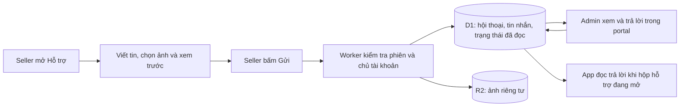

# Đề xuất hộp hỗ trợ VNCode riêng trên Cloudflare

Trong đối chiếu Wbcode, đầu mục WB-090/WB-122 có hội thoại hỗ trợ và ảnh đính kèm. VNCode hiện mở trang Hướng dẫn khi bấm Hỗ trợ; chưa có dịch vụ nhận tin/thư trả lời tương ứng. Không thể dùng backend hỗ trợ riêng của Wbcode bằng license VNCode.

Đây là thay đổi kiến trúc được tách ra để người dùng duyệt theo yêu cầu «nếu cần nâng cấp kiến trúc cấu hình app hãy hỏi tôi». Những sửa đăng ký, GTIN, sản phẩm, TN VED và bộ cài không phụ thuộc vào dịch vụ mới này.

## Phương án

Dùng Worker license/portal VNCode đang có để xác thực tài khoản và giới hạn quyền; D1 lưu hội thoại/tin nhắn; một bucket R2 riêng lưu ảnh. Thông tin giấy phép, API sàn/Catalog, chứng thư và khóa riêng không được tự đính kèm. Seller xem nội dung và chủ động bấm Gửi; app không tự gửi lỗi hoặc ảnh.

- API: tạo/liệt kê hội thoại, đọc/gửi tin, đánh dấu đã đọc; nhánh admin kiểm tra role riêng. Dùng khóa idempotency cho từng tin để mạng lỗi không gửi trùng.
- Dữ liệu: `support_threads(account_id,status,updated_at)`; `support_messages(thread_id,author_role,body,created_at,client_request_id)`; `support_attachments(message_id,object_key,mime,size,sha256)`; dấu đã đọc theo người dùng. Server tự xác định account từ phiên, không tin account_id do client nhập.
- Ảnh PNG/JPEG tối đa 2 MiB/ảnh, tối đa 3 ảnh/tin; xác minh nội dung, bỏ metadata và không cho bucket public. URL tải được cấp sau kiểm tra chủ hội thoại hoặc role admin.
- App đọc ở worker nền, chỉ poll khi hộp đang mở (tối đa mỗi 60 giây, có backoff); không dùng hết ngân sách HTTP dành cho FBS. Thư GS1 vẫn theo cấu hình hộp thư doanh nghiệp hiện có.
- Cần thêm binding R2 và migration D1 cho portal; có thể triển khai trước rồi mới bật UI trong bản app. Kiểm thử bằng tài khoản và ảnh giả lập; chưa gửi tin thật cho bất cứ người nhận nào.

Phương án giữ nguyên: tiếp tục dùng Hướng dẫn/Hỗ trợ hiện tại và ghi rõ không chuyển hai chức năng hội thoại/ảnh từ Wbcode vào VNCode. Không thể đánh dấu hai đầu mục này là đã có hộp hội thoại khi chưa tạo backend.
