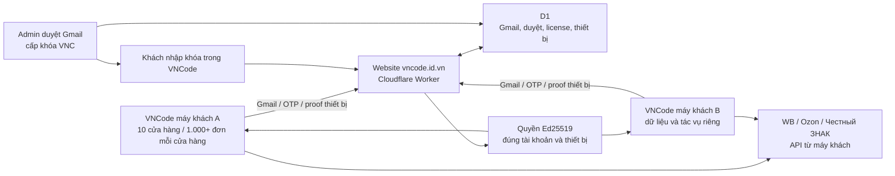

# VNCode 1.4.0: nhiều khách hàng, dữ liệu riêng trên mỗi máy

Mô hình theo lựa chọn của người dùng: mỗi khách chạy VNCode trên máy riêng;
website `vncode.id.vn` dùng chung để đăng ký Gmail, phê duyệt và cấp license.
SQLite, API key seller, chứng thư CryptoPro, KIZ, cache và hàng đợi đơn thuộc
từng máy. Website license không nhận kho KIZ, đơn hàng hay API key WB/Ozon.

## Xử lý 10 cửa hàng trên một máy

- Ghi KIZ WB: hai worker toàn ứng dụng, tối đa một luồng ghi mỗi cửa hàng;
  luân phiên sau từng đơn. Không nhận trùng supply hoặc đơn đang xử lý.
- Đọc Ozon để chuẩn bị in: hai yêu cầu chi tiết trong mỗi cửa sổ, tối đa bốn
  reader toàn ứng dụng; commit reservation theo thứ tự đã xác nhận. Budget HTTP
  seller dùng chung giới hạn hai request đang thực thi.
- Danh sách FBS chỉ render 100 dòng/trang. Chọn toàn bộ theo bộ lọc chốt danh
  sách ID trong worker, tối đa 10.000 đơn/lần; không dựng 10.000 hàng trên FX.
- Đăng ký Znack dùng trang 300 dòng; Ozon giữ `product_id/offer_id/SKU`, WB giữ
  `nmID/chrtID`. Ký lô dùng một tác vụ có giới hạn và kiểm tra từng thẻ.
- Mapping/policy được đọc một lần cho thao tác. Chi tiết posting/item được đọc
  theo nhóm 500; reserve WB theo toàn kế hoạch trong một transaction. Consume
  và release giữ điều kiện shop/reservation và rollback cả nhóm khi sai.
- PDF Ozon ghép tuần tự: một phần PDF trên đĩa tại một thời điểm, cửa sổ chuẩn
  bị hai đơn, flush các trang đã ghép và bảng nhặt hàng. Không gửi KIZ qua `/ship`.
- Chặn trùng tệp PDF đang xuất giữa các cửa hàng. Callback theo owner/generation;
  SQL, seller API và mở trình xem PDF chạy ngoài JavaFX. Đóng app kiểm tra các
  tác vụ đã nhận, kể cả đăng ký thẻ đang chạy.

## Quyền và phục hồi

Mặc định portal cấp một cửa hàng. Admin cần cấp `maxShops >= 10` nếu khách quản
lý 10 cửa hàng; giới hạn xử lý không tự mở rộng quyền license.

Trước mỗi seller write có checkpoint. Timeout/5xx hoặc mất phản hồi dẫn đến
đối soát, không tự gửi lại. Lịch sử in WB có nút **Đối soát KIZ**: dùng đúng mã
đã in để đọc trạng thái WB, cập nhật checkpoint của các đơn đang chờ; không xóa
metadata hoặc tự gán lại. Checkpoint chưa rõ chặn in mới trước khi reserve mã khác.

INN, môi trường, fingerprint chứng thư và credential shop được chốt cho tác vụ
Catalog. Thẻ cũ vẫn dùng cho KIZ/in trong lúc tạo thẻ mới. Chỉ chuyển con trỏ
GTIN sau khi thẻ mới đã xuất bản và xuất hiện trên đúng biến thể của sàn.
Adapter thêm barcode giữ nguyên mã cũ; thao tác xóa/thay barcode trên sàn chưa mở.

True API hiện xác minh được danh sách nhóm may mặc. Sync đọc mới thêm các thẻ
do VNCode đã đăng ký và đang dùng, kể cả nhóm khác, theo đúng owner. Không công
bố đã lấy toàn bộ các nhóm hàng hoặc mọi thẻ tạo ngoài VNCode.

## Website dùng chung

Client giữ timer 60 giây để lưu highwater; chỉ gọi renew khi cadence 150–180
giây đã đến hạn, nên thời điểm thực tế được làm tròn theo timer. Khởi đầu có
jitter, lỗi có backoff; thao tác kiểm tra thủ công vẫn gọi ngay và được singleflight.

Portal 0.3.1 cache promise import khóa ký theo cả secret và key ID. Sau khi ký,
checkpoint kiểm tra lại quyền/revision/thiết bị trước khi trả lease. D1 có index
bổ sung; Cron mỗi phút chỉ dọn tối đa 500 dòng hết hạn mỗi bảng tạm, giữ tài khoản,
license, thiết bị và audit. Mã website nằm tại `website/license-portal`.

Kiểm thử cloud/SQLite giả không thay cho nghiệm thu Windows, máy in, seller thật
hoặc năng lực Cloudflare/D1 production. Chủ website đã báo triển khai Portal và đăng nhập admin được;
public pin client đã nhận từ chủ website với key ID `vncode-1`; còn chờ xác minh chữ ký server và nghiệm thu thực tế.
