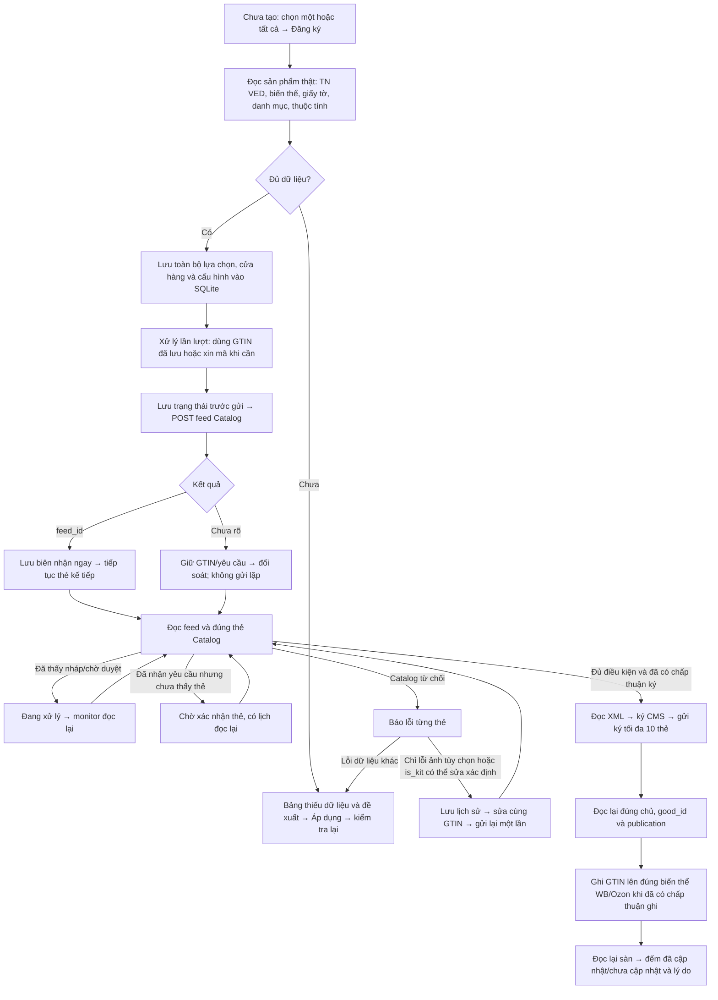
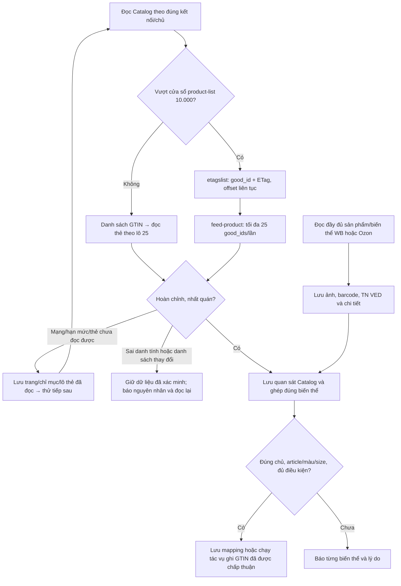

# Áp dụng luồng Znack vào nền VNCode 1.5.11

Nền phát hành đã đối chiếu: `v1.5.11`, commit `2abe716d77a0f2d4d5f08ed0ae6451bf29ea2495`, phát hành 22.10.2026. Nhánh này tích hợp nền đó cùng các sửa luồng chưa phát hành trong PR #9–#11; không thay Latest hoặc tạo bộ cài.

Tham chiếu hành vi: Wbcode 1.3.11, bản public Latest đọc ngày 22.10.2026. Phân tích tĩnh dùng skill `find-reverse-engineered` và bộ lớp đã xác minh hash từ lần nghiên cứu trước. Không chép mã dịch ngược vào VNCode; triển khai bằng các workflow, repository và HTTP client của VNCode. Không coi việc đọc mã Wbcode là kiểm thử production.

## Luồng đã nối trong ứng dụng

Biên nhận gửi, xác nhận thẻ tồn tại, kiểm duyệt, xuất bản và xác nhận GTIN trên sàn là các kết quả riêng. Không tăng số thẻ đã tạo chỉ vì POST trả HTTP 200 hoặc có `feed_id`.

| Bước | Mã VNCode thực hiện |
|---|---|
| Dữ liệu nguồn, mặc định và kiểm tra thiếu trường | `RegistrationSources`, `RegistrationAutomaticDraft`, `RegistrationBatchPreflight`, workflow Ozon |
| TN VED từ sản phẩm; giấy tờ chỉ dùng để kiểm phạm vi | Snapshot WB/Ozon, `ZnackRegistrationDocuments`, `RegistrationPermitValidator` |
| Lựa chọn và hàng đợi bền vững | `ZnackRegistrationBatchService/Store`, `OzonRegistrationBatchService/Repository` |
| Gửi feed thật, lưu trước/sau gửi, chặn gửi lặp | `ZnackCardRegistrationWorkflow`, `OzonCardRegistrationWorkflow`, `ZnackApiClient`, command journal |
| Đọc duyệt/ký độc lập với trang đang mở | `ZnackRegistrationMonitor`, `SyncRuntime`, signing consent và các checkpoint chữ ký |
| Ghi và đọc lại GTIN trên sàn | `GtinSyncCoordinator`, `WbGtinAdapter`, `OzonGtinAdapter`, `ZnackGtinBackgroundService` |
| Đồng bộ/ghép GTIN có sẵn | `WbCatalogMappingService`, `OzonCatalogMappingService`; không gọi tạo thẻ để giả đồng bộ |
| Bộ lọc và báo cáo | `RegistrationCardIndex`, `ZnackRegistrationQueryRepository`, controller WB/Ozon và báo cáo theo toàn bộ lựa chọn |

## Sửa thêm trong lần tích hợp

- Ozon tự xử lý lỗi tùy chọn ảnh/`is_kit` đã được Catalog **xác nhận từ chối**, cả lúc gửi đầu tiên và khi đối soát lô đã lưu. Giữ nguyên GTIN, danh tính, TN VED và lịch sử payload/biên nhận. Mỗi lượt chỉ sửa một lần; lỗi trường khác hoặc kết quả chưa rõ không được tự gửi lại.
- Lô Ozon cũ đã kết thúc với lỗi tùy chọn có thể được monitor mở lại một lần để đọc kết quả mới. Nội dung lỗi lưu trước đây chỉ dùng để lên lịch kiểm tra; không phải quyền POST. Lô đã hủy/tạm dừng và chữ ký chưa rõ kết quả vẫn được giữ nguyên.
- WB không tự tạm dừng một yêu cầu khỏe mạnh chỉ vì Catalog nhập thẻ quá 5 phút. Monitor WB/Ozon không gán trạng thái lỗi chỉ do hết thời gian nội bộ. Chưa thấy thẻ thì giữ biên nhận và đọc lại.
- Khi đọc API gặp cooldown dài, worker nhường xử lý và lưu lịch thử lại thay vì ngủ trong yêu cầu HTTP. Quy tắc không phát lại cấp GTIN/gửi feed/ký chưa rõ kết quả giữ nguyên.
- Giữ sửa chữa của nền 1.5.11: bộ lọc lỗi dựa trên từ chối thật; sửa thẻ có feed bị từ chối nhưng chưa có `good_id`; đề xuất sửa được điền trong bảng. Nhóm cần kiểm tra ghép thẻ được giữ riêng, không bị xếp vào “Lỗi” hay “Chưa tạo”.
- Giữ dữ liệu đang hiển thị, bộ lọc, lựa chọn và mức đã tải trong khi worker chạy. Đọc bảng cục bộ dùng làn riêng để các tác vụ mạng không giữ màn hình ở skeleton.

## Đọc Catalog lớn và tiếp tục đồng bộ

`NationalCatalogVersionSource` gọi các endpoint công bố trong tài liệu API National Catalog: `GET /v3/etagslist` và `GET /v3/feed-product?good_ids=...`. `etagslist` tối đa 100 mục/phản hồi; `feed-product` tối đa 25 ID/mã mỗi yêu cầu. Không đẩy offset của `product-list` vượt 10.000. VNCode đặt giới hạn bảo vệ 100.000 ID cho đường chỉ mục này; vượt giới hạn hoặc thiếu GTIN không được giả là đã đọc hết.

`CatalogVersionCheckpoint` lưu từng trang và lô đọc trong SQLite, không ghi lại toàn bộ JSON của 100.000 thẻ sau mỗi lô. Phạm vi gồm cửa hàng và danh tính kết nối/chữ ký. Tra cứu trước đăng ký bắt đầu mới và không mượn/xóa cursor của đồng bộ nền. Thời điểm quan sát của lô cũ không được làm mới bằng cách đọc cache.

Đường đọc danh sách GTIN hiện có cũng giữ cursor khi gặp DNS, ngắt kết nối, EOF hoặc HTTP lỗi máy chủ; không chỉ khi gặp 429/timeout. Danh sách thay đổi hoặc dữ liệu sai không thể chứng minh thẻ không tồn tại.

## Kiểm chứng và giới hạn

Kết quả cuối cùng: **504 ca trong 27 lớp**, không lỗi/bỏ qua trong kết quả cuối mỗi lớp. Lượt 27 lớp phát hiện 2 lỗi phân loại; đã sửa và chạy lại đủ 4 lớp bị ảnh hưởng (88 ca đạt). Không chạy lại các ca quy mô lớn không liên quan. Chi tiết lưu trong `2026-10-22-znack-workflow-parity-tests.json`; đây không phải toàn bộ test suite của ứng dụng. Các bài kiểm thử dùng SQLite, HTTP Catalog giả lập, bộ điều hợp WB/Ozon và JavaFX trên màn hình ảo. Có kiểm tra 10.001 thẻ Catalog, lô WB 10.000 GTIN và đọc lại kết quả.

Trong lượt này, thử đọc API chỉ mục thật trả **HTTP 429**. Không tiếp tục gây tải hoặc thực hiện mutation production; chưa nghiệm thu việc tạo/ký thẻ thật bằng CryptoPro hoặc ghi GTIN vào tài khoản seller. Không có bộ cài/tag/Latest mới.

Hàng đợi tiếp tục khi ứng dụng còn chạy hoặc được mở lại. Khi máy mất mạng/tiến trình đã tắt hẳn thì không thể gửi HTTP. Giữ giới hạn thử lại có sẵn đối với lỗi đọc liên tiếp: sau 5 lần lỗi cần tiếp tục cùng yêu cầu đã lưu; chờ xử lý bình thường không tiêu thụ giới hạn này. Không tự cấp một GTIN khác hoặc gửi lặp mutation chưa rõ kết quả để vượt trạng thái chờ.
