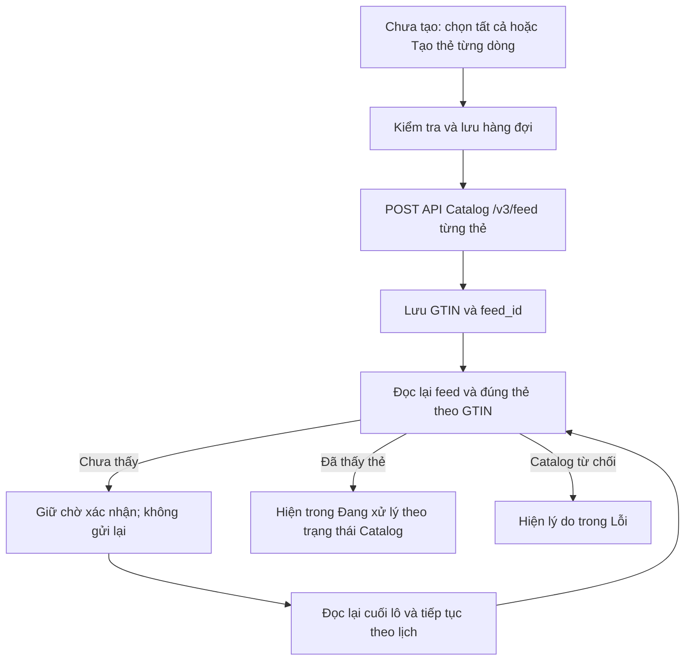

# Gửi thẻ qua API, xác nhận Catalog và thu gọn hàng sản phẩm

Nền ứng dụng: mã phát hành `v1.5.12`. Nhánh sửa: `fix/catalog-readback-compact-rows`.
Tài liệu này không phải biên nhận phát hành; Latest công khai vẫn là 1.5.12.

## Hành vi

- WB: chọn tất cả trong bộ lọc Chưa tạo và nút Tạo thẻ từng dòng cùng dùng hàng đợi bền vững hiện có. Ozon được sửa để nút tạo từng thẻ cũng đi qua bước kiểm tra và hàng đợi này.
- Mỗi sản phẩm được gửi JSON thật bằng `POST /v3/feed` qua `ZnackApiClient`, dùng kết nối API Catalog đúng cửa hàng. Không dùng omsId/omsConnection làm thông tin xác thực đăng ký thẻ.
- Sau mỗi lần gửi, lưu GTIN và feed_id trước khi đọc lại feed và thẻ theo GTIN. Sau khi gửi hết lô, đọc thêm một lượt các thẻ còn chờ; lượt cuối này chỉ đọc, không cấp GTIN, gửi lại feed, sửa hoặc ký.
- Bộ lọc Đang xử lý cần quan sát Catalog hoặc checkpoint đọc lại thẻ có good_id và trạng thái phù hợp. Chỉ đang POST hoặc có feed_id chưa đủ điều kiện chuyển bộ lọc.
- Yêu cầu đã gửi nhưng chưa đọc thấy thẻ tiếp tục hiện trong Chưa tạo với trạng thái đang xác nhận. Chọn tất cả không đưa các yêu cầu này vào lần gửi mới. Hàng đợi tự tiếp tục đọc lại và giữ giới hạn/Retry-After của dịch vụ.
- Giữ nguyên template, TN VED sản phẩm, kiểm tra phạm vi giấy tờ, shop/chủ sở hữu, chữ ký, quyền và cơ chế chống gửi lặp. Không thay schema hay xóa dữ liệu đã đồng bộ.
- Đọc API thật phát hiện tên nước sản xuất của WB `Китай` khác tên chính thức `КНР (Китайская Народная Республика)`. Chỉ thêm bí danh khi mục CN tương ứng thật sự có trong dictionary hiện hành; giữ nước nguồn và không suy đoán từ tên chứa chữ Китай của quốc gia khác.
- Lượt đọc cuối của thẻ vừa gửi chỉ xác minh. Khi khôi phục một lô Ozon cũ, giữ khả năng sửa tùy chọn một lần sau khi đọc lại được từ chối thật của server; không làm mất luồng khôi phục đã có.

## Hàng thu gọn

- Sản phẩm WB/Ozon: 135 → 104 px, ảnh giữ tỷ lệ trong khung 64 × 88 px, giảm khoảng đệm và khoảng cách giữa các dòng.
- Đăng ký WB/Ozon: 96 → 76 px, ảnh giữ tỷ lệ tối đa 40 × 56 px, nút trong hàng giảm chiều cao tối thiểu xuống 40 px.
- Giữ metadata và tooltip; chất liệu ở cửa sổ hẹp dùng một dòng với tooltip đầy đủ để không đẩy nội dung khỏi hàng.

## Kiểm chứng

Các kiểm thử dùng SQLite tạm, JavaFX thật trên Xvfb và máy chủ HTTP Catalog giả lập. Ca HTTP kiểm tra payload lưu trước khi POST, feed_id lưu trước đọc lại, thẻ xuất hiện muộn sau lần POST cuối, không gửi lặp khi có receipt nhưng chưa có thẻ và membership của hai bộ lọc.

187 ca mục tiêu có kết quả cuối đạt. Lượt toàn bộ đầu tiên phát hiện một lỗi khôi phục lô Ozon; đã sửa và chạy lại 103 ca liên quan, tất cả đạt. Lượt `clean verify` cuối **BUILD SUCCESS: 2.929 ca, 2.927 đạt, 2 bỏ qua theo hệ điều hành, không lỗi/thất bại**. [Biên nhận kèm hash nguồn](../validation/2026-10-23-catalog-readback-compact-verify.json).

API production đã đọc được hai trang Catalog gồm 1.253 ID duy nhất, sau đó đọc chi tiết đủ các ID theo lô 25 và kiểm tra schema/registry giấy tờ. Sau khi người dùng bấm Đăng ký cho đúng fixture đã trình bày, đã cấp đúng 1 GTIN và POST feed 1 lần. Đọc lại xác nhận đúng thẻ, article, màu, hệ size và TN VED; Catalog tăng lên 1.254 thẻ. Trạng thái mới nhất `draft / moderation`, chưa ký xanh. Feed vẫn có thể báo `Received` trong khi thẻ đã tồn tại: việc xác nhận phải dựa thêm vào đọc đúng thẻ, không chờ riêng trạng thái feed.

Đây là lượt thử API thật sử dụng payload được dựng bằng mã template/mapper VNCode, chưa phải nghiệm thu nút trong app Windows của seller. Không ký hoặc ghi GTIN lên sàn ở lượt thử này. [Biên nhận đã loại dữ liệu seller](../validation/2026-10-23-catalog-one-card-api-live.json); payload và định danh thật giữ riêng trong thư mục tạm bảo vệ, không commit vào repo.

Đã đưa nguyên phản hồi đọc lại thật qua `ZnackNationalCatalogService.submissionStatus` trên app-data tạm: mã nhận `CardModeration`, `cardVerified=true` và `RegistrationCardIndex.catalogCardInProgress=true`, kể cả feed còn `Received`. Bài đọc này không thực hiện thêm mutation hoặc ký.

Ảnh view thật dùng dữ liệu tổng hợp: [Sản phẩm](images/2026-10-23-compact-rows/products-selected.png), [đăng ký WB](images/2026-10-23-compact-rows/wb-registration.png), [đăng ký Ozon](images/2026-10-23-compact-rows/ozon-registration.png).
