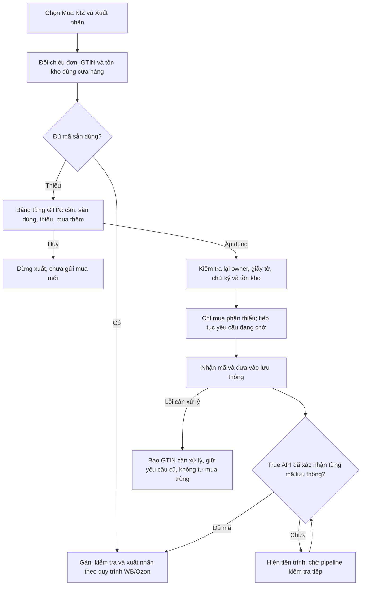

# Mua phần thiếu rồi tự xuất nhãn WB/Ozon

Nền `ce56ee3`, nhánh `fix/update-gtin-ozon-fbs-layout`. Áp dụng khi seller chọn nguồn **Mua KIZ** rồi xuất nhãn. Không thêm backend hoặc kho song song.

## Hành vi

- Kiểm tra trước khi chọn tệp không mua mã. WB vẫn chặn nhấn in lặp ngay khi bắt đầu preflight và không mở hộp thoại của cửa hàng cũ sau khi seller chuyển cửa hàng. Ozon readiness chỉ đọc dữ liệu; chỉ thiếu tồn kho mới đi tiếp tới đề xuất mua. Thiếu mapping, yêu cầu chưa hỗ trợ hoặc không có đơn vẫn chặn.
- Bảng đề xuất có tất cả GTIN thiếu, phân biệt số thiếu với số mua thêm. GTIN đang có lượt mua hoặc mã chưa xác minh không tự phát sinh mua trùng. Áp dụng đóng bảng trước khi enqueue; Hủy không mua mới. Nếu tồn kho thay đổi làm tăng số cần mua, phải có đề xuất/xác nhận mới.
- Tệp đích và lựa chọn in được lấy trước khi mua. Một tác vụ giữ nguyên đơn/cửa hàng/nguồn kho và tự tiếp tục xuất sau khi đủ mã; không cần nhấn xuất lại trong phiên đang mở. WB giữ enqueue gán mã trong worker sau khi xuất; Ozon giữ kiểm tra/gán exemplar và nhãn vận đơn chính thức cùng nhãn kết hợp.
- Tác vụ in dùng hàng đợi riêng có giới hạn, giữ activity/handoff như các worker hiện có. Hai tác vụ in chờ lưu thông không chiếm hết hai worker thông thường; ca hồi quy xác nhận tác vụ UI khác vẫn chạy.
- Chờ nằm ngoài khóa lập kế hoạch và ngoài reservation. Mã `RECEIVED` hoặc `INTRO_SENT` không được tính là sẵn dùng. Chỉ mã mua `AVAILABLE / IN_CIRCULATION` đúng shop/GTIN mới cho xuất. Pipeline hiện có xác nhận document và đọc lại từng CIS qua True API trước khi ghi IN_CIRCULATION.
- Lượt mua mới phục vụ in lưu `autoIntroduction=true` trong profile riêng của pipeline, cùng kết nối/chữ ký gốc, trong giao dịch enqueue. Không thay cài đặt toàn cửa hàng hoặc profile giao dịch cũ. Khôi phục/reconcile vẫn dùng UUID và kết nối cũ.
- Viên thuốc WB/Ozon hiện tiến trình mua/kiểm tra lưu thông và xuất nhãn; tự ẩn khi xong, lỗi hoặc hủy. Có trường hợp cần bổ sung giấy tờ, lỗi ký, lỗi mua hoặc lưu thông: app giữ yêu cầu, báo cần xử lý và không tự mua thêm để thay thế một kết quả chưa rõ.
- Đổi credential hoặc cấu hình trong lúc xác nhận/chờ sẽ chặn tác vụ in cũ. Pipeline có phí đã lưu vẫn giữ kết nối gốc. Mất mạng được xử lý bởi scheduler/reconciliation hiện có; vòng chờ in chỉ đọc kho/pipeline, không tăng tốc gọi API hoặc bỏ qua Retry-After.

## Phạm vi bền vững

Pipeline mua và profile đưa vào lưu thông tồn tại qua khởi động lại. Tác vụ tự xuất PDF trong lần sửa này là continuation của phiên đang mở; không có dịch vụ nền chạy khi tiến trình đã đóng và không có hàng đợi xuất PDF tự chạy sau restart. Nếu đóng app/cài cập nhật lúc chờ, lượt mua đã gửi được giữ, seller mở lại và chọn xuất nhãn. Bộ cập nhật có thể dừng tại checkpoint đã lưu của lượt mua; không ép hoàn tất một mutation đang ghi.

## Kiểm tra

- 118 ca mục tiêu đạt, log `/tmp/vncode-print-purchase-final-targeted.log`, gồm 57 ca FxmlSmokeTest, 12 ca session, 3 ca hộp thoại, kho/print/readiness/profile và hàng đợi/handoff. Sau chỉnh nhãn nút RU/ZH, 21 ca liên quan cuối đạt trong `/tmp/vncode-print-purchase-last-targeted.log`. Bấm nút Áp dụng/Hủy thật bằng JavaFX trên Xvfb, bốn ngôn ngữ, bảng 200 dòng và giới hạn chiều cao cửa sổ. Không phải nghiệm thu native Windows.
- Các ca WB/Ozon giả lập xác nhận chưa Áp dụng thì chưa enqueue; mua đúng 3 mã khi cần 5/sẵn 2; RECEIVED chưa được xuất; xác nhận lưu thông rồi chỉ xuất một lần; có pipeline cũ thì không mua thêm; hủy, đổi owner/cấu hình, mất phản hồi, lỗi introduction và thiếu dữ liệu không dẫn đến mua lặp/xuất sớm. Profile riêng được đọc lại bằng repository mới, giữ cài đặt cũ, rollback snapshot sai; integrity_check/foreign_key_check sạch.
- Lượt đầu phát hiện cần giữ preflight bất đồng bộ và sửa biểu diễn hằng số FXML. Đã sửa; các lượt đạt trên là kết quả sau sửa, không dùng các lượt thất bại làm bằng chứng đạt.
- Full đầu kết thúc 2.980 ca, một thất bại ở phép đo thứ tự callback đa luồng, không lỗi exception. Giữ stress 10.000 đơn, chuyển xác minh chia lượt sang tình huống giữ một writer chủ động để không phụ thuộc lịch CPU; 37 ca liên quan đạt sau sửa, Node 117/117. Bản 1.5.14 chạy lại full trong `/tmp/vncode-1514-full-verify.log`, hash `06df14f553ad61b717ccbfe021a6b7b9ab76bb7eafabb7ff7a2e8c0dd585c4a8`; build Windows phải kiểm tra đúng SHA trước phát hành.
- Không mua KIZ có phí, ký chứng thư seller hoặc gán/nhận đơn production trong lượt sửa này. Chủ dự án đã yêu cầu sau khi hoàn tất phải gộp và phát hành 1.5.14; đang chuẩn bị build Windows, chưa công bố Latest.

Sửa proof sau khi Catalog published đã full 2.963 ca trước khi thêm continuation: [bản sửa trước](2026-10-24-kiz-purchase-published-identity.md). File `zl.txt` đã bị Ozon validation thật từ chối 200/200 do cryptotail; đây là kết quả riêng, không dùng làm fixture mua/gán production.
