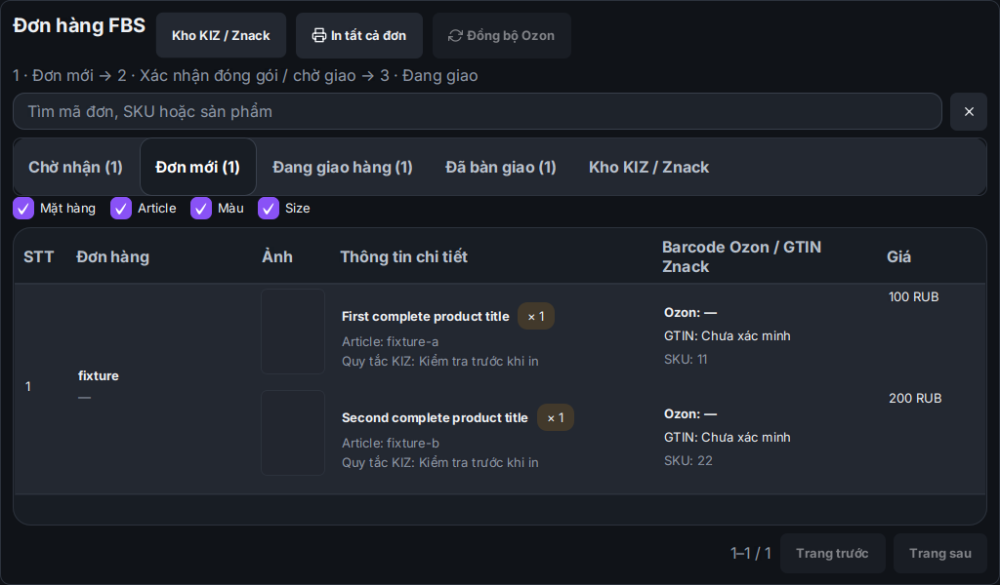
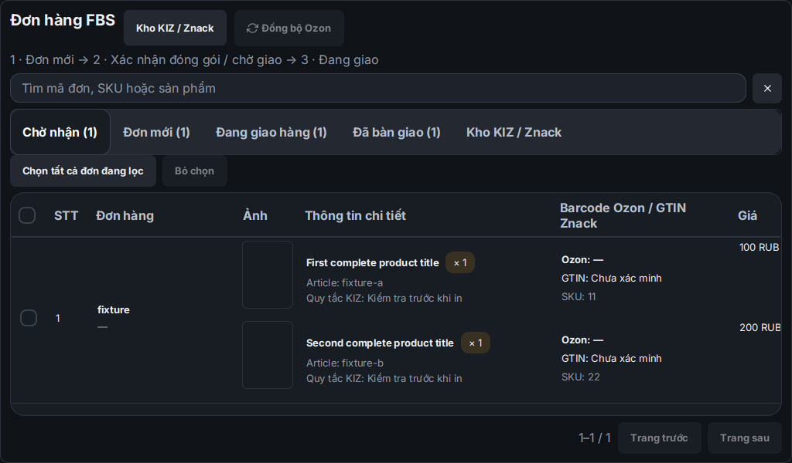

# Sửa nhãn khi In tất cả Ozon và bố cục FBS theo WB

Nguồn nền là 1.5.15 đã phát hành. Nhánh sửa `fix/ozon-batch-label-identity-fbs-layout`; mã chốt `0f5c527126a16b0047faae62528ba6dca46a9a47`. Chưa đóng gói hoặc thay Latest trong lượt sửa này.

## Nguyên nhân và cách sửa nhãn

`OzonBatchLabelDownloader` trước đây chỉ tìm đúng chuỗi số posting trong phần chữ của mỗi trang PDF. Nhãn chỉ có barcode vận chuyển, dấu gạch nối được in khác hoặc trang không có số đơn sẽ làm cả lô dừng với `OZON_LABEL_BATCH_IDENTITY_UNVERIFIED`. Đồng bộ lại vẫn có thể tải đúng tệp đó và gặp lại cùng lỗi.

Đường sửa thực hiện việc lấy/ghép nhãn, giữ cổng xác minh:

- Đọc barcode vận chuyển trên/dưới từ các API danh sách/chi tiết posting bằng `with.barcodes=true`. Chuẩn hóa dấu gạch nối và khoảng trắng trong số đơn; khớp đúng toàn bộ định danh và kiểm tra xung đột.
- Với trang không có chữ nhận diện, đọc barcode trong chính trang PDF, đối chiếu với số posting hoặc barcode vận chuyển của đơn. Giới hạn kích thước ảnh render; không dùng SKU hoặc barcode sản phẩm để xác định đơn vì nhiều đơn có thể cùng sản phẩm.
- Giữ đường nhanh: tối đa 1.000 posting dùng chung một tác vụ v3 và một lần tải PDF. Nhãn có định danh rõ tiếp tục ghép đúng dù trang bị đảo thứ tự. Khi in lại một đơn trong tác vụ chung, đối chiếu cả các thành viên đã lưu để loại đúng trang của các đơn không được chọn.
- Nếu tệp chung không chứng minh được danh tính của tất cả trang hoặc thiếu trang cho posting đã chọn, yêu cầu nhãn chính thức riêng cho từng posting trong nhóm bằng luồng v2 đã có. Mỗi yêu cầu chỉ chứa đúng một posting; lưu receipt rồi đọc/tải đúng tác vụ đó. Không ghép theo vị trí trang, thứ tự request hoặc suy đoán từ số trang.
- Lưu `ISOLATING` trước khi gửi tác vụ riêng, giữ receipt chung đến khi có receipt riêng. Nếu mất phản hồi/thiếu task ID, không tạo lặp khi mở lại hoặc bấm in lại. Một worker khác và kết quả cập nhật tác vụ chung không được xóa trạng thái chưa rõ này. Chỉ lần bị từ chối rõ ràng mới chuyển về `ISOLATE_REQUIRED` để thử lại có kiểm soát. Giữ kiểm tra license cho việc tạo tác vụ mới.
- Sau khi đã có tác vụ riêng, in lại dùng receipt đã lưu. Giữ cách tạo hai nhãn chính cho sản phẩm có KIZ: nhãn vận chuyển và nhãn kết hợp barcode sản phẩm/KIZ; bỏ trang sản phẩm trùng khi có đủ bằng chứng đã thay thế.

Không thêm backend hoặc kho song song, không đổi schema. Dùng trạng thái có lưu trong bảng `ozon_label_jobs` hiện có. Lấy riêng nhiều nhãn cần thêm yêu cầu API so với đường chung; chỉ dùng khi tệp chung thiếu bằng chứng để ghép đúng.

## Giao diện FBS

Theo bảng chi tiết shipment WB đang có trong app: STT, mã đơn và hạn giao, ảnh lớn giữ tỷ lệ, thông tin hàng, cột riêng Barcode Ozon/GTIN Znack/SKU, trạng thái KN3 và giá. Dùng cùng kiểu card, nút, header bảng, đường phân hàng và cuộn ngang khi cửa sổ hẹp. Chuyển In tất cả lên thanh thao tác, hiện tại tab Đơn mới. Giữ bốn nhóm Chờ nhận/Đơn mới/Đang giao hàng/Đã bàn giao và tab Kho KIZ.

Giữ dữ liệu ngày thật của Ozon, không gọi hạn giao là ngày tạo đơn. Mã đơn/ngày và barcode/GTIN cập nhật theo dữ liệu đã đồng bộ. Dòng nhiều sản phẩm có chiều cao tương ứng; phân trang và thao tác vẫn ở trong cửa sổ nhỏ. Tên cột barcode có đủ bốn ngôn ngữ.

Ảnh dưới từ JavaFX/Xvfb với dữ liệu tổng hợp, không phải dữ liệu seller:

## Kiểm chứng và giới hạn

- 72 ca mục tiêu đạt trước lượt xử lý trang render không hỗ trợ; sau đó hồi quy rộng 555 ca có đúng một kỳ vọng giao diện cũ thất bại (cột mã đơn bắt buộc 100 px). Đã cập nhật kỳ vọng theo bố cục mới và chạy lại toàn bộ các phần liên quan cuối: **161/161 ca đạt, không lỗi/thất bại/bỏ qua**. Các kiểm tra Ozon khác trong lượt rộng đạt; kết quả từng lượt được ghi riêng, không coi lượt lỗi là BUILD SUCCESS.
- Kiểm tra PDF qua HTTP localhost: 1.000 đơn/ba request, trang đảo, alias barcode vận chuyển, trang chỉ có barcode và quét độc lập trang đã tách, dấu gạch nối/khoảng trắng, tệp không rõ/xung đột, receipt riêng/in lại/khởi động lại, chặn tạo lặp khi mất receipt, giữ trạng thái khi cập nhật chung và retry lần bị từ chối rõ.
- Kiểm tra xuất PDF thực qua `OzonPrintBundleService.exportAll`: đúng nhãn vận chuyển POST-1, đúng KIZ và barcode sản phẩm trên nhãn tiếp theo, sau đó đúng POST-2. Nếu nhãn của đơn sau lỗi, giữ nguyên hai tệp đích cũ, KIZ vẫn RESERVED và chưa ghi receipt đã in.
- JavaFX kiểm tra đủ cột/mã đơn/ngày/barcode/GTIN/KN3 trên bốn tab; nhiều sản phẩm cùng dòng; bốn ngôn ngữ, hai theme, cửa sổ hẹp/rộng, phân trang và nút thao tác. Kiểm tra FXML, theme và các phần shipment WB liên quan đạt. Node contracts **117/117**.
- **API Ozon thật chỉ đọc**: danh sách có `with.barcodes=true` và chi tiết posting trả HTTP 200; chi tiết có cả barcode vận chuyển trên/dưới. Không tạo tác vụ nhãn, đổi đơn, gán hoặc tiêu KIZ trên tài khoản thật trong lượt này. Việc xuất PDF và ghép KIZ được kiểm tra bằng dữ liệu tổng hợp/HTTP localhost, chưa nghiệm thu thao tác trên Windows của seller.

[Biên nhận và hash nguồn/log](../validation/2026-10-25-ozon-batch-label-fbs-verify.json). Latest vẫn là v1.5.15 bất biến; khi phát hành các sửa này phải dùng phiên bản mới và chạy bộ cài/native/upgrade Windows đúng mã nguồn.
