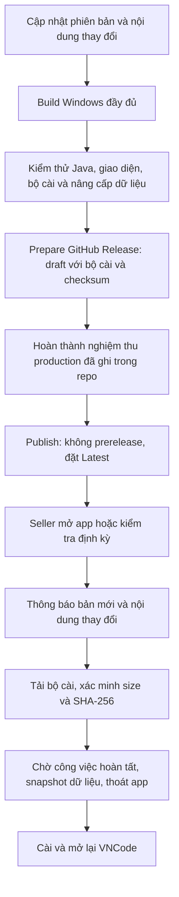

# Phát hành VNCode và thông báo cập nhật

Repo phát hành cố định:
https://github.com/ntccong2468-lab/Bancapnhat/releases.
`/releases/new` là biểu mẫu tạo bản phát hành, không phải địa chỉ API cho app.
VNCode dùng GitHub API `/repos/ntccong2468-lab/Bancapnhat/releases/latest`.

Workflow **Prepare or publish VNCode GitHub Release** có trên nhánh mặc định;
`release_source_ref` chọn nhánh chứa mã mới và bản ghi nghiệm thu (hiện là
`update/vncode-approved-upgrades`). Workflow nhận run ID của build
Windows đầy đủ và SHA nguồn chính xác. Chế độ `prepare` tạo draft tag `vX.Y.Z`,
đính kèm EXE Windows, SHA-256, build-info và release notes sau khi kiểm tra
nguồn/build/bộ cài. Chế độ `publish` kiểm tra trạng thái hoàn tất và nghiệm thu
license production, rồi đặt Published/Latest. Không ghi đè bản đã phát hành.

Tên bộ cài: `VN-code-X.Y.Z-Windows-x64.exe`. Notes lấy từ
`docs/releases/VN-code-X.Y.Z.md`. Nếu cần thêm thông tin trong biểu mẫu GitHub,
giữ tag đúng phiên bản và các asset đã kiểm chứng. Không gửi artifact kiểm tra
dưới dạng cập nhật chính thức; app loại draft/prerelease và các asset sai nền tảng.

Giờ mở app: kiểm tra ở executor riêng, không chặn luồng giao diện. App đang
chạy kiểm tra lại mỗi 45–60 phút với thời gian lệch nhẹ giữa máy. **Để sau** vẫn
giữ nút thông báo trên header; kiểm tra thủ công hiển thị cả bản đã bỏ qua.
Phiên bản mới phải lớn hơn bản đang cài. Lỗi mạng và repo chưa có Published
Release được báo riêng; không báo nhầm rằng app đã mới nhất.

Hiện khóa cập nhật riêng chưa được pin: kênh kiểm tra digest asset GitHub qua
HTTPS và kiểm tra byte trước cài; không tuyên bố manifest có chữ ký. Cặp khóa
Ed25519 cập nhật (nếu thêm) khác cặp khóa license và phải pin trong bản cài
trước khi yêu cầu chữ ký ở bản tiếp theo.

Nghiệm thu còn thiếu được giữ trong file acceptance tương ứng; không đổi các
cờ chưa chạy thành `true` để vượt bước publish. Draft không hiện với seller.
Sau khi publish, kiểm tra `/releases/latest` trả đúng tag, notes và digest EXE,
rồi thử bằng VNCode phiên bản trước với **Kiểm tra phiên bản**.
