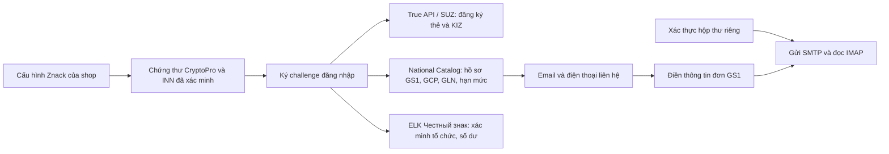

# Đối chiếu Wbcode 1.3.8 và hai màn hình Znack

**Cập nhật 14/10/2026:** phần đối chiếu dưới đây ghi trạng thái trước khi viết
mã bổ sung. Đã triển khai tab Thông tin, scope/checkpoint theo doanh nghiệp,
giấy tờ từng sản phẩm, phân trang/chọn tập lọc, ký thẻ đã duyệt, thẻ mới giữ GTIN
cũ, đăng ký Ozon bằng SKU gốc và GTIN ADD WB/Ozon theo hợp đồng chính thức.
Không coi các đoạn “hiện tại/chưa có” bên dưới là trạng thái mới nhất.
[Kiểm chứng và giới hạn mới](../validation/2026-10-14-vn-code-140-scaling.md).
Thay/xóa barcode sàn, nguồn mọi nhóm Catalog bên ngoài VNCode và nghiệm thu
seller/CryptoPro/mail thật vẫn chưa hoàn thành.

Kiểm tra ngày 13/10/2026, giờ Việt Nam. Phạm vi: ghi chú phát hành công khai,
hai ảnh do người dùng cung cấp và mã hiện tại của VNCode trên nhánh
`update/vn-code-1.4.0`. Đây là báo cáo đối chiếu, chưa phải triển khai các mục mới
bên dưới hoặc nghiệm thu tài khoản thật. Không sao chép dữ liệu cá nhân trong ảnh.

## Phiên bản và nguồn

Bản công khai mới nhất là [Wbcode 1.3.8](https://github.com/rupphi/relatest-wcode/releases/tag/v1.3.8),
phát hành lúc **04:14:49 ngày 13/10/2026**, giờ Việt Nam
(`2026-10-12T21:14:49Z`). Đây là bản mới hơn 1.3.7 duy nhất trong danh sách release
công khai tại thời điểm kiểm tra. Nguồn metadata:
[GitHub Releases API](https://api.github.com/repos/rupphi/relatest-wcode/releases?per_page=100).

`relatest-wcode` chỉ có README và tài sản phát hành; `source-wcode` trả 404, không
đủ căn cứ phân biệt private và không tồn tại. `test-wcode` công khai là mã cũ
1.1.32, không dùng để khẳng định cách triển khai 1.3.4–1.3.8. Những mô tả tính năng
Wbcode trong báo cáo là công bố của tác giả, chưa kiểm chứng bằng chạy binary.

| Bản | Điểm liên quan cần đưa vào kế hoạch VNCode |
|---|---|
| [1.3.4](https://github.com/rupphi/relatest-wcode/releases/tag/v1.3.4) | Sáu kiểm tra GS1/CZ; cảnh báo; xử lý GTIN theo mọi prefix; FBO không chặn cả lô vì một thẻ chưa ký. Ký thỏa thuận trong app là công bố, chưa có hợp đồng API để áp dụng. |
| [1.3.5](https://github.com/rupphi/relatest-wcode/releases/tag/v1.3.5) | Đọc tên/INN từ chứng thư CMS thực; giấy tờ trong sổ giấy phép CZ khi cập nhật GTIN WB; GTIN nhập tay khớp nhanh; chú thích bước đang đồng bộ. |
| [1.3.6](https://github.com/rupphi/relatest-wcode/releases/tag/v1.3.6) | TN VED đổi nhóm bốn số → thẻ/GTIN mới, giữ thẻ cũ; article theo cách Catalog chuẩn hóa; cuộn tải thêm; ký đơn prefix và ảnh giấy → PDF. |
| [1.3.7](https://github.com/rupphi/relatest-wcode/releases/tag/v1.3.7) | Ưu tiên giấy tờ còn hiệu lực của từng sản phẩm; nhóm giày theo TN VED; hỏi lại cỡ không số; lỗi giấy phép có thương hiệu/tờ khai; đồng bộ Ozon giữ màn hình đang xem. |
| [1.3.8](https://github.com/rupphi/relatest-wcode/releases/tag/v1.3.8) | Đăng ký thẻ mới cho sản phẩm WB/Ozon đã có thẻ; thẻ cũ dùng KIZ/in đến khi thẻ mới đã ký và có trên sàn; đăng ký lại hàng loạt, xác nhận số GTIN dùng. Bộ lọc WB theo ngôn ngữ và nút Ozon không cắt chữ. |

1.3.8 còn có tìm kiếm hướng dẫn không dấu, video có trạng thái tải/nút tải lại,
ảnh/video lớn hơn, nhập ngày giấy tờ theo `dd.MM.yyyy` và khóa nút giới tính khi
đang tải/lưu. Các mục này là đợt UI/phần sản phẩm riêng, không thay luồng license
Gmail → chủ VNCode duyệt/cấp khóa đã thống nhất.

## Dùng chung cấu hình Znack, xác thực đúng từng dịch vụ

Luồng đã có trong mã:

Các dịch vụ dùng cùng danh tính đã cấu hình; token/cookie của True API, Catalog và
ELK có phạm vi riêng. Không lấy token của một dịch vụ để coi là đã đăng nhập dịch
vụ khác. CryptoPro sử dụng khóa riêng trong token/kho chứng thư để ký; VNCode không
tải hay lưu khóa riêng/PIN.

| Dữ liệu/chức năng | Mã và trạng thái hiện tại |
|---|---|
| Chứng thư thực, fingerprint, INN và hạn chứng thư | `ZnackAutomationController.java:421`, `CryptoProSignedCertificateReader.java:38`; đã có đọc từ CMS và kiểm tra đăng nhập thực. |
| GS1 dùng cấu hình Znack cùng shop | `Gs1Pane.java:107`, `:139`, `:152`; xác minh lại danh tính chữ ký khi mở phiên Catalog. |
| Hồ sơ/GCP/GLN/GTIN còn lại | `NationalCatalogGs1Client.java:91`; đọc `gs1/gcp-gln` và `gs1/form`. |
| Email/điện thoại/người ký cho đơn | `Gs1PrefixRequestService.java:43`; hồ sơ Catalog và chứng thư thực, cho khách duyệt/chỉnh liên hệ. |
| Số dư tài khoản CZ | `ChestnyZnakBalanceClient.java:26`, `:46`, `:59`; ELK xác minh INN và tách productGroup/contractId, có thời điểm cập nhật. |
| Gửi/đọc thư GS1 | `Gs1Pane.java:452`, `Gs1MailAccount.java:4`; SMTP/IMAP TLS riêng, mật khẩu DPAPI. Chưa có endpoint CZ cung cấp quyền hộp thư. |

[Release 1.3.0](https://github.com/rupphi/relatest-wcode/releases/tag/v1.3.0) công bố
tự điền ngân hàng, điện thoại, email và địa chỉ từ CZ. Điều đó hỗ trợ mục tiêu lấy
**thông tin liên hệ** tự động; không chứng minh quyền đọc Gmail hay mật khẩu SMTP
có thể lấy từ CZ. Cần bổ sung adapter hồ sơ CZ đã xác minh nếu muốn nguồn hồ sơ
CZ trực tiếp/fallback; adapter ELK hiện chỉ kiểm tra INN và lấy số dư, chưa chuyển
các trường ngân hàng/địa chỉ/liên hệ sang form GS1.

Hạn chứng thư, hạn phiên đăng nhập và hạn thành viên GS1 là ba dữ liệu khác nhau.
Ngày GS1 thiếu không chứng minh đã đóng phí vô thời hạn; không lấy hạn CryptoPro
để điền hạn hội viên. Thư trả lời cũng không tự chứng minh đã được cấp prefix.

## Màn hình Cấu hình Znack theo ảnh

Hiện FXML có Cài đặt / Danh mục GTIN / Đã xóa / Đơn hàng và mã / Nhật ký audit,
chưa có tab Thông tin với các thẻ như ảnh. Đã có `omsId`, `omsConnection`, chọn
chứng thư, Test signature và hướng dẫn hai mã SUZ. Cần nâng cấp:

1. Tab **Thông tin**: chủ tài khoản/INN từ danh tính đã xác minh; trạng thái đăng
   nhập hiện tại; số dư CZ và thời điểm cập nhật; hạn chứng thư, số ngày còn lại.
2. Tab **Lịch sử mua KIZ** dùng lịch sử đơn hiện có; giữ **Đã xóa**, đưa trường
   thiết lập vào **Cài đặt**, giữ audit có thể truy xuất.
3. Số dư nhiều nhóm/hợp đồng phải chọn tài khoản cụ thể; không cộng tùy tiện.
   Phân biệt chưa lấy được, dữ liệu đã lưu/cũ và kết quả mới.
4. **Đang hoạt động** cần phiên đăng nhập thực còn hiệu lực. `signerTestedAt`
   chứng minh lần kiểm tra trước, không chứng minh phiên hiện tại.
5. Đổi chứng thư/INN/môi trường phải hủy hiệu lực phiên/cache đúng phạm vi và giữ
   lịch sử tác vụ đã gửi để đọc lại/đối soát.

Bằng chứng: `znack-automation-view.fxml:12`, `:58`, `:85`, `:104`, `:114`;
`ZnackAutomationController.java:436`, `:931`; `ZnackAuthService.java:27`.

## Màn hình Đăng ký thẻ Znack theo ảnh

| Mục | Hiện tại trong VNCode | Cần nâng cấp |
|---|---|---|
| Cấu hình giấy tờ | Có form giấy tờ mặc định của shop | Ưu tiên giấy tờ còn hạn của từng sản phẩm; shop là fallback, đọc registry CZ khi cần. |
| Ký thẻ đã duyệt | Pipeline tự ký khi ReadyToSign | Nút riêng, lấy thẻ đã duyệt từ Catalog, hiển thị tập thẻ/nội dung để xác nhận ký. |
| Cập nhật GTIN lên WB | Adapter riêng đang khóa `api_contract_unverified` | Chốt hợp đồng ghi đúng nmID/chrtID, preview, xác nhận, checkpoint và readback. |
| Đồng bộ Znack | Làm mới hiện chỉ đọc SQLite | Đọc Catalog đúng doanh nghiệp; ghép theo biến thể, giữ thẻ không gắn sản phẩm trong số đếm/toàn Catalog. |
| Bảng và bộ lọc | Có ảnh/tên/article/màu/size/barcode/trạng thái và tìm kiếm | Thêm giới tính/TN VED và các số đếm thẻ đã ký/chờ ký/từ chối/lưu trữ, tổng Catalog và lỗi chưa gắn. |
| Tải thêm | Giới hạn 500 dòng, offset luôn 0 | Cuộn tải thêm với thứ tự ổn định và tổng kết quả; không tải toàn catalog lên FX thread. |
| Tìm GTIN mới | Tìm barcode WB, nhưng chưa xét `r.gtin` | Tìm được GTIN đã cấp dù chưa cập nhật vào barcode WB. |
| Chọn tất cả | Chỉ các dòng đủ điều kiện trong trang đang tải | Chốt tất cả kết quả đang lọc; phân biệt số đã tải và số được chọn, xác nhận lượng GTIN sử dụng. |
| Thẻ mới trên sản phẩm đã xuất bản | Không có action REGISTER_NEW; PUBLISHED không đủ điều kiện đăng ký | Luồng mới theo 1.3.8, giữ thẻ cũ hoạt động trong suốt quá trình thay thế. |
| WB và Ozon | Workflow đăng ký hiện giới hạn WB | Adapter/domain đăng ký Ozon riêng, không dùng chrtID hoặc endpoint WB cho Ozon. |

Bằng chứng: `znack-card-registration-view.fxml:10`, `:18`, `:24`, `:34`;
`ZnackCardRegistrationController.java:52`, `:138`, `:280`, `:290`, `:347`;
`WbGtinAdapter.java:10`; `ZnackCardRegistrationWorkflow.java:79`, `:237`;
`ZnackCardRegistrationModels.java:29`, `:64`; `ZnackCardRegistrationRepository.java:135`.

Đã có `requestNewGtin`/`generateFreshOne` cho tình huống phân bổ GTIN cần duyệt
lại. Đây chưa phải vòng đời thay thẻ 1.3.8 cho sản phẩm PUBLISHED. Không công bố
toàn bộ chức năng xin GTIN mới là thiếu; phần còn thiếu là thay thẻ, giữ mapping
cũ và chuyển mapping sau khi thẻ mới thật sự dùng được trên sàn.

Tự ký hiện thuộc pipeline đăng ký đã có, được mô tả trong
`docs/wb-znack-card-registration-test-spec.md:20`. Báo cáo ghi nhận khác biệt với
nút ký riêng trong ảnh, không suy rằng mọi việc tiếp tục từ checkpoint là chưa
được khách cho phép.

## Điều kiện cần sửa trước khi nối các tác vụ với cấu hình thật

Checkpoint đăng ký hiện chỉ gắn shop/chrtID, GTIN/feed/payload/status. Chưa giữ
INN doanh nghiệp, môi trường và fingerprint chứng thư: `ZnackCardRegistrationSchema.java:14`.
Worker lấy cấu hình ở lúc thực thi (`ZnackCardRegistrationWorkflow.java:131`),
trong khi callback đổi shop chỉ chặn kết quả UI. Chặn đổi signer hiện xét pipeline
mua KIZ và mã reserved, chưa xét đăng ký thẻ (`ZnackRepository.java:140`).

Đợt nghiệp vụ cần gắn xác nhận và checkpoint vào danh tính đã duyệt, kiểm tra
CMS/INN/môi trường/cấu hình trước khi phân bổ GTIN, tạo feed và ký, giữ đọc lại
tác vụ đã gửi. Không tiếp tục dùng payload doanh nghiệp cũ với cấu hình mới.
`ZnackSafety.requireSigned` hiện xét selector và thời điểm đã test, chưa tương
đương guard danh tính CMS thực của GS1. Đây là thiếu kiểm tra trong mã hiện tại,
chưa phải bằng chứng một thao tác sai đã xảy ra trên tài khoản thật.

Hợp đồng endpoint National Catalog trước đây được ghi trong spec trong repo;
lượt đối chiếu này chưa tìm được bộ fixture v5.62/v16 được tham chiếu để xác minh
lại hợp đồng đó. Các trạng thái server hiện nhận diện Rejected/Moderated/Signed;
trạng thái lạ vẫn processing, không tự kích hoạt ký. Nút ký hàng loạt mới cần duyệt
tập thẻ/XML và lưu nội dung ký riêng, không chỉ thêm một nút gọi pipeline cũ.

## Luồng thay thẻ cần triển khai theo 1.3.8

Giữ **active GTIN/card cũ** và **candidate GTIN/card mới** tách biệt. Sau khi khách
duyệt số GTIN tiêu thụ: cấp mã mới → tạo/moderation → ký đúng đơn/thẻ → cập nhật
biến thể trên WB/Ozon → đọc lại xác nhận sàn đã có GTIN mới → chuyển mapping mua
KIZ/in sang candidate. Timeout hoặc lỗi ở giữa giữ active cũ và đối soát; không
xóa mã/KIZ/lịch sử cũ, không tự cấp mã hoặc gửi lại vì chưa rõ kết quả.

Đổi nhóm TN VED bốn số, giấy tờ hoặc dữ liệu thẻ có thể là lý do thay thẻ; article
cần theo hợp đồng chuẩn hóa Catalog, không dùng phép xóa ký tự tùy tiện làm
khớp hai sản phẩm khác nhau. Quy tắc giày/chất liệu/cỡ cần nguồn API/từ điển,
không suy quy định pháp lý chỉ từ nội dung release.

## Thứ tự nâng cấp

1. Gắn danh tính và xác nhận vào checkpoint đăng ký; đọc hồ sơ CZ đã xác minh,
   dùng chung cấu hình nhưng phiên riêng cho từng dịch vụ.
2. Tab Thông tin và ba thẻ tài khoản/số dư/chứng thư; quản lý nguồn/thời điểm/cache.
3. Đồng bộ Catalog, tổng trạng thái/lỗi, tải thêm và chọn toàn bộ kết quả đã lọc.
4. Giấy tờ từng sản phẩm, giày/cỡ/article và nút ký thẻ đã duyệt.
5. Chốt hợp đồng ghi GTIN WB/Ozon và đọc lại; sau đó luồng thẻ mới/bulk thay thẻ
   1.3.8 với active/candidate mapping.

Lượt kiểm tra này không đổi logic ứng dụng, không chạy thêm kiểm thử cho tài liệu
và không thực hiện thao tác seller/mail thật. Kết quả 1.041/1.042 kiểm thử Java,
42/42 Node và smoke JAR trước đó thuộc đợt GS1/Word đã ghi trong báo cáo riêng;
không dùng các con số đó để chứng minh các mục còn thiếu ở đây đã hoạt động.
