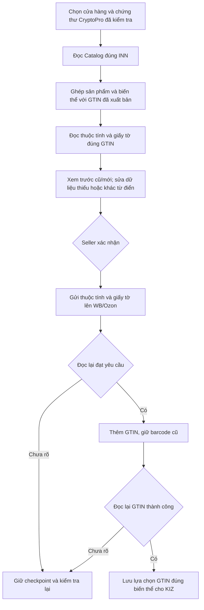
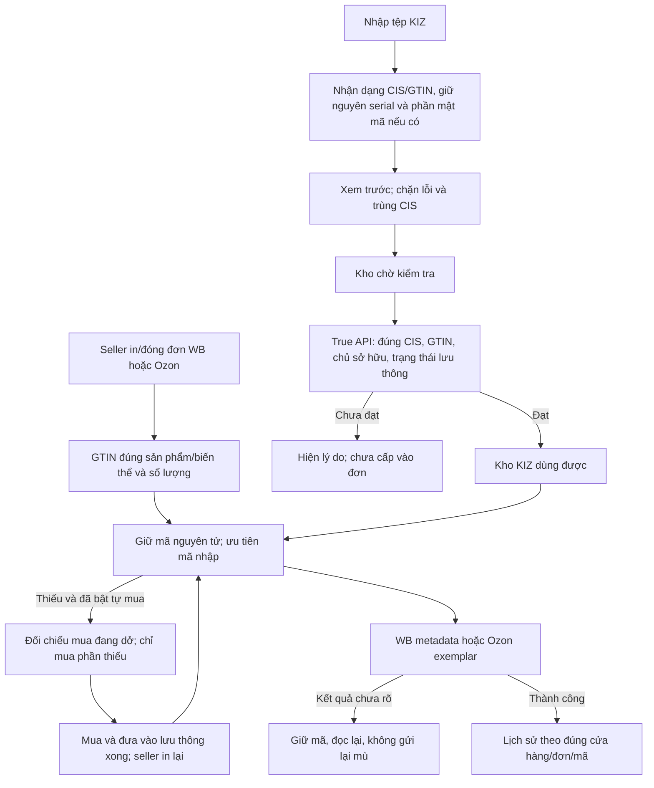

# Đối chiếu Catalog, GTIN và KIZ cho VNCode 1.4.11

Phạm vi được duyệt: Catalog/Честный знак → xem trước thuộc tính, giấy tờ và GTIN → WB/Ozon → đọc lại; sau đó kiểm tra gán KIZ, thêm kho nhập tệp và ưu tiên dùng kho trước khi mua phần thiếu.

## Nguồn đã đối chiếu

1. [WBCode 1.3.8](https://github.com/rupphi/relatest-wcode/releases/tag/v1.3.8), phát hành 12/10/2026. Đối chiếu thêm ghi chú 1.3.5 và 1.3.7. Chưa tìm thấy mã nguồn công khai của WBCode 1.3.8; ghi chú và bằng chứng giao diện không chứng minh toàn bộ xử lý bên trong.
2. [WCode 1.1.32, nguồn công khai cố định tại 8f7c3d1](https://github.com/rupphi/test-wcode/tree/8f7c3d1ac8598158029b8d037e2d3c128e240727): OrderExportWorkflow, KizAttachmentCoordinator, OzonExemplarService, OzonProductGtinMappingRepository, ZnackGtinInventoryService; tài liệu `docs/znack-automatic-gtin-permit-documents-spec.md`.
3. [WCode 1.0.27 tại 457a6113](https://github.com/rupphi/test-wcode/tree/457a6113301978454f244248956962ab1fcdeb7e): đây là phiên bản lịch sử còn kho KIZ seller nhập, không nhầm với kho tự mua của nhánh mới.
   - [KizInventoryWorkflow](https://github.com/rupphi/test-wcode/blob/457a6113301978454f244248956962ab1fcdeb7e/src/main/java/com/tuandev/fbsbarcode/features/kiz/KizInventoryWorkflow.java): đọc PDF và lưu theo cửa hàng/danh mục.
   - [PdfDataMatrixReader](https://github.com/rupphi/test-wcode/blob/457a6113301978454f244248956962ab1fcdeb7e/src/main/java/com/tuandev/fbsbarcode/features/kiz/PdfDataMatrixReader.java): giải mã DataMatrix, thử cả hai nửa trang.
   - [KizService](https://github.com/rupphi/test-wcode/blob/457a6113301978454f244248956962ab1fcdeb7e/src/main/java/com/tuandev/fbsbarcode/features/kiz/KizService.java): thêm/lấy mã trong `kizs`, FIFO theo ID, gửi `sgtins` lên WB.
4. Bằng chứng giao diện WBCode chạy trên Windows đã có trong `docs/research/vncode-wbcode-2026-10-14/evidence/`. Lần quan sát đó không kích hoạt license WBCode và không đăng nhập tài khoản seller; không coi là đã chạy đơn thật.

## Bảng đối chiếu từng thay đổi

| Mục | Bằng chứng WBCode/WCode | VNCode áp dụng |
|---|---|---|
| GTIN đã xuất bản, đúng chủ tài khoản | WCode 1.1.32 và ghi chú WBCode 1.3.5 | Chứng thư CryptoPro + INN + môi trường + cửa hàng; dữ liệu Catalog còn hạn, thẻ published/trade unit; không bỏ qua kiểm tra chủ sở hữu |
| TN VED, chất liệu, giới tính, màu, thương hiệu, tên và thuộc tính | Ghi chú WBCode 1.3.7; source WCode và trường đăng ký Catalog | Đọc thuộc tính theo ID Catalog, tra từ điển riêng WB/Ozon, xem trước cũ/mới, cho sửa giá trị đề xuất; không chép ID thuộc tính giữa hai sàn |
| Giấy tờ theo đúng GTIN | WBCode 1.3.5/1.3.7 và spec WCode `/v4/rd-info-by-gtin` | Lấy hồ sơ đang có hiệu lực; trạng thái 18/19 là còn chờ; không lấy giấy tờ mặc định của cửa hàng để giả làm hồ sơ của sản phẩm; không tự tạo ngày hết hạn |
| Giữ barcode/GTIN cũ trong khi đăng ký mã mới | WBCode 1.3.8 | Gửi thuộc tính/giấy tờ → đọc lại → thêm GTIN → đọc lại. Giữ toàn bộ barcode cũ. Không vượt hạn chế API Ozon bằng cách thay mất barcode |
| GTIN dùng để chọn KIZ | WCode OrderExportWorkflow và mapping Ozon | Chỉ lưu lựa chọn biến thể đã có đọc lại thành công; không dùng một đề xuất GTIN chưa gửi để gán đơn; giữ cơ chế bảo toàn GTIN đang hoạt động của thẻ thay thế |
| Gán KIZ WB | WCode KizAttachmentCoordinator/KizService | Giữ `sgtins`, scope cửa hàng, giới hạn tốc độ và checkpoint. WB từ chối vì trạng thái đơn được báo rõ; không tính là bỏ qua không có lỗi |
| Gán KIZ Ozon | WCode OzonExemplarService | Giữ số exemplar theo số lượng từng sản phẩm, dự trữ riêng, validate/set/status và đối soát khi mất phản hồi; dùng kho nhập qua cùng bộ cấp mã |
| Kho mã seller nhập | WCode 1.0.27 | Thêm tab Kho KIZ; nhận dạng GTIN từ từng mã, chống trùng CIS, dự trữ nguyên tử; không trộn mã khác GTIN chỉ vì cùng danh mục |
| Quản lý mã nhập lỗi | WCode 1.0.27 có reset/xóa kho theo danh mục | Chỉ loại mã nhập chưa dùng, chưa đạt kiểm tra; giữ mã đã giữ/đã dùng và mã đã sẵn sàng. Khôi phục phải kiểm tra lại, không xóa dấu vết CIS |
| Tệp văn bản và nhiều ứng dụng ghi chú | Yêu cầu mở rộng của chủ VNCode; không có bằng chứng WCode 1.0.27 hỗ trợ tất cả các loại này | TXT/CSV/TSV/JSON/XML/XLSX/XLS/DOCX/RTF/Markdown/HTML, PDF/ảnh DataMatrix và ZIP chứa định dạng hỗ trợ; văn bản UTF-8/BOM/UTF-16, phần ASCII của ANSI. Không gọi mọi định dạng nhị phân là đã hỗ trợ |
| Ưu tiên kho, tự mua thiếu | Kho WCode cũ + pipeline mua Znack của WCode mới | Ưu tiên imported stock đã xác minh. Seller bật tùy chọn tự mua có tính phí; thao tác in/đóng đơn chỉ bổ sung phần thiếu. Chờ lần mua/đưa vào lưu thông/kiểm tra đang dở; không tạo mua lặp |
| Giao diện và tác vụ nền | Giao diện quan sát, model kho cũ, controller WCode mới | Bảng số lượng theo GTIN, cũ/mới và trạng thái rõ; đọc tệp/API chạy nền; bỏ kết quả thuộc cửa hàng cũ; không đọc `Task.getValue()` từ worker |
| Đọc Catalog lớn | WCode/VNCode ZnackProductService dùng batch 25 GTIN, phân cách bằng dấu chấm phẩy | Dùng cùng hợp đồng batch, giữ một batch trong bộ nhớ; 1.000 GTIN cần 40 lần đọc feed-card thay vì 1.000. Giấy tờ vẫn đọc riêng theo API của đúng GTIN |
| Khởi phục công việc đang gửi | Rà soát cấu trúc VNCode khi ghép các luồng trên | Khởi phục job khi mở workspace; mở thêm màn hình/service không được đổi job đang gửi thành trạng thái khởi phục |

## Luồng đồng bộ

## Tệp mẫu và giới hạn thực tế

- `quan.txt` được đọc cục bộ, không đưa mã thật vào Git, log, fixture hay tài sản phát hành. Đã xác định cấu trúc: 600 dòng khác nhau, một GTIN có check digit hợp lệ, 31 ký tự/dòng, serial 13 ký tự; có serial chứa dấu phẩy. Đây là CIS/SGTIN ngắn, không kèm crypto tail.
- Bộ nhận dạng giữ nguyên CIS ngắn và DataMatrix đầy đủ thành hai dạng. Không suy đoán phần mật mã hoặc thay dấu `?` do ứng dụng khác làm mất GS. Tệp kiểm thử dùng mã tổng hợp khác hoàn toàn mã của seller.
- PDF/ảnh phải có DataMatrix đọc được. Không coi OCR hay dòng chữ in dưới tem là phần mật mã đầy đủ. Tệp nhị phân chưa hỗ trợ (ví dụ định dạng ghi chú độc quyền) cần xuất ra một trong các định dạng trên.
- Giới hạn 32 MB/tệp, 100.000 mã, 1.000 trang PDF/khung ảnh, 100 tệp ZIP; không giải nén ZIP ra ổ đĩa, không nhận archive lồng nhau. Công thức Excel không được thực thi; XML tắt external entities.
- Kho lưu cục bộ trên từng máy. Cần chia mã riêng cho các máy; chống trùng trong một cơ sở dữ liệu không chứng minh chống trùng giữa các máy độc lập.
- Các kiểm thử mô phỏng không xác nhận seller đã gán thành công đơn thật, cũng không chứng minh file mẫu đã ở trạng thái lưu thông trên True API. Không thực hiện mua KIZ, gửi metadata hay dùng mã thật trong phiên sửa mã này.

Kết quả kiểm thử, bản dựng Windows và link phát hành được ghi riêng trong `docs/releases/VN-code-1.4.11-status.json` khi hoàn tất.
