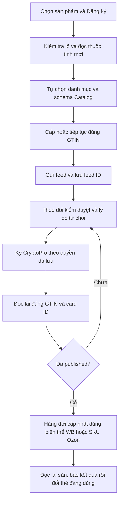

# Mẫu mặc định đăng ký thẻ Znack

Mã mẫu: `vncode-catalog-approved-v1`. Mặc định được đóng gói và nạp trực tiếp bởi `RegistrationTemplate`; cả WB và Ozon gọi qua `ZnackNationalCatalogService.buildPayload`. Đây là bộ dựng JSON theo cấu trúc, không gửi dữ liệu seller ra một dịch vụ AI.

Đăng ký đúng sản phẩm/biến thể seller đã chọn. Đọc sản phẩm sàn và schema thuộc tính bắt buộc của danh mục National Catalog hiện tại. Tự chọn danh mục khớp loại hàng và TN VED; không lấy danh mục của thẻ mẫu cho mặt hàng khác. Chỉ dùng GTIN được cấp hoặc đã lưu cho chính lượt đăng ký này; giữ nguyên GTIN/feed_id khi tiếp tục một yêu cầu chưa rõ kết quả. Điền tên, thương hiệu, article, màu, size và hệ size, chất liệu, giới tính, xuất xứ, quy chuẩn và giấy tờ từ dữ liệu thật của sản phẩm/cấu hình đã xác nhận. Loại bỏ khoảng trắng ở hai đầu; giữ nguyên khoảng trắng bên trong. attr_value_type phải thuộc schema của chính danh mục, không sao chép hệ size hay giấy tờ của thẻ mẫu. Không tự bịa giá trị còn thiếu. Gửi moderation=1 cùng identified_by loại gtin, cấp trade-unit và số lượng 1. Lưu feed_id; theo dõi duyệt, hiển thị lý do từ chối, ký bằng CryptoPro đã cấu hình khi được cho phép. Chỉ xác nhận đã xuất bản sau khi đọc lại đúng GTIN, good_id và good_status=published. Sau đó ghép đúng biến thể WB/Ozon (Ozon kiểm tra thêm SKU, tên, màu, size), cập nhật qua hàng đợi đã duyệt và đọc lại sàn trước khi báo thành công. Không coi đọc danh mục, HTTP 200, feed đã nhận hoặc đã gửi chữ ký là đăng ký thành công.

