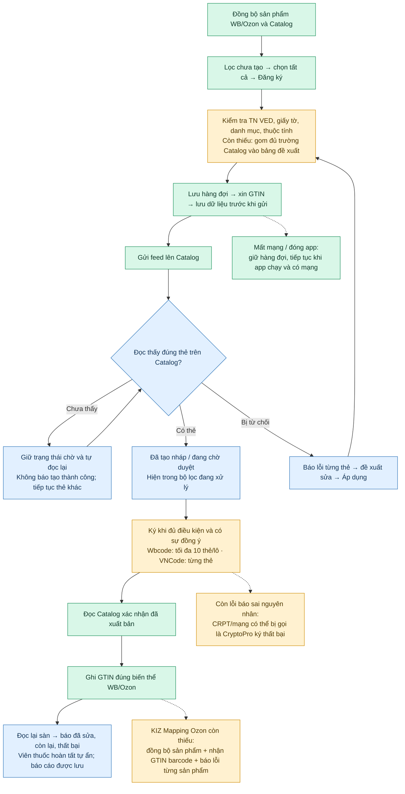

# Đối chiếu toàn bộ luồng đăng ký Znack: Wbcode 1.3.11 và VNCode

Ngày kiểm tra: **20.10.2026**. “WB” trong yêu cầu được hiểu là ứng dụng **Wbcode**. Đối chiếu bao gồm đăng ký từ sản phẩm Wildberries và Ozon, ký thẻ, cập nhật GTIN lên sàn, khôi phục hàng đợi và báo cáo.

**Kết quả:** VNCode có các bước chính của luồng, nhưng chưa tương đương hoàn toàn với Wbcode mới nhất. Hai khác biệt được xác nhận trực tiếp giữa hai ứng dụng là ký theo lô và thao tác đồng bộ/map GTIN tại KIZ Mapping Ozon. Ngoài ra, VNCode còn thiếu bảng bổ sung đầy đủ trường bắt buộc của Catalog trước khi chạy hàng loạt, và có một nhánh báo sai lỗi mạng thành lỗi CryptoPro. Các phần này được liệt kê riêng bên dưới; báo cáo không đánh dấu chúng là đã sửa.

## Nguồn và giới hạn bằng chứng

- Wbcode mới nhất tại thời điểm kiểm tra: [v1.3.11](https://github.com/rupphi/relatest-wcode/releases/tag/v1.3.11), phát hành **20.10.2026 04:57:25 UTC**. Đã tải, xác minh checksum và kiểm tra tĩnh các lớp/phương thức trong bộ cài; không chạy Wbcode hoặc đăng nhập seller vào ứng dụng này.
- `WCode.exe`: 149.511.168 byte; SHA-256 `6103163af499d6d54cf08672f4b8cda33d9c29b12f35d9a7a12f872e08b314d8`, khớp checksum chính thức và digest GitHub. JAR ứng dụng giải nén có SHA-256 `cfaf50305212bfd60d8839654df2d769b7180672b9a54e59dbec62bdcf3435c5`.
- Kho source Wbcode hiện tại trả HTTP 404 với quyền truy cập hiện có. Source công khai [test-wcode](https://github.com/rupphi/test-wcode/tree/8f7c3d1ac8598158029b8d037e2d3c128e240727) là **1.1.32**, commit `8f7c3d1ac8598158029b8d037e2d3c128e240727`; workflow của bản thử nghiệm này chủ ý dừng trước bước ghi GTIN lên WB. Không dùng nó để kết luận luồng bản mới.
- File ZIP người dùng cung cấp chứa tài liệu hướng dẫn, không chứa source ứng dụng Wbcode. Không cài đặt hoặc thực thi chỉ dẫn trong ZIP.
- VNCode được đối chiếu theo source **`3ea8216`**, sau bản 1.5.4 đã phát hành, cộng sửa viên thuốc hoàn tất của `CatalogErrorRepairDialog` trong cùng đợt. Không coi bộ cài 1.5.4 cũ là đã chứa các sửa source này.
- Bằng chứng giữ trong [thư mục đối chiếu](2026-10-20-wbcode-1311-znack-evidence/): metadata phát hành, checksum, hash lớp và các cạnh gọi phương thức chọn lọc. Không đưa bộ cài, JAR hoặc toàn bộ mã bên thứ ba vào repository. Số dòng `javap` trong JSON là dòng bản phân tích tạm, không phải dòng source Java của Wbcode.

## Luồng hoạt động từ đầu đến cuối

**Màu xanh lá:** đã có trong mã. **Xanh dương:** các phần vừa sửa/kiểm tra. **Màu vàng:** còn thiếu hoặc khác Wbcode. Màu sắc không có nghĩa đã nghiệm thu tạo/ký/ghi dữ liệu thật trên Windows seller. Bảng dưới có bằng chứng cho từng bước.

| Bước | Wbcode 1.3.11 đã thấy trong bản đóng gói | VNCode hiện tại và bằng chứng | Kết luận |
| --- | --- | --- | --- |
| 1. Đồng bộ dữ liệu nguồn | Controller gọi `RegistrationRunner.syncZnack`; có đọc sản phẩm, thẻ và feed. | [RegistrationSources](../../src/main/java/com/vncode/app/features/sync/RegistrationSources.java#L32) gắn dữ liệu nguồn với cửa hàng/chủ sở hữu, kiểm tra lượt đọc hoàn chỉnh trước đăng ký. | Có. `SOURCES_COMPLETE` chỉ xác nhận đọc nguồn, không phải tạo thẻ thành công. |
| 2. Xem thẻ chưa tạo, tìm/lọc, cuộn | `onSelectAll`, `onRegisterSelected`, `reviewTnvedThen`; có luồng riêng WB/Ozon. | [Query WB](../../src/main/java/com/vncode/app/ui/znackregistration/ZnackRegistrationQueryRepository.java#L121) và [Ozon pane](../../src/main/java/com/vncode/app/ui/znackregistration/OzonRegistrationPane.java#L243) tách chưa tạo/đang xử lý/lỗi, đọc dần. | Có; Ozon còn thiếu bộ lọc danh mục trong pane đăng ký. |
| 3. Chọn tất cả, đóng băng danh sách | Luồng chọn hàng loạt đi qua kiểm tra rồi đưa vào runner. | [Controller WB](../../src/main/java/com/vncode/app/ui/znackregistration/ZnackCardRegistrationController.java#L254) đọc toàn bộ ID/revision phù hợp ngoài FX; [Ozon](../../src/main/java/com/vncode/app/ui/znackregistration/OzonRegistrationPane.java#L243) cũng đọc hết kết quả. Lựa chọn không phụ thuộc chỉ 50/300 dòng đang thấy. | Có trần quét/lựa chọn 100.000; vượt trần dừng bằng lỗi thay vì âm thầm cắt danh sách. Thông báo giới hạn còn cần diễn giải rõ hơn. |
| 4. Đọc dữ liệu hiện tại đúng sản phẩm | `RegistrationDraftPreparer.prepareSnapshot` đọc characteristics và phân loại đã xác minh. | [RegistrationAutomaticDraft](../../src/main/java/com/vncode/app/integration/znack/registration/RegistrationAutomaticDraft.java#L15) đọc lại khi snapshot thiếu/cũ/sai chủ; Ozon dùng [workflow riêng](../../src/main/java/com/vncode/app/integration/znack/registration/OzonCardRegistrationWorkflow.java#L55). | Có. Không lấy dữ liệu của shop khác làm mẫu. |
| 5. Kiểm tra TN VED và giấy tờ | Draft preparer, `RegistrationDocuments`, category schema kiểm tra trước gửi. | [RegistrationPermitValidator](../../src/main/java/com/vncode/app/integration/znack/registration/RegistrationPermitValidator.java#L25) kiểm loại, số, ngày, trạng thái và phạm vi TN VED; [ZnackRegistrationDocuments](../../src/main/java/com/vncode/app/integration/znack/registration/ZnackRegistrationDocuments.java) chọn giấy tờ cho sản phẩm. | Có. Không đổi mã hàng hợp lệ chỉ để ép khớp giấy tờ. |
| 6. Tự chọn danh mục Catalog | `RegistrationCategoryResolver.resolve` thử xác định tự động; gọi chooser khi có nhiều cách hiểu. | [RegistrationAutomaticDraft](../../src/main/java/com/vncode/app/integration/znack/registration/RegistrationAutomaticDraft.java#L33) dùng danh mục hiện hành của API và loại hàng. | Có khi xác định được duy nhất; trường hợp mơ hồ dừng để xem lại, không đoán danh mục đầu tiên. |
| 7. Mẫu mặc định, thuộc tính bắt buộc | Preparer đọc schema bắt buộc của danh mục và chuẩn bị draft. | [RegistrationTemplate](../../src/main/java/com/vncode/app/integration/znack/registration/RegistrationTemplate.java#L9) là mẫu dữ liệu có phiên bản; [complete](../../src/main/java/com/vncode/app/integration/znack/registration/RegistrationAutomaticDraft.java#L40) xử lý preset, kiểu dữ liệu và phụ thuộc schema. | Có mẫu mặc định; đây là ánh xạ dữ liệu xác định, không phải gọi AI viết prompt mỗi lần. |
| 8. Bảng đề xuất và Áp dụng trước khi chạy | Có preflight và bước xem TN VED; chưa đủ bằng chứng rằng Wbcode gom mọi trường schema động vào một bảng duy nhất. | [RegistrationBatchPreflight](../../src/main/java/com/vncode/app/ui/znackregistration/RegistrationBatchPreflight.java#L23) chỉ gom 5 nhóm: thương hiệu, giấy tờ, giới tính, chất liệu, TN VED. [Áp dụng](../../src/main/java/com/vncode/app/ui/znackregistration/RegistrationBatchPreflight.java#L109) chờ xác nhận ghi thật lên sàn. | **Chưa đủ yêu cầu VNCode:** các trường Catalog động khác còn phát hiện muộn khi chạy từng thẻ. |
| 9. Lưu hàng đợi từng SKU | `RegistrationQueueStore`, runner và checkpoint riêng Ozon. | [WB batch](../../src/main/java/com/vncode/app/integration/znack/registration/ZnackRegistrationBatchService.java#L71), [Ozon batch](../../src/main/java/com/vncode/app/integration/znack/registration/OzonRegistrationBatchService.java#L54) lưu lựa chọn và tiến trình, xử lý từng thẻ. | Có. Thẻ chờ đọc lại không chặn mọi thẻ mới ở phía sau. |
| 10. Xin GTIN và lưu trước khi gửi | `generateOne` rồi `saveGenerated`; yêu cầu cấp không tự retry mù. | [WB workflow](../../src/main/java/com/vncode/app/integration/znack/registration/ZnackCardRegistrationWorkflow.java#L467) và [Ozon](../../src/main/java/com/vncode/app/integration/znack/registration/OzonCardRegistrationWorkflow.java#L277) lưu GTIN/payload trước feed. | Có. Timeout không tự xin GTIN khác và tiêu thêm mã. |
| 11. Gửi feed thật | Workflow → service → `submitNationalCatalogFeed` → POST không tự lặp vào `/v3/feed`. | [ZnackNationalCatalogService](../../src/main/java/com/vncode/app/integration/znack/registration/ZnackNationalCatalogService.java#L204) có transport thật; lưu ranh giới yêu cầu trước POST. API Catalog theo đúng chủ được dùng trực tiếp cho đường Catalog. | Có trong mã và kiểm thử HTTP cục bộ; chưa chứng minh tạo thẻ production từ Windows seller. |
| 12. Đọc feed và thẻ chính xác | `progress`, `readSubmission`, `publication`, `publicationBatch` đọc feed và `productCards`. | [submissionStatus](../../src/main/java/com/vncode/app/integration/znack/registration/ZnackNationalCatalogService.java#L310) kiểm feed, đúng GTIN/goodId và trạng thái thẻ thật. | **Đã sửa:** nhận feed không còn đồng nghĩa đã tạo/xuất bản. |
| 13. Chuyển sang đang xử lý | Có phân biệt feed, draft, moderation, ready-to-sign và published. | [Query WB](../../src/main/java/com/vncode/app/ui/znackregistration/ZnackRegistrationQueryRepository.java#L128), [Ozon](../../src/main/java/com/vncode/app/ui/znackregistration/OzonRegistrationPane.java#L268) nhận cả draft thật từ Catalog; làm mới cục bộ định kỳ vẫn giữ phần đã cuộn và lựa chọn. | **Đã sửa:** không cần bấm tạo lần hai chỉ để đọc kết quả yêu cầu đã gửi. |
| 14. Phân biệt lỗi và chờ | Workflow có tiến trình, lỗi, sẵn sàng ký; monitor xử lý tiếp. | Feed từ chối, sai danh tính, mất quyền, 404 tạm thời và 429 được tách; batch có `WAITING_REMOTE`, `NEEDS_ACTION` hoặc `FAILED` phù hợp. | Có; còn nhánh báo lỗi xác thực CRPT sai tên CryptoPro, xem mục thiếu. |
| 15. Ký thẻ được duyệt | `signLocked` tạo signing document, CryptoPro CMS và POST chữ ký; giữ trạng thái yêu cầu chưa rõ kết quả. | [WB ký](../../src/main/java/com/vncode/app/integration/znack/registration/ZnackCardRegistrationWorkflow.java#L583), [Ozon ký](../../src/main/java/com/vncode/app/integration/znack/registration/OzonCardRegistrationWorkflow.java#L425) kiểm consent đúng thẻ và checkpoint nội dung ký. | Có luồng; chưa nghiệm thu chứng thư/CryptoPro thật trong đợt này. |
| 16. Ký theo lô | `signBatch` thực sự ghép tối đa **10 XML** vào một POST. | [WB signApproved](../../src/main/java/com/vncode/app/integration/znack/registration/ZnackCardRegistrationWorkflow.java#L114) và [Ozon signApproved](../../src/main/java/com/vncode/app/integration/znack/registration/OzonCardRegistrationWorkflow.java#L321) lặp từng thẻ; [sendReviewedSigning](../../src/main/java/com/vncode/app/integration/znack/registration/ZnackNationalCatalogService.java#L511) chỉ thêm **1 XML** mỗi POST. | **Khác biệt thật về xử lý theo lô/hiệu năng.** Chọn nhiều thẻ trong UI không chứng minh đã ký gộp. |
| 17. Đọc lại sau ký | `RegistrationPublicationMonitor` xác nhận publication trước bước tiếp theo. | [ZnackRegistrationMonitor](../../src/main/java/com/vncode/app/integration/znack/registration/ZnackRegistrationMonitor.java#L23) đọc lại; snapshot Published cũ không chứng minh lượt sửa mới đã xuất bản. | Có. Thẻ không tìm thấy được xử lý riêng; không ký lại yêu cầu chưa rõ kết quả. |
| 18. Ghi GTIN lên WB | Monitor → `WbRegisteredGtinWriter.append`; kiểm đúng nmID/chrtID và đọc lại GTIN, giữ cấu trúc thẻ/size. | [WbGtinAdapter](../../src/main/java/com/vncode/app/integration/wb/WbGtinAdapter.java#L75), [GtinSyncCoordinator](../../src/main/java/com/vncode/app/features/gtinsync/GtinSyncCoordinator.java#L161) ghi rồi đối soát đúng biến thể, bảo toàn barcode hiện có. | Có; chỉ đọc lại đúng trên sàn mới tính đã cập nhật. |
| 19. Ghi GTIN lên Ozon | `OzonRegistrationBarcodeBinder`: refresh → addBarcodes → refresh → carries. | [OzonGtinAdapter](../../src/main/java/com/vncode/app/integration/ozon/OzonGtinAdapter.java#L67), coordinator và matcher SKU/color/size riêng. | Có luồng ghi/đọc lại; không đồng nghĩa KIZ Mapping Ozon đã đầy đủ. |
| 20. Hơn 10.000 GTIN | Release 1.3.11 công bố sửa đồng bộ tài khoản hơn 10.000 GTIN. | [ZnackGtinBackgroundService](../../src/main/java/com/vncode/app/features/sync/ZnackGtinBackgroundService.java#L94) chia tác vụ; [test 10.001](../../src/test/java/com/vncode/app/features/sync/ZnackGtinBackgroundServiceTest.java#L52) xác nhận hai phần 10.000 + 1 và tách đã gửi/đã xác minh. | Đã có chia lô; chưa đo thông lượng production 10.000 thẻ. |
| 21. Đồng bộ & map GTIN Ozon | Mới trong 1.3.11: `OzonGtinMappingSyncService.syncAndMap` đồng bộ sản phẩm, Catalog, nhận GTIN barcode hiện có, map và trả lỗi từng sản phẩm. | [KizMappingController](../../src/main/java/com/vncode/app/ui/kizmapping/KizMappingController.java#L179) chỉ chạy pipeline đầy đủ cho WB; nhánh Ozon chỉ refresh Catalog rồi đọc mapping đã lưu. | **Còn thiếu đầy đủ tại nút Mapping của Ozon.** |
| 22. Khôi phục sau đóng app/mất mạng | Runner khôi phục queue, publication monitor và checkpoint Ozon. | Hai batch service và monitor tiếp tục từ dữ liệu đã lưu; giữ chủ/tài khoản gốc, không gửi lại thao tác chưa rõ kết quả; tôn trọng `Retry-After`. | Có khôi phục. HTTP chỉ tiếp tục khi tiến trình chạy và có mạng/xác thực, không thể gửi khi máy hoặc app đã tắt hẳn. |
| 23. Báo cáo toàn bộ và viên thuốc | Các điểm vào controller/runner cho thấy trạng thái từng thẻ; kiểm tra tĩnh chưa chứng minh chính xác thời gian ẩn UI. | [GtinBackgroundStatus](../../src/main/java/com/vncode/app/ui/znackregistration/GtinBackgroundStatus.java#L52), báo cáo đăng ký và sửa lỗi lưu toàn bộ; [RegistrationStatusPill](../../src/main/java/com/vncode/app/ui/znackregistration/RegistrationStatusPill.java#L26) tự ẩn sau hoàn tất. | Đã sửa thêm viên thuốc sửa lỗi Catalog: ẩn sau 8 giây thành công/15 giây lỗi, báo cáo vẫn lưu. |

## Các nhánh khôi phục và sửa thẻ cần giữ

- Đổi bốn số đầu TN VED: [TnvedGroupChange](../../src/main/java/com/vncode/app/integration/znack/registration/TnvedGroupChange.java) phân biệt đổi nhóm; workflow giữ thẻ cũ, tạo thẻ/GTIN mới thay vì sửa danh tính thẻ cũ.
- Article chỉ khác các ký tự Catalog loại bỏ: [CatalogArticleValue](../../src/main/java/com/vncode/app/integration/znack/registration/CatalogArticleValue.java) chuẩn hóa trước khi đối chiếu, tránh nhận nhầm thành sản phẩm khác.
- Yêu cầu cấp GTIN trước chưa rõ kết quả: giữ trạng thái cần kiểm tra; chỉ [xin GTIN mới](../../src/main/java/com/vncode/app/integration/znack/registration/ZnackCardRegistrationWorkflow.java#L189) sau thao tác/xác nhận rõ của seller. Không tự xin mã mới vì timeout.
- Chọn tất cả thẻ lỗi: [CatalogErrorRepairService](../../src/main/java/com/vncode/app/integration/znack/registration/CatalogErrorRepairService.java#L32) lập báo cáo gồm cả thẻ Catalog chưa ghép sản phẩm; chỉ sửa sau khi có liên kết/chứng cứ hợp lệ và seller áp dụng đề xuất.

Các nhánh trên có trong source VNCode. Lịch sử phát hành Wbcode đã nêu hành vi tương ứng; mức chứng minh cho mọi chi tiết giao diện của chúng vẫn thấp hơn các cạnh gọi được kiểm trực tiếp trong bộ cài 1.3.11.

## Các phần còn thiếu, theo mức ảnh hưởng

1. **Gom đủ trường Catalog trước khi chạy đăng ký hàng loạt.** Bảng hiện tại bỏ qua sản phẩm chưa có snapshot và chỉ kiểm tra năm nhóm trường phổ biến. Schema bắt buộc/phụ thuộc thực tế được kiểm sau trong `RegistrationAutomaticDraft.complete`; Ozon có thể kết thúc từng dòng bằng lỗi ở `OzonRegistrationBatchService` dòng 116–119. Cần đọc đủ snapshot/schema, gom lỗi của toàn bộ lựa chọn vào bảng đề xuất có Áp dụng, rồi mới xin GTIN/gửi. Không tự điền giá trị có nhiều cách hiểu. Đây là phần thiếu theo yêu cầu người dùng; chưa đủ chứng cứ nói Wbcode đã có đúng một bảng như vậy.
2. **Hoàn thiện nút Đồng bộ & map GTIN Ozon.** Phải nối đồng bộ sản phẩm → Catalog → nhận GTIN trên barcode Ozon → xác minh chủ/trạng thái/giấy tờ → lưu mapping → báo từng sản phẩm chưa map được. Hiện chức năng cập nhật GTIN Ozon ở nơi khác đã có; thiếu nằm tại đường gọi của nút KIZ Mapping.
3. **Báo đúng lỗi mạng/xác thực CRPT.** [ZnackAutomationController](../../src/main/java/com/vncode/app/ui/znack/ZnackAutomationController.java#L738) ký kiểm tra cục bộ rồi gọi CRPT. Nhánh thất bại ở dòng 821–828 bọc mọi lỗi không thuộc CryptoPro thành `SIGNING_FAILED`. Vì vậy mạng/CRPT không trả lời có thể hiện “CryptoPro ký thất bại”. Mã `SIGNATURE_NOT_TESTED` đã có riêng; cần giữ lỗi gốc và tách rõ bước ký cục bộ với bước xác thực từ xa.
4. **Ký thật theo lô và tối ưu đối soát.** VNCode chưa ghép tối đa 10 XML như Wbcode. Monitor hiện đọc tối đa **3 thẻ mỗi lượt** ([SyncRuntime](../../src/main/java/com/vncode/app/features/sync/SyncRuntime.java#L44)); đó không phải giới hạn chọn hay tạo ba thẻ. Khi còn việc chờ, hẹn lại 15 giây; mặc định luồng Znack lúc nhàn là 15 phút. Cần tối ưu theo hạn mức API, đồng thời giữ checkpoint/consent/đối soát từng thẻ. Không tăng tốc bằng gửi lại yêu cầu có kết quả chưa xác định.
5. **Bổ sung lọc danh mục tại trang đăng ký Ozon.** [ProductQuery](../../src/main/java/com/vncode/app/ui/znackregistration/OzonRegistrationPane.java#L184) luôn truyền danh sách danh mục rỗng. Đây là khoảng thiếu giao diện VNCode; chưa chứng minh được bộ lọc tương ứng của Ozon trong Wbcode mới nhất.
6. **Nghiệm thu production còn thiếu.** Chưa có bằng chứng tạo một thẻ thật → xuất hiện đúng trên Catalog → ký CryptoPro → đọc Published → ghi/đọc lại GTIN WB/Ozon bằng nút trong Windows seller ở đợt này. Không được chuyển các kết quả mô phỏng hoặc chỉ đọc API thành kết luận đã đăng ký thật thành công.

## Những sửa đã hoàn thành trong đợt này

- Chỉ tăng số thẻ đã tạo sau khi đọc được đúng thẻ trên Catalog; lưu riêng nhận feed, đang chờ nhìn thấy thẻ, draft thật, kiểm duyệt và xuất bản. Không lấy thẻ cũ Published để xác nhận lượt gửi mới.
- Batch WB/Ozon đọc lại yêu cầu đã gửi, giữ GTIN và feed, tiếp tục các thẻ khác khi một thẻ chờ; lỗi quyền/danh tính/schema không bị lặp vô hạn như lỗi mạng. Tôn trọng thời gian 429 API trả về.
- Bộ lọc đang xử lý nhận các draft Catalog; làm mới dòng khi tiến trình chạy, giữ lựa chọn/phần đã cuộn, không bắt seller bấm đăng ký lần nữa để đọc cùng yêu cầu.
- Sửa tự ẩn viên thuốc hoàn tất sửa lỗi Catalog; giữ báo cáo để mở lại sau đó.
- Sửa khôi phục cửa sổ tiến trình VNCode đang giữ khóa dữ liệu, phân biệt lỗi khóa với lỗi điều hướng cũ trong log, và bảo vệ DB không đọc được khỏi bị ghi đè trong khôi phục. Chi tiết ở [báo cáo khởi động](../validation/2026-10-20-startup-instance-activation.md).

Mẫu đăng ký mặc định, phạm vi TN VED/giấy tờ và dữ liệu seller được giữ. Không hạ kiểm tra license, chứng thư, quyền sở hữu hoặc giấy tờ để làm kiểm thử chạy qua.

## Kiểm tra và dữ liệu thật đã đọc

- **606 kiểm thử Java đạt**, không lỗi/không bỏ qua: 455 kiểm thử liên quan, 55 FXML chạy JVM riêng, 96 kiểm thử GTIN/sửa lỗi bổ sung. **10 kiểm tra Node entrypoint đạt.** Bao gồm HTTP fixture gửi feed/đọc thẻ, restart/mạng/429, bộ lọc, UI JavaFX, checkpoint ký và adapter ghi/đọc lại GTIN WB/Ozon. [Kết quả máy đọc được](../validation/2026-10-20-catalog-startup-regression.json).
- API thật đọc được **1.277 thẻ Catalog: 1.241 published, 34 lỗi, 2 draft**. Tổng chưa tăng trong lần đọc đối chiếu; không thể kết luận đã tạo thêm thẻ. 130 GTIN đã cấp được đọc bằng chế độ lấy mã tồn tại, chưa có thẻ hiển thị tương ứng; không cấp GTIN mới. Không có feed ID thật để đọc nguyên văn lý do kiểm duyệt của các lượt đó.
- Đọc WB đủ bốn trang: **388 sản phẩm, 1.982 biến thể, 3.777 barcode**. Đối chiếu trong tài khoản Catalog hiện tại không chứng minh mọi GTIN không khớp là chưa đăng ký trên toàn hệ thống. [Bằng chứng API đã loại dữ liệu nhạy cảm](../validation/2026-10-20-catalog-submission-readonly.json).
- Không tạo/ký/xuất bản thẻ production, không sửa bài đăng thật trong đợt này. Kiểm tra Linux/JavaFX không thay thế nghiệm thu Windows/CryptoPro. Đây là kiểm thử phạm vi liên quan, không phải tuyên bố toàn repository hoặc toàn app không còn lỗi.
- Source và báo cáo được lưu trên nhánh phát triển; **chưa đóng gói/phát hành bộ cài mới trong đợt này**. Bản Latest 1.5.4 đã phát hành vẫn giữ nguyên.
