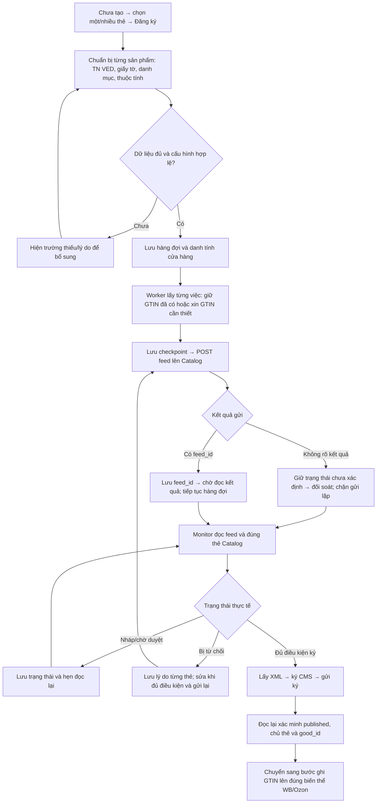
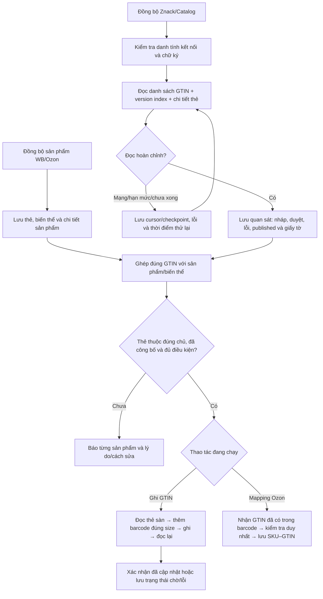

> Báo cáo nghiên cứu trước khi triển khai. Việc tích hợp tiếp theo được ghi trong [báo cáo thay đổi](../fixes/2026-10-22-znack-workflow-parity.md).

# Wbcode mới nhất: luồng đăng ký Znack và đồng bộ

Đối chiếu ngày 22.10.2026, giờ Moscow. API GitHub Latest hiện trả **v1.3.11**, phát hành 20.10.2026 lúc 07:57:25 Moscow: https://github.com/rupphi/relatest-wcode/releases/tag/v1.3.11.

Dùng skill `find-reverse-engineered` tại `/workspace/Bancapnhat/.agents/skills/find-reverse-engineered/SKILL.md`. Tìm `wbcode` và `честный знак` không có kết quả phù hợp trong chỉ mục. Nguồn phát hành GitHub là tìm kiếm bổ sung bên ngoài chỉ mục. Repository phát hành không công bố license trong metadata; không sao chép mã bên thứ ba vào VNCode.

Lần này đọc lại các lớp dịch ngược của đúng bộ cài 1.3.11 đã xác minh trong đợt trước và đối chiếu metadata mới. Digest EXE hiện tại vẫn là `6103163af499d6d54cf08672f4b8cda33d9c29b12f35d9a7a12f872e08b314d8`; JAR được ghi nhận trước đó có SHA-256 `cfaf50305212bfd60d8839654df2d769b7180672b9a54e59dbec62bdcf3435c5`. Kiểm lại 118 file lớp đang lưu: tất cả khớp hash bản phân tích; không có file thiếu/sai. Không tải lại hay chạy bộ cài trong lần này. Đây là phân tích tĩnh, không phải source gốc đầy đủ hoặc nghiệm thu tài khoản thật.

## Đăng ký

- `RegistrationDraftPreparer.prepareSnapshot`: thẻ mới lấy TN VED từ characteristics của sản phẩm. Với thẻ cũ có `good_id`, mã đọc classification đã xác minh của Catalog; không tự đổi danh tính thẻ cũ để khớp giấy tờ. Danh mục/schema được đọc theo TN VED; giấy tờ được chọn/kiểm riêng.
- `RegistrationRunner.enqueue`: kiểm cấu hình/giấy tờ, claim và lưu queue trước khi worker chạy. Có fingerprint cấu hình/cửa hàng để chặn dùng kết nối đã đổi.
- `RegistrationRunner.start/tick`: phục hồi việc bị gián đoạn; dispatcher có hai worker theo shop và cấu hình trì hoãn tạo 5 giây. `tick` lấy việc, gọi workflow và cập nhật phase. Đây là nhịp nội bộ, không phải tốc độ được Catalog bảo đảm.
- `ZnackNationalCatalogService.submit`: có POST feed thật và bắt buộc `feed_id` không rỗng. `feed_id` chỉ là biên nhận; published được xác minh riêng.
- Monitor publication được hẹn lại sau mỗi lượt hoàn tất, khoảng nghỉ 15 giây. Không thể tiếp tục gửi HTTP khi tiến trình đã tắt hẳn; queue được phục hồi khi app chạy lại.
- Lỗi mạng/hạn mức được hẹn lại; kết quả cấp GTIN/gửi feed/gửi ký chưa rõ có trạng thái riêng, không coi timeout là quyền tạo lại.
- Ozon lưu checkpoint `SUBMISSION_UNCERTAIN` trước gửi và `PROCESSING` sau nhận feed; tiếp tục đọc, ký, xác minh publication rồi bind barcode.

## Đồng bộ và ghi GTIN

- `ZnackProductService.syncPass`: đọc danh sách, version index và chi tiết; `ZnackCatalogSyncStore` lưu checkpoint/cache theo kết nối/shop. Có xử lý riêng cửa sổ listing 10.000 GTIN. Cơ chế này chưa phải bằng chứng đã đọc đủ mọi GTIN của mọi tài khoản trên 10.000.
- `ZnackGtinAutoSync` phân biệt SYNCING/WAITING/SUCCEEDED/FAILED và lưu `retryAtMillis`.
- `RegistrationPublication`: published đòi `good_signed=true`, `good_status=published` và không có trạng thái xung đột. Khả năng dùng KIZ xét thêm cờ mark/turn.
- `RegistrationPublicationMonitor.writeBack`: đọc WB → kiểm GTIN đã ở đúng size → giữ dữ liệu thẻ khi thêm barcode → kiểm quyền/checkpoint/kết nối → ghi → đọc lại WB.
- `OzonGtinMappingSyncService.syncAndMap`: đồng bộ Ozon → kiểm chữ ký → làm mới Catalog nếu đủ điều kiện → nhận GTIN đã có trong barcode → xác minh → lưu mapping SKU–GTIN → báo sản phẩm chưa map. Mapping không đồng nghĩa tạo thẻ hoặc ghi barcode mới lên sàn.

| Lô thấy trong mã Wbcode 1.3.11 | Kích thước |
|---|---:|
| `ZnackNationalCatalogService.signBatch` | Tối đa 10 good_id/lần ký |
| Đối soát GTIN Catalog trong publication monitor | 25 GTIN/lô |
| Nhóm thẻ WB trong publication monitor | 50 nmID/lô |

Ba con số thuộc ba bước khác nhau. 50 là lô nội bộ Wbcode, không phải giới hạn tối đa API WB.

## Giới hạn tự sửa lỗi và điểm cần giữ cho VNCode

`RegistrationPublicationMonitor.retryRejectedPayload` có nhánh bỏ `good_images` khi ảnh bị từ chối và bỏ `is_kit` khi Catalog cấm kiểu комплект. Nhánh này yêu cầu tìm được `good_id` dương, đối chiếu ID, kiểm chủ thẻ và chuẩn bị cập nhật thẻ cũ; thiếu ID thì báo “National Catalog card is not available yet”. Vì vậy không được lấy Wbcode làm bằng chứng rằng mọi lỗi 0/N đều tự được sửa hoặc đã tạo được thẻ.

Các nguyên tắc nên giữ: hàng đợi đã lưu và tự tiếp tục; tách tạo/duyệt/ký/ghi GTIN; không báo thành công chỉ do nhận feed; không gửi lại yêu cầu chưa rõ kết quả; xác minh đúng article/màu/size/chủ; đọc lại sàn sau ghi; báo lỗi từng thẻ và thời gian chờ. Luồng đồng bộ chỉ đọc/ghép dữ liệu, không thay cho thao tác Đăng ký.

Không chạy Wbcode, không dùng API key seller, không tạo/ký thẻ hoặc ghi GTIN thật, không thay đổi mã nguồn hay phát hành VNCode trong đợt báo cáo này.

Bằng chứng lớp đang lưu: `/workspace/reports/wbcode-1.3.11-study-20261021/decompiled/`. Các điểm gọi được đọc trực tiếp: RegistrationRunner, RegistrationDraftPreparer, ZnackNationalCatalogService, RegistrationPublication, RegistrationPublicationMonitor, OzonZnackRegistrationService, ZnackProductService, ZnackCatalogSyncStore, ZnackGtinAutoSync, OzonGtinMappingSyncService.
