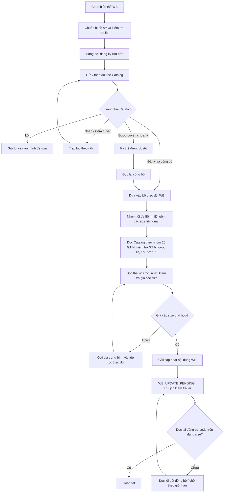
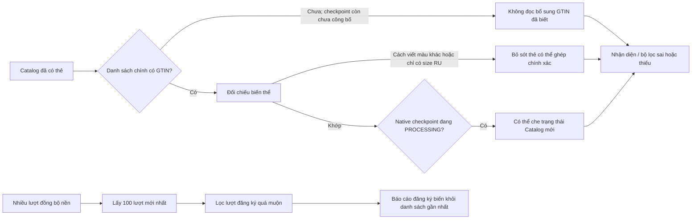
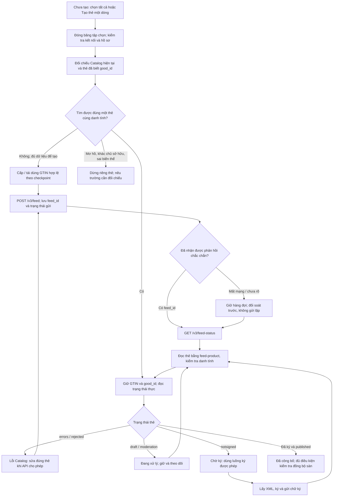
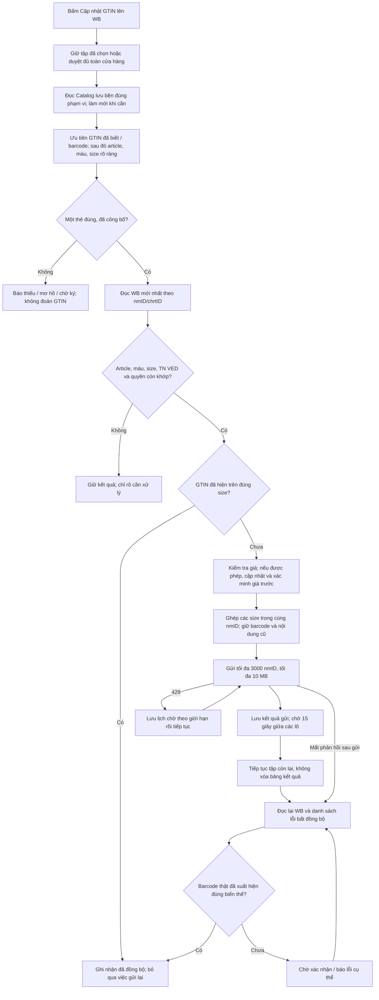
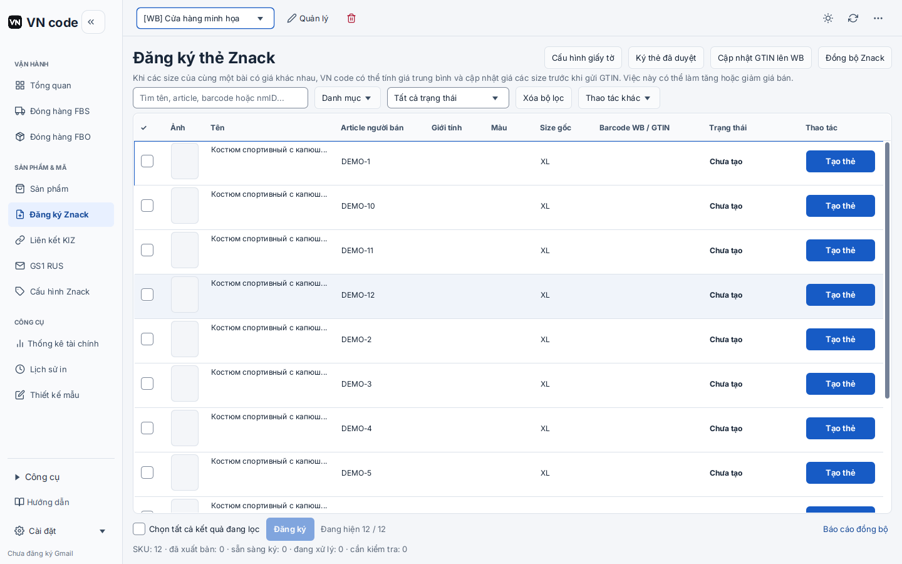
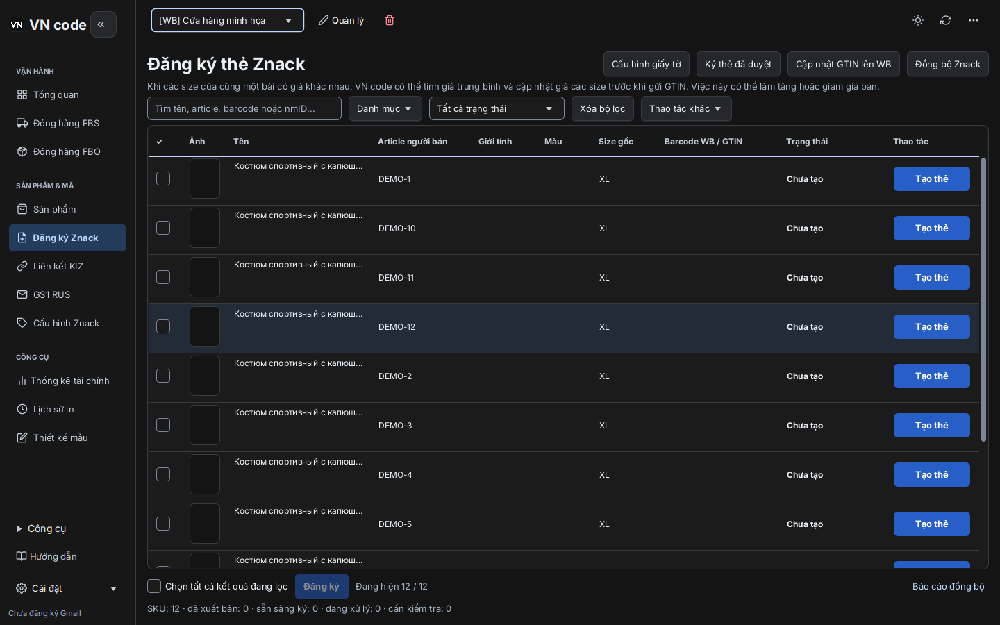
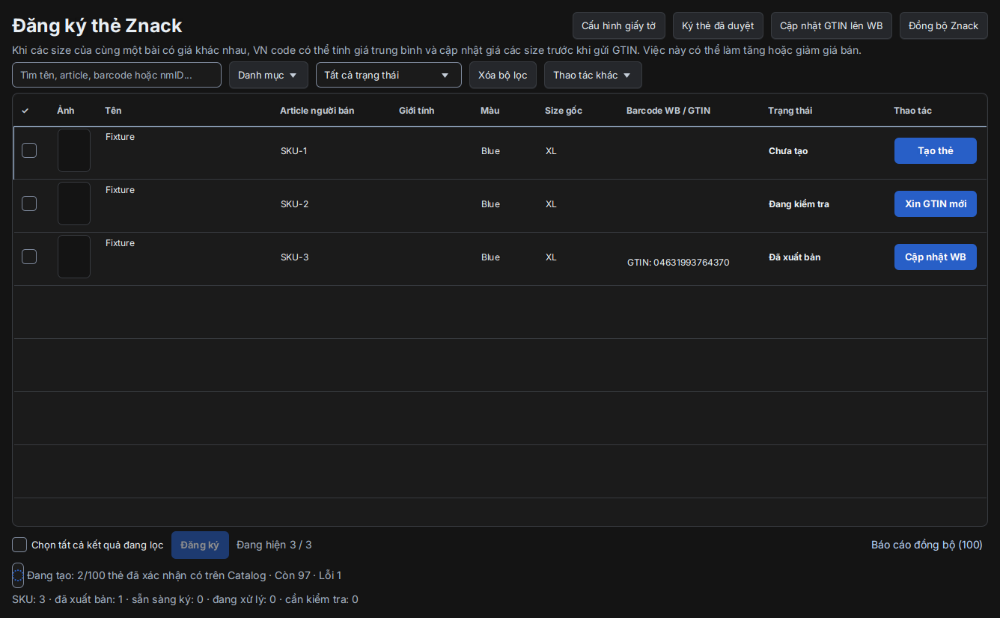

# Đăng ký Znack và đồng bộ GTIN: WBCode 1.3.18 / VN Code 1.6.3

Ngày kiểm tra: 05.11.2026 UTC. Nguồn VN Code: `d9af0b9`, kế thừa bản đã phát hành 1.6.3; phần sửa ở nhánh `fix/znack-state-wb-gtin-20261105`. Báo cáo này không phải biên nhận phát hành hay biên nhận ghi lên sàn.

## Kết quả chính

Đã sửa việc trạng thái hàng đợi cũ che kết quả Catalog mới, bổ sung đọc trực tiếp thẻ đã biết `good_id`, thống nhất quy tắc màu/size giữa nhận diện và ghi GTIN, sửa mất màu WB khi API trả chuỗi, và đưa báo cáo đồng bộ nền ra khỏi danh sách mặc định. Một vùng tiến độ thay cho hai thông báo trùng; các chức năng phụ có nút **Thao tác khác** nhìn thấy được ở WB và Ozon.

Không thể coi mọi bài WB chưa có GTIN là lỗi gửi API. Trong dữ liệu API hiện có, nhiều bài chưa ghép được đúng danh tính hoặc khác nhóm TN VED. Phải phân biệt **không tìm được thẻ đúng**, **đã gửi yêu cầu**, **đã đọc được thẻ**, **đã công bố**, và **barcode đã xuất hiện ở đúng biến thể WB**.

## Bằng chứng và phạm vi

| Nguồn | Đã kiểm tra | Giới hạn |
|---|---|---|
| WBCode mới nhất tại thời điểm đối chiếu | Bản công khai [1.3.18](https://github.com/rupphi/relatest-wcode/releases/tag/v1.3.18), công bố 04.11.2026 07:18:18 UTC; trích xuất JAR và đọc các lớp đăng ký, theo dõi công bố, đồng bộ, UI | Phân tích tĩnh; không chạy nghiệp vụ WBCode trên tài khoản thật. Một phương thức do trình dịch ngược không khôi phục được hoàn toàn, nên không suy diễn mọi nhánh xử lý giá |
| VN Code | Mã nguồn, SQLite tạm, kiểm thử JavaFX, hàng đợi và adapter thật của ứng dụng với HTTP mô phỏng | Không chứng minh kiểm duyệt hoặc ghi thật thành công trên máy seller |
| WB và Catalog thật | Đọc đủ các trang WB; đọc danh sách Catalog và chi tiết 25 GTIN/lượt; chạy bộ đọc/ghép hiện tại trên bản chụp JSON | Chỉ đọc; không tạo/ký thẻ, không sửa giá, không ghi GTIN. Tập API trong môi trường không được mặc định là mọi cửa hàng trên máy seller |
| UI | TASTE, Impeccable; ảnh JavaFX native sáng/tối, kiểm tra vùng danh sách, nút phụ và tiến độ | Impeccable chỉ quét regex đối với Java/FXML; kiểm tra bố cục dựa thêm vào render và test native, không gọi đó là kiểm tra DOM đầy đủ |

WBCode EXE SHA-256: `3ae5b292022913cfbeda1155ed2d4a881a613233bd1a05ae606e6a9b5e86364d`.

JAR trích xuất SHA-256: `f0e0c3a01d34a5f6116f0260778a064b948658739237baa5afe9999fef0f70de`.

Không đưa binary hay mã dịch ngược WBCode vào repository. Các sửa đổi VN Code được viết độc lập theo hành vi và kiểm thử.

## Đối chiếu luồng

| Khâu | WBCode 1.3.18 quan sát được | VN Code trước sửa | VN Code sau sửa |
|---|---|---|---|
| Dữ liệu đầu vào | Sản phẩm sàn, hồ sơ từng biến thể, kho trạng thái Catalog lưu bền | Hai nguồn có biên nhận, cache theo cửa hàng/doanh nghiệp/chứng thư | Giữ nguyên phạm vi và dữ liệu cũ |
| Tìm thẻ | Kho Catalog/version index và danh tính GTIN/good ID; kiểm tra chủ sở hữu | Chỉ đọc bổ sung những GTIN cục bộ đã `PUBLISHED` ngoài danh sách chính | Đọc cả thẻ đã biết `good_id`, kể cả chưa ký/đang xử lý; một GTIN vừa cấp chưa đủ để coi là có thẻ |
| Màu/size | Có lưu metadata biến thể; không đủ bằng chứng để khẳng định mọi cách viết màu đều được ghép | Index so màu nghiêm ngặt khác quy tắc adapter; thiếu size gốc làm bỏ qua size RU đã có | Chung bảng màu tương đương có giới hạn; size RU chỉ dùng nếu Catalog ghi loại size Nga và WB có chính size đó; không đổi XL thành 52 bằng suy đoán |
| Tiến độ Catalog | Hàng đợi và trạng thái thẻ được theo dõi riêng | Checkpoint cũ có thể che lỗi/chờ ký vừa đọc từ Catalog | Quan sát Catalog có danh tính và mới hơn được dùng để hiển thị; yêu cầu đang gửi/chưa rõ kết quả vẫn phải đối soát feed trước khi thử lại |
| Công bố | Kiểm tra `good_status`, `good_signed`, trạng thái chi tiết; logic được đọc nghiêm ngặt với bản nháp/sửa đổi | VN có phân biệt bản công bố và bản sửa nháp | Giữ phân biệt: bản công bố có sửa đổi nháp không đồng nghĩa toàn bộ thẻ chưa tồn tại |
| WB GTIN | Bộ theo dõi lấy nhóm tối đa 50 nmID; đọc Catalog theo nhóm 25 GTIN; đọc WB, xử lý giá, gửi và đọc lại | Đã có chia lô 3.000 nmID/10 MB, cách 15 giây, giữ dữ liệu và đọc lại | Giữ cơ chế lô; sửa đầu vào ghép để các biến thể hợp lệ đi tới bộ gửi; không hạ điều kiện đúng article/màu/size/TN VED |
| Lịch sử báo cáo | UI trạng thái chính và chi tiết theo tác vụ | Lấy 100 lượt gần nhất trước rồi mới lọc loại; nhật ký nền làm mất lượt seller; 20 cột luôn hiện | SQL lọc đúng chủ sở hữu và loại trước phân trang. Mặc định lượt đăng ký/sửa/GTIN, 7 cột chính; mở thêm lịch sử nền/chi tiết kỹ thuật khi cần |
| Thao tác UI | Trạng thái chính, hành động theo dòng | Tiến độ vừa nổi trên bảng vừa lặp dưới bảng; tùy chọn nằm trong menu chuột phải tiêu đề | Một vùng tiến độ dưới bảng; nút Thao tác khác; giữ chọn tất cả, đăng ký từng thẻ/theo lô, ký, sửa, tiếp tục/dừng và xuất báo cáo |

### Sơ đồ WBCode quan sát từ mã 1.3.18

Các mốc 50 nmID và 25 GTIN ở trên là nhóm xử lý nội bộ nhìn thấy trong `RegistrationPublicationMonitor`, không phải khẳng định giới hạn chung cho mọi endpoint Catalog.

### Những chỗ VN Code có thể hiển thị sai trước sửa

### Luồng VN Code sau sửa: đăng ký tới công bố

`feed_id` chứng minh có yêu cầu để theo dõi; `good_id` là danh tính cần đọc; cả hai riêng lẻ đều không chứng minh đã công bố hay đã ghi WB. Chỉ một quan sát Catalog mới, đủ danh tính mới thay checkpoint cũ ở giao diện. Nếu feed còn đang gửi/chưa rõ kết quả, trạng thái card cũ không cho phép tự gửi lại.

### Luồng VN Code sau sửa: cập nhật GTIN WB

Đã đọc lại [tài liệu WB chính thức](https://dev.wildberries.ru/api/swagger/yaml/en/02-items.yaml) ngày 05.11.2026: `/content/v2/cards/update` tối đa **3.000 nmID**, **10 MB**, giới hạn **10 yêu cầu/phút**, khoảng cách **6 giây**, burst 5. VN giữ khoảng nghỉ 15 giây theo yêu cầu trước; vẫn dùng bộ giới hạn tốc độ. Tài liệu nói rõ HTTP 200 chưa đủ, phải đọc lại và xem lỗi cập nhật.

## Đối chiếu dữ liệu API thật, chỉ đọc

| Phép đo | Kết quả |
|---|---:|
| Bài WB / biến thể | 388 / 1.982 |
| Thẻ Catalog đọc đủ chi tiết | 1.380 |
| Đã công bố | 1.260 |
| Nháp: chờ ký / nháp thuần / lỗi | 117 / 2 / 1 |
| Biến thể ghép duy nhất trước / sau sửa màu | 248 / 263 |
| Trong 263 biến thể ghép được: công bố / chờ ký | 229 / 34 |
| GTIN của 229 biến thể công bố đã thấy trên WB / chưa thấy | 1 / 228 |
| Trong 229 biến thể, nhóm TN VED tương thích | 25 |
| Biến thể chưa tìm được danh tính khớp | 1.719 |
| Trong toàn bộ biến thể, chưa có article tương ứng chính xác trong tập Catalog | 1.533 |

15 biến thể được nhận diện thêm là màu `зеленый` trên WB và `ЗЕЛЁНЫЙ` trên Catalog, với article và size đã đối chiếu. Đây là tương đương chính tả; không dùng so tên gần giống, không bỏ sắc độ màu hoặc tự quy đổi size.

228 trường hợp đã có thẻ công bố nhưng chưa có barcode trên WB **không đồng nghĩa 228 trường hợp đã đủ điều kiện ghi**: 204 trong 229 biến thể khớp danh tính có nhóm TN VED khác nhau. 25 trường hợp tương thích nhóm vẫn phải kiểm tra mã đầy đủ, chứng từ, quyền, giá và dữ liệu mới nhất ở bước ghi. Không đổi TN VED hoặc gán chéo GTIN để làm đẹp số hoàn tất.

Dữ liệu đếm: [JSON tổng hợp](../validation/2026-11-05-znack-readonly-identity-counts.json). JSON chi tiết seller giữ ngoài repo; không có key, mã KIZ hay danh sách định danh seller trong báo cáo này.

## Các thay đổi trong mã

- `RegistrationCardIndex`: dùng chung đối chiếu màu/size; ưu tiên quan sát Catalog có danh tính và mới hơn checkpoint khi phù hợp; giữ chặn yêu cầu chưa rõ kết quả và dữ liệu khác chủ sở hữu.
- `ZnackRegistrationQueryRepository`, `OzonRegistrationPane`: truyền thời điểm checkpoint để tính đúng bộ lọc. `OzonCardRegistrationRepository.Row` đọc `updated_at` vốn đã lưu; không đổi schema.
- `NationalCatalogGtinSource.ownedKnownGtins`: đọc bổ sung thẻ có `good_id` trong đúng phạm vi, không chỉ `PUBLISHED`; không xem cấp GTIN là tạo thẻ thành công.
- `GtinMatchingService`, `GtinCatalogIndex`, `OzonSkuGtinMatcher`, `ZnackAutoSyncService`: cùng bảng tương đương màu; dùng size RU rõ ràng ngay cả khi thiếu size gốc. Trường hợp nhiều thẻ trùng danh tính vẫn yêu cầu đối chiếu.
- `ProductRepository`: không làm mất màu WB khi giá trị API là chuỗi thay vì mảng.
- `SyncRunRepository.listOwned`, `RegistrationSyncReportDialog`: lọc chủ sở hữu/loại trước LIMIT; vẫn mở được báo cáo theo ID cũ; giữ đầy đủ dữ liệu kỹ thuật và CSV.
- Controller/FXML WB và pane Ozon: bỏ tiến độ nổi trùng với footer; nút Thao tác khác thay chức năng chỉ tìm được bằng menu chuột phải; không đổi theme đã duyệt.

## Kiểm chứng và cách thao tác

Kiểm thử mới tái hiện ba lỗi màu/size trước sửa: 26 ca chạy, 3 thất bại đúng nguyên nhân. Sau sửa, nhóm nhận diện, query, báo cáo, UI WB và tự động ghép: **166/166** đạt. Các nhóm bổ sung và kết quả cuối được ghi ở [bàn giao](../validation/2026-11-05-znack-reconcile-handoff.md).

Ca **10.000 biến thể WB** dùng planner/adapter/SQLite thật của app và API mô phỏng: đủ 4 lần ghi, không quá 3.000 nmID/lượt, đọc lại đủ 10.000, mở lại không ghi lặp; có xác minh khoảng nghỉ 15 giây giữa lô. Thời gian chạy test khoảng 203 giây không phải dự báo tốc độ API trên cửa hàng thật. [Biên nhận mô phỏng](../validation/2026-11-05-znack-wb-10000-mock.json).

Thao tác chính được giữ: **Chưa tạo → chọn tất cả hoặc từng thẻ → Đăng ký → theo dõi một vùng tiến độ → xem thẻ Đang xử lý / Chờ ký / Lỗi Catalog → ký và xác minh công bố → Cập nhật GTIN lên WB**. Lỗi dữ liệu hoặc thiếu mapping có lý do riêng; không tự biến thành Catalog từ chối.

Ảnh sau sửa dùng dữ liệu minh họa, chụp từ JavaFX thật:

## Nghiệm thu còn cần khi phát hành

Chưa thực hiện ghi/ký Catalog hoặc GTIN thật trong lượt này; chưa build/cài Windows và chưa thay Latest. Việc kiểm duyệt do Catalog quyết định. Để nghiệm thu ghi thật, cần chọn biến thể có danh tính và TN VED hợp lệ, xác nhận phạm vi sửa giá nếu có, gửi rồi đọc lại đúng `nmID/chrtID`. Không dùng việc nhận HTTP 200 hoặc test mô phỏng để tuyên bố toàn bộ bài seller đã cập nhật.
