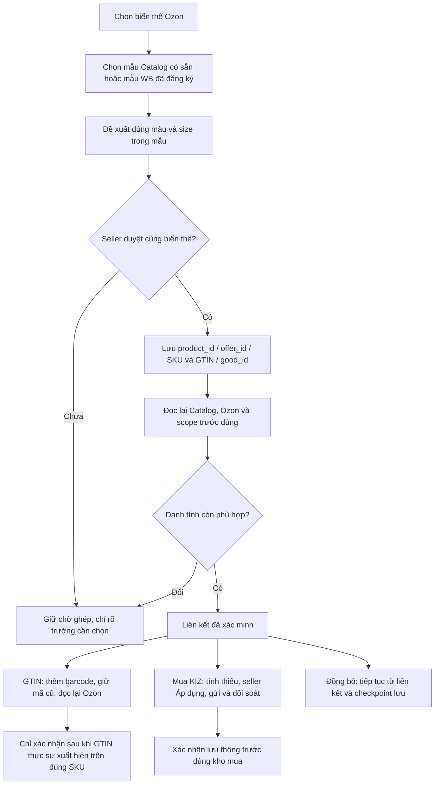

# Ozon/Catalog khác tên và SKU nhưng cùng biến thể — kiểm quy tắc và đề xuất

Ngày **07.11.2026, MSK (UTC+03:00)**. Theo yêu cầu chủ dự án: sau khi hoàn tất bản gộp 1.6.5 chưa phát hành, kiểm quy tắc KIZ mapping Ozon và đề xuất cho cùng sản phẩm/cùng size được ghi tên, article/SKU khác nhau. Mục đích dùng chung liên kết để mua KIZ, đồng bộ sản phẩm và đẩy GTIN.

**Đây là đề xuất sau đọc source, chưa thay quy tắc ghép tự động, ghi liên kết seller hoặc gửi GTIN thật.** Bản sửa PDF được ghi riêng. Không đưa 1.6.5 lên Latest.

## 1. Đang nhận diện bằng gì

| Đường xử lý hiện có | Điều kiện chính | Tên/SKU khác có dùng được không? |
| --- | --- | --- |
| `OzonCatalogMappingService` | Đọc barcode thật của đúng sản phẩm Ozon, đối chiếu thẻ Catalog hiện hành; publication, owner/scope, trade unit, màu, size, giấy tờ; đọc mới barcode trước ghi proof. | **Có**, nếu đúng GTIN đã có trên Ozon. Không đòi tên Catalog bằng tên bài Ozon hoặc article hai bên bằng nhau. SKU Ozon dùng xác định đúng sản phẩm trong cửa hàng, không phải SKU của Catalog. Khác TN VED đã được phép ở service này. |
| Chưa có GTIN trên Ozon | Service không tự suy GTIN từ tên. Lựa chọn cũ chưa được đọc thấy trên Ozon có thể trả `GTIN_NOT_ON_OZON`. | Tên khác không tự tạo ra liên kết. Không nên đổi tên/SKU chỉ để vượt điều kiện này. |
| `WbOzonGtinMatcher.match` | Tự đề xuất từ barcode chung; nếu chưa có, dùng article chuẩn hóa bằng nhau; vẫn kiểm màu/size và xung đột. | Hai article khác hoàn toàn thường ra `NO_SAFE_MATCH` ở đường tự động dù seller biết là cùng hàng. |
| `evaluatePair` / `evaluateManualBatch` | Seller chọn mẫu WB, ghép biến thể Ozon theo màu/size và thẻ Catalog của mẫu; cặp luôn cần duyệt. | Đã hỗ trợ article khác nhau. Không cần tên bài WB/Ozon giống nhau. |
| `OzonExistingCardLinkService` | Đọc mới Catalog/Ozon, xác nhận good_id/GTIN, published/signed/trade unit/owner, màu/size; seller duyệt rồi lưu `OzonReviewedGtinLinks`. | Không so article/tên hai bên, nhưng **vẫn có gate TN VED bằng nhau** ở bước đọc review. |
| `WbOzonLinkRepository` và `WbOzonGtinDispatchService` | Lưu native ID, GTIN/good_id, owner/scope, revision và chứng cứ cặp đã duyệt; đọc lại trước gửi/khôi phục. | Có liên kết thủ công bền vững; không coi “đã lưu liên kết” là “GTIN đã lên Ozon”. |
| `KizCrossMarketplaceProof` / `KizPurchaseMappingProof` | Kiểm liên kết WB/Ozon đã duyệt, quan sát hiện hành và proof tại lúc sử dụng. Chỉ liên kết đã duyệt chưa tự trở thành proof đặt mua/dành kho. | Có thể gặp `KIZ_CROSS_PURCHASE_REVIEW_REQUIRED`; việc sửa tên bài hoặc trùng size không thay thế xác nhận liên kết phục vụ mua. |

**Điểm chưa nhất quán cần xử lý nếu triển khai phương án mới:** service mapping mua đã bỏ so TN VED, nhưng `WbOzonGtinMatcher.mismatch` và `OzonExistingCardLinkService.read` vẫn có điều kiện TN VED. Một liên kết có thể vượt bước mapping nhưng bị chặn ở review/dispatch phía sau. Không nên chỉ đổi thông báo lỗi hoặc bỏ một gate ở UI.

## 2. Phương án đề xuất: ghép một lần với thẻ Catalog có sẵn

**Ưu tiên liên kết trực tiếp Ozon ↔ thẻ Catalog theo từng biến thể đã được seller xác nhận.** Nếu thẻ đã đăng ký từ WB, WB chỉ là nguồn hỗ trợ chọn mẫu. Không cần đăng ký GTIN mới hoặc đi qua WB mỗi lần mua/in khi Catalog đã có thẻ đúng.

Một liên kết phải giữ:

- Cửa hàng, owner/scope doanh nghiệp và nguồn Catalog.
- Catalog: `good_id`, GTIN và dấu vết quan sát/publication/giấy tờ.
- Ozon: `product_id`, `offer_id`/article người bán và SKU số do Ozon cấp.
- Mẫu hàng, màu và size thực; danh tính biến thể đã được người dùng duyệt.
- Chứng cứ, thời điểm duyệt và các thay đổi quan trọng cần đọc lại.

**Tên bài và cách ghi article là bí danh mô tả.** Chúng giúp tìm kiếm/đề xuất, không làm khóa nối duy nhất. Cùng một size cũng chưa đủ: hai mẫu khác nhau, hai màu hoặc hai thành phần tạo hai danh tính sản phẩm không được gộp chỉ vì đều ghi XL.

## 3. Thao tác cho seller

1. Chọn một hoặc nhiều biến thể Ozon, mở **Ghép thẻ Catalog có sẵn**. Dùng lại cơ chế review/link hiện có; nếu chọn từ WB thì dùng bước chọn mẫu của “Ghép GTIN từ WB”.
2. Chọn đúng mẫu Catalog. App đề xuất các cặp màu/size trong mẫu đó, hiển thị hai bên cạnh nhau để duyệt cả nhóm. Tên và article được phép khác.
3. Seller xác nhận **cùng một biến thể thực tế**. Lưu liên kết một lần theo native ID, không dựa vị trí danh sách hoặc tên gần giống.
4. Khi cập nhật GTIN, app đọc lại đúng sản phẩm, kiểm xung đột rồi `v1/barcode/add`, giữ barcode cũ; chỉ ghi “đã lên Ozon” sau readback đúng `product_id`/SKU.
5. Khi mua KIZ, cùng liên kết đã xác minh cấp proof cho đúng biến thể và thẻ Catalog published. Bảng mua vẫn yêu cầu Áp dụng cho số lượng thiếu; dùng TN VED/giấy tờ Catalog. Không bắt phải có barcode trên Ozon nếu liên kết Catalog và quyền mua đã được xác minh đầy đủ.
6. Khi mở lại app hoặc đồng bộ, dùng liên kết đã lưu và cập nhật phần thay đổi. Đổi danh tính/owner/size/màu/good_id cần xem lại; sửa cách trình bày tên không nên bắt ghép lại toàn danh mục.

Ví dụ minh họa, không phải dữ liệu seller: Catalog ghi “Модель A, черный, XL”, article `MODEL-A`; Ozon ghi “Áo mẫu A màu đen”, article `AO-A-DEN-XL`, SKU số khác. Seller chọn mẫu A, app xác nhận cùng màu đen và size XL rồi lưu đúng cặp ID. Không cần sửa article Ozon thành `MODEL-A`.

## 4. Chuẩn hóa và quyết định theo từng trường hợp

| Khác biệt | Cách xử lý đề xuất |
| --- | --- |
| Hoa/thường, khoảng trắng, dấu phân cách hoặc đơn vị có đối chiếu rõ | Chuẩn hóa để tìm kiếm; giữ nguyên giá trị thật trên sàn. |
| Dịch tên bài hoặc article/SKU người bán khác hoàn toàn | Seller chọn đúng mẫu và duyệt cặp; lưu alias/native ID. Không tự gộp chỉ theo tên gần giống. |
| `XL` và `52` | Chỉ ghép khi metadata size nhà sản xuất/size Nga hoặc bảng đối chiếu đã xác minh chứng minh cùng cỡ. Không tự suy XL = 52 cho mọi sản phẩm. |
| Màu viết khác ngôn ngữ | Dùng từ điển/alias rõ nghĩa; sắc độ khác hoặc nhiều khả năng cần chọn. |
| TN VED khác | Theo quyết định mới cho mapping mua KIZ: được phép; giữ mã Catalog cho mua. Trước khi triển khai, cần thống nhất các gate còn lại trong matcher/review/adapter, có hồi quy riêng. |
| GTIN đã ở sản phẩm Ozon khác | Báo đúng sản phẩm đang giữ GTIN, xử lý xung đột riêng; không đánh dấu ghi thành công hoặc tự gán sang sản phẩm khác. |
| Thẻ Catalog chưa published, giấy tờ thiếu hoặc khác chủ | Giữ liên kết để theo dõi/hoàn thiện, chưa cấp proof mua hợp lệ hoặc coi GTIN đã đồng bộ. |
| Đổi offer_id/SKU | Đọc native `product_id` và metadata để xác minh trước cập nhật liên kết; không tự coi ID mới là bí danh của ID cũ. |

## 5. Luồng dùng chung

Trạng thái nội bộ “liên kết đã duyệt”, “proof mua hợp lệ” và “GTIN đã trên Ozon” là ba bằng chứng khác nhau. Có thể dùng chúng trong báo cáo/tooltip hiện có, không cần thêm lại nhiều bộ lọc trạng thái Znack.

## 6. Phần cần làm nếu chọn triển khai

- Tái sử dụng `OzonReviewedGtinLinks`/review và bảng liên kết WB–Ozon; không tạo một bộ mapping theo tên tách biệt với mua KIZ.
- Đưa quy tắc danh tính đã duyệt thành một bộ dùng chung cho mapping, purchase proof và GTIN dispatch; giữ kiểm source/owner/độ mới/xung đột. Kiểm TN VED phải nhất quán với quyết định cho phép khác mã, không bỏ qua kiểm Catalog tự thay danh tính.
- Tách fingerprint phần danh tính khỏi thay đổi trình bày để tránh mất liên kết chỉ vì đổi tiêu đề; đổi product/variant/màu/size/chủ sở hữu vẫn yêu cầu xác minh.
- Đồng bộ theo lô đúng giới hạn API, giữ checkpoint/cache và đọc lại phần cần ghi, không quét lại mọi bài cho từng đơn in.
- Nghiệm thu: ghép hai tên/article khác; restart giữ cặp; mua đúng GTIN; GTIN xuất hiện đúng SKU; khác màu/size không gửi; mất phản hồi không gửi trùng; một cặp lỗi không chặn các cặp hợp lệ.

Chưa sửa schema hoặc bật tự liên kết để hiện thực hóa đề xuất này. Cặp credential mới do chủ dự án cung cấp đã đọc được API Ozon thật (roles HTTP 200 và danh mục/đơn hàng). Kiểm PDF và nhận đơn gilet được ghi ở biên bản riêng; chúng không chứng minh đã lưu mapping mua hoặc đẩy GTIN Ozon. Cặp Secrets cũ của môi trường chưa được xác nhận đã cập nhật; không ghi credential vào tài liệu/Git. Thay đổi schema cho journal nhận đơn, nếu có trong bản 1.6.5, thuộc luồng nhận đơn riêng, không phải triển khai đề xuất mapping này.

Nguồn đã đọc: [mapping Ozon](../../src/main/java/com/vncode/app/features/kizmapping/OzonCatalogMappingService.java), [matcher WB/Ozon](../../src/main/java/com/vncode/app/features/gtinsync/WbOzonGtinMatcher.java), [review thẻ có sẵn](../../src/main/java/com/vncode/app/integration/znack/registration/OzonExistingCardLinkService.java), [liên kết đã duyệt](../../src/main/java/com/vncode/app/integration/znack/registration/OzonReviewedGtinLinks.java), [bảng liên kết](../../src/main/java/com/vncode/app/features/gtinsync/WbOzonLinkRepository.java), [dispatch](../../src/main/java/com/vncode/app/features/gtinsync/WbOzonGtinDispatchService.java), [proof KIZ](../../src/main/java/com/vncode/app/features/kiz/KizCrossMarketplaceProof.java).
