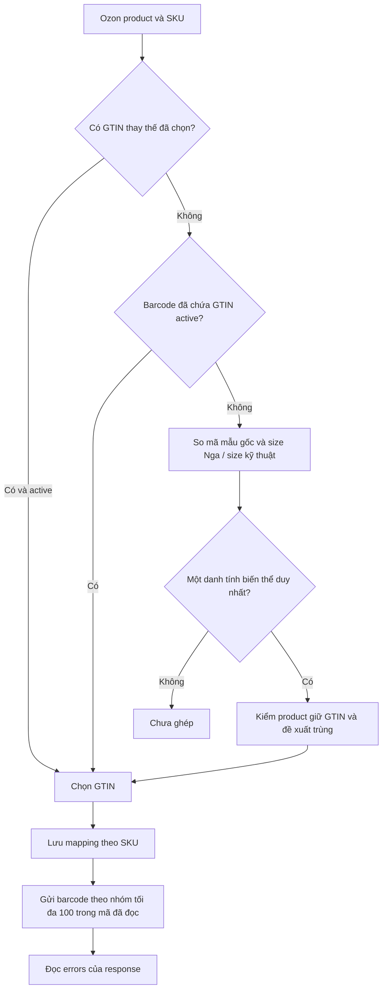
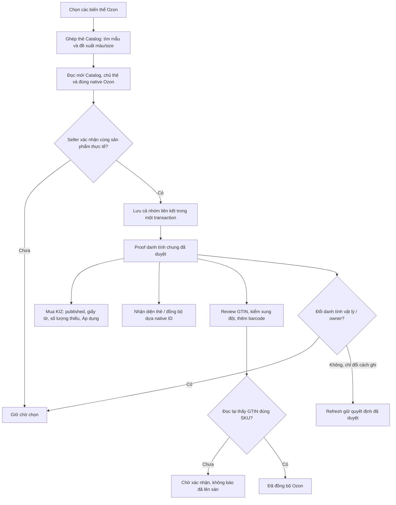

# Đối chiếu WBCode 1.3.20 — cùng sản phẩm Ozon/Catalog nhưng khác tên và mã người bán

Quan sát ngày **07.11.2026**. Dùng Code Doctor, OpenQodex và skill REA; phạm vi là nhận diện thẻ, mapping mua KIZ và cập nhật GTIN Ozon. Không thay quy tắc nhận đơn/KIZ WB. [Bàn giao triển khai VN Code](../validation/2026-11-07-ozon-reviewed-variant-handoff.md).

## Nguồn và phương pháp

- GitHub Releases xác nhận bản WBCode mới nhất là **[v1.3.20](https://github.com/rupphi/relatest-wcode/releases/tag/v1.3.20)**, công bố `2026-11-06T10:46:35Z`, tức **06.11.2026 13:46:35 MSK**. Không dùng bản 1.3.18 cũ làm đại diện cho Latest.
- Tải asset công khai `WCode.exe` (149.613.568 byte), kiểm SHA-256 với digest/checksum release: `4c07dd9742ec7464c3dd1db17551db9014d1c16e474618a243b702e43451371a`.
- REA MCP không có trong công cụ phiên này. Dùng 7-Zip 25.01 để trích MSI/CAB và CFR 0.152 để đọc tĩnh các class liên quan. JAR ứng dụng có SHA-256 `e2ed6a7b1e9844ce95746afe3f9c6a15a11ce8a9bdb39339e6ea8b83e0aa51ab` và 1.370 class. **Không chạy WBCode, installer hoặc license; không nghiệm thu API bằng ứng dụng WBCode.**
- Sáu class được đối chiếu bytecode đều giống bản 1.3.18 từng nghiên cứu. Điều này chỉ áp dụng sáu class, không khẳng định toàn bộ ứng dụng không đổi. [Biên nhận hash và phạm vi](../validation/ozon-reviewed-20261107/wbcode-reference.json).
- Binary và mã giải biên dịch chỉ nằm trong thư mục phân tích riêng ngoài Git. Tài liệu này mô tả hành vi quan sát được; triển khai VN Code được viết trên các service/repository vốn có, không chép mã WBCode.

## Hành vi thấy trong WBCode mới nhất

| Điểm quan sát | Bằng chứng tĩnh | Ý nghĩa cho yêu cầu |
| --- | --- | --- |
| Ưu tiên liên kết/GTIN có sẵn | `OzonZnackMappingService.verifiedMappings`: mã thay thế đã chọn cho native product, rồi GTIN active nằm trong barcode Ozon, rồi mới tìm theo danh tính | Không bắt đăng ký lại chỉ vì tên Ozon khác tên Catalog. |
| Ghép khi chưa có GTIN trong barcode | `match`, `hasWholeBaseArticle`, `preferredSameVariant`: mã mẫu gốc chuẩn hóa, size Nga; size kỹ thuật có sẵn phải nhất quán. Chọn mã trong cùng một danh tính biến thể | Không thấy cơ chế chứng minh hai article hoàn toàn khác nhau chỉ bằng tên gần giống hoặc cùng size. |
| Xung đột | Theo dõi product đang giữ barcode; loại đề xuất GTIN mới cùng lúc cho nhiều SKU. Nhánh mã thay thế có thứ tự ưu tiên riêng | Cần khóa cặp đúng native ID, kiểm GTIN đã thuộc bài khác, không gộp hai mẫu cùng size. |
| Lưu quyết định | `OzonProductGtinMappingRepository` và màn `OzonGtinMappingEditor` lưu theo SKU/quy tắc article | Cần quyết định đã lưu thay vì tìm lại theo tên mỗi lần mua. |
| Đọc thẻ Catalog để tiếp nhận | `OzonMarketplaceGtinAdoption` chia nhóm **25 GTIN**, kiểm scope tài khoản và thẻ/giấy tờ | Đây là kích thước đọc thấy trong mã WBCode, không phải kết luận giới hạn chính thức toàn API Catalog. |
| Đẩy barcode | `publishBarcodes` chia nhóm **100 binding**, gọi `addBarcodes` và kiểm `errors` trong response | Đây là nhóm ghi barcode Ozon trong WBCode, không phải lô tạo thẻ Catalog. Trong chính phương thức này không thấy lượt đọc lại; chưa kết luận về mọi đường gọi khác của WBCode. |

**Kết luận đối chiếu:** có thể kế thừa cách tổ chức GTIN/native SKU và theo dõi xung đột. Trường hợp tên/article khác hoàn toàn vẫn cần seller xác nhận đúng mẫu thực tế. Không có bằng chứng trong phần mã đã đọc để tự coi mọi bài cùng màu/size là cùng sản phẩm.

## Chênh lệch VN Code tìm thấy và cách xử lý

Trước sửa, VN Code đã có review thẻ có sẵn và bảng `ozon_reviewed_gtin_links`, nhưng proof dùng riêng cho adapter GTIN. Mua KIZ còn đi theo registration hoặc barcode; matcher vẫn dựa article/size. Fingerprint cũ bao gồm nhiều nội dung trình bày. Vì vậy một cặp seller đã chọn có thể dùng được ở một bước nhưng bị báo thiếu mapping ở bước khác; khác nhóm TN VED trong review cũng có thể chặn yêu cầu đã cho phép khác mã.

| Tình huống | VN Code sau sửa trong 1.6.5 |
| --- | --- |
| Tên/article Catalog khác tên/article Ozon | Seller chọn đúng cặp trong **Ghép thẻ Catalog**, đọc mới cả hai bên và xác nhận. Lưu `shop/owner/source + product_id/offer_id/SKU + GTIN/good_id`. Không sửa tên/article trên sàn. |
| Mua KIZ trước khi barcode được đưa lên Ozon | Cặp trực tiếp đã duyệt, thẻ published còn mới và giấy tờ hợp lệ cấp proof mua đúng native SKU. Lấy TN VED/giấy tờ từ Catalog. Lưu cặp không tự mua KIZ. |
| Khác TN VED giữa hai bên | Cho phép ở đường liên kết native đã duyệt, mua và dispatch tương ứng. Catalog vẫn cần mã đầy đủ cho mua. Matcher cũ chưa có quyết định ghép vẫn giữ gate cũ; không nới toàn bộ danh mục. |
| Thẻ đã chọn nhưng chưa có barcode trên Ozon | Hiển thị riêng số **đã ghép, chờ cập nhật Ozon**; không tính là đã đồng bộ. |
| Bản ghi đăng ký hoặc barcode cũ | Cặp seller vừa duyệt có ưu tiên thống nhất ở nhận diện thẻ, mua và đồng bộ. Không xóa lịch sử registration hoặc barcode cũ. Cặp hết hiệu lực không được âm thầm rơi về mã cũ. |
| Chỉ đổi tiêu đề/cách viết article mô tả | Sau đọc lại, fingerprint danh tính vật lý không đổi nên không cần duyệt lại. Đổi native offer ID/SKU, màu, size, category, thương hiệu/thành phần/thuộc tính vật lý thì không dùng lại quyết định cũ. |
| Ghi barcode trả HTTP 200 | Vẫn chờ đọc lại đúng `product_id/offer_id/SKU`; giữ barcode trước đó. Chỉ ghi APPLIED sau khi GTIN thực sự hiện trên Ozon. |
| Mở lại ứng dụng | Dùng quyết định/cache lưu cục bộ có owner/scope. Refresh phần hết hạn trong lượt có giới hạn; không tự tái duyệt danh tính đã đổi. |

### Sơ đồ luồng tham chiếu WBCode

Sơ đồ mô tả thứ tự thấy trong các phương thức đã đọc; không thay thế kiểm chứng ứng dụng WBCode đang chạy hoặc hợp đồng API chính thức.

### Sơ đồ VN Code triển khai cho khác tên/article

Số ca, nguồn build, ảnh và giới hạn nghiệm thu của triển khai được lưu trong [bàn giao](../validation/2026-11-07-ozon-reviewed-variant-handoff.md). Nhận thật chín đơn gilet ở lượt trước là bằng chứng luồng nhận đơn riêng, **không** phải bằng chứng đã mua KIZ hoặc ghi GTIN bằng liên kết mới.
