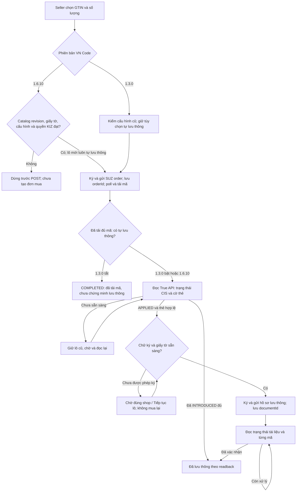
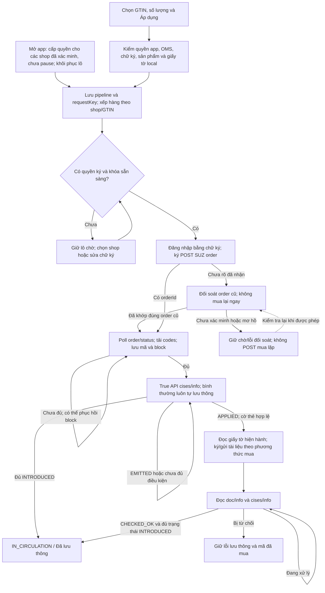

# Đối chiếu mua KIZ: VN Code 1.3.0, VN Code hiện tại và WBCode mới nhất

Kiểm tra ngày **16.11.2026, giờ Moscow**. Đã đọc đúng nguồn hai bản VN Code, đối chiếu binary WBCode chính thức và chạy bốn ca kiểm thử hiện hữu bằng dữ liệu tổng hợp. Không sửa mã ứng dụng, chạy WBCode, mua KIZ, ký CryptoPro hoặc gửi API nghiệp vụ thật.

## Kết luận

**Đã tìm thấy các khác biệt giải thích vì sao hai app có thể cho kết quả khác nhau; chưa có bằng chứng một giao dịch mua mới thất bại do POST mua bị đổi sai.** Payload tạo đơn, endpoint SUZ và AuthService của VN Code 1.3.0 so với 1.6.10 vẫn giữ cùng cấu trúc. Các điểm khác đáng chú ý nằm ở kiểm tra trước mua, định nghĩa hoàn tất và khả năng tiếp tục lô đang chờ ký.

1. **1.3.0 có nhánh tải đủ mã là “Hoàn tất”.** Khi `autoIntroduction=false` — mặc định trong cấu hình trống/giao diện cũ — coordinator chuyển `COMPLETED` ngay sau tải đủ mã. Điều đó chưa chứng minh mã đã lưu thông. 1.6.10 tạo lô mới luôn bật ý định lưu thông; WBCode 1.3.26 bình thường cũng luôn bật. Vì vậy “Hoàn tất” cũ và “Đã lưu thông” mới không phải cùng một mức hoàn thành. Không biết cấu hình thực của lượt mua cũ nên không khẳng định seller đã dùng nhánh tắt này.
2. **VN Code có thêm điểm chặn Catalog trước POST mà WBCode không có trong chuỗi mua đã kiểm.** `validatePrerequisites → KizPurchaseMappingProof.requireKnownPermit → CatalogReadRevision.requireComplete` ném `SOURCE_SYNC_REQUIRED` nếu revision sau thay đổi cấu hình Catalog chưa có lần đọc hoàn chỉnh. Sau đó còn đối chiếu bằng chứng giấy tờ của GTIN. Revision rỗng được chấp nhận theo legacy; không phải app buộc tải lại toàn bộ Catalog ở mỗi lần bấm mua. WBCode kiểm sản phẩm/giấy tờ local, và đọc registry hiện hành ở bước làm hồ sơ lưu thông sau mua. Cùng một GTIN có dữ liệu local có thể qua bước đầu WBCode nhưng bị VN chặn trước khi SUZ nhận đơn.
3. **Khôi phục nhiều cửa hàng khác nhau.** VN cấp quyền ký cho shop ban đầu rồi tiếp tục hàng đợi của tất cả shop. Shop khác có thể dừng khi cần ký/xác thực lại. WBCode trước khi khôi phục duyệt từng shop WB/Ozon, cấp quyền cho shop đã kiểm chữ ký và chưa pause/block/reconfigure. WBCode vẫn không tự gỡ pause hay bảo đảm USB token có mặt.
4. **Thông báo từng gửi xác định một điểm dừng cục bộ.** `WAITING_INTRODUCTION_READINESS` kèm `Waiting for the user to select this shop before signing.` là marker của SigningSession, không phải response SUZ từ POST mua. Ở luồng thông thường, readiness nằm sau khi đã tải đủ mã. Khi bị pause, scheduler chủ động dừng cho tới khi seller tiếp tục; kho đủ điều kiện in có thể vẫn bằng0. Log được gửi trước đây thuộc1.6.9, không phải bằng chứng nghiệm thu giao dịch mới trong lượt nghiên cứu này.
5. **Một số sửa liên quan đã có trong workspace nhưng chưa có ở Latest.** FBS public có thể tiếp tục đợi kho khi tác vụ ký đã pause. Workspace đã thêm thoát vòng chờ và Tiếp tục đúng lô ở WB/Ozon, giữ nguyên mã cũ, cùng WAL/đối soát tải mã và nguyên nhân pending. Không coi các sửa đó đã tới app seller chỉ vì source cũng ghi version1.6.10.

## Phiên bản đã ghim

| Bản | Nguồn kiểm chứng | Giới hạn |
| --- | --- | --- |
| VN Code1.3.0 | README của [Vncode](https://github.com/ntccong2468-lab/Vncode/blob/c01c5cac03a65310500109613a15032b65bb1d12/README.md) dẫn `v1.3.0-preview.1`; POM/app.version đều1.3.0; commit `7858f9c3502980c6e1d3141bbeef719c85493d04`, CI38028666240 khớp | Tag Git/nguồn/CI còn truy cập được; release API hiện404, chưa tải lại hoặc chạy bộ cài cũ. [Biên nhận](vn130/VERSION-RECEIPT.json). |
| VN Code Latest1.6.10 | Release445977967, source `b74b5edfd46636e8779c94f467eef01c03c50a14`, phát hành15.11.2026; build-info và source ZIP đúng digest GitHub | Tám tệp mua trong Git khớp source ZIP sau chuẩn hóa CRLF/LF. Build-info ghi chưa nghiệm thu mua KIZ có phí. [Phiên bản](latest-public/VERSION-RECEIPT.json), [proof nguồn](latest-public/purchase-source-proof.json). |
| VN Code workspace | HEADnền`a7c4d008…` cộng toàn bộ sửa trước; source1.6.10; baseline3.907tệp | Chưa phát hành. Đối chiếu19module phân biệt rõ phần giống public và phần mới. [Đối chiếu](current/SOURCE-COMPARISON.json). |
| WBCode Latest1.3.26 | Release446845555, phát hành16.11.2026 lúc13:14:10MSK; EXE SHA `afcd6f99f800fa1f1e83f4229ec24223becf72d0f78f90680ceb390a0bfd1d70`; JAR SHA `d10efde1c0ef6e6f8cf3e850e1dd7615966b0aa1e83082181f6c8dd26380f1b6` | Binary thật, không phải source chính thức. Trích/đọc tĩnh bằng công cụ đã xác minh; không chạy WBCode hoặc nghiệm thu mua thật. [Binary](wbcode/download-verification.json), [trích xuất](wbcode/extraction-provenance.json). |

WBCode được kiểm là **1.3.26**, không dùng báo cáo1.3.25 ngày14.11 làm bằng chứng Latest hôm nay. `target_commitish=main` của release không được gán thành một commit nguồn WBCode đã biết.

## Sơ đồ đối chiếu VN Code

Guard ký còn có thể dừng ở đăng nhập hoặc tạo lệnh mua; không chỉ ở nút SIGN. Sơ đồ nêu đường bình thường của lô mới. Hồ sơ thiếu/chứng từ bị từ chối được giữ để sửa; không phải mọi trạng thái chờ đều tự giải quyết được chỉ bằng lặp API.

[Sơ đồ đầy đủ1.3.0](vn130/purchase-v130.mmd) · [Luồng workspace và phục hồi](current/CURRENT-AUDIT.md) · [Sơ đồ pause/resume](diagrams/vn-signing-pause-resume.mmd).

## Sơ đồ mua KIZ của WBCode1.3.26

Sơ đồ mô tả đường bình thường, không khẳng định mọi lỗi mạng hoặc buffer đã đóng đều phục hồi được. Phương thức PRODUCTION dựng `LP_INTRODUCE_GOODS`, COMMISSION có tài liệu riêng; xem [sơ đồ đầy đủ/API/từng method](wbcode/REPORT.md), [Mermaid đầy đủ](diagrams/wbcode-full.mmd) và [UI/quyền ký](wbcode/ui-signing/REPORT.md).

WBCode có những kiểm tra nhẹ hơn, không nên sao chép thành báo thành công thiếu căn cứ: nhánh xác nhận dùng trạng thái/số lượng INTRODUCED, chưa thấy proof đầy đủ từng CIS và owner INN trong đường đó. **Phần owner proof bổ sung trên mọi đường hoàn tất của VN Code hiện chỉ ở workspace**, chưa có đầy đủ trong public1.6.10; public đã có ở đường quan sát legacy. Không gán các sửa chưa phát hành cho app hiện hành.

## Các điều kiện cần phân biệt khi seller nói “không mua được”

| Vị trí dừng | Điều có thể kết luận | Điều chưa thể kết luận |
| --- | --- | --- |
| Trước POST, `SOURCE_SYNC_REQUIRED` hoặc thiếu hồ sơ | App chưa cho gửi mua; kiểm revision/giấy tờ/GTIN đúng shop | Không phải SUZ đã từ chối đơn vừa gửi |
| Đã có orderId, đang chờ/tải | SUZ đã tạo đơn; phải tiếp tục đúng đơn, tránh mua trùng | Chưa chắc đã tải đủ mã hoặc đã lưu thông |
| Readiness + marker chọn shop | Tác vụ cần ký đã bị pause cục bộ; xem hồ sơ gốc và nguyên nhân CryptoPro | Không chứng minh POST mua thất bại; marker cũng có trong bản cũ/WBCode |
| EMITTED, thẻ chưa sẵn sàng, giấy tờ chưa xác minh | Bước lưu thông chưa đủ điều kiện, kho in có thể vẫn0 | Không được đổi thành “Đã lưu thông” chỉ để hết chờ |
| Buffer CLOSED/EXHAUSTED hoặc mất response cấp mã | Cần đọc/khôi phục block đúng đơn nếu server cho phép | Không bảo đảm tải được mọi block, không tạo đơn mua mới vô điều kiện |

Không thấy bước usage/apply-report riêng trong luồng đã kiểm của ba app. Vì điều kiện APPLIED đã có từ1.3.0 khi bật lưu thông và cũng có trong WBCode, **không có căn cứ gọi đây là API mới bị VN Code bỏ quên gây regression**. Cần hợp đồng ngành/phản hồi thật nếu tiếp tục điều tra trạng thái EMITTED.

## Hướng xử lý phù hợp, chưa triển khai trong lượt này

1. Tách rõ “đã đặt mua”, “đã tải mã”, “chờ ký”, “chờ giấy tờ” và “đã lưu thông”; hiển thị mã lô/số mã đã lưu/nguyên nhân chờ. Kho0 không đồng nghĩa phải mua lại.
2. Tham khảo WBCode về khôi phục các shop/lô đã được cho phép và đã xác minh. Giữ pause/reconfiguration và danh tính hồ sơ gốc; không tự gỡ lỗi chữ ký hoặc cấp quyền ký mới cho lô chưa được phép.
3. Đối với gate Catalog, xem xét proof riêng GTIN trong **đúng nguồn cấu hình/doanh nghiệp mới**, thay vì buộc chờ quét đầy đủ nếu đã có bằng chứng đủ cho GTIN đó. Không dùng cache từ trước khi đổi credential để bỏ qua kiểm tra.
4. Giữ các sửa FBS thoát vòng bận/tiếp tục đúng lô, WAL và readback owner đang có trong workspace cho lần phát hành tiếp theo. Không phục hồi nhánh tải xong báo lưu thông hoặc làm yếu xác minh CIS để bắt chước thành công của app khác.

Đây là đề xuất từ đối chiếu; lượt này chưa sửa sản phẩm hoặc tự phát hành.

## Kiểm chứng đã chạy và bảo toàn

- Đọc Git/CI/GitHub release, đối chiếu source commit và digest; tám tệp mua public khớp source ZIP sau chuẩn hóa line ending.
- WBCode EXE/JAR kiểm digest/CRC; đọc CFR và đối chiếu bytecode bằng javap. Chỉ thực thi công cụ phân tích đã xác minh, không thực thi WBCode.
- **4/4 ca kiểm thử hiện hữu đạt**,0failure/error/skip,exit0: hai cấu hình autoIntroduction đều tạo lô mới có ý định lưu thông; pause không mở signer/không tự schedule; tiếp tục đúng lô không mua lại và giữ mã đã tiêu thụ. Dùng class hiện tại đã đối chiếu source, Maven offline direct surefire, không tuyên bố fresh build hoặc mua thật. [Kết quả](verification/RESULT.json), [lệnh](verification/command.json), [phạm vi](verification/README.md).
- 7.705 tệp chứng cứ kiểm thử trước và nguồn/class không bị tác vụ kiểm thử sửa. [Kiểm kê toàn bộ baseline](preservation.json) chốt nguồn ứng dụng/config/test giữ nguyên, chỉ thêm nghiên cứu và cập nhật ba tài liệu memory.
- Đã dùng REA, Code Doctor và ECC review theo hướng dẫn Markdown. Không cài hook/plugin vào app hoặc dependency hệ thống.

Chưa chạy VN Code1.3.0/WBCode trên Windows, chưa nghiệm thu CryptoPro, tài khoản SUZ, số dư, cấp mã thật hoặc lưu thông thật của seller. Không có log mua mới để quy mọi trường hợp lỗi vào cùng một nguyên nhân. Các sơ đồ có độ tin cậy cao cho nhánh mã/bytecode đã đọc; chúng không thay kết quả giao dịch thật.

Nguồn bổ sung: [VN1.3.0 chi tiết](vn130/REPORT.md), [VN hiện tại](current/CURRENT-AUDIT.md), [WBCode1.3.26 chi tiết](wbcode/REPORT.md), [bản pin nghiên cứu](versions.json).
