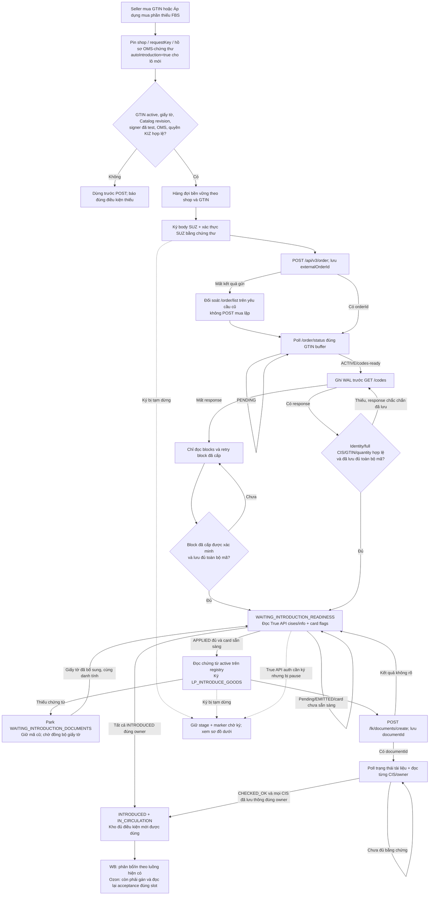
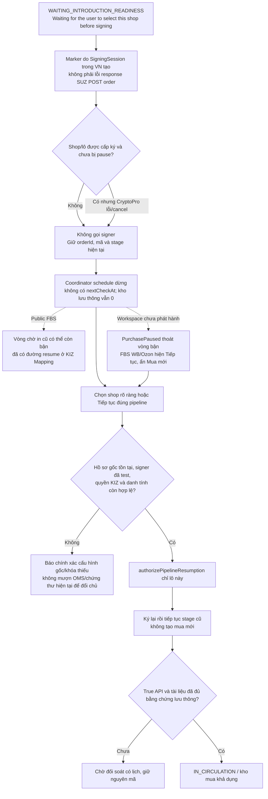

# VN Code hiện tại: kiểm tra tĩnh luồng mua KIZ và điểm dừng

Phạm vi: nguồn `/workspace/vncode-ios-motion-20261114`, nền `a7c4d008ae450a82b6cfbfbb79e5532eca6bfa1e` cộng mọi chỉnh sửa có sẵn; đối chiếu nguồn public 1.6.10 `b74b5edfd46636e8779c94f467eef01c03c50a14` ở `../latest-public/source`. Nguồn 1.3.0 Preview do agent chuyên trách pin ở `../vn130/source`; báo cáo provenance chính của agent đó là căn cứ phiên bản. Lượt này không sửa mã, không chạy app/CryptoPro/Maven, không đọc hồ sơ seller, không mua hoặc ghi API thật.

## Kết luận có căn cứ

1. **Thông báo `Waiting for the user to select this shop before signing.` là marker tạm dừng ký do VN Code tạo cục bộ**, không phải phản hồi mua hàng từ SUZ. Điều kiện nằm trong `ZnackSigningSession.guarded`: chưa có quyền ký của shop/lô, lô đã chờ ký, hoặc shop đang bị chặn sau lỗi CryptoPro. Marker có thể kèm mã nguyên nhân `[CRYPTOPRO_…]`. Guard cùng thông báo đã tồn tại ở 1.3.0; không được nói đây là guard vừa thêm làm hỏng bản mới.
2. **“Hoàn tất” của 1.3.0 có nghĩa khác nếu tắt autoIntroduction.** Bản cũ `completeDownloadedCodes` dòng610–615 và `checkIntroductionReadiness` dòng631–634 chuyển `COMPLETED` ngay sau tải mã khi `autoIntroduction=false`. Bản hiện tại bắt buộc ý định lưu thông cho mua mới: `enqueueForCirculation` dòng148–149, lưu snapshot `expected.withAutoIntroduction(true)` trong repository dòng758–762. Tải mã xong luôn sang readiness; lô cũ tắt auto chỉ được đọc đối soát, không tự gửi chứng từ mới. Do đó không thể so “Hoàn tất cũ” với “Đã lưu thông hiện tại” như cùng một tiêu chí.
3. **Bộ auth và gửi đơn của bản public 1.6.10 giống nguyên byte workspace hiện tại.** SHA đối chiếu19 tệp trong [SOURCE-COMPARISON.json](SOURCE-COMPARISON.json) xác nhận `ZnackAuthService`, `ZnackSigningSession`, queue, safety, `ZnackKizOrderService`, repository, inventory, API client, mapping proof và `KizMappingController` không đổi giữa public và workspace. Coordinator chỉ giữ lại thông báo pending thay vì xóa nó. Không có căn cứ tĩnh để kết luận một thay đổi mới đã làm hỏng `POST /order` của mọi lô.
4. **Có các sửa chưa phát hành ảnh hưởng trực tiếp cảm giác “mua bị đứng”.** Public FBS chờ số mã khả dụng nhưng không tháo vòng chờ khi chữ ký bị pause. Workspace thêm `PurchasePaused`, quét đúng lô đang chờ, thoát vòng in, hiển thị Tiếp tục ở cả WB/Ozon và không mua mới. Nó cũng thêm WAL/kiểm danh tính whole-package ở download và giữ đúng nguyên nhân khi đang đối soát. Không được coi các sửa này đã có trong app public chỉ vì version nguồn cũng ghi1.6.10.
5. **Chưa có lỗi API thật mới để gán nguyên nhân hiện tại.** Log chữ ký được cung cấp trước đây thuộc1.6.9, không phải lần mua mới đang được nghiệm thu. Nó khoanh đường tạm dừng ký hậu tải theo thiết kế FSM; cần orderId, số mã đã lưu và nguyên nhân CryptoPro của đúng lần lỗi mới để kết luận giao dịch thực đã đến đâu. Đây là phân tích nguồn, không xác nhận tài khoản seller đã mua/lưu thông thật.

## Các điều kiện dừng hiện có

| Vị trí | Điều kiện chính xác | Hậu quả | Mức kết luận |
| --- | --- | --- | --- |
| Coordinator556–581, MappingProof33–55 | GTIN chưa active/đúng shop, chứng từ thiếu, hoặc Catalog credential revision mới chưa được đọc hoàn tất (`SOURCE_SYNC_REQUIRED`) | Dừng trước tạo pipeline/gửi đơn. Revision rỗng được chấp nhận theo legacy; không phải mọi lần mua đều bắt buộc đọc toàn Catalog từ đầu | Nhánh code xác nhận; chưa thấy lỗi này trong lần mua mới của seller |
| Safety14–20, order buy25–44 | Chưa test signer, thiếu omsConnection/omsId, cryptcp không dùng được, license KIZ không có | Không gửi đơn hoặc tạm dừng đúng boundary | Nhánh code xác nhận |
| SigningSession64–86 | Recovered job chưa được cấp ký, đang waiting, hoặc signer từng lỗi/cancel và shop bị chặn | Persist marker ở stage cũ; không mở CryptoPro lặp mỗi poll | Khớp loại thông báo lịch sử; không chứng minh lỗi signer mới |
| CodeService23–72,81–110 | Mất response của GET cấp mã, payload thiếu/sai identity, thiếu mã, CLOSED/EXHAUSTED | Đối soát lại block đã cấp trên đơn cũ; không tự mua lại | Sửa WAL/identity mới chỉ ở workspace; server có thể chưa cho phục hồi block |
| Readiness44–99/CisReadback55–57 | Mã không phải APPLIED hoặc INTRODUCED; card chưa goodMarkFlag/goodTurnFlag; readback thiếu/sai | Chờ30giây rồi đối soát tiếp, kho khả dụng chưa tăng | Guard này đã có ở1.3.0 autoIntro=true và WBCode; không phải regression mới |
| Introduction25–59 | Không đọc được chứng từ đang active từ registry hoặc chữ ký tài liệu lỗi | Park/chờ metadata hoặc chờ ký; không đánh dấu thành công bằng HTTP200 | Nhánh code xác nhận |
| Confirm105–137/Readiness25–41 | Chưa đủ toàn bộ CIS INTRODUCED thuộc đúng owner gốc | Kho mua chưa AVAILABLE để in | Điều kiện thành công hiện tại; chặt hơn “tải xong” cũ |
| Repository305–334/Coordinator441–447,284–299 | Pipeline đã lưu hồ sơ OMS/chứng thư gốc | Đổi cấu hình hiện tại không tự đổi chứng thư/OMS của lô mua trước; resume dùng hồ sơ gốc | Điều kiện thiết kế xác nhận, không gọi đó là lỗi đã tái hiện |

`APPLIED` không phải bước mới: 1.3.0 autoIntro=true cũng kiểm APPLIED/INTRODUCED; WBCode1.3.26 cũng có nhánh tương tự theo agent kiểm binary. Không thấy endpoint usage-report/apply trong VN hiện tại, nhưng không có bằng chứng hợp đồng light-industry yêu cầu VN phải gửi thêm endpoint đó. Vì vậy không kết luận “thiếu usage report” là nguyên nhân.

## Sơ đồ mua hiện tại

Lô legacy `autoIntroduction=false` đi từ readiness sang **chỉ quan sát lưu thông**, không đi sang ký/gửi tài liệu mới. Không được dùng chữ “legacy false” để quay lại COMPLETED giả cho mã chưa lưu thông.

## Sơ đồ marker đang gặp và tiếp tục đúng lô

## Kiểm thử tối thiểu đề xuất cho parent

Không chạy Maven trong nhánh audit này. Ba method sẵn có, không thêm test và không ghi API thật:

- `ZnackCirculationPolicyTest#everyNewPurchasePinsCirculationWithoutChangingTheGlobalPreference` — hai parameter cases, pin autoIntro=true vào lô nhưng không sửa global settings.
- `ZnackSigningRecoveryTest#pausedPaidReadinessDoesNotOpenSignerOrScheduleAutomaticRetries` — marker giữ dữ liệu, không signer/poll, stock0.
- `ZnackSigningRecoveryTest#foregroundResumeKeepsPaidIdentityRawCodesAndConsumedInventory` — resume đúng lô cũ, không mua lại, không làm mã CONSUMED thành AVAILABLE.

Tổng dự kiến4 invocation, phải lấy số thực từ kết quả nếu parent chạy. Đây là test signer/HTTP tổng hợp, không phải chứng nhận CryptoPro Windows, số dư thật hoặc nhận mã thật.

## Khuyến nghị cho bước sửa sau khi người dùng duyệt

Ưu tiên phân tách UI “Đã đặt mua / đã tải mã / đang chờ ký / đã lưu thông”, hiển thị orderId, số mã lưu bền, nguyên nhân pause và nút tiếp tục lô cũ. Không bỏ guard ký vốn đã có ở1.3.0, không dùng COMPLETED thay cho bằng chứng lưu thông, và không mua lại chỉ vì kho khả dụng bằng0. Nếu chứng thư đã đổi, cần một luồng chuyển hồ sơ có xác minh cùng owner/OMS cho lô đang chờ; không âm thầm thay snapshot gốc. Các sửa chưa phát hành về FBS pause/resume và download WAL cần giữ trong bản phát hành kế tiếp theo yêu cầu riêng; lượt này chỉ phân tích.

## Bằng chứng nguồn chính

Các số dòng dưới đây là nguồn workspace tại lúc kiểm, không phải số dòng binary WBCode hoặc mã chính thức1.3.0:

- `ZnackSigningSession.java:21,64–86,94–120`: marker, điều kiện guard, cấp ký theo lô/shop.
- `ZnackPurchaseCoordinator.java:114–174,284–313,441–553`: entry/consent, bound context, chuyển stage, bắt lỗi.
- `ZnackPurchaseCoordinator.java:556–581,653–819,822–895,915–939`: preflight, poll/download, readiness, introduction, scheduler.
- `ZnackRepository.java:298–334,735–765`: giữ hồ sơ gốc và ý định lưu thông theo pipeline.
- `HomeController.java:1319–1429,1875`: khởi động chọn shop, cấp ký shop đầu tiên, explicit shop selection/resume.
- `KizMappingController.java:322–372,550–584`: mua, phát hiện pause và resume; tệp này giống public1.6.10 nguyên byte.
- `KizPrintPurchaseSession.java:79–138`: chờ in và PurchasePaused mới ở workspace.
- `SupplyDetailController.java:715–752,915–940`; `OzonDashboardController.java:1515–1550,1650–1682`: nút tiếp tục trong FBS chưa phát hành.
- `ZnackGtinInventoryService.java:108–139`: AVAILABLE + IN_CIRCULATION + owner/source constraints; mã tải về nhưng chưa lưu thông không tính kho in.

Độ tin cậy cao cho các nhánh code và khác biệt SHA đã kiểm. Không có nhật ký mua mới/HTTP thực, token SUZ còn hiệu lực hoặc chứng thư Windows trong phạm vi; không thể dùng phân tích này để bảo đảm mua thành công với mọi điều kiện server.
