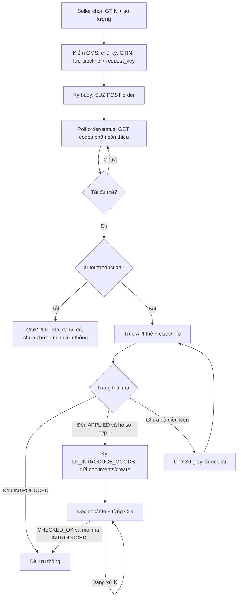

# Đối chiếu VN Code 1.3.0 với bản phát hành mới nhất — mua KIZ

Kiểm tra nguồn ngày 16.11.2026. Chỉ nghiên cứu tĩnh và xác minh nguồn Git/CI; không chạy app cũ, mua KIZ, ký CryptoPro, gửi API nghiệp vụ hoặc sửa mã ứng dụng. Kết luận về hành vi server thật vẫn cần dấu vết của giao dịch đang lỗi.

## 1. Đã tìm đúng bản người dùng chỉ

Repo `ntccong2468-lab/Vncode` hiện có tag/release 1.1.33 và 1.1.34. **README của chính repo này dẫn “VN code 1.3.0 Preview” tới `Bancapnhat/v1.3.0-preview.1`.** POM của bản này ghi cả `version` và `app.version` là **1.3.0**, nên khớp số phiên bản hiển thị trong app, không phải tự thay bằng 1.1.33.

- README Vncode: commit `c01c5cac03a65310500109613a15032b65bb1d12`, bản sao [linked-repo-README.md](linked-repo-README.md).
- Tag Git còn truy cập được: `v1.3.0-preview.1` → **`7858f9c3502980c6e1d3141bbeef719c85493d04`**.
- API CI run `38028666240` trả HTTP200, `completed/success`, `head_sha` đúng commit trên.
- Release API của preview hiện HTTP404; không có plain tag `v1.3.0`. Không tuyên bố đã tải hoặc kiểm lại bộ cài cũ. Tài liệu gốc ghi SHA EXE và kiểm Windows, đồng thời nói chưa nghiệm thu bằng chứng thư/shop thật.
- Nguồn cũ đã được `git archive` đúng commit; tar SHA-256 `f238809fc79d8a733f7cf278c9bbc013679887d0a7b781a6dd343e0db4da2c15`.

[Biên nhận phiên bản](VERSION-RECEIPT.json) · [API phiên bản/CI](bancapnhat-version-api-checks.json) · [tag remote](remote-tags.txt).

Bản phát hành mới được parent xác minh độc lập: **1.6.10**, release445977967, source **`b74b5edfd46636e8779c94f467eef01c03c50a14`**. Bản source hiện đang sửa có HEAD nền `a7c4d008…` cộng working diff và **chưa phát hành**; không gọi các sửa mới là đã có trong app seller. Build-info công bố 1.6.10 cũng ghi chưa xác minh mua KIZ có phí, nên không dùng số kiểm thử fixture làm chứng cứ mua thật.

## 2. Kết luận chính từ mã nguồn

**Khác biệt lớn nhất đã chứng minh là điều kiện được coi là hoàn tất sau khi tải mã.**

- **1.3.0:** nếu `autoIntroduction=false`, tải đủ mã là chuyển pipeline sang `COMPLETED` ngay. Chưa gọi True API để chứng minh mã đã lưu thông.
- **1.6.10:** nút mua thông thường gọi `enqueueForCirculation`, tạo lô với `autoIntroduction=true`; sau tải đủ luôn vào `WAITING_INTRODUCTION_READINESS`, kiểm trạng thái, giấy tờ, ký/gửi tài liệu rồi mới xác minh lưu thông.
- Vì vậy, “1.3.0 mua được/Hoàn tất” và “1.6.10 còn Kiểm tra mã/Chờ lưu thông” **không mặc nhiên là cùng một mức hoàn thành**. Nhánh trên giải thích được sự khác nhau về trạng thái mà chưa cần giả định POST mua của bản mới bị hỏng.
- `WAITING_INTRODUCTION_READINESS` là nhánh sau tải mã trong luồng bình thường. Thông báo `Waiting for the user to select this shop before signing.` là điểm dừng ký cục bộ; đây không phải nội dung lỗi SUZ trả về cho POST mua.

Không có log/response thật mới trong lượt này để chứng minh tất cả trường hợp “không mua được” đều cùng nguyên nhân. Nếu lỗi nằm trước `orderId` hoặc ở tải buffer, các gate khác trong bảng dưới phải được đối chiếu riêng.

## 3. Những gì giống nhau và khác nhau

| Phần | 1.3.0 | 1.6.10 phát hành | Ý nghĩa |
| --- | --- | --- | --- |
| SUZ xác thực | AuthService | Cùng file byte-identical | Không có căn cứ kết luận protocol token mới bị đổi |
| Body tạo đơn | productGroup lp, releaseMethodType PRODUCTION, GTIN, quantity, OPERATOR, templateId10, cisType | Cùng đoạn tạo payload | Đã kiểm SHA đoạn tạo body, loại đúng các dòng gate license thêm vào |
| POST mua | `/api/v3/order?omsId=…`, ClientToken, X-Signature | Cùng endpoint/header và ký body | Lõi yêu cầu phát hành mã không đổi |
| Hàng đợi | Theo shop/GTIN, tuần tự, request_key | Executor và PipelineState byte-identical | Khác biệt không nằm ở bản thân executor |
| Kết thúc tải, autoIntroduction tắt | `COMPLETED` ngay | Luôn quan sát lưu thông; enqueue mặc định bật lưu thông | Hoàn tất ở bản cũ có thể chỉ là đủ file mã |
| Ký bị khóa | Đã có AUTHORIZED_SHOPS/PIPELINES, BLOCKED_SHOPS, WAITING_PIPELINES | Giữ guard, thêm nguyên nhân CryptoPro và resume theo lô | Không được nói bản mới mới thêm chặn chọn shop |
| True API trước ký lưu thông | Khi bật autoIntroduction: APPLIED/INTRODUCED + goodMarkFlag/goodTurnFlag | Cũng có bước này, xác minh CIS identity chặt hơn; nhánh quan sát lưu thông có owner proof, nhánh allIntroduced thông thường chưa đối chiếu owner | APPLIED precheck không phải mới phát sinh ở 1.6.10; không gán mọi owner proof của workspace cho bản đã phát hành |
| App license | Không có gate Permission.KIZ trong buy | Có kiểm quyền KIZ trước tạo/ký/gửi | Có thể chặn trước mua nếu quyền không hợp lệ; không giải thích riêng log đã ở readiness |
| Giấy tờ/mapping | Dựa GTIN/product có permit khi auto bật | Thêm known-permit mapping proof và lưu profile gốc theo đơn mua | Cần phân biệt thiếu hồ sơ với lỗi SUZ |
| Poll buffer | Gộp các record, không bắt buộc GTIN riêng | Chọn đúng buffer GTIN, chặn thiếu/trùng/status rỗng | Response thiếu GTIN có thể bị chặn mới; chưa có response thật để quy lỗi |
| Mất phản hồi GET codes | Không có WAL ngay trước consuming GET trong service cũ | Public đã bỏ retry GET cấp mã; source chưa phát hành bổ sung WAL và đối soát package | Không sao chép hành vi cũ để tạo thành công giả/mua trùng |

**Phân biệt owner proof theo phiên bản:** public1.6.10 `checkCirculation` đã dùng kiểm owner cho đường chỉ quan sát; tuy nhiên đường `check` thông thường có thể trả `Readiness.introduced()` từ `ZnackCisReadback.inspect` khi đủ số mã, chưa dùng `inspectOwned`. Source workspace chưa phát hành bổ sung đối chiếu owner vào cả nhánh allIntroduced thông thường và bước xác nhận tài liệu. Không tuyên bố các sửa này đã có trên app1.6.10 của seller.

Bảng so hash/độ dài 12 tệp: [THREE-WAY-FILE-COMPARISON.json](THREE-WAY-FILE-COMPARISON.json). Kiểm tĩnh tự động: [STATIC-CHECKS.json](STATIC-CHECKS.json).

## 4. Sơ đồ bản 1.3.0

Sơ đồ đầy đủ có nhánh tạm dừng ký: [purchase-v130.mmd](purchase-v130.mmd). Đối chiếu hai phiên bản: [purchase-v130-vs-public-latest.mmd](purchase-v130-vs-public-latest.mmd).

## 5. Nguồn cụ thể, có thể đối chiếu lại

Các đường dẫn dưới là nguồn archive đúng bản, không phải dòng decompile:

- 1.3.0 `ZnackPurchaseCoordinator.java`: `enqueue`130–149; xử lý SigningDeferred407–411; sau tải610–626; auto=false hoàn tất631–634; readiness637–655; scheduler736–756.
- 1.3.0 `ZnackSigningSession.java`45–61: đã có shop/pipeline authorization, CryptoPro lỗi làm BLOCKED_SHOPS;66–80 cho cấp lại quyền; không persist trạng thái này qua process.
- 1.3.0 `HomeController.java`1160–1188: chọn shop explicit và shop ban đầu cấp quyền ký, sau đó resume đúng hàng đợi.
- 1.3.0 `ZnackIntroductionReadinessService.java`25–66,145–169: trước ký, kiểm mã APPLIED/INTRODUCED và hai flag thẻ; không có bước usage/apply-report trong nhóm phương thức mua này.
- 1.3.0 `ZnackIntroductionService.java`15–50,64–91: đọc giấy tờ, ký LP_INTRODUCE_GOODS, kiểm lại tài liệu và tất cả mã; `CISES_MAX_CODES_PER_REQUEST=1000`.
- Public1.6.10 `ZnackPurchaseCoordinator.java`142–173: ép ý định lưu thông cho lô mua;765–819: không kết thúc chỉ bằng tải đủ;916 trở đi scheduler còn guard chờ ký.
- Public1.6.10 `ZnackKizOrderService.java`25–47: gate license bao quanh cùng payload;59–79: poll đúng GTIN buffer.

Nguồn gốc 1.3.0: [commit7858f9c](https://github.com/ntccong2468-lab/Bancapnhat/tree/7858f9c3502980c6e1d3141bbeef719c85493d04). Public1.6.10: [commitb74b5ed](https://github.com/ntccong2468-lab/Bancapnhat/tree/b74b5edfd46636e8779c94f467eef01c03c50a14).

## 6. Hướng xử lý phù hợp sau khi duyệt báo cáo

Giữ kiểm đúng mã/GTIN/owner, chống mua trùng, journal và chỉ báo đã lưu thông sau readback. Không phục hồi nhánh `COMPLETED` chỉ vì tải xong để che lỗi.

Tách rõ trạng thái “SUZ đã nhận đơn / đã tải mã / chờ ký / đã gửi tài liệu / đã lưu thông”. Với lô đang dừng, tiếp tục **đúng orderId và profile gốc**, hiển thị nguyên nhân CryptoPro thực; không tạo đơn mua mới. Đối chiếu nhánh autoIntroduction và grant của lô sau restart/chọn shop. Bản source đang sửa đã có một số sửa pause/stock/WAL và owner proof cho mọi đường hoàn tất nhưng chưa phát hành; cần công bố đúng phạm vi sau kiểm chứng nếu người dùng yêu cầu, không coi chúng đang có trên app hiện hành.

Lượt này không chỉnh production code, không chạy lại bộ test app hoặc gọi SUZ/Catalog thật. Các kiểm tra Python/Git/API GitHub chỉ xác minh nguồn và hành vi tĩnh, không thay thế nghiệm thu mua KIZ có phí.
