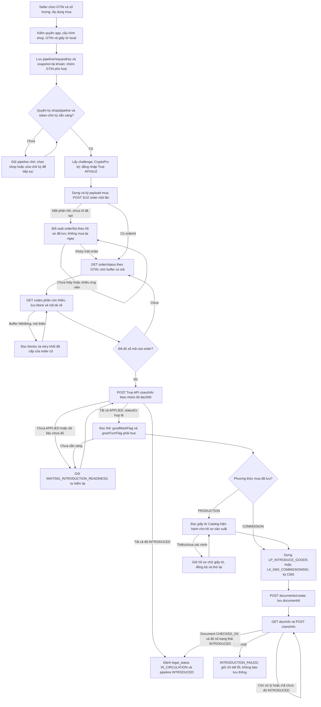

# WBCode mới nhất: luồng mua KIZ — 16.11.2026

Đã kiểm **WBCode v1.3.26**, bản Latest chính thức khi đọc lúc **23:14 MSK ngày 16.11.2026**, phát hành **13:14:10 MSK cùng ngày**. Phạm vi là phân tích tĩnh bộ cài thật: không chạy WBCode, kích hoạt license, ký CryptoPro hoặc gọi API mua/ghi dữ liệu.

## Phiên bản và bằng chứng

- [Release chính thức](https://github.com/rupphi/relatest-wcode/releases/tag/v1.3.26), release ID `446845555`.
- `WCode.exe`: **149.650.432 byte**, SHA-256 `afcd6f99f800fa1f1e83f4229ec24223becf72d0f78f90680ceb390a0bfd1d70`, khớp cả digest GitHub và `checksums.sha256` chính thức.
- JAR trong PE → MSI → CAB: **5.614.068 byte, 1.383 class**, SHA-256 `d10efde1c0ef6e6f8cf3e850e1dd7615966b0aa1e83082181f6c8dd26380f1b6`.
- Trích bằng portable 7-Zip 25.01 chính thức, hash khớp digest GitHub; công cụ đặt riêng trong thư mục nghiên cứu, không cài vào hệ thống. CFR 0.152 lấy từ Maven Central, kiểm SHA-256 theo checksum công bố; chỉ chạy công cụ đọc class. Dùng `javap -p -c` JDK25 đối chiếu bảy class lõi và các class UI/guard.
- `target_commitish=main` không chứng minh commit mã nguồn tương ứng. Các đường dẫn/dòng dưới là bản CFR cục bộ của đúng binary này, không phải mã nguồn chính thức. Method CFR giải không hoàn chỉnh được đọc qua bytecode; lỗi giải mã không phải lỗi app.

Biên nhận: [download](download-verification.json), [trích JAR](extraction-provenance.json), [7-Zip](extractor-provenance.json), [CFR](cfr-provenance.json), [javap lõi](javap/provenance.json), [UI/guard](ui-signing/evidence-inputs.json).

## Kết luận chính

**WBCode mới nhất cũng buộc tự tiếp tục tới lưu thông**, giống hướng xử lý VN Code hiện tại. `Settings.empty`, đọc/lưu settings trong repository và settings dựng từ giao diện đều đặt `autoIntroduction=true`. Hộp mua từ màn Liên kết KIZ chỉ hỏi số lượng, không có checkbox bỏ lưu thông. Nhánh legacy `autoIntroduction=false → COMPLETED` vẫn nằm trong coordinator, nhưng không phải cấu hình bình thường của bản 1.3.26.

**Cũng có guard chờ chọn cửa hàng/chữ ký**, cùng thông báo `Waiting for the user to select this shop before signing.` Đây là lý do dừng ở máy khách, không phải thông báo OMS hoặc Catalog từ chối mua. Khởi động có thể khôi phục mọi shop WB/Ozon có chữ ký đã xác minh và chưa pause; chọn shop bằng thao tác người dùng cấp lại quyền và tiếp tục pipeline. Chi tiết ở [báo cáo UI/guard](ui-signing/REPORT.md).

**Không phải tải xong là đã lưu thông.** Readiness nhận `APPLIED` với `statusEx` rỗng/`EMPTY`, hoặc toàn bộ mã đã `INTRODUCED`. `EMITTED`, mã thiếu, sai GTIN hoặc trạng thái phụ khác đều tiếp tục chờ. Khi toàn bộ `APPLIED`, app còn đọc cờ thẻ `goodMarkFlag=true`, `goodTurnFlag=true` rồi mới dựng và ký hồ sơ đưa vào lưu thông.

**Có khác biệt rõ trước khi POST mua:** WBCode chủ yếu kiểm GTIN và giấy tờ đã lưu cục bộ, không có lớp `KizPurchaseMappingProof`/`CatalogReadRevision` như VN Code hiện tại trong chuỗi mua đã kiểm. Một cửa hàng VN Code có GTIN/giấy tờ nhưng revision Catalog chưa đầy đủ hoặc bằng chứng giấy tờ cho GTIN chưa đạt có thể bị chặn trước POST, trong khi cùng dữ liệu local đi qua kiểm tra ban đầu của WBCode. Riêng `requireKnownPermit` của VN Code là gate revision Catalog và `CatalogPermitEvidence`, không phải phép kiểm article/màu/size bắt buộc cho mọi lần mua trực tiếp; proof biến thể/FBS có các caller riêng. Đây là khác biệt có căn cứ mã; chưa chứng minh đó chính là lỗi đang xảy ra trên máy seller.

**Khác biệt ở caller khởi động nhiều cửa hàng:** WBCode `HomeController$21.call` cấp quyền `authorizeVerifiedShop` cho từng shop WB/Ozon đủ điều kiện và không pause trước khi khôi phục tất cả. VN Code hiện tại `HomeController.resumeAllPersistedZnackPipelines` chỉ cấp quyền shop ban đầu được chọn, rồi coordinator vẫn duyệt mọi shop; shop còn lại có thể gặp cùng guard WAITING dù không có lỗi server. Không được suy thành “WBCode bỏ quyền ký” hoặc “mọi job bị pause đều được cấp lại quyền”: helper WBCode giữ điều kiện chứng thư đã xác minh và trạng thái pause/block.

Bytecode được đọc lại: `HomeController$21.call` offsets3–13 lấy `findAll().iterator`,19–74 lặp; offset70 gọi `authorizeVerifiedShop`, sau vòng lặp mới gọi `resumeAllPersisted` tại131/150. Helper từ chối signingPaused, thiếu chứng thư/thời điểm đã kiểm, sai loại shop, BLOCKED hoặc RECONFIGURING; không xóa pause bền vững lúc startup. [Bytecode caller](ui-signing/home-resume-all-javap.txt).

## Sơ đồ mua đầy đủ của WBCode 1.3.26

Sơ đồ rút gọn đường bình thường và các nhánh phục hồi chính. Guard chữ ký áp dụng ở mọi lần cần ký, không chỉ tại nút D. Nhánh `COMMISSION` dùng tài liệu riêng và không có toàn bộ yêu cầu metadata sản xuất; sơ đồ giấy tờ tại L mô tả `PRODUCTION`. Con số 1.000 là giới hạn guard/chunk trong binary đã đọc, không phải việc kiểm độc lập hợp đồng API hiện hành.

## Bảng bước/API/trạng thái

| Bước | API/logic quan sát | Điều kiện tiếp tục |
| --- | --- | --- |
| Đăng nhập | `GET /api/v3/true-api/auth/key`; ký challenge; `POST .../auth/simpleSignIn` cho True API hoặc `.../auth/simpleSignIn/{omsConnection}` cho SUZ | Chứng thư đã kiểm, OMS connection đúng, nhận token. True API dùng Bearer; SUZ dùng header `clientToken`. Không dùng token WB/Ozon thay token SUZ. |
| Trước mua | `validatePrerequisites`: quantity>0, GTIN production, không có purchase cùng GTIN đang chờ giấy tờ/lưu thông, có Product local; khi PRODUCTION và auto intro, có permit local; signature/OMS/CryptoPro sẵn sàng | Permit local có đủ loại/số/ngày cấp; không chứng minh đã đọc mới toàn Catalog trong bước này. |
| Tạo đơn | `POST /api/v3/order?omsId=…`, JSON `productGroup`, `attributes.releaseMethodType`, từng GTIN/quantity/serialNumberType/templateId/cisType; body ký qua `X-Signature` | Phải có order ID. HTTP200 thiếu ID vẫn lỗi; kết quả không rõ chuyển đối soát, không tự POST lại ngay. |
| Chờ/tải | `GET /api/v3/order/status`, `GET /api/v3/codes`; thiếu buffer giảm quantity theo available; đã cấp nhưng không lưu được dùng `/order/codes/blocks` và `/order/codes/retry` | Đếm mã local theo order phải đủ quantity rồi mới sang readiness. Download tạo local inventory AVAILABLE nhưng legal RECEIVED, chưa là IN_CIRCULATION. |
| Readiness | `POST /api/v3/true-api/cises/info?pg=lp` và `GET .../nk/feed-product?gtins=…` | Toàn mã APPLIED, không special status, hoặc toàn INTRODUCED. Sau APPLIED còn đòi hai cờ thẻ true. EMITTED vẫn chờ. |
| Giấy tờ và lưu thông | Đọc Registry/Catalog qua `/v4/rd-info-by-gtin`; ký payload loại PRODUCTION `LP_INTRODUCE_GOODS` hoặc COMMISSION `LK_INDI_COMMISSIONING`; `POST /api/v3/true-api/lk/documents/create?pg=lp` | Không chỉ có HTTP200: phải có document ID, lưu để đối chiếu; lỗi/mất phản hồi có nhánh hòa giải. |
| Xác nhận | `GET /api/v4/true-api/doc/{documentId}/info?pg=lp` và `POST cises/info` | Đường document cần CHECKED_OK và đủ số trạng thái INTRODUCED trước IN_CIRCULATION/INTRODUCED. |
| Nền/khởi động lại | Pipeline, order, block, document và identity được lưu SQLite; hàng đợi phân việc CREATE/RETRIEVE/INTRODUCE, guard shop/generation/pipeline | Thường 2s khi chưa lỗi; readiness/document/reconcile thường30s; closed order300s; quota có lịch riêng. Đây là lịch app, không bảo đảm server sẽ sẵn sàng sau thời gian đó. |

## Những điểm không nên suy diễn hoặc chép nguyên

1. **Chưa tìm thấy bước usage/apply-report trong đường mua đã kiểm.** `ZnackApiClient` có order/status/codes/blocks/retry, cises/info và documents; `download → completeDownloadedCodes → checkIntroductionReadiness` không có lệnh riêng đổi `EMITTED` sang `APPLIED`. Điều này cũng không chứng minh ứng dụng bị thiếu một API bắt buộc: SUZ/True API có thể đổi trạng thái từ luồng phía server; cần hợp đồng ngành và phản hồi thật để xác định. Không gọi đây là nguyên nhân lỗi VN Code vì bản cũ/WBCode cũng giữ guard APPLIED.
2. **Xác nhận INTRODUCED của WBCode nhẹ hơn proof mới của VN Code.** `inspectCises` kiểm GTIN nếu phản hồi có GTIN, trạng thái và `statusEx`, không đối chiếu owner INN hoặc đầy đủ fingerprint của tập mã. `IntroductionService.allIntroduced` dùng hàm `walk` đếm đệ quy mọi `status=INTRODUCED`; `introducedCount` cũng dùng count. Không được vẽ sơ đồ như thể WBCode đã có `verifyOwnedCirculation` hoặc bằng chứng đúng chủ sở hữu từng mã. Identity của hồ sơ mua và token ký được kiểm ở lớp khác, không thay phép xác minh pháp lý từng CIS.
3. **Local permit không phải registry fresh proof.** `hasCompletePermit` chọn giấy tờ local, hoặc legacy GoodsDocument chỉ kiểm loại/số/ngày cấp không rỗng. `GoodsDocument` có ba trường này; trước POST không có bằng chứng revision Catalog hoàn chỉnh hay đối chiếu màu/size/mapping marketplace. Giấy tờ Catalog hiện hành được đọc lại lúc dựng tài liệu sản xuất; đơn có thể đã mua nhưng phải chờ ở đó.
4. **COMPLETED vẫn có nhánh legacy.** Coordinator còn nhánh nếu `autoIntroduction=false` thì tải đủ → COMPLETED; settings bình thường 1.3.26 buộc true, nên không dùng nhánh còn tồn tại để mô tả cấu hình mặc định. UI phân biệt “Hoàn tất”, “Đã tải mã” và “Đã lưu thông”.
5. **Một thông báo WAITING chưa chứng minh không mua được.** Nó có thể phát sinh lúc ký đăng nhập, tạo đơn hoặc ký tài liệu sau khi đã tải mã. Cần xem pipeline stage/order ID/số mã/document ID và lý do cụ thể để xác định điểm dừng, không quy mọi trường hợp thành OMS từ chối.

## Chỉ dẫn đối chiếu class/method

Các số dòng sau thuộc file CFR cục bộ dưới `decompiled/com/tuandev/fbsbarcode/integration/znack/`.

| Nhận định | Bằng chứng chính | Kiểm chéo |
| --- | --- | --- |
| Bắt đầu/queue/idempotency | `ZnackPurchaseCoordinator.java:159`, `:243` | `javap/ZnackPurchaseCoordinator.txt`, start/startLocked/enqueueBatchLocked |
| Gate trước POST | `ZnackPurchaseCoordinator.java:567`, `:872`; `ZnackSafety.java:15` | `javap/ZnackPurchaseCoordinator.txt`, validatePrerequisites/hasCompletePermit |
| Body mua và chữ ký | `ZnackKizOrderService.java:236`, batch`:105`; `ZnackApiClient.java:344` | `javap/ZnackKizOrderService.txt`, buy/advanceBatch; `javap/ZnackApiClient.txt`, createOrder |
| Tải/phục hồi block | `ZnackKizCodeService.java:40`, `:75`, `:97` | `javap/ZnackKizCodeService.txt`, download/recoverIssuedBlocks/storeResponse |
| Legacy complete/normal readiness | `ZnackPurchaseCoordinator.java:747`, `:763` | `javap/ZnackPurchaseCoordinator.txt:3319`, `:3389` |
| APPLIED/INTRODUCED, không owner proof | `ZnackIntroductionReadinessService.java:40`, `:134` | `javap/ZnackIntroductionReadinessService.txt`, check/inspectCises |
| Dựng và gửi lưu thông | `ZnackIntroductionService.java:57`, `:131`; API`:403` | `javap/ZnackIntroductionService.txt`, submit/productionDocument |
| Xác nhận pháp lý theo count/status | `ZnackIntroductionService.java:199`, `:343`, `:362`, `:368`; Coordinator`:773`, `:818` | `javap/ZnackIntroductionService.txt`, confirm/allIntroduced/walk; Coordinator checkIntroductionReadiness |
| Token/credential recovery | `ZnackAuthService.java:46`, `:175`, `:250` | `javap/ZnackAuthService.txt` |
| Mặc định true, pause/resume/label | [Báo cáo UI/signing](ui-signing/REPORT.md) | Các javap riêng và hash trong `ui-signing/evidence-inputs.json` |

## Các lệnh thật và giới hạn

Đã thực thi GET metadata/asset GitHub, kiểm hash, kiểm CRC JAR, trích PE/MSI/CAB bằng công cụ đã kiểm hash, CFR selected core144 class và `javap -p -c` bảy class lõi; child đọc UI/signing thêm các class liên quan. Không thực thi main/static initializer WBCode; không dùng license hoặc chứng thư thật.

Một lần thử helper đọc MSI/OLE/CAB bằng libarchive bị chính parser từ chối trước khi có app JAR; đã chuyển sang 7-Zip chính thức và kiểm SHA/CRC. Đó là lỗi thử công cụ trích, không phải lỗi WBCode. Không có unit test, build WBCode, nghiệm thu Windows, giao dịch mua KIZ hoặc cập nhật live trong nghiên cứu này.

Các kết luận mạnh là phiên bản/artifact, branch và endpoint trong bytecode. Nguyên nhân của giao dịch thật còn phụ thuộc snapshot settings, khóa/chứng thư, đăng nhập SUZ, giấy tờ, dữ liệu Catalog và phản hồi server trên đúng cửa hàng. Không khẳng định một thiết kế client có thể bảo đảm mọi mua/đưa lưu thông luôn thành công.
