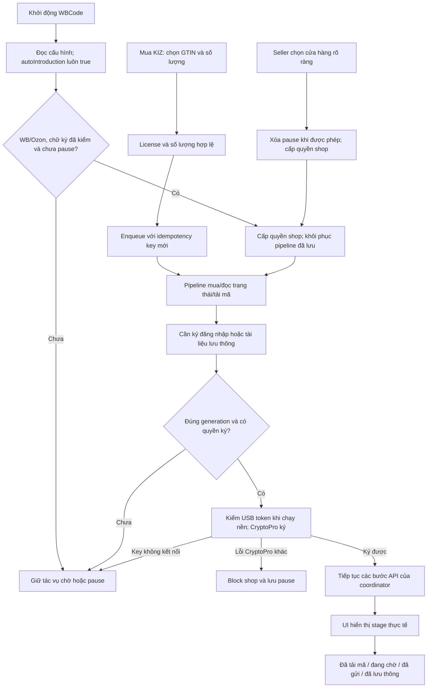

# WBCode 1.3.26 — giao diện mua, cấu hình và quyền ký

Phân tích tĩnh đúng JAR `d10efde1c0ef6e6f8cf3e850e1dd7615966b0aa1e83082181f6c8dd26380f1b6` đã trích từ EXE phát hành chính thức. Không chạy WBCode, không ký CryptoPro, kích hoạt license hoặc gọi API seller/SUZ/Catalog. Đọc CFR 0.152 và đối chiếu `javap -p -c` JDK25 ở các nhánh quan trọng; số dòng CFR là bản dịch ngược cục bộ, không phải mã nguồn chính thức.

## Kết luận xác nhận

1. **WBCode mới nhất cũng bắt buộc tự làm bước lưu thông.** `Settings.empty()` truyền `true`; `ZnackRepository.getSettings(Connection)` truyền `true` khi đọc cấu hình, không đọc giá trị cũ của cột `auto_introduction`; `saveSettings(Connection,Settings)` luôn ghi số `1` vào cột này; `ZnackAutomationController.settings()` cũng truyền `true`. Do đó không được mô tả WBCode 1.3.26 như ứng dụng mặc định chỉ tải mã rồi tùy chọn lưu thông.
2. **Hộp mua tại Liên kết KIZ chỉ hỏi số lượng**, khoảng spinner 1–100.000, mặc định10, kiểm số dương, kiểm license rồi `coordinator.enqueue(settings,gtin,count,UUID)`. Không thấy checkbox tắt/bật lưu thông trong hộp này. UI dựng `Settings` luôn bật lưu thông; một chuỗi i18n cũ nếu còn tồn tại không chứng minh có tùy chọn đang hiển thị.
3. **WBCode có cùng thông báo chờ ký** `Waiting for the user to select this shop before signing.` Đây là thông báo địa phương của `ZnackSigningSession`, không tự chứng minh lỗi server CRPT hoặc OMS.
4. **Khởi động có thể khôi phục nền cho nhiều cửa hàng**: `HomeController$21.call()` duyệt các cửa hàng; `authorizeVerifiedShop(shop,settings,signingPaused)` chỉ cấp quyền khi là WB/Ozon, có chứng thư, đã kiểm chứng chữ ký và không tạm dừng. Sau đó gọi `resumeAllPersisted`. Không phải chỉ cửa hàng foreground mới có thể hoạt động.
5. **Chọn cửa hàng bằng thao tác người dùng là đường tiếp tục rõ ràng**: `HomeController.selectShopExplicitly` → `$20.call` → `authorizeShopExplicitly(repository)` (xóa pause bền vững nếu không đang cấu hình lại) → `resume(settings)` → đồng bộ GTIN cho hồ sơ chờ giấy tờ → `resumeEligibleIntroductions(settings)`. Điều này cấp quyền tiếp tục; nó không bảo đảm chứng thư/token/API sẽ thành công.
6. **Đã tải mã, Hoàn tất và Đã lưu thông là ba nhãn riêng**. `KizMappingController.localizeStatus` dùng `znack.status_value.<stage>`. Trong tiếng Việt: `CODES_DOWNLOADED=Đã tải mã`, `COMPLETED=Hoàn tất`, `INTRODUCED=Đã lưu thông`, `WAITING_INTRODUCTION_READINESS=Đang chờ lưu thông`, `WAITING_INTRODUCTION_DOCUMENTS=Đang chờ giấy tờ GTIN`. Phải xem nhánh coordinator để biết điều kiện chuyển stage, không suy từ chữ “Hoàn tất”.

## Khi nào guard ký dừng

`ZnackSigningSession.guard` kiểm `admit` trước và trong khóa ký riêng theo cửa hàng. Bị dừng nếu signer-generation đã đổi, cửa hàng bị block/đang thay cấu hình, pipeline đang ở tập chờ, hoặc chưa được cấp quyền shop/pipeline. Nhánh không có quyền trả WAITING; nhánh đổi signer/bị block/reconfiguration trả thông báo đã tạm dừng.

Nếu shop không foreground hoặc đang tự thử lại, guard còn gọi `requireKeyConnected()` trước `sign()`. `KEY_NOT_CONNECTED` được chuyển thành `SigningDeferredException(WAITING_MESSAGE,false)`, giữ pipeline chờ. Lỗi CryptoPro khác block shop và cố ghi pause bền vững tối đa3 lần; không giả thành ký thành công. `authorizeVerifiedShop` không tự xóa shop block. Thao tác chọn shop rõ ràng hoặc đường sửa chữ ký có cơ chế cấp lại quyền.

## Sơ đồ phần giao diện và quyền ký

Sơ đồ này chỉ mô tả phần UI/guard đã kiểm. Các trạng thái `APPLIED`, `EMITTED`, nội dung tài liệu và polling API phải lấy từ báo cáo coordinator của tác vụ cha.

## Chỉ dẫn bằng chứng

| Nhận định | CFR | Bytecode đối chiếu |
| --- | --- | --- |
| `autoIntroduction=true` khi cấu hình trống | Record được đọc trực tiếp bằng javap | `settings-record-javap.txt:347`, `empty`, offset30=`iconst_1` |
| Đọc settings bỏ qua cột auto cũ | `decompiled/.../ZnackRepository.java:437` | `repository-javap.txt:1293`, `getSettings(Connection)`, offset195=`iconst_1` |
| Ghi auto=1 | `ZnackRepository.java:462` | `repository-javap.txt:1453`, `saveSettings`, offset238=`iconst_1`,239=`setInt` |
| UI settings bật auto | `ZnackAutomationController.java:1481` | `automation-controller-javap.txt:3189`, offset92=`iconst_1` |
| Mua từ màn mapping | `KizMappingController.java:630` | `kiz-mapping-controller-javap.txt`, `showBuy` và `lambda$showBuy$4` |
| Guard và WAITING | `ZnackSigningSession.java:46`, `:135`, `:270`, `:374` | `signing-session-javap.txt`, `guard`, `admit`, `authorizeShopExplicitly`, `authorizeVerifiedShop` |
| Explicit shop selection tiếp tục | `HomeController` đọc qua bytecode | `home-controller-javap.txt:3052`; `home-resume-selected-javap.txt`, `call`, offsets29–55 |
| Startup khôi phục nhiều shop | `HomeController` đọc qua bytecode | `home-resume-all-javap.txt`, `call`, offsets37–74 và131 |
| Nhãn trạng thái | `KizMappingController.java:860` | `status-labels-vi.txt`, trích nguyên các khóa không nhạy cảm từ JAR |

`evidence-inputs.json` ghi hash các bản đọc tĩnh. Không có unit test, build ứng dụng, giao dịch thật hoặc nghiệm thu Windows trong tác vụ nghiên cứu này.
