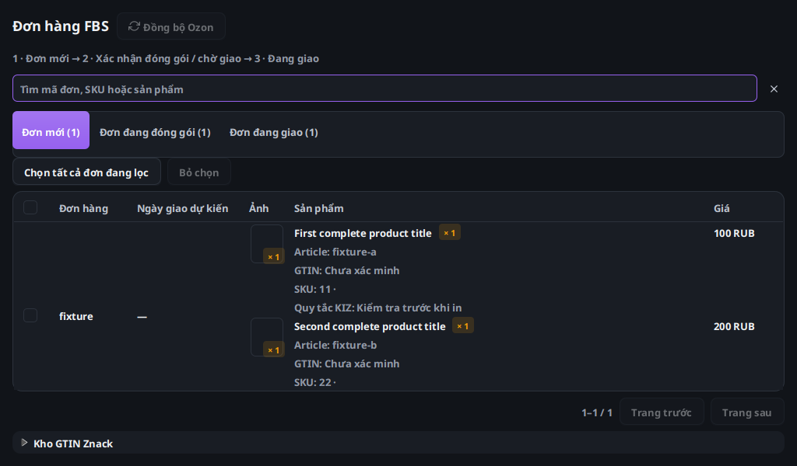
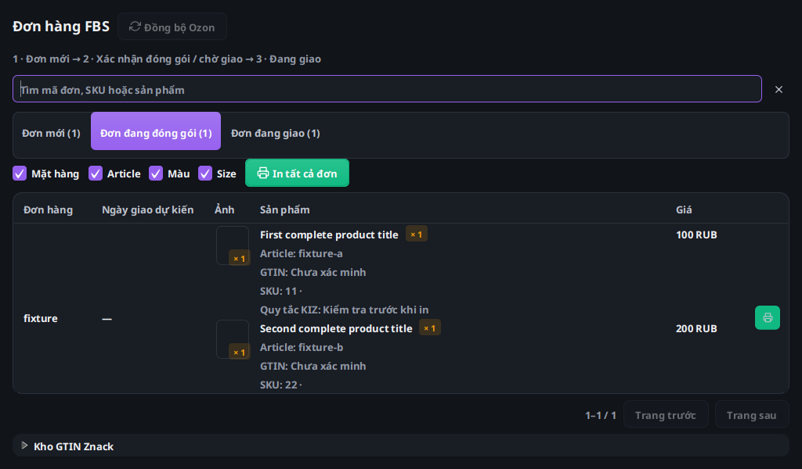
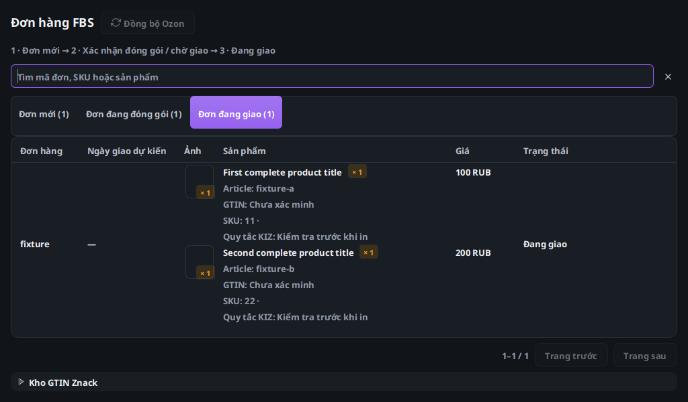

# Ozon FBS 1.4.7: đối chiếu bố cục WB

Đối chiếu màn hình WB hiện có (`packing-view.fxml`/`PackingController`) với Ozon (`ozon-dashboard-view.fxml`/`OzonDashboardController`). Phần so sánh này không tuyên bố có mã backend riêng của Wbcode.

| Thành phần WB | Điều chỉnh Ozon |
|---|---|
| Tiêu đề và đồng bộ cùng hàng | Đặt nút đồng bộ cạnh tiêu đề, chỉ hiện thông báo trạng thái khi có nội dung |
| Tìm kiếm gọn trong thanh lọc | Thanh tìm kiếm chung ba trạng thái, có nút xóa và chú thích theo ngôn ngữ |
| Ảnh, sản phẩm và giá riêng | Thêm ngày giao dự kiến và cột giá; giữ số posting riêng |
| Chọn đơn và thao tác lô | Giữ chọn toàn bộ kết quả lọc qua nhiều trang, thanh thao tác tự xuống dòng |
| Danh sách và thông tin kho KIZ | Phân trang dưới bảng, kho GTIN/KIZ thu gọn để ưu tiên diện tích đơn |

Mỗi sản phẩm có chiều cao 116 logical px; dòng đơn 124 px cho một sản phẩm và thêm 120 px mỗi sản phẩm tiếp theo (trước đây 184 và thêm 180). Ảnh, giá và mô tả dùng chung bước hàng; không làm mất số lượng hay sản phẩm thứ hai. Ngày giao giữ offset từ Ozon, không diễn giải lại theo giờ Windows.

Luồng Ozon giữ nguyên: đơn mới → xác nhận/gán KIZ và giao posting theo quy tắc Ozon → chờ giao/in → đang giao. Không chuyển sang API supply của WB. Các kiểm tra chủ cửa hàng, license, KIZ, đối soát kết quả không chắc chắn và xác nhận lô giữ nguyên.

Kiểm tra local JavaFX: ba tab × bốn ngôn ngữ × hai theme × hai kích thước (824×600 và 1140×768), 48 tổ hợp không có nút nằm ngoài chiều rộng/chiều cao cửa sổ; phân trang nằm dưới bảng. Các kiểm thử lô 1.000 đơn, giữ lựa chọn qua nhiều trang, kết quả cửa hàng cũ và UI tiếp tục pulse trong khi đọc nền đã chạy. Kiểm thử nâng cấp Windows và DPI thực do workflow Windows xác nhận riêng.

Ảnh dưới đây dùng dữ liệu tổng hợp, thiếu ảnh sản phẩm thật nên hiện khung chờ. Không dùng token seller và không gọi thao tác ghi lên Ozon.

Bổ sung: mở rộng kho GTIN/KIZ trong workspace 824×600 trên Linux vẫn giữ các nút trong vùng hiển thị. Toàn bộ Java/FXML Windows ở run 38635358816 đã đạt 1.235/1.237 kiểm thử, không failures/errors; hai trường hợp POSIX/off-Windows không áp dụng. Nghiệm thu nhiều máy/offline/thu hồi trên production vẫn chưa chạy.
