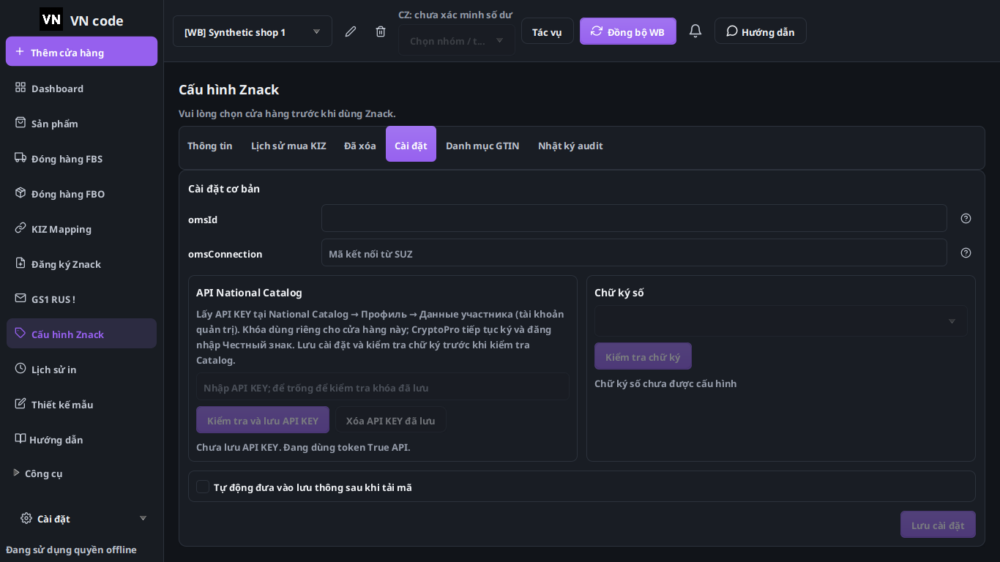
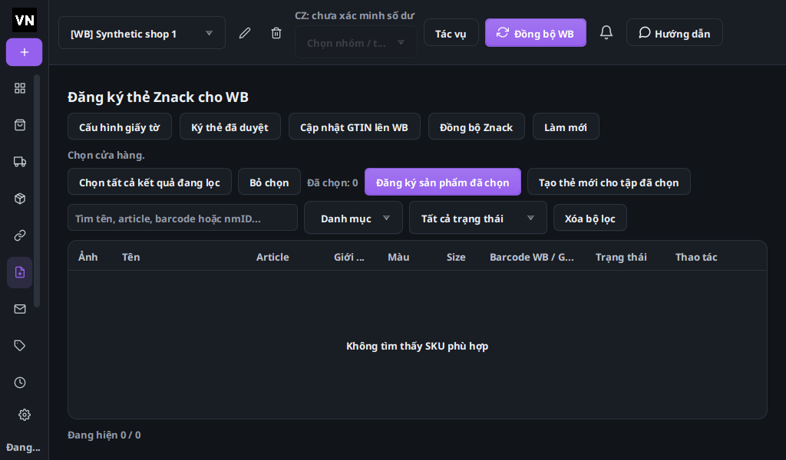
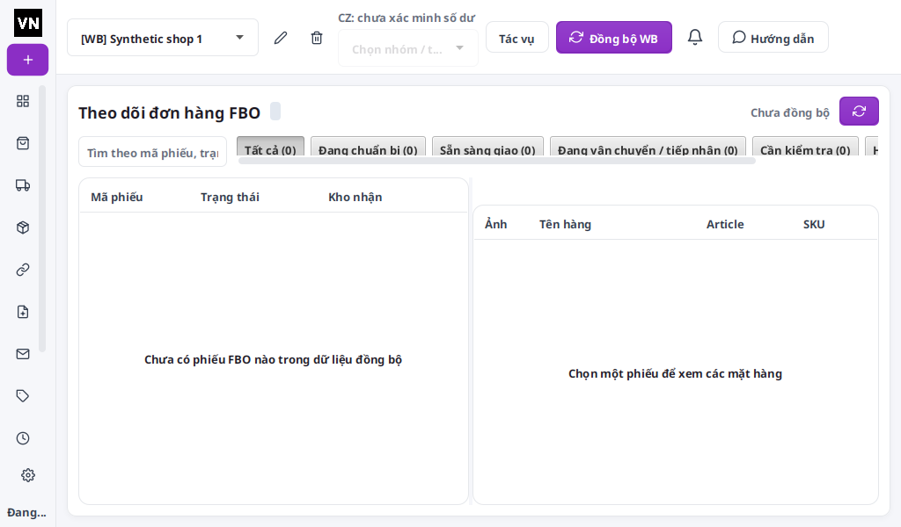

# VNCode 1.4.6 — tinh chỉnh toàn bộ giao diện

Đối chiếu Wbcode v1.3.8, là bản mới nhất GitHub trả về khi kiểm tra lại.
Nguồn: bộ cài chính thức đã quan sát trong lượt audit 14/10, ảnh GS1/Znack
do chủ app cung cấp, và ảnh VNCode từ mã đang sửa. Những màn hình Wbcode cần
tài khoản chỉ có ảnh tham chiếu; không suy luận đã kiểm thử nghiệp vụ từ ảnh.

| Mục | Quan sát và thay đổi VNCode |
|---|---|
| Thanh bên | Giữ icon + nhãn ở màn hình rộng, icon + tooltip khi hẹp; giảm 260 → 224px, rail 64px. Sửa tiêu đề nhóm công cụ đẩy icon ra ngoài viewport. |
| Header | Thu gọn chọn cửa hàng và nút, cùng chiều cao; giữ lựa chọn tài khoản số dư, tác vụ, đồng bộ, hỗ trợ và thông báo cập nhật. |
| Toàn bộ trang | Font cơ bản 13px, tiêu đề 22/18/14px, nền tối trung tính, padding và góc bo thống nhất. Giữ màu trạng thái và giao diện sáng. |
| Bảng | Header 36px, hàng đơn giản gọn hơn; giữ quy tắc chiều cao riêng cho đơn Ozon nhiều sản phẩm, ảnh, mã vạch và chi tiết in. |
| Điều hướng | Bỏ fade 120ms để nội dung hiện ngay khi đổi trang; giữ cache và các hook vòng đời hiện có. |
| Znack | Catalog và CryptoPro chia hai cột từ 780px, xếp dọc khi hẹp; thao tác API KEY xuống dòng theo chiều rộng. |
| Đăng ký thẻ | Dải chọn/đăng ký và bộ lọc tự xuống dòng. Sửa ComboBox trạng thái và placeholder còn giữ ngôn ngữ cũ. |
| FBO | Hạ kích thước tối thiểu hai panel, giữ kéo chia và cuộn bảng; nút làm mới luôn trong khung ở 1024px. |
| GS1, License, trang chủ | Giảm khoảng trống thừa; giữ chữ giải thích, quyền, hạn, cảnh báo và nút nghiệp vụ. |
| Cập nhật | Giữ thông báo header, notes, tải riêng/tải và cập nhật. Thêm workflow chuẩn bị/publish GitHub Release đúng nguồn đã build. |

Đã chạy 272 tổ hợp layout: 17 trang × 4 ngôn ngữ × 2 theme × 2 kích thước
1024×600/1366×768, trên JavaFX Linux. Không còn nút tràn ngang. Có kiểm thử
riêng icon thanh bên nằm trong viewport và nhãn hỗ trợ còn đủ khi thu gọn;
thẻ trang chủ giữ nội dung nằm trong chiều cao thực.

Các ảnh tại `evidence` dùng dữ liệu giả lập, nhiều bảng ở trạng thái chưa chọn
cửa hàng. Đây là kiểm tra hình học/giao diện; không xác nhận tích hợp tài khoản
seller. Kiểm tra Windows và DPI được chạy riêng trong build đầy đủ, kết quả
được ghi sau run; không lấy kết quả Linux để khẳng định Windows.

