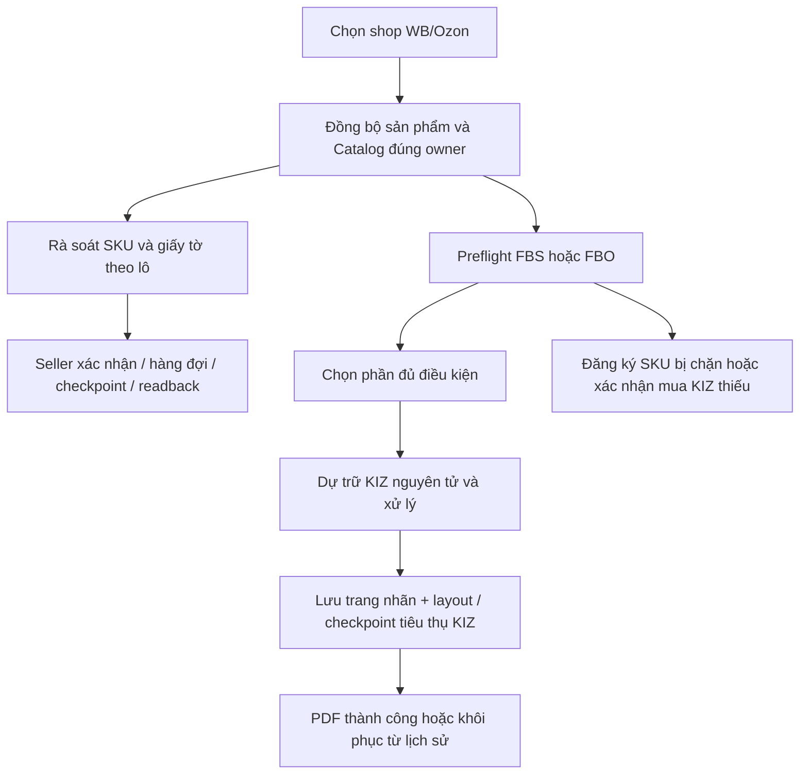
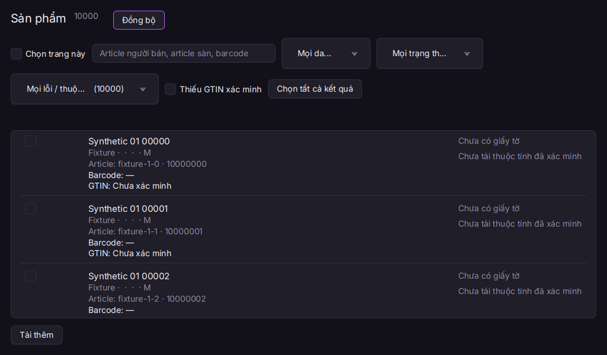
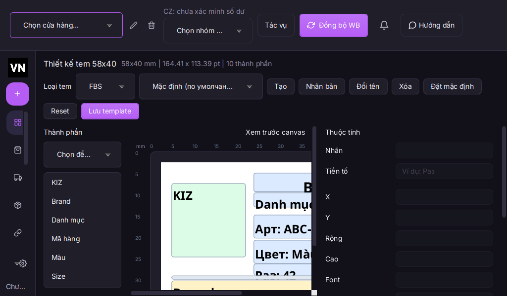
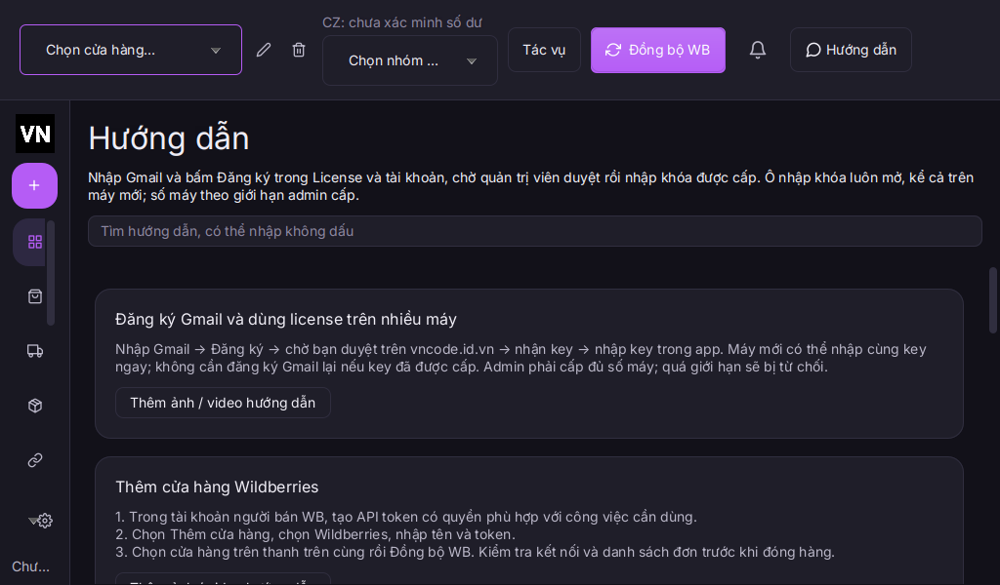

# VNCode: triển khai các mục đã duyệt

Mã ứng dụng 1.4.1 chưa phát hành. Thay đổi dựa trên 26 mục đã duyệt trong báo cáo Wbcode ngày 14.10.2026. Không triển khai website hoặc tạo GitHub Release trong đợt này.

## Luồng mới

## Đối chiếu phạm vi

| ID | Mục | Trạng thái và kết quả |
|---|---|---|
| 01 | License và tài khoản | **Nền đã có; chờ nghiệm thu thật**. Gmail đăng ký trực tiếp, nhập key luôn mở; nhiều máy theo max_devices. Hướng dẫn đã đồng bộ. Chưa dùng tài khoản thật để kiểm chứng duyệt/kích hoạt hai máy. |
| 02 | Thêm cửa hàng và mở ứng dụng | **Đã triển khai**. Trang đầu có bốn nút theo bước: đăng ký Gmail/nhập key → thêm shop → cấu hình Znack → kiểm tra sản phẩm; sidebar thu gọn/header wrap; giữ trạng thái license/shop hiện có. |
| 03 | Dữ liệu sản phẩm Ozon | **Đã triển khai**. Đọc brand/material/TN VED/gender từ snapshot Ozon của đúng owner; tách chưa tải và thiếu thuộc tính, bỏ nhóm thuộc tính phức hợp không tương ứng. |
| 04 | Bảng sản phẩm và giới tính | **Đã triển khai**. Dòng sản phẩm gọn, ảnh giữ tỉ lệ, giới tính hiển thị và sửa hàng loạt theo dictionary của từng sàn. |
| 05 | Bộ lọc lỗi sản phẩm | **Đã triển khai**. Bộ lọc chưa tải/thiếu thương hiệu/thiếu chất liệu/TN VED không hợp lệ; đếm trên cùng snapshot và phạm vi lọc. |
| 06 | Chọn sản phẩm và sửa hàng loạt | **Đã triển khai**. Xóa lựa chọn khi đổi lọc; khóa thao tác lô trong lúc dữ liệu đang thay đổi; preview tối đa 1000 sản phẩm và 64 MiB; giữ consent/checkpoint/readback. |
| 07 | Giấy tờ và ngày dán từ clipboard | **Đã triển khai**. Dán dd.MM.yyyy và commit editor trước preview; chặn ngày không hợp lệ ngay cả khi chưa mất focus. |
| 08 | TN VED, ngành hàng và giấy tờ từng SKU | **Một phần; cần nguồn quy tắc**. Chọn mã TN VED 10 số còn hiệu lực từ catalog trong công cụ sửa; giữ rà soát từng SKU/giấy tờ. Chưa tự suy ra phân loại pháp lý/giày khi thiếu nguồn quy tắc đã xác minh. |
| 09 | Cấu hình Znack / CryptoPro | **Nền đã có; chờ nghiệm thu thật**. Giữ CryptoPro và phiên CZ/ELK/National Catalog theo INN; cần Windows có chứng thư thật. |
| 10 | Đồng bộ Catalog và tổng số thẻ | **Một phần; cần hợp đồng API**. Giữ paging, đếm và đồng bộ nguồn hiện có; chưa chứng minh API toàn bộ thẻ ngoài app ở mọi nhóm hàng. Không gọi dữ liệu nguồn hạn chế là toàn bộ Catalog. |
| 11 | Đăng ký Ozon hàng loạt | **Đã triển khai**. Review lô Ozon tối đa 1000 SKU/64 MiB, consent giấy tờ chưa kiểm chứng, hàng đợi từng SKU, dừng phần chưa gửi và tiếp tục checkpoint. |
| 12 | Tạo thẻ mới cho sản phẩm đã xuất bản | **Đã triển khai**. Chọn sản phẩm đã xuất bản, tạo thẻ mới theo lô WB/Ozon; xác nhận số GTIN sẽ dùng; candidate và active được giữ riêng. |
| 13 | Thêm GTIN vào WB / Ozon | **Đã triển khai; chờ ghi thật**. Giữ ADD-only và readback; bổ sung đối chiếu GTIN barcode/Catalog của đúng SKU và credential owner. Catalog cũ cần đồng bộ lại để có owner proof. |
| 14 | GS1: sáu kiểm tra và thỏa thuận CZ | **Một phần; cần hợp đồng API**. Giữ sáu kiểm tra GS1. Thỏa thuận CZ chưa có API kiểm chứng tiếp tục hiển thị Chưa kiểm chứng và đường dẫn portal; header số dư đúng tài khoản/nhóm. |
| 15 | GS1: xin tiền tố, gia hạn, khôi phục | **Nền đã có; giới hạn mẫu**. Giữ đơn GS1, chữ ký vẽ, Word/PDF/ảnh và preview. Word phức tạp dùng PDF/ảnh seller đã ký; cần nghiệm thu mẫu thật. |
| 16 | GS1: email thật và thư trả lời | **Đã bổ sung; chờ mail thật**. Tự điền email hồ sơ đã xác thực và đúng INN khi chưa có cấu hình gửi; SMTP/IMAP TLS và DPAPI có sẵn vẫn cần quyền truy cập hộp thư thật. |
| 17 | WB: đơn hàng và supply | **Nền đã có; kiểm thử hồi quy**. Giữ supply cục bộ/đồng bộ nền, retry đọc có giới hạn và bảng cũ khi lỗi; kiểm thử hồi quy dữ liệu cache trong lúc worker bận. |
| 18 | Ozon: gán KIZ theo shipment/lô | **Đã triển khai**. Preflight tính tập posting sẵn sàng theo pool KIZ dùng chung; cho seller xác nhận xử lý riêng tập đủ điều kiện, giữ đơn bị chặn. |
| 19 | FBO: GTIN theo biến thể và nhãn | **Đã triển khai**. GTIN FBO khớp shop + sản phẩm gốc + biến thể + barcode thực tế + Catalog published/tradeUnit/current owner; chặn GTIN kỹ thuật 029 và ánh xạ mơ hồ. |
| 20 | FBO: mua KIZ và xử lý phần đủ điều kiện | **Đã triển khai**. Bảng Cần/Có/Phải mua theo SKU; chọn phần ready hoặc chuyển đăng ký; mua phần thiếu sau consent và kiểm tra lại; dự trữ KIZ nguyên tử theo lô. |
| 21 | Thiết kế mẫu và lịch sử in | **Đã triển khai**. Designer nhúng trong workspace, đổi ngôn ngữ giữ nội dung; FBO lưu layout và trang đã đóng băng, checkpoint tiêu thụ KIZ và khôi phục PDF sau lỗi xuất. PDF thành công không xác nhận máy in vật lý. |
| 22 | Header, cảnh báo và tiến độ | **Đã triển khai**. Header số dư theo INN/environment/tài khoản/nhóm với tuổi cache/ngưỡng cảnh báo; trung tâm tổng hợp job mọi shop và mở trang xử lý. |
| 23 | Hướng dẫn, video và trợ giúp | **Đã triển khai; cần nội dung media**. Tìm không dấu trong 8 mục, chữ đọc offline, thêm ảnh/video do người dùng chọn, play/seek/retry/resume và dừng khi rời trang. Chưa kèm bộ video hướng dẫn chính thức. |
| 24 | Giao diện, font và bốn ngôn ngữ | **Đã triển khai; QA Windows**. Đóng gói Inter có OFL và source hash, header wrap/sidebar thu gọn, bản dịch RU/EN/VI/ZH. QA native/DPI theo CI. |
| 25 | Tin tức, cập nhật và khôi phục dữ liệu | **Nền đã có; một phần**. Giữ updater/checksum/backup/lock/migration và tin WB. Chưa có nguồn tin Ozon chính thức đã xác minh. Không phát hành release hoặc triển khai website trong đợt này. |
| 26 | 10 shop, 1000+ đơn và nhiều người | **Đã bổ sung; cần đo thực tế**. Giảm truy vấn theo SKU/GTIN bằng batch, giữ worker/cache budget và shop guards; đo synthetic 10 shop/100000 sản phẩm/10000 đơn. Chưa thay thế đo shipment API/máy in thật trên PC 2CPU/4GiB. |

## Dữ liệu và vận hành

- Mỗi người chạy app trên PC riêng; không đồng bộ đơn/KIZ giữa nhiều PC. Cùng key được phép khi admin tăng giới hạn máy/cửa hàng tương ứng.
- Schema vẫn là v5; không thêm bảng hoặc đổi định dạng app-data. FBO dùng bảng lịch sử đã có và trạng thái prepared/pdf_ready/success/failed. Bản cũ không hiểu trạng thái mới sẽ không cho in lại chúng.
- Catalog không có metadata owner từ bản cũ cần đồng bộ lại trước khi dùng làm bằng chứng GTIN. Đổi credential làm bằng chứng cũ mất hiệu lực.
- Khôi phục FBO dùng đúng KIZ và layout đã đóng băng, không lấy KIZ mới. Trạng thái PDF thành công chỉ nói tệp đã xuất, không nói máy in đã nhận.
- Tác vụ marketplace, mua KIZ và gửi thư vẫn đi qua xác nhận. Không có thao tác thật nào được thực hiện bởi công cụ trong lần triển khai này.

## Kiểm chứng

Mã chức năng `68d2862` đã qua full clean verify: 1195 kiểm thử trên Linux và Windows, 0 lỗi; mỗi hệ điều hành có 2 kiểm thử bị bỏ qua theo điều kiện nền tảng. 48 Node contracts và CI Portal đều qua.

[CI Windows 38532545791](https://github.com/ntccong2468-lab/Bancapnhat/actions/runs/38532545791) đã kiểm tra EXE, khởi chạy native, DPAPI, cài/gỡ độc lập, nâng cấp dữ liệu từ 1.1.34 đến 1.4.0 và 6 lượt workspace ở DPI 100/125/150%. Bộ cài unsigned là artifact kiểm thử, chưa phải GitHub Release.

Windows dùng hai tập dữ liệu 6WB+4Ozon và 10Ozon, mỗi tập 100000 sản phẩm/10000 đơn. p95 chuyển shop tối đa 202 ms, hiển thị Ozon FBS tối đa 368 ms. Có một nhịp FX 514 ms; probe Linux toàn luồng có một nhịp 807 ms không tái hiện trong lượt đo riêng 200 lần chuyển shop. Chưa xác định nguyên nhân các nhịp riêng lẻ và chưa đo PC 2CPU/4GiB.

Kết quả chi tiết và giới hạn được ghi trong [validation.json](validation.json), [probe Linux](approved-workspace-probe.json), [probe theo giai đoạn](approved-workspace-phase-probe.json) và [probe Windows](approved-windows-workspace.json). Synthetic/UI probe không thay thế nghiệm thu license hai máy, CryptoPro, mail GS1, API sàn và máy in thật. Những mục thiếu hợp đồng API/nguồn quy tắc được giữ rõ là một phần.

## Ảnh chạy thực tế sau nâng cấp

