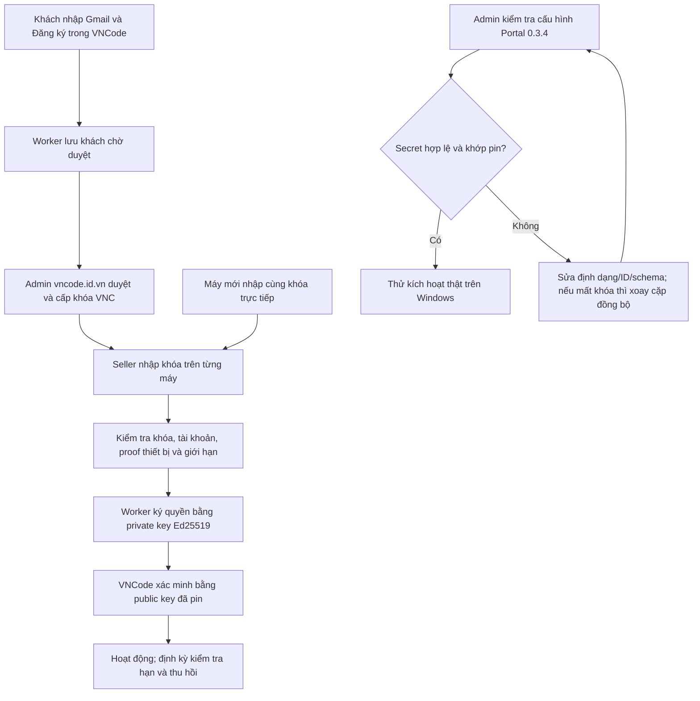
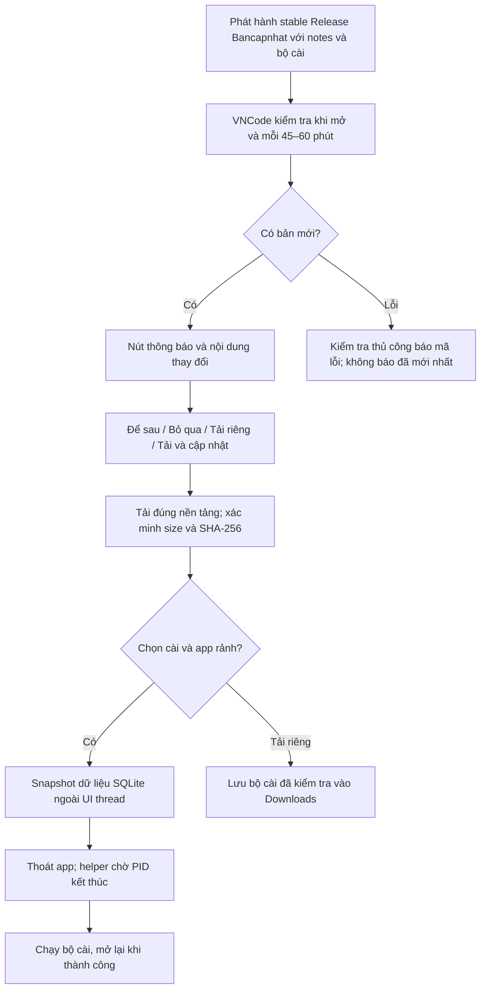

# Đối chiếu license và cập nhật: VNCode 1.4.3 / Portal 0.3.4

Ngày đối chiếu: 14/10/2026. Wbcode mới nhất quan sát được là **v1.3.8** từ
[repo phát hành chính thức](https://github.com/rupphi/relatest-wcode/releases/tag/v1.3.8).
Giao diện tham chiếu từ bộ cài chính thức đã chạy ở lượt rà soát trước; không có
mã nguồn backend công khai hoặc tài khoản Wbcode để kiểm chứng kích hoạt thật.
Phân biệt giao diện đã thấy, hợp đồng manifest công khai và suy luận triển khai.

| Mục | Wbcode quan sát được | VNCode / website và thay đổi |
|---|---|---|
| Nhập license | Ô khóa, kích hoạt và biểu mẫu mua | Giữ Gmail → admin duyệt → cấp khóa → nhập vào app theo yêu cầu chủ app. Không thêm thanh toán tự động. |
| Máy mới | Có kích hoạt bằng khóa | VNCode cho nhập khóa ngay, không yêu cầu đăng ký Gmail trên mỗi máy; cùng khóa theo giới hạn thiết bị. |
| Gmail admin | Không có bằng chứng backend tương ứng | Portal hỗ trợ license desktop riêng cho Gmail admin, giữ vai trò và mật khẩu website. |
| Chẩn đoán ký | Không quan sát được backend Wbcode | Lỗi thực tế `SIGNING_NOT_CONFIGURED`. Portal cũ chỉ báo Secret tồn tại; 0.3.4 import, ký và xác minh thật với public pin của VNCode. |
| Khóa riêng bị mất | Không có bằng chứng cơ chế khôi phục | Giữ Secret đang lưu, thử đọc định dạng trước; nếu không dùng được thì tạo cặp mới/ID mới, cập nhật pin app và Portal đồng bộ. Không thể khôi phục từ public key. |
| Thu hồi/xóa | Không thử trên Wbcode | Có thu hồi thiết bị, giới hạn máy/cửa hàng/offline; xóa mã đã hủy, xóa Gmail thường và đăng ký lại; bảo vệ admin. |
| Kiểm tra phiên bản | Mục kiểm tra thủ công trong Settings | Có kiểm tra lúc mở app, nay thêm timer 45–60 phút với jitter, thực hiện ở executor riêng. |
| Thông báo và notes | Manifest 1.3.8 có 11 notes và mandatory=false | Dialog notes, nút tải/cài, tải riêng, để sau, bỏ qua; nút bản mới trên header vẫn hiện sau Để sau. |
| Kiểm tra thủ công | Giao diện có action | Hiện bản từng bỏ qua; phân biệt lỗi mạng, chưa có release và đang ở bản mới nhất. |
| Xác minh bộ cài | Manifest công khai chứa size, SHA-256 và chữ ký | Kiểm tra size/SHA-256 trước tải riêng hoặc chạy; sửa URL manifest về Bancapnhat. Nếu đã pin khóa cập nhật thì bắt buộc xác minh Ed25519, không fallback khi chữ ký sai. |
| Cài đặt an toàn | Chưa quan sát được tự cập nhật end-to-end | Chặn cài lúc còn công việc nền; snapshot SQLite đã kiểm tra, chạy chuẩn bị ngoài FX thread; helper đợi PID thoát rồi chạy bộ cài và mở lại nếu thành công. |
| Nguồn bản mới | Stable v1.3.8 đang công khai | Bancapnhat hiện chưa có stable public release. Draft/prerelease/artifact kiểm thử không được gửi tới seller như bản cập nhật ổn định. |

## Luồng license cần vượt kiểm tra

Website nhận Gmail đã được chủ website xác nhận; đó là kiểm tra đăng ký riêng,
chưa chứng minh G/H thành công. Đã tạo mã license cũng chưa chứng minh ký quyền.

## Luồng cập nhật

Chữ ký manifest dùng **khóa cập nhật riêng**, không phải public key raw của
license. Workflow release pin SPKI DER Base64 từ `UPDATE_MANIFEST_PUBLIC_KEY`
vào build, tạo manifest bằng `UPDATE_MANIFEST_PRIVATE_KEY`. Nếu chưa cấu hình
cặp này, app kiểm tra digest GitHub qua HTTPS; không gọi đó là cập nhật có
chữ ký. SHA-256 bảo vệ đúng byte đã công bố; không thay thế chữ ký nhà phát hành.

## Bằng chứng và kiểm thử

- [Ảnh Wbcode license chính thức](evidence/official-wbcode-1.3.8-license.png).
- Manifest chính thức Wbcode 1.3.8 có envelope `wcode-update-envelope-v1`.
  Digest artifact: `81c4ccd5266df026a83a31932063a2e9b33c2266c5d89cf9af861bd65f8fedcb`.
  Digest bộ cài khai báo: `e44ee1f994acc362603c4d3bf23134a4762a8d0c83b3c8630b90d2f587ba7a84`.
  Đã đối chiếu digest GitHub của manifest; chưa xác minh chữ ký Wbcode do không
  có public pin của Wbcode. Không sử dụng khóa hoặc bộ cài của Wbcode để cập nhật VNCode.
- 86 kiểm thử Java: license, updater transport/model, kiểm tra signature thực,
  tampered/truncated downloads, bộ cài không được xác minh, notes/choices/header
  FXML và đổi ngôn ngữ. 54 kiểm thử Portal và 48 hợp đồng đóng gói.
- Portal diagnostics ký thông điệp thử, không cấp license/thiết bị. Test kiểm tra
  Secret tồn tại nhưng sai, cặp khóa không khớp, ID khác và schema thiếu.
- Build Windows đầy đủ 1.4.2 run **38551260158** đã đạt; không áp kết quả đó
  cho thay đổi 1.4.3. Bản 1.4.3 dùng build kiểm thử tập trung và native smoke;
  trạng thái cụ thể ở [release status](../../releases/VN-code-1.4.3-status.json).

## Việc production còn thiếu

Deploy Portal 0.3.4 lên đúng Worker/DB; kiểm tra Secret với pin `vncode-1` hiện
có; nếu không thể dùng thì chuẩn bị cặp mới và app tin pin mới trước khi xoay.
Sau đó thử kích hoạt, máy thứ hai/giới hạn, thu hồi, gia hạn và offline thật.
Chỉ công bố stable release sau các kiểm tra cần thiết. Xem
[hướng dẫn Portal](../../../website/license-portal/HUONG-DAN-CAP-NHAT-034.md).
