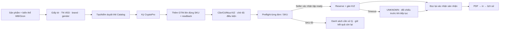
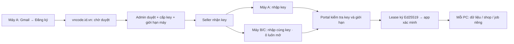

# VNCode: rà soát desktop Wbcode và bảng nâng cấp

Ngày 14/10/2026 · VNCode 1.4.1 đang phát triển · Wbcode chính thức 1.3.8.

**Kết luận:** ưu tiên tính đúng của dữ liệu/GTIN/KIZ và hoàn thiện các luồng lô trước khi thêm trang trí. Kiến trúc 10 shop và nhiều PC đã có nền; cần đo/nghiệm thu mạng, chữ ký, license và máy in thật. Đợt rà soát này không sửa mã ứng dụng hoặc phát hành bộ cài.

## Cách kiểm chứng và giới hạn

- Đã tải bộ cài chính thức, đối chiếu SHA-256 `e44ee1f994acc362603c4d3bf23134a4762a8d0c83b3c8630b90d2f587ba7a84`, cài và mở trên Windows GitHub-hosted mới.
- Đã mở thanh điều hướng, menu Settings, màn License và thao tác mở Thêm shop. Màn License có nhập key sẵn và phần mua license. Thêm shop bị chặn `SHOP-LIMIT` khi chưa có quyền; các trang nghiệp vụ không hiển thị nội dung trong trạng thái này. Đây là giới hạn quan sát, không phải bằng chứng những tính năng đó thiếu trong Wbcode.
- Không kích hoạt license, không nhập credential sàn, không tạo shop, không gửi GS1/mail, không ký CryptoPro, không gán KIZ thật. Các luồng có tài khoản được đối chiếu bằng ảnh bạn gửi, changelog 1.3.0–1.3.8 và mã VNCode.
- Repo `rupphi/relatest-wcode` công khai bộ cài/ghi chú phát hành. README trỏ tới `rupphi/source-wcode`, nhưng repo nguồn hiện trả 404; không có mã Wbcode 1.3.8 để kiểm tra đầy đủ. Repo `/workspace/code-wbr` chỉ có LICENSE.
- Đã chạy panel JavaFX VNCode từ JAR 1.4.1 với dữ liệu giả lập, chụp bốn ngôn ngữ ở 1024×600 và 1366×768. Bộ báo cáo giữ ảnh tiếng Việt; dữ liệu thử không phải dữ liệu seller.

**Bằng chứng:** [changelog Wbcode 1.3.8](https://github.com/rupphi/relatest-wcode/releases/tag/v1.3.8) · [Windows quan sát desktop](https://github.com/ntccong2468-lab/Bancapnhat/actions/runs/38514036757) · [chạy sidebar](https://github.com/ntccong2468-lab/Bancapnhat/actions/runs/38513761332).

## Bảng nâng cấp toàn bộ

P0: trước khi dùng thật/phát hành. P1: hoàn thiện vận hành. P2: trải nghiệm/hướng dẫn. Ưu tiên là đề xuất của đợt rà soát, không phải tuyên bố mọi mục đều chưa có.

| Mã | Hạng mục | Ưu tiên | Hiện trạng VNCode | Nâng cấp / nghiệm thu cần làm |
|---|---|---|---|---|
| 01 | License và tài khoản | P0 | Có · chờ nghiệm thu | Nghiệm thu đăng ký → admin duyệt → cấp key → kích hoạt hai máy. Sửa hướng dẫn còn yêu cầu xác minh Gmail. Giữ mô hình duyệt thủ công của VNCode. |
| 02 | Thêm cửa hàng và mở ứng dụng | P1 | Có · cần hoàn thiện UX | Trang đầu có hướng dẫn rõ: đăng ký/key → thêm shop → cấu hình Znack → kiểm tra dữ liệu. Trạng thái trống có nút hành động; lỗi tách license, mạng và quyền API. |
| 03 | Dữ liệu sản phẩm Ozon | P0 | Thiếu trong dòng hiển thị | Chuẩn hóa thuộc tính Ozon theo danh mục; nối dữ liệu đã xác minh vào bảng, ghi thời điểm và nguồn; cập nhật sau readback. |
| 04 | Bảng sản phẩm và giới tính | P1 | Một phần | Bảng gọn: ảnh, tên/article, giới tính, màu, size, barcode/GTIN, giấy tờ. Thêm chỉnh giới tính WB/Ozon theo hợp đồng thuộc tính của từng sàn. |
| 05 | Bộ lọc lỗi sản phẩm | P1 | Chưa có bộ lọc tương đương | Thêm bộ lọc lỗi nhanh và số lượng; chọn tất cả theo đúng tập kết quả. TN VED nằm trong công cụ sửa/đăng ký, không thêm menu riêng. |
| 06 | Chọn sản phẩm và sửa hàng loạt | P0 | Có · thiếu trạng thái nhất quán | Hiển thị rõ lựa chọn ngoài bộ lọc hoặc thu hẹp sau xác nhận; khóa thao tác ghi khi snapshot đang đổi; giữ đọc/cuộn/chuyển shop. |
| 07 | Giấy tờ và ngày dán từ clipboard | P0 | Có · thiếu định dạng nhập rõ | Nhận dd.MM.yyyy khi dán, commit và kiểm tra ngày bắt đầu/kết thúc; báo lỗi tại trường; hiển thị trạng thái sàn phê duyệt. |
| 08 | TN VED, ngành hàng và giấy tờ từng SKU | P1 | Một phần | Gợi ý TN VED theo loại, giới tính, chất liệu; người bán xác nhận. Giày có thuộc tính nhóm và size cần kiểm tra. Đổi nhóm 4 số đi qua luồng thẻ mới. |
| 09 | Cấu hình Znack / CryptoPro | P0 | Có · chờ nghiệm thu thật | Nghiệm thu lấy chứng thư từ CryptoPro, đăng nhập CZ/ELK/National Catalog theo cấu hình Znack; phân biệt hạn chứng thư, hạn phiên và hạn GS1. |
| 10 | Đồng bộ Catalog và tổng số thẻ | P1 | Một phần | Phân biệt tổng Catalog, thẻ khớp sản phẩm và thẻ lỗi chưa gắn. Đồng bộ tăng dần; quét lại khi Catalog thay đổi trong lúc ký. |
| 11 | Đăng ký Ozon hàng loạt | P0 | Chưa có luồng rà soát lô | Bản rà soát lô: tự điền những SKU đủ dữ liệu, gom SKU thiếu vào danh sách xử lý; gửi từng SKU qua hàng đợi có giới hạn. |
| 12 | Tạo thẻ mới cho sản phẩm đã xuất bản | P1 | Có từng sản phẩm · thiếu thao tác lô | Thêm lệnh tạo thẻ mới cho tập sản phẩm đã xuất bản, preview số GTIN sẽ tiêu thụ và xác nhận; xử lý candidate đang tồn tại. |
| 13 | Thêm GTIN vào WB / Ozon | P0 | Có · cần nghiệm thu và cải thiện đối chiếu | Luồng kiểm tra nhanh GTIN nhập thủ công khi mua/in: đọc lại SKU và Catalog theo shop, nhận diện lỗi cụ thể, cache có tuổi. Kiểm chứng ghi GTIN thật. |
| 14 | GS1: sáu kiểm tra và thỏa thuận CZ | P1 | Có · thỏa thuận chưa xác minh | Kết nối trạng thái thỏa thuận bằng API đã xác minh; nếu không có hợp đồng API thì mở portal và giữ Chưa kiểm chứng. Header cảnh báo theo tài khoản/nhóm. |
| 15 | GS1: xin tiền tố, gia hạn, khôi phục | P1 | Có · giới hạn mẫu Word | Kiểm tra mẫu seller thật và bố cục; preview PDF trước gửi; xử lý mẫu phức tạp bằng ảnh/PDF đã ký; nghiệm thu khôi phục và doanh nghiệp chưa mở hồ sơ. |
| 16 | GS1: email thật và thư trả lời | P0 | Có · cần cấu hình/kiểm chứng thật | Tự điền địa chỉ email từ hồ sơ CZ/National Catalog đã xác thực; xác nhận tài khoản gửi. Cấu hình OAuth/app password cho SMTP/IMAP để gửi/nhận thật. |
| 17 | WB: đơn hàng và supply | P1 | Có · cần nghiệm thu lỗi mạng | Giữ bảng đã tải khi refresh lỗi, badge dữ liệu cũ/thời điểm cập nhật; retry có giới hạn với đọc; in không bị khóa bởi đồng bộ không liên quan. |
| 18 | Ozon: gán KIZ theo shipment/lô | P0 | Có batch · cần tách đơn bị chặn | Preview Ready / Thiếu GTIN / Thiếu KIZ / Không hỗ trợ; cho chọn xử lý riêng tập ready sau xác nhận. Theo dõi từng posting, không một hộp lỗi chung. |
| 19 | FBO: GTIN theo biến thể và nhãn | P0 | Cần sửa luồng hiện tại | Ánh xạ theo shop + nmId + chrtId/SKU/size; GTIN đã xác minh trên sàn và thẻ đã ký; template nhãn chọn đúng GTIN khi nghiệp vụ yêu cầu. |
| 20 | FBO: mua KIZ và xử lý phần đủ điều kiện | P0 | Thiếu luồng đầy đủ | Preflight theo SKU: Cần / Có / Phải mua, thẻ chưa ký, GTIN chưa có trên sàn; xử lý tập hợp lệ sau xác nhận và chuyển SKU lỗi sang Đăng ký Znack. |
| 21 | Thiết kế mẫu và lịch sử in | P1 | Có · designer còn modal | Nhúng designer vào workspace, hướng dẫn đặt ngay dưới designer; preview và in thử; trang lịch sử có trạng thái PDF/in thực tế và in lại có kiểm soát. |
| 22 | Header, cảnh báo và tiến độ | P1 | Một phần | Header số dư đúng nhóm/tài khoản, cảnh báo dưới ngưỡng cấu hình; trạng thái cũ rõ ràng. Tiến độ theo giai đoạn, xem job mọi shop. |
| 23 | Hướng dẫn, video và trợ giúp | P2 | Còn đơn giản | Tìm không dấu trong tiêu đề/tóm tắt/nội dung; ảnh/video inline, loading/retry/resume, dừng khi rời trang. Sửa nội dung license/GTIN sai hiện trạng; trợ giúp theo lỗi. |
| 24 | Giao diện, font và bốn ngôn ngữ | P2 | Có nền · cần thống nhất | Chọn font có giấy phép phù hợp và đóng gói; bỏ rule mâu thuẫn. Skeleton ổn định, ảnh đúng tỉ lệ, modal trong màn hình, nút dài wrap thích hợp. |
| 25 | Tin tức, cập nhật và khôi phục dữ liệu | P1 | Có · còn nghiệm thu | Nghiệm thu update từ bản cũ, backup/rollback khi lỗi; giữ tin gốc khi dịch lỗi; chỉ thêm tin Ozon khi có nguồn chính thức phù hợp. |
| 26 | 10 shop, 1000+ đơn và nhiều người | P0 | Có kiến trúc · cần đo thực tế | Giữ dữ liệu/job trên từng PC; website chỉ account/license. Đo Windows 2CPU/4GiB, shipment100/500/1000, lỗi mạng/429, máy in và recovery; theo dõi FX p95/heap/queue. |

## Chi tiết và điều kiện hoàn tất

### 01. License và tài khoản — P0

**Hiện có:** 1.4.1 đã viết Gmail trực tiếp; ô nhập key luôn mở; máy mới nhận tài khoản từ key. Portal đã có chế độ gmail_admin.

**Cần làm:** Nghiệm thu đăng ký → admin duyệt → cấp key → kích hoạt hai máy. Sửa hướng dẫn còn yêu cầu xác minh Gmail. Giữ mô hình duyệt thủ công của VNCode.

**Nghiệm thu:** Một Gmail xuất hiện ở admin, không OTP/mật khẩu; hai máy dùng cùng key khi admin đặt max_devices ≥ 2; máy vượt giới hạn có thông báo rõ. Chữ ký server khớp public key vncode-1.

Mã/hiện trạng: [VN-code-1.4.1-status.json:7](https://github.com/ntccong2468-lab/Bancapnhat/blob/audit/wbcode-desktop-2026-10-14/docs/releases/VN-code-1.4.1-status.json#L7) · [messages_vi.properties:1114](https://github.com/ntccong2468-lab/Bancapnhat/blob/audit/wbcode-desktop-2026-10-14/src/main/resources/com/vncode/app/i18n/messages_vi.properties#L1114). Tham chiếu: 1.3.0–1.3.1; yêu cầu riêng VNCode.

### 02. Thêm cửa hàng và mở ứng dụng — P1

**Hiện có:** Có cửa hàng độc lập WB/Ozon, trạng thái license và bộ điều phối theo shop. Wbcode chưa kích hoạt chặn thêm shop với SHOP-LIMIT.

**Cần làm:** Trang đầu có hướng dẫn rõ: đăng ký/key → thêm shop → cấu hình Znack → kiểm tra dữ liệu. Trạng thái trống có nút hành động; lỗi tách license, mạng và quyền API.

**Nghiệm thu:** Máy mới hiểu bước tiếp theo; đổi shop không mất trang đang mở và không nhận kết quả của shop cũ.

Mã/hiện trạng: [HomeController.java:258](https://github.com/ntccong2468-lab/Bancapnhat/blob/audit/wbcode-desktop-2026-10-14/src/main/java/com/vncode/app/ui/workspace/HomeController.java#L258) · [WorkspaceHeaderController.java:52](https://github.com/ntccong2468-lab/Bancapnhat/blob/audit/wbcode-desktop-2026-10-14/src/main/java/com/vncode/app/ui/workspace/WorkspaceHeaderController.java#L52). Tham chiếu: 1.3.0, 1.3.7; quan sát desktop.

### 03. Dữ liệu sản phẩm Ozon — P0

**Hiện có:** SQL Ozon đang trả chuỗi rỗng cho brand/material/tnved; snapshot chi tiết có cơ chế lưu riêng.

**Cần làm:** Chuẩn hóa thuộc tính Ozon theo danh mục; nối dữ liệu đã xác minh vào bảng, ghi thời điểm và nguồn; cập nhật sau readback.

**Nghiệm thu:** Sản phẩm có thương hiệu/chất liệu/TN VED ở Ozon hiển thị đúng sau đồng bộ và sau sửa. Phân biệt thiếu dữ liệu với chưa tải.

Mã/hiện trạng: [ProductRepository.java:42](https://github.com/ntccong2468-lab/Bancapnhat/blob/audit/wbcode-desktop-2026-10-14/src/main/java/com/vncode/app/features/products/ProductRepository.java#L42) · [ProductRefreshService.java:31](https://github.com/ntccong2468-lab/Bancapnhat/blob/audit/wbcode-desktop-2026-10-14/src/main/java/com/vncode/app/features/products/ProductRefreshService.java#L31). Tham chiếu: 1.3.2.

### 04. Bảng sản phẩm và giới tính — P1

**Hiện có:** Có phân trang SQL, tìm kiếm, ảnh, barcode/GTIN, giấy tờ; chưa có trường gender trong ProductRow hoặc bulk edit. Các hàng hiện khá cao.

**Cần làm:** Bảng gọn: ảnh, tên/article, giới tính, màu, size, barcode/GTIN, giấy tờ. Thêm chỉnh giới tính WB/Ozon theo hợp đồng thuộc tính của từng sàn.

**Nghiệm thu:** 1024×600 vẫn nhìn được thao tác chính; nút đầy đủ ở tiếng Việt/RU/EN/ZH; không ghi giới tính khi tải hoặc lưu.

Mã/hiện trạng: [ProductRow.java:4](https://github.com/ntccong2468-lab/Bancapnhat/blob/audit/wbcode-desktop-2026-10-14/src/main/java/com/vncode/app/features/products/ProductRow.java#L4) · [ProductBulkEdit.java:8](https://github.com/ntccong2468-lab/Bancapnhat/blob/audit/wbcode-desktop-2026-10-14/src/main/java/com/vncode/app/features/products/ProductBulkEdit.java#L8). Tham chiếu: 1.3.2, 1.3.7–1.3.8.

### 05. Bộ lọc lỗi sản phẩm — P1

**Hiện có:** Có text/category/documentState/missingGtin; chưa có lọc lỗi TN VED, thiếu brand/material kèm số lượng.

**Cần làm:** Thêm bộ lọc lỗi nhanh và số lượng; chọn tất cả theo đúng tập kết quả. TN VED nằm trong công cụ sửa/đăng ký, không thêm menu riêng.

**Nghiệm thu:** Số đếm và tập khóa chọn dùng cùng snapshot, tìm kiếm và bộ lọc.

Mã/hiện trạng: [ProductQuery.java:5](https://github.com/ntccong2468-lab/Bancapnhat/blob/audit/wbcode-desktop-2026-10-14/src/main/java/com/vncode/app/features/products/ProductQuery.java#L5) · [ProductsPane.java:97](https://github.com/ntccong2468-lab/Bancapnhat/blob/audit/wbcode-desktop-2026-10-14/src/main/java/com/vncode/app/ui/products/ProductsPane.java#L97). Tham chiếu: 1.3.4.

### 06. Chọn sản phẩm và sửa hàng loạt — P0

**Hiện có:** Có preview/consent/checkpoint/readback. ProductsPane giữ selection khi đổi bộ lọc; bulk toolbar chưa gắn đầy đủ với loading/syncing.

**Cần làm:** Hiển thị rõ lựa chọn ngoài bộ lọc hoặc thu hẹp sau xác nhận; khóa thao tác ghi khi snapshot đang đổi; giữ đọc/cuộn/chuyển shop.

**Nghiệm thu:** Chọn A rồi lọc B không vô tình sửa A; đổi cửa hàng không gửi nhầm; trên 100 sản phẩm chỉ báo hoàn tất sau readback.

Mã/hiện trạng: [ProductsPane.java:84](https://github.com/ntccong2468-lab/Bancapnhat/blob/audit/wbcode-desktop-2026-10-14/src/main/java/com/vncode/app/ui/products/ProductsPane.java#L84) · [ProductsPane.java:119](https://github.com/ntccong2468-lab/Bancapnhat/blob/audit/wbcode-desktop-2026-10-14/src/main/java/com/vncode/app/ui/products/ProductsPane.java#L119) · [ProductBulkEditPane.java:49](https://github.com/ntccong2468-lab/Bancapnhat/blob/audit/wbcode-desktop-2026-10-14/src/main/java/com/vncode/app/ui/products/ProductBulkEditPane.java#L49). Tham chiếu: 1.3.3–1.3.5, 1.3.8.

### 07. Giấy tờ và ngày dán từ clipboard — P0

**Hiện có:** Có tải giấy tờ, metadata và preview cho WB/Ozon. DatePicker của bulk edit chưa đặt bộ chuyển đổi dd.MM.yyyy và bước commit rõ trước preview.

**Cần làm:** Nhận dd.MM.yyyy khi dán, commit và kiểm tra ngày bắt đầu/kết thúc; báo lỗi tại trường; hiển thị trạng thái sàn phê duyệt.

**Nghiệm thu:** Dán 14.10.2026 rồi bấm xem trước ngay vẫn gửi đúng ngày; ngày không hợp lệ không tạo request.

Mã/hiện trạng: [ProductBulkEditPane.java:25](https://github.com/ntccong2468-lab/Bancapnhat/blob/audit/wbcode-desktop-2026-10-14/src/main/java/com/vncode/app/ui/products/ProductBulkEditPane.java#L25) · [ProductBulkEditPane.java:48](https://github.com/ntccong2468-lab/Bancapnhat/blob/audit/wbcode-desktop-2026-10-14/src/main/java/com/vncode/app/ui/products/ProductBulkEditPane.java#L48). Tham chiếu: 1.3.4, 1.3.8.

### 08. TN VED, ngành hàng và giấy tờ từng SKU — P1

**Hiện có:** Có tra cứu TN VED và preflight đăng ký; Ozon có rà soát thuộc tính/giấy tờ mỗi sản phẩm. Chưa chứng minh đủ gợi ý phân loại như bản tham chiếu.

**Cần làm:** Gợi ý TN VED theo loại, giới tính, chất liệu; người bán xác nhận. Giày có thuộc tính nhóm và size cần kiểm tra. Đổi nhóm 4 số đi qua luồng thẻ mới.

**Nghiệm thu:** Không tự quyết định mã pháp lý khi dữ liệu thiếu; giấy tờ hợp lệ từng sản phẩm ưu tiên trước cấu hình shop.

Mã/hiện trạng: [ProductBulkEditPane.java:59](https://github.com/ntccong2468-lab/Bancapnhat/blob/audit/wbcode-desktop-2026-10-14/src/main/java/com/vncode/app/ui/products/ProductBulkEditPane.java#L59) · [OzonRegistrationReviewDialog.java:24](https://github.com/ntccong2468-lab/Bancapnhat/blob/audit/wbcode-desktop-2026-10-14/src/main/java/com/vncode/app/ui/znackregistration/OzonRegistrationReviewDialog.java#L24). Tham chiếu: 1.3.2, 1.3.6–1.3.7.

### 09. Cấu hình Znack / CryptoPro — P0

**Hiện có:** Có tab thông tin, số dư theo tài khoản/nhóm, chứng thư, owner INN và phiên theo dịch vụ; không cộng các số dư khác phạm vi.

**Cần làm:** Nghiệm thu lấy chứng thư từ CryptoPro, đăng nhập CZ/ELK/National Catalog theo cấu hình Znack; phân biệt hạn chứng thư, hạn phiên và hạn GS1.

**Nghiệm thu:** Owner INN từ chữ ký CMS trùng shop; đổi cert/INN vô hiệu kết quả cũ; hồ sơ/email lấy từ tài khoản đã xác thực.

Mã/hiện trạng: [ZnackAutomationController.java:389](https://github.com/ntccong2468-lab/Bancapnhat/blob/audit/wbcode-desktop-2026-10-14/src/main/java/com/vncode/app/ui/znack/ZnackAutomationController.java#L389) · [Gs1Pane.java:284](https://github.com/ntccong2468-lab/Bancapnhat/blob/audit/wbcode-desktop-2026-10-14/src/main/java/com/vncode/app/ui/gs1/Gs1Pane.java#L284). Tham chiếu: 1.3.4–1.3.5; yêu cầu người dùng.

### 10. Đồng bộ Catalog và tổng số thẻ — P1

**Hiện có:** Có đồng bộ/đếm/phân trang; nguồn True API may mặc và các nhóm ngoài may mặc mà app biết. Chưa xác minh nguồn toàn bộ thẻ ngoài app của mọi nhóm.

**Cần làm:** Phân biệt tổng Catalog, thẻ khớp sản phẩm và thẻ lỗi chưa gắn. Đồng bộ tăng dần; quét lại khi Catalog thay đổi trong lúc ký.

**Nghiệm thu:** Kiểm chứng trên >10.000 thẻ; không gọi tổng dữ liệu cục bộ là toàn bộ Catalog khi nguồn chưa đủ.

Mã/hiện trạng: [VN-code-1.4.0-status.json:1](https://github.com/ntccong2468-lab/Bancapnhat/blob/audit/wbcode-desktop-2026-10-14/docs/releases/VN-code-1.4.0-status.json#L1) · [ZnackCardRegistrationController.java:755](https://github.com/ntccong2468-lab/Bancapnhat/blob/audit/wbcode-desktop-2026-10-14/src/main/java/com/vncode/app/ui/znackregistration/ZnackCardRegistrationController.java#L755). Tham chiếu: 1.3.1, 1.3.3–1.3.4.

### 11. Đăng ký Ozon hàng loạt — P0

**Hiện có:** OzonRegistrationPane.registerSelection từ chối nếu chọn hơn một sản phẩm và yêu cầu review từng sản phẩm.

**Cần làm:** Bản rà soát lô: tự điền những SKU đủ dữ liệu, gom SKU thiếu vào danh sách xử lý; gửi từng SKU qua hàng đợi có giới hạn.

**Nghiệm thu:** 100+ SKU có tiến độ theo giai đoạn, hủy phần chưa gửi, tiếp tục từ checkpoint; lỗi một SKU không mất kết quả SKU đã xong.

Mã/hiện trạng: [OzonRegistrationPane.java:99](https://github.com/ntccong2468-lab/Bancapnhat/blob/audit/wbcode-desktop-2026-10-14/src/main/java/com/vncode/app/ui/znackregistration/OzonRegistrationPane.java#L99). Tham chiếu: 1.3.4–1.3.8.

### 12. Tạo thẻ mới cho sản phẩm đã xuất bản — P1

**Hiện có:** Có active/candidate và chuyển thẻ sau xác minh. WB thao tác thẻ mới nằm ở menu từng hàng; Ozon review một sản phẩm.

**Cần làm:** Thêm lệnh tạo thẻ mới cho tập sản phẩm đã xuất bản, preview số GTIN sẽ tiêu thụ và xác nhận; xử lý candidate đang tồn tại.

**Nghiệm thu:** GTIN/KIZ cũ còn hoạt động đến khi candidate ký và đọc lại trên sàn thành công; không dùng candidate cho đơn cũ.

Mã/hiện trạng: [ZnackCardRegistrationController.java:584](https://github.com/ntccong2468-lab/Bancapnhat/blob/audit/wbcode-desktop-2026-10-14/src/main/java/com/vncode/app/ui/znackregistration/ZnackCardRegistrationController.java#L584) · [ZnackCardRegistrationController.java:743](https://github.com/ntccong2468-lab/Bancapnhat/blob/audit/wbcode-desktop-2026-10-14/src/main/java/com/vncode/app/ui/znackregistration/ZnackCardRegistrationController.java#L743) · [OzonRegistrationPane.java:99](https://github.com/ntccong2468-lab/Bancapnhat/blob/audit/wbcode-desktop-2026-10-14/src/main/java/com/vncode/app/ui/znackregistration/OzonRegistrationPane.java#L99). Tham chiếu: 1.3.6, 1.3.8.

### 13. Thêm GTIN vào WB / Ozon — P0

**Hiện có:** Có ADD-only, preview, consent, checkpoint, readback. Ozon print readiness đang đọc mapping cục bộ.

**Cần làm:** Luồng kiểm tra nhanh GTIN nhập thủ công khi mua/in: đọc lại SKU và Catalog theo shop, nhận diện lỗi cụ thể, cache có tuổi. Kiểm chứng ghi GTIN thật.

**Nghiệm thu:** Không xóa/thay barcode cũ. Timeout ghi chuyển sang đối chiếu; chỉ báo thành công khi sàn trả về GTIN của đúng biến thể.

Mã/hiện trạng: [OzonPrintReadinessService.java:48](https://github.com/ntccong2468-lab/Bancapnhat/blob/audit/wbcode-desktop-2026-10-14/src/main/java/com/vncode/app/integration/ozon/OzonPrintReadinessService.java#L48) · [OzonGtinAdapter.java:1](https://github.com/ntccong2468-lab/Bancapnhat/blob/audit/wbcode-desktop-2026-10-14/src/main/java/com/vncode/app/integration/ozon/OzonGtinAdapter.java#L1). Tham chiếu: 1.3.5; nền tảng đã viết.

### 14. GS1: sáu kiểm tra và thỏa thuận CZ — P1

**Hiện có:** Có sáu ô kiểm tra, GCP/GLN, quota nhiều tiền tố, thành viên, chứng thư/đăng nhập/số dư. Agreement truyền null vào readiness.

**Cần làm:** Kết nối trạng thái thỏa thuận bằng API đã xác minh; nếu không có hợp đồng API thì mở portal và giữ Chưa kiểm chứng. Header cảnh báo theo tài khoản/nhóm.

**Nghiệm thu:** Không hiển thị xanh cho agreement chưa đọc; không suy ra membership vô hạn từ ngày trống; chỉ xin tiền tố khi điều kiện quota đạt.

Mã/hiện trạng: [Gs1Pane.java:161](https://github.com/ntccong2468-lab/Bancapnhat/blob/audit/wbcode-desktop-2026-10-14/src/main/java/com/vncode/app/ui/gs1/Gs1Pane.java#L161) · [Gs1ReadinessService.java:1](https://github.com/ntccong2468-lab/Bancapnhat/blob/audit/wbcode-desktop-2026-10-14/src/main/java/com/vncode/app/features/gs1/Gs1ReadinessService.java#L1). Tham chiếu: 1.3.4.

### 15. GS1: xin tiền tố, gia hạn, khôi phục — P1

**Hiện có:** Đã có đơn, ký vẽ/PDF, ảnh ký, nhập Word, thư theo luồng, hóa đơn/chứng từ. PDF từ Word chỉ hỗ trợ mẫu đơn giản một trang.

**Cần làm:** Kiểm tra mẫu seller thật và bố cục; preview PDF trước gửi; xử lý mẫu phức tạp bằng ảnh/PDF đã ký; nghiệm thu khôi phục và doanh nghiệp chưa mở hồ sơ.

**Nghiệm thu:** Chữ ký đặt đúng chỗ; ảnh giữ hướng; thông tin điền từ hồ sơ đúng INN; gửi thư không đồng nghĩa GS1 đã cấp tiền tố.

Mã/hiện trạng: [Gs1Pane.java:414](https://github.com/ntccong2468-lab/Bancapnhat/blob/audit/wbcode-desktop-2026-10-14/src/main/java/com/vncode/app/ui/gs1/Gs1Pane.java#L414) · [VN-code-1.4.0-status.json:1](https://github.com/ntccong2468-lab/Bancapnhat/blob/audit/wbcode-desktop-2026-10-14/docs/releases/VN-code-1.4.0-status.json#L1). Tham chiếu: 1.3.0, 1.3.6–1.3.7.

### 16. GS1: email thật và thư trả lời — P0

**Hiện có:** Có SMTP/IMAP TLS, bảo vệ credential DPAPI, hội thoại, hóa đơn và chống gửi trùng. Email hồ sơ và quyền truy cập hộp thư là hai thông tin khác nhau.

**Cần làm:** Tự điền địa chỉ email từ hồ sơ CZ/National Catalog đã xác thực; xác nhận tài khoản gửi. Cấu hình OAuth/app password cho SMTP/IMAP để gửi/nhận thật.

**Nghiệm thu:** Thư gửi thành công, trả lời gắn đúng luồng/INN; mail timeout vào trạng thái chưa rõ rồi đối chiếu; không tự gửi lại.

Mã/hiện trạng: [NationalCatalogGs1Client.java:91](https://github.com/ntccong2468-lab/Bancapnhat/blob/audit/wbcode-desktop-2026-10-14/src/main/java/com/vncode/app/integration/gs1/NationalCatalogGs1Client.java#L91) · [Gs1Pane.java:414](https://github.com/ntccong2468-lab/Bancapnhat/blob/audit/wbcode-desktop-2026-10-14/src/main/java/com/vncode/app/ui/gs1/Gs1Pane.java#L414). Tham chiếu: 1.3.0, 1.3.4; yêu cầu người dùng.

### 17. WB: đơn hàng và supply — P1

**Hiện có:** Có dữ liệu cục bộ, đồng bộ nền và supply theo shop; chưa chứng minh đủ hành vi 5xx/429 bằng trải nghiệm thực tế trong đợt này.

**Cần làm:** Giữ bảng đã tải khi refresh lỗi, badge dữ liệu cũ/thời điểm cập nhật; retry có giới hạn với đọc; in không bị khóa bởi đồng bộ không liên quan.

**Nghiệm thu:** WB 5xx không làm rỗng supply; retry không gửi lại thao tác ghi; lỗi nêu WB và bước cần xử lý.

Mã/hiện trạng: [SupplyLoadWorkflow.java:16](https://github.com/ntccong2468-lab/Bancapnhat/blob/audit/wbcode-desktop-2026-10-14/src/main/java/com/vncode/app/features/supply/SupplyLoadWorkflow.java#L16) · [WbSupplySyncService.java:95](https://github.com/ntccong2468-lab/Bancapnhat/blob/audit/wbcode-desktop-2026-10-14/src/main/java/com/vncode/app/integration/wb/WbSupplySyncService.java#L95). Tham chiếu: 1.3.1, 1.3.4.

### 18. Ozon: gán KIZ theo shipment/lô — P0

**Hiện có:** Đã có batch, khóa job, reservation, checkpoint, readback; UI preflight cả tập và dừng nếu có đơn chưa ready.

**Cần làm:** Preview Ready / Thiếu GTIN / Thiếu KIZ / Không hỗ trợ; cho chọn xử lý riêng tập ready sau xác nhận. Theo dõi từng posting, không một hộp lỗi chung.

**Nghiệm thu:** Lô 100/500/1000 đơn; thao tác không khóa FX; không gán trùng KIZ; đơn không đủ điều kiện vẫn giữ trạng thái chặn.

Mã/hiện trạng: [OzonDashboardController.java:429](https://github.com/ntccong2468-lab/Bancapnhat/blob/audit/wbcode-desktop-2026-10-14/src/main/java/com/vncode/app/ui/ozon/OzonDashboardController.java#L429) · [OzonExemplarService.java:417](https://github.com/ntccong2468-lab/Bancapnhat/blob/audit/wbcode-desktop-2026-10-14/src/main/java/com/vncode/app/integration/ozon/OzonExemplarService.java#L417). Tham chiếu: 1.3.4–1.3.5; nhu cầu 100+ đơn.

### 19. FBO: GTIN theo biến thể và nhãn — P0

**Hiện có:** FboKizPrintPlanner lấy GTIN theo nmId; exporter dùng product.sku cho trang barcode, chưa có GTIN riêng trên FboProductSku.

**Cần làm:** Ánh xạ theo shop + nmId + chrtId/SKU/size; GTIN đã xác minh trên sàn và thẻ đã ký; template nhãn chọn đúng GTIN khi nghiệp vụ yêu cầu.

**Nghiệm thu:** Hai size cùng nmId khác GTIN không in/gán nhầm. Preview hiện SKU, barcode và GTIN riêng; không đổi nhãn vận chuyển sang GTIN tùy tiện.

Mã/hiện trạng: [FboKizPrintPlanner.java:34](https://github.com/ntccong2468-lab/Bancapnhat/blob/audit/wbcode-desktop-2026-10-14/src/main/java/com/vncode/app/features/fbo/FboKizPrintPlanner.java#L34) · [FboBarcodePdfExporter.java:93](https://github.com/ntccong2468-lab/Bancapnhat/blob/audit/wbcode-desktop-2026-10-14/src/main/java/com/vncode/app/features/fbo/FboBarcodePdfExporter.java#L93) · [FboProductSku.java:3](https://github.com/ntccong2468-lab/Bancapnhat/blob/audit/wbcode-desktop-2026-10-14/src/main/java/com/vncode/app/features/fbo/FboProductSku.java#L3). Tham chiếu: 1.3.1, 1.3.4.

### 20. FBO: mua KIZ và xử lý phần đủ điều kiện — P0

**Hiện có:** Planner hiện ném lỗi cả lô nếu có sản phẩm thiếu mapping; dự trữ KIZ toàn lô và rollback khi thất bại.

**Cần làm:** Preflight theo SKU: Cần / Có / Phải mua, thẻ chưa ký, GTIN chưa có trên sàn; xử lý tập hợp lệ sau xác nhận và chuyển SKU lỗi sang Đăng ký Znack.

**Nghiệm thu:** SKU lỗi không chặn SKU hợp lệ nếu seller chọn xử lý riêng; chỉ in sau KIZ đúng trạng thái và số lượng. Không tự mua khi chưa xác nhận.

Mã/hiện trạng: [FboKizPrintPlanner.java:46](https://github.com/ntccong2468-lab/Bancapnhat/blob/audit/wbcode-desktop-2026-10-14/src/main/java/com/vncode/app/features/fbo/FboKizPrintPlanner.java#L46). Tham chiếu: 1.3.2, 1.3.4.

### 21. Thiết kế mẫu và lịch sử in — P1

**Hiện có:** Có editor FXML và lịch sử. Designer mở APPLICATION_MODAL với min 1180×760.

**Cần làm:** Nhúng designer vào workspace, hướng dẫn đặt ngay dưới designer; preview và in thử; trang lịch sử có trạng thái PDF/in thực tế và in lại có kiểm soát.

**Nghiệm thu:** Dùng được ở 1024×600/DPI150%; mở designer không khóa theo dõi job; không mặc định PDF tạo xong là máy in đã nhận.

Mã/hiện trạng: [PrintTemplateDesignerService.java:14](https://github.com/ntccong2468-lab/Bancapnhat/blob/audit/wbcode-desktop-2026-10-14/src/main/java/com/vncode/app/features/print/PrintTemplateDesignerService.java#L14) · [shop-sidebar-view.fxml:57](https://github.com/ntccong2468-lab/Bancapnhat/blob/audit/wbcode-desktop-2026-10-14/src/main/resources/com/vncode/app/ui/shop/shop-sidebar-view.fxml#L57). Tham chiếu: 1.3.0, 1.3.2, 1.3.7.

### 22. Header, cảnh báo và tiến độ — P1

**Hiện có:** Có shop selector, đồng bộ, news/support. Chưa có số dư CZ ở header hoặc trung tâm job thống nhất.

**Cần làm:** Header số dư đúng nhóm/tài khoản, cảnh báo dưới ngưỡng cấu hình; trạng thái cũ rõ ràng. Tiến độ theo giai đoạn, xem job mọi shop.

**Nghiệm thu:** Cảnh báo không dùng số dư của shop cũ; không cộng account khác nhau; có thể rời trang rồi quay lại theo dõi job.

Mã/hiện trạng: [WorkspaceHeaderController.java:16](https://github.com/ntccong2468-lab/Bancapnhat/blob/audit/wbcode-desktop-2026-10-14/src/main/java/com/vncode/app/ui/workspace/WorkspaceHeaderController.java#L16). Tham chiếu: 1.3.2, 1.3.4–1.3.5.

### 23. Hướng dẫn, video và trợ giúp — P2

**Hiện có:** GuidesPane có năm mục chữ, không search/media. Nút hỗ trợ mở trang hướng dẫn.

**Cần làm:** Tìm không dấu trong tiêu đề/tóm tắt/nội dung; ảnh/video inline, loading/retry/resume, dừng khi rời trang. Sửa nội dung license/GTIN sai hiện trạng; trợ giúp theo lỗi.

**Nghiệm thu:** Offline vẫn đọc hướng dẫn chữ; video lỗi không làm treo app; không hướng dẫn thay GTIN khi chỉ hỗ trợ thêm.

Mã/hiện trạng: [GuidesPane.java:11](https://github.com/ntccong2468-lab/Bancapnhat/blob/audit/wbcode-desktop-2026-10-14/src/main/java/com/vncode/app/ui/guides/GuidesPane.java#L11) · [messages_vi.properties:1122](https://github.com/ntccong2468-lab/Bancapnhat/blob/audit/wbcode-desktop-2026-10-14/src/main/resources/com/vncode/app/i18n/messages_vi.properties#L1122). Tham chiếu: 1.3.7–1.3.8.

### 24. Giao diện, font và bốn ngôn ngữ — P2

**Hiện có:** Có light/dark và bốn ngôn ngữ, virtualized table/list. CSS khai báo Inter rồi root sau ghi đè Segoe UI/System; chỉ thấy ARIAL.TTF trong assets.

**Cần làm:** Chọn font có giấy phép phù hợp và đóng gói; bỏ rule mâu thuẫn. Skeleton ổn định, ảnh đúng tỉ lệ, modal trong màn hình, nút dài wrap thích hợp.

**Nghiệm thu:** RU/EN/VI/ZH tại 1024×600,1366×768,DPI100/125/150%; không cắt thao tác chính, không nhảy layout khi tải.

Mã/hiện trạng: [theme.css:47](https://github.com/ntccong2468-lab/Bancapnhat/blob/audit/wbcode-desktop-2026-10-14/src/main/resources/com/vncode/app/styles/theme.css#L47) · [theme.css:1113](https://github.com/ntccong2468-lab/Bancapnhat/blob/audit/wbcode-desktop-2026-10-14/src/main/resources/com/vncode/app/styles/theme.css#L1113). Tham chiếu: 1.3.3–1.3.8.

### 25. Tin tức, cập nhật và khôi phục dữ liệu — P1

**Hiện có:** Có tin WB, dịch Yandex tùy cấu hình, updater và migration/backup/lock. Chưa có nguồn tin Ozon đã xác minh; phát hành app đang tạm dừng.

**Cần làm:** Nghiệm thu update từ bản cũ, backup/rollback khi lỗi; giữ tin gốc khi dịch lỗi; chỉ thêm tin Ozon khi có nguồn chính thức phù hợp.

**Nghiệm thu:** Cập nhật không mất shop/key/job; checksum được kiểm tra; lỗi migration giữ bản sao khôi phục; không xuất secret trong báo cáo lỗi.

Mã/hiện trạng: [VN-code-1.4.0-status.json:1](https://github.com/ntccong2468-lab/Bancapnhat/blob/audit/wbcode-desktop-2026-10-14/docs/releases/VN-code-1.4.0-status.json#L1) · [VN-code-1.4.1-status.json:35](https://github.com/ntccong2468-lab/Bancapnhat/blob/audit/wbcode-desktop-2026-10-14/docs/releases/VN-code-1.4.1-status.json#L35). Tham chiếu: Nền VNCode; không sao chép cơ chế thanh toán Wbcode.

### 26. 10 shop, 1000+ đơn và nhiều người — P0

**Hiện có:** Đã có SQL paging/batch, worker giới hạn, cache ngân sách, job lock và UI epoch. Probe lần này: 10 Ozon, 10.000 đơn, 100.000 sản phẩm.

**Cần làm:** Giữ dữ liệu/job trên từng PC; website chỉ account/license. Đo Windows 2CPU/4GiB, shipment100/500/1000, lỗi mạng/429, máy in và recovery; theo dõi FX p95/heap/queue.

**Nghiệm thu:** Không KIZ trùng khi dừng/mở lại; số đơn và trạng thái đúng. Đạt mục tiêu đề xuất p95 hiển thị cache <1s và không đơ FX >500ms trong bài đo đã chốt.

Mã/hiện trạng: [SellerWorkspaceProbe.java:40](https://github.com/ntccong2468-lab/Bancapnhat/blob/audit/wbcode-desktop-2026-10-14/tools/SellerWorkspaceProbe.java#L40) · [VN-code-1.4.0-status.json:1](https://github.com/ntccong2468-lab/Bancapnhat/blob/audit/wbcode-desktop-2026-10-14/docs/releases/VN-code-1.4.0-status.json#L1). Tham chiếu: Yêu cầu riêng VNCode; nhiều PC độc lập.

## Sơ đồ nghiệp vụ

Bản SVG độc lập: [GTIN/KIZ](01-workflow.svg) · [License](02-license.svg) · [GS1](03-gs1.svg) · [Nhiều PC](04-architecture.svg) · [Bố cục đề xuất](05-desktop-wireframe.svg). [Bản HTML tương tác](index.html) có lọc bảng, sơ đồ và ảnh thực tế; chạy offline.

## Bố cục đề xuất

Header: chọn shop, số dư CZ có phạm vi/thời điểm, cảnh báo và tiến độ job. Sidebar: Tổng quan → Sản phẩm → FBS/Shipment → FBO → Mapping → Đăng ký Znack → Cấu hình Znack → GS1 → Lịch sử → Thiết kế mẫu → Hướng dẫn; Công cụ chứa chức năng phụ. License luôn mở. TN VED nằm trong quy trình rà soát/sửa sản phẩm.

Khu vực nội dung dùng bảng ảo hóa gọn; bộ lọc lỗi có số đếm; vùng thao tác luôn cho biết tập chọn, tập ready và tập bị chặn. Progress hiển thị các bước và liên kết job, không khóa toàn workspace. GS1 có sáu ô kiểm tra và hội thoại; khi cửa sổ nhỏ, hội thoại xuống dưới. Designer nhúng thay modal tối thiểu lớn hơn màn hình.

## Kết quả probe và kế hoạch hiệu năng

Probe Linux một chu kỳ đổi 10 shop Ozon, 10.000 đơn / 100.000 sản phẩm: p95 hiển thị sản phẩm 315,54 ms; p95 từ đổi shop đến frame mới 476,32 ms; p95 panel FBS 614,57 ms; p95 từ mở FBS đến frame mới 765,85 ms. Không ghi nhận FX stall >500 ms; gap lớn nhất 344,99 ms; heap tại thời điểm báo cáo ~174 MiB. Hàng đợi đã hết và listener được giải phóng. Đây là UI/cache cục bộ trên máy cloud 4 CPU, không đo độ trễ mạng, CryptoPro, gán 1000 đơn thật hay in thật; không khẳng định mọi PC sẽ không lag.

Tiếp theo: Windows 2CPU/4GiB, 10 shop (6WB+4Ozon và 10Ozon), 100/500/1000 đơn cho shipment; có và thiếu KIZ, cùng nmId nhiều size, timeout sau ghi, 429/5xx, dừng app/mở lại. Đo p50/p95 từng bước, FX stalls, heap, queue, số truy vấn, reservation trùng và kết quả readback. Mục tiêu đề xuất: cache hiển thị p95 <1 giây và không FX stall >500 ms trong bài đo đã chốt; thời gian API/in báo riêng theo môi trường.

## Thứ tự triển khai đề xuất

1. P0: nghiệm thu license thật; dữ liệu Ozon; selection/busy; ngày giấy tờ; batch đăng ký Ozon; FBO theo biến thể + nhãn GTIN + tách SKU; đối chiếu KIZ/GTIN theo đơn.
2. P1: bulk tạo thẻ mới; phạm vi Catalog; TN VED/gender/error filters; GS1 agreement và mẫu; header/job center; designer nhúng; resilience supply/update.
3. P2: hướng dẫn ảnh/video/search và font/layout bốn ngôn ngữ.
4. Nghiệm thu CryptoPro/GS1/mail/sàn/máy in và cấu hình license trên hai PC; đo máy Windows yếu trước khi tuyên bố bản dùng thật.

Bảng Excel: `upgrade-table.csv` (UTF-8 BOM). JSON: `upgrade-table.json`. Ảnh thật và summary: thư mục `evidence/`; SHA từng tệp trong `evidence/checksums.json`. Bản vẽ là đề xuất, không phải giao diện đã triển khai.

Bổ sung trạng thái build: [Windows VNCode 1.4.1 run 38510879592](https://github.com/ntccong2468-lab/Bancapnhat/actions/runs/38510879592) đã thành công. Trường pending trong JSON trạng thái trước đó là dữ liệu lịch sử; nghiệm thu license/seller thật và việc phát hành vẫn chưa hoàn tất. Nguồn app/JAR được ghi trong `audit-context.json`.
