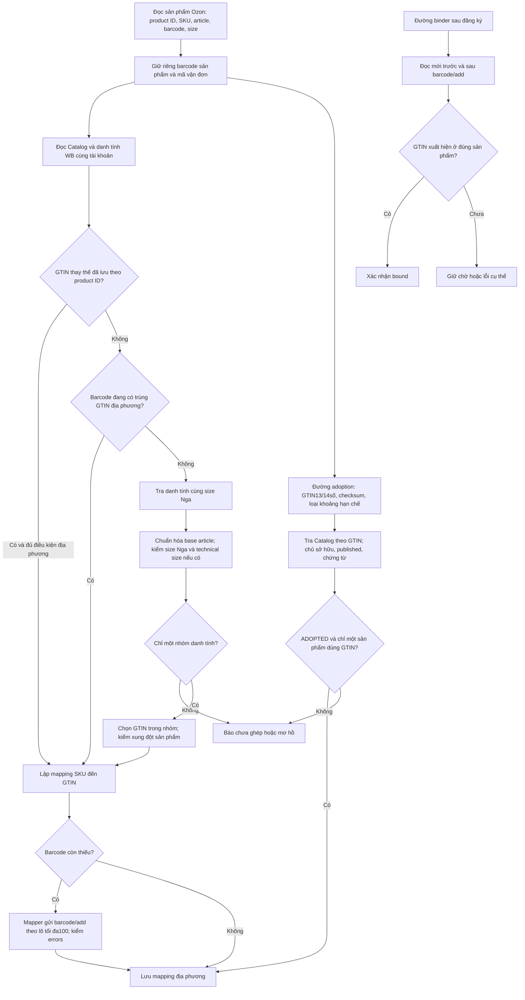

# WBCode mới nhất: đọc GTIN Ozon và ghép thẻ Catalog

Kiểm tra ngày 14/11/2026, trên **WBCode v1.3.25**, bản Latest chính thức tại thời điểm `2026-11-14T12:03:04Z`. Đây là phân tích tĩnh bộ cài đã xác minh; không chạy WBCode, không kích hoạt license, không gửi thay đổi lên Ozon/Catalog.

## 1. Bản được kiểm và độ tin cậy

- Kho phát hành: <https://github.com/rupphi/relatest-wcode/releases/tag/v1.3.25>.
- Release ID `443286851`; phát hành `2026-11-12T18:29:00Z`.
- `WCode.exe`: 149.642.240 byte; SHA-256 `86be2d8bbe639b8a1358730c93060e7da0e685e9a1198bd035064b8188e4f8c2`. Khớp cả digest GitHub và `checksums.sha256` chính thức.
- JAR trích từ PE → MSI → CAB bằng 7-Zip 25.01: 5.605.859 byte, 1.380 class; SHA-256 `20e339e956d286608681f7e7cf3c6b5af7f7fde3fb202dc933ee06490136a423`.
- Phân tích bằng CFR 0.152, đối chiếu `javap -p -c` / `-v` ở những hàm CFR giải mã không hoàn chỉnh. Không coi lỗi hiển thị của CFR là lỗi đang xảy ra trong ứng dụng.
- Các kết luận dưới đây gắn với class/method trong **binary 1.3.25**. `target_commitish: main` của release không chứng minh một commit nguồn tương ứng, nên báo cáo không gán nhầm hash mã nguồn.

Chứng cứ máy đọc: `release-summary.json`, `download-verification.json`, `extraction-provenance.json`, `mapping-observations.json`, `mapping-inputs.json` trong cùng thư mục báo cáo.

## 2. GTIN được đọc từ đâu trên Ozon?

WBCode giữ riêng `product_id`, SKU số của Ozon, `offer_id`/article người bán và mảng **barcode sản phẩm**. GTIN được nhận diện trong `barcodes[]`, không lấy mã vận đơn làm GTIN và không coi native SKU là GTIN.

Luồng đọc sử dụng `v3/product/list`, `v3/product/info/list` và thuộc tính từ `v4/product/info/attributes`. `OzonJson.parseProductInfo` chấp nhận `items` ở gốc hoặc trong `result.items`; ID lấy `id` hoặc `product_id`, native SKU lấy `sku` hoặc `fbo_sku`. Riêng parser này không có trường GTIN JSON chuyên biệt. Chi tiết reader do phần kiểm độc lập của báo cáo tổng hợp đối chiếu thêm.

**Không chỉ nhận tiền tố `046`.** Cần phân biệt hai quy tắc:

| Đường xử lý | Điều kiện thực tế |
|---|---|
| `GtinNormalizer.normalize`, được mapper dùng để so với danh sách GTIN địa phương | Chuỗi số từ 1–14 ký tự, bổ sung số 0 phía trái thành 14 số; không tự kiểm tra checksum hay buộc `046` trong hàm normalize |
| `OzonMarketplaceGtinAdoption.gtins`, dùng tìm GTIN sàn để tiếp nhận từ Catalog | Barcode gốc chỉ gồm 13/14 số, normalize, checksum GS1 đúng, loại khoảng mã lưu thông hạn chế; không buộc `046` |

Khoảng bị adoption loại là đầu EAN tương ứng `020–029`, `040–049`, `200–299` sau chuẩn hóa. Hàm `isTechnicalRange` riêng kiểm `029` không phải toàn bộ quy tắc loại của adoption. Tên helper và điểm gọi phải được đọc cùng nhau.

## 3. WBCode tìm danh tính thẻ bằng dữ liệu nào?

`OzonZnackMappingService.sync` xây danh sách danh tính biến thể từ hai nguồn trong **đúng tài khoản Catalog/doanh nghiệp**:

1. Thẻ Catalog đã đồng bộ: `ZnackVariantIdentityBackfill.fromSyncedCatalog` lấy `product_name`, size Nga, category; trong tên tìm dấu **`арт.` / `арт`** để lấy article. Không suy ra article bằng so tên gần giống. Có quy tắc bỏ size cuối article khi nhận ra size đó.
2. Dữ liệu đăng ký WB cùng tài khoản: `forAccount` chỉ nhận cửa hàng WB có cùng `ZnackAccountKey`; `forWbShop` chỉ đọc đăng ký `PUBLISHED` hoặc `WB_UPDATE_PENDING`, gắn `vendor_code + wb_size` với GTIN. Metadata còn lưu tech size, màu, category và brand. Việc lưu metadata không đồng nghĩa mọi trường đều được mapper so.

Khóa tài khoản gắn môi trường True API và participant INN. Danh tính được tra trước theo size Nga (`findByRussianSize(account, ruSize)`), sau đó kiểm article/size.

## 4. Thứ tự ghép thật của mapper

`OzonZnackMappingService.verifiedMappings` áp dụng thứ tự sau cho từng sản phẩm:

1. **GTIN thay thế đã lưu theo `productId`** trong luồng đăng ký Ozon, nếu GTIN có trong tập đủ điều kiện địa phương.
2. **Barcode hiện có của sản phẩm trùng GTIN địa phương**, sau normalize. Nếu nhiều barcode cùng đủ điều kiện, chọn GTIN đầu tiên theo thứ tự chuỗi.
3. **Ghép danh tính article + size**; chỉ dùng các danh tính có GTIN thuộc tập đủ điều kiện địa phương.

Hai bước đầu là liên kết đã biết theo ID/barcode, không chạy lại toàn bộ phép so article + size của bước ba.

Trong bước ba, `match` kiểm:

- Article Ozon và size Nga phải có giá trị.
- Khi cả size nhà sản xuất của Ozon và technical size của thẻ đều có, hai giá trị sau chuẩn hóa phải bằng nhau.
- Sau khi bỏ phần size ở cuối article theo quy tắc, **baseArticleKey phải bằng nhau và ruSizeKey phải bằng nhau**.
- Chuẩn hóa bằng Unicode NFKC, thu gọn khoảng trắng, bỏ khoảng trắng đầu/cuối và chuyển chữ thường. Không dịch tên, không đổi từ đồng nghĩa, không đoán bảng quy đổi size.
- Với size chữ như `XL`, phần size cuối được bỏ nếu tách bằng `-`, `/` hoặc khoảng trắng; dấu `_` không thuộc nhánh bỏ size Ozon này. Với size số, có thể nhận cả hậu tố số liền article. Quy tắc parser Catalog riêng không hoàn toàn giống parser Ozon.

**Trong hàm `match` này không có phép so độc lập tên bài, màu, brand, category hay TN VED.** Màu có thể đã nằm trong base article, nhưng đó chỉ là nội dung article, không có phép xác minh màu riêng. Vì vậy hai tên bài khác nhau vẫn ghép được nếu cùng danh tính article/size; hai SKU/article viết hoàn toàn khác nhau không tự khớp chỉ vì tên trông giống nhau.

Khi nhiều ứng viên còn lại, `preferredSameVariant` nhóm theo **base article + size Nga + technical size**. Phải chỉ có một nhóm; trong nhóm đó chọn GTIN nhỏ nhất theo chuỗi. Điều này khác yêu cầu “chỉ duy nhất một GTIN”. Có thể nhiều GTIN trong cùng một nhóm danh tính.

Mapper kiểm GTIN có đang nằm trên `productId` khác trong danh sách sản phẩm đã đọc hay không, và loại các đề xuất gắn cùng GTIN mới cho nhiều SKU. Kiểm chủ sở hữu barcode ở nhánh suy article; không nên diễn đạt thành mọi nhánh đều kiểm cùng một bộ điều kiện. Đó là kiểm xung đột trong dữ liệu Ozon đã tải, không phải bảo đảm đã đọc mọi chủ sở hữu trên toàn sàn.

### Ý nghĩa chính xác của chữ “active”

Tập `activeGtins` tại mapper được lấy từ `ZnackRepository.findProducts().filter(ZnackMappingEligibility::hasDocuments)`. Riêng `hasDocuments` kiểm có ít nhất một chứng từ đủ trường; SQL tương ứng yêu cầu type, number và date không rỗng. Các truy vấn mapping địa phương còn loại sản phẩm deleted/identity archived.

**Không được diễn giải predicate này thành “vừa đọc Catalog và xác nhận đã xuất bản, giấy tờ còn hạn”.** Luồng adoption bên dưới có các kiểm tra khác; nơi khác tạo dữ liệu địa phương cũng có thể đã kiểm trước đó. Báo cáo chỉ kết luận đúng kiểm tra nhìn thấy tại từng điểm gọi.

## 5. GTIN đã có trên Ozon được nhận về Catalog ra sao?

`OzonGtinMappingSyncService.syncAndMap` cập nhật sản phẩm Ozon, thử đồng bộ Catalog khi có điều kiện chữ ký, rồi tìm sản phẩm chưa có mapping. Chỉ xem sản phẩm không archived, có SKU, không được miễn KIZ và có GTIN barcode hợp lệ theo `adoption.gtins`.

`OzonMarketplaceGtinAdoption` xử lý GTIN theo lô đọc 25, với các nhánh kiểm:

- Nếu đã có sản phẩm địa phương đủ chứng từ thì có nhánh trả `ADOPTED` ngay; đây không phải lần đọc Catalog mới.
- Với thẻ đọc mới: phải xác định đúng một thẻ theo GTIN, `producer_inn` thuộc doanh nghiệp đang xác thực và trạng thái published; sau đó giải quyết/kiểm chứng từ. Có kết quả riêng cho khác chủ, chưa published, thiếu/chưa xác minh giấy tờ hoặc bị ẩn.
- Không so thêm article/màu/size tại bước tiếp nhận theo **GTIN đã xác định chính xác** này.

Sync chỉ lưu mapping `shop + SKU → GTIN` nếu outcome là `ADOPTED` và GTIN đó xuất hiện ở đúng một sản phẩm trong tập Ozon đã tải. Nếu nhiều sản phẩm dùng chung, giữ báo cáo chưa ghép thay vì đoán.

## 6. Mapping cố định được lưu và ưu tiên thế nào?

`OzonProductGtinMappingRepository` có hai bảng khác nhau:

- `ozon_product_gtin_mappings`: khóa **shop_id + SKU số Ozon**, trỏ GTIN.
- `ozon_article_gtin_mappings`: khóa **shop_id + article_key**, cho phép liên kết article đã chọn với GTIN. Article được thu gọn khoảng trắng và chuyển chữ thường; method này không tự dùng NFKC như bộ danh tính bên trên.

`findResolvedBySku` dựng kết quả theo ưu tiên:

1. Mapping article do người dùng lưu.
2. Mapping article suy từ các SKU cùng article, **chỉ khi mọi mapping đã biết của article đó nhất quán**; có hai GTIN khác nhau thì không lan liên kết theo article.
3. Mapping riêng của SKU.

Các truy vấn này yêu cầu GTIN vẫn thuộc sản phẩm địa phương chưa deleted/archived danh tính và đủ chứng từ theo predicate SQL. Không dùng tên gần giống làm khóa cố định. Bảng SKU được `replaceVerifiedMappings` thay toàn bộ cho cửa hàng bằng giao dịch; bảng article riêng không bị xóa trong thao tác đó.

## 7. Cập nhật GTIN lên Ozon và xác nhận

`OzonZnackMappingService.sync` chỉ gửi những GTIN chưa có trong barcode sản phẩm đã đọc. `publishBarcodes` chia lô **100**; `OzonApiClient.addBarcodes` gửi `POST /v1/barcode/add`, mỗi phần tử gồm native SKU dạng số và GTIN chuẩn hóa14số. Mapper đếm `errors`, từ chối thì báo lỗi; khi gửi xong mới thay bảng mapping SKU.

**Trong chuỗi method `syncAndMap → synchronizeAndMap → sync → publishBarcodes → addBarcodes` vừa kiểm, không có bước đọc lại sản phẩm ngay sau POST để xác minh barcode đã xuất hiện.** Product sync nằm trước publish; sau publish high-level service đọc lại kho địa phương, không gọi lại API product info trong method đó. Nhận xét này chỉ giới hạn ở chuỗi method trên.

Một luồng khác, **`OzonRegistrationBarcodeBinder`**, có xác minh tốt hơn: đọc product info mới → nếu barcode đã có thì xác nhận; nếu chưa thì lấy native SKU → gửi addBarcodes → **đọc lại product info mới**. Chỉ đánh dấu bound khi đã thấy GTIN. Nếu kết quả POST không rõ ràng vẫn đối chiếu đọc lại, có lỗi SKU thì từ chối, chưa quan sát được thì chờ. Binder đọc từng nhóm tối đa100 đăng ký; POST của nhóm chỉ chứa các SKU còn thiếu barcode. Không đánh đồng hai đường mapper và binder thành một hành vi.

## 8. Kết luận áp dụng cho tình huống cùng sản phẩm nhưng khác cách ghi

WBCode không có bằng chứng về một bộ AI tự ghép theo tên gần giống trong các method này. Nó dựa vào **GTIN đã có**, **liên kết cố định**, hoặc **article gốc + size** với quy tắc bỏ hậu tố. Nếu Catalog và Ozon khác cả mã mẫu lẫn cách đặt SKU/article, cần lập liên kết alias đúng biến thể hoặc một lần xác nhận cặp; sau đó lưu theo doanh nghiệp/cửa hàng và ID sản phẩm ổn định.

Đáng tham khảo là ưu tiên liên kết đã xác nhận, chuẩn hóa hậu tố size có giới hạn, phân biệt barcode/native SKU, chặn mơ hồ và xác minh đọc lại của binder. Không nên sao chép việc chọn GTIN nhỏ nhất trong nhiều thẻ hay bỏ kiểm màu chỉ vì WBCode làm vậy. Với VNCode cần đối chiếu các đường riêng (mua KIZ, đăng ký, ghép WB–Ozon, gửi GTIN), vì TN VED có thể được áp dụng khác nhau ở từng đường.

## 9. Chỉ mục chứng cứ

Các số dòng sau là **file CFR cục bộ phục vụ đọc**, không phải dòng mã nguồn chính thức của WBCode:

| Class/method | Chứng cứ |
|---|---|
| `OzonZnackMappingService.synchronizeAndMap/sync` | `decompiled/.../integration/ozon/OzonZnackMappingService.java:81`, `:195` |
| `match` | cùng file `:246` |
| `verifiedMappings` | cùng file `:280`; nhánh replacement lỗi trình bày CFR đã đối chiếu `javap-OzonZnackMappingService.txt`, bytecode125–201 |
| `preferredSameVariant` | cùng file `:356` |
| `publishBarcodes` | cùng file `:392` |
| `ZnackVariantIdentity.fromOzon` | `decompiled/.../integration/znack/registration/ZnackVariantIdentity.java:23` |
| Backfill Catalog/WB | `.../ZnackVariantIdentityBackfill.java:35`, `:54`, `:81`, `:113` |
| Điều kiện chứng từ | `decompiled/.../integration/znack/ZnackMappingEligibility.java:12` |
| `findResolvedBySku` | `javap-v-OzonProductGtinMappingRepository.txt:1788`; bytecode510–627; BootstrapMethods#4 là `Map.putIfAbsent` |
| `findActiveSkuMappings` | cùng javap `:3381`; SQL join documented product |
| High-level sync/adoption candidates | `decompiled/.../features/kizmapping/OzonGtinMappingSyncService.java:84`, `:119`, `:158` |
| Adoption/binder độc lập | `independent-cfr/.../integration/znack/registration/OzonMarketplaceGtinAdoption.java`, `OzonRegistrationBarcodeBinder.java`, bản javap cùng tên trong `independent-javap/` |
| Reader/API độc lập | `root-static/decompiled/.../integration/ozon/OzonJson.java`, `OzonApiClient.java:155`; metadata `reader-observations.json` |

Độ tin cậy cao cho logic branch, khóa DB và endpoint quan sát từ bytecode. Chưa nghiệm thu hành vi thực với một tài khoản WBCode/Ozon, chưa khẳng định hiệu năng, quyền seller hoặc thay đổi API server. Báo cáo không chứa API key, chứng thư hay thông tin sản phẩm thật.
