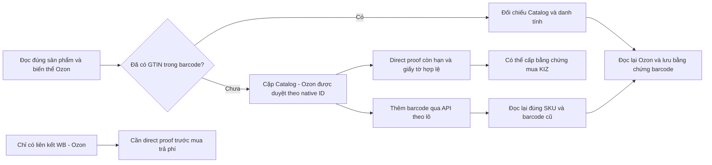

# Đối chiếu GTIN Ozon/Catalog: VN Code hiện tại và WBCode mới nhất

Ngày kiểm tra: 14/11/2026 (UTC). Phạm vi: nghiên cứu tĩnh; không sửa thuật toán, không gọi Seller API, không chạy ứng dụng/chữ ký/license, không khẳng định đã cập nhật GTIN thật.

VN Code được đọc tại commit `53a22c1e2ca169b36afd8e53d6469b2d497805b7`, nhánh `fix/kiz-original-flow-20261114`, ứng viên mã nguồn 1.6.10. WBCode: bản phát hành **1.3.25**, GitHub release `443286851`, công bố `2026-11-12T18:29Z`; JAR SHA-256 `20e339e956d286608681f7e7cf3c6b5af7f7fde3fb202dc933ee06490136a423`. Chỉ mô tả hành vi quan sát được; không đưa mã nguồn dịch ngược/binary WBCode vào VN Code hoặc ZIP.

## Trả lời trực tiếp

Cả hai ứng dụng đọc **mảng `barcodes[]` của sản phẩm Ozon**, không lấy GTIN từ mã vận đơn. `product_id`, SKU số của Ozon, `offer_id` của seller và chuỗi barcode `OZN...` là bốn loại thông tin khác nhau. SKU số là đích khi gửi `v1/barcode/add`; SKU số không tự trở thành GTIN. Barcode bắt đầu `OZN` không được bỏ chữ rồi coi phần số là GTIN.

Không có quy tắc “mọi GTIN Ozon phải bắt đầu 046”. VN Code có nhánh nhận diện `046` riêng cho WB; không được áp nhánh đó cho Ozon. Với Ozon, phải lần theo chỗ gọi: helper chuẩn hóa chỉ thêm số 0 bên trái; validator mới kiểm độ dài/chữ số/check digit và dữ liệu Catalog. WBCode cũng tách helper chuẩn hóa khỏi kiểm check digit; nhánh `OzonMarketplaceGtinAdoption.gtins` chỉ nhận 13/14 chữ số, check digit đúng và không thuộc dải restricted circulation.

Tên bài đăng khác nhau không nhất thiết cản đồng bộ nếu đã có GTIN thật đúng sản phẩm hoặc có liên kết biến thể đã duyệt. Khi **cả tên lẫn mã hàng khác hoàn toàn và Ozon chưa có GTIN**, chỉ “cùng màu/cùng size” không chứng minh được đó là cùng sản phẩm. VN Code đã có đường duyệt cặp cố định theo `shop + product_id + offer_id + native SKU ↔ GTIN + good_id`; đó là đường phù hợp cho trường hợp này.

## VN Code: đọc → ghép → quyết định → lưu → xác minh

| Đường xử lý | Đọc dữ liệu | Ghép và xử lý mơ hồ | Lưu và xác minh |
|---|---|---|---|
| Danh mục Ozon | `OzonGtinProductReader.list`: phân trang `ALL` và `ARCHIVED`, 500 sản phẩm/trang trong mã; đọc `v3/product/info/list`, giữ riêng product ID/offer ID/native SKU/barcodes. Thiếu ID, trùng, cursor không tiến, số lượng không đủ đều báo chưa đọc đủ. `OzonProductSnapshotReader` bổ sung thuộc tính từ `v4/product/info/attributes`. | Không dùng tên bài đăng để tạo khóa đích. Khóa là cửa hàng/OZON/product ID/offer ID; lượt đọc xác minh lại native SKU. | `readBarcodeSnapshot` đọc mới theo các nhóm tối đa 1.000 product ID trong mã, kiểm SKU/archived/owner; có generation để kết quả cũ không ghi đè kết quả mới. Nguồn: `integration/ozon/OzonGtinProductReader.java:14`, `:40`, `:72`; `OzonProductSnapshotReader.java:39`. |
| Tìm ứng viên Catalog | `GtinCatalogIndex` chỉ nhận GTIN hợp lệ, không dải kỹ thuật 029, thẻ published/trade unit (trừ chế độ tìm thẻ nháp có chủ đích). | Ưu tiên liên kết đã duyệt; tiếp theo article + màu + size chuẩn hóa; nếu chưa có thì `OzonSkuGtinMatcher`. Fallback này chỉ xử lý mã model có cấu trúc, suffix size phải khớp size thực; màu và loại size phải đúng, loại sản phẩm/thương hiệu không được mâu thuẫn khi biết cả hai. Alias `DASHOA → DASH` có phạm vi cụ thể; không fuzzy tên tùy ý. Trả danh sách ứng viên, không có điểm “AI confidence”. | Một ứng viên tìm được chưa tự cấp quyền ghi lên Ozon. Caller còn kiểm duy nhất/nguồn/chủ sở hữu/trạng thái/thời điểm. Nguồn: `features/gtinsync/GtinCatalogIndex.java:21`, `:35`; `OzonSkuGtinMatcher.java:23`, `:45`, `:52`. |
| Mapping xác nhận barcode Ozon | `OzonCatalogMappingService.refresh` đọc Catalog đúng scope và danh mục Ozon, ưu tiên cặp đã duyệt hoặc GTIN đã thực sự nằm trong barcode. | GTIN trùng ở các biến thể khác nhau bị chặn. Nhiều GTIN dùng được → `GTIN_AMBIGUOUS`. Với cặp native đã duyệt nhưng barcode chưa có, đếm riêng **linked**, không phải lỗi chưa ghép. Thiếu barcode ở đường thường → `GTIN_NOT_ON_OZON`/`GTIN_BARCODE_MISSING`. Thẻ Catalog phải đúng màu/size, published, trade unit, giấy tờ có căn cứ. | Chỉ các cặp cần xác nhận barcode được đọc mới GTIN + native SKU, sau đó `GtinSyncRepository.recordObservedOzonMapping` kiểm cache generation/owner trong transaction và ghi mapping đã quan sát. **Đường này không ghi bài Ozon và không phải toàn bộ điều kiện mua KIZ.** Nguồn: `features/kizmapping/OzonCatalogMappingService.java:76`, `:145`, `:200`; `features/gtinsync/GtinSyncRepository.java:112`. |
| Cấp bằng chứng mua KIZ | `KizPurchaseMappingProof.resolve` ưu tiên `KizRegistrationIdentityRepository.readForPurchase`; sau đó mới fallback `FboVerifiedGtinRepository` theo barcode thực. | Có đường hồ sơ đăng ký đã được server tiếp nhận, có receipt/scope/payload đúng biến thể; hồ sơ PUBLISHED đòi thêm Catalog observation hiện tại. Riêng cặp native Ozon đã duyệt V2 được `OzonReviewedVariantProof.purchaseClaims` xác nhận owner/source/SKU/revision/màu/size/giấy tờ đang hợp lệ, kiểm xung đột GTIN ở sản phẩm khác. **Cặp này có thể dùng mua KIZ trước khi barcode được cập nhật lên Ozon.** | Không biến proof mua KIZ thành bằng chứng GTIN đã lên sàn. Fallback FBO mới đòi barcode hiện có + Catalog published/trade unit/scope/variant. Link **chỉ có ở đường WB→Ozon** không đủ cho mua trả phí: `KIZ_CROSS_PURCHASE_REVIEW_REQUIRED`; vẫn cần direct proof tương ứng. Nguồn: `features/kiz/KizPurchaseMappingProof.java:16`, `:65`; `KizRegistrationIdentityRepository.java:42`, `:88`, `:103`, `:127`; `features/gtinsync/OzonReviewedVariantProof.java:59`, `:72`, `:108`, `:144`; `features/fbo/FboVerifiedGtinRepository.java:22`, `:89`. |
| Đẩy GTIN lên Ozon | `OzonGtinAdapter` đọc snapshot đầy đủ, Catalog proof hiện tại, đúng product/offer/native SKU, barcode cũ. | Màu/size phải đúng; cần liên kết native đã duyệt hoặc hồ sơ đăng ký đã chứng minh, không chỉ tên gần giống. Quét cả ALL/ARCHIVED để tìm GTIN thuộc sản phẩm khác. Chỉ hỗ trợ **thêm**, không hỗ trợ thay barcode. | `submitBatch` gửi `v1/barcode/add` với `{sku, barcode}`, tối đa 100 cặp theo mã hiện tại. Sau gửi, `verify` đọc mới: GTIN phải có đúng một lần; các barcode cũ/định danh phải giữ được; chưa thấy → PENDING/UNKNOWN, không thành công chỉ vì HTTP 200. Nguồn: `integration/ozon/OzonGtinAdapter.java:45`, `:70`, `:148`, `:179`, `:254`. |
| Ghép WB → Ozon | `WbOzonGtinMatcher` lấy GTIN đã chứng minh của WB, đối chiếu Catalog trong scope Ozon. | Ưu tiên barcode chung; sau đó article chuẩn hóa nếu không xung đột GTIN hiện có. Màu/size bắt buộc; nhiều ứng viên hoặc một GTIN đích nhiều biến thể bị vô hiệu hóa tự động. Cặp khác article được chọn thủ công; không tự suy từ tên. `autoEligible` chỉ là nhãn ứng viên, không đồng nghĩa đã có lệnh ghi. | `WbOzonGtinReviewService` đọc lại WB/Ozon/Catalog và chỉ lưu sau khi seller duyệt chính cặp đó. Lưu cả WB nmID/chrtID, Ozon native key, GTIN/good_id, owner/scope/revision. Dispatch tạo checkpoint trước API và đọc lại sau. Nguồn: `features/gtinsync/WbOzonGtinMatcher.java:39`, `:77`, `:91`, `:147`; `WbOzonGtinReviewService.java:143`. |
| Tìm lại thẻ trước đăng ký | `RegistrationExistingCards.LookupContext.lookup` đọc Catalog đầy đủ đúng scope, tìm cả draft/error khi cần. | Barcode trùng GTIN vẫn phải tương thích article/màu/size. Thiếu dữ liệu không bị coi là “chưa có thẻ”. Nhiều danh tính → AMBIGUOUS; thẻ tìm được được đọc lại GTIN/good_id/status/details. | `OzonCardRegistrationWorkflow` nhận lại thẻ cùng good_id, không tạo feed receipt giả; repository lưu GTIN/good_id/trạng thái/owner/scope. Nguồn: `integration/znack/registration/RegistrationExistingCards.java:54`, `:98`; `OzonCardRegistrationWorkflow.java:370`; `OzonCardRegistrationRepository.java:190`. |

## TN VED hiện không có một quy tắc chung

Đây là khác biệt đang có trong mã nguồn, không phải thay đổi được thực hiện trong lượt nghiên cứu này.

| Đường | Quy tắc VN Code hiện tại | Nguồn |
|---|---|---|
| Mapping Ozon để mua KIZ | Không chặn chỉ vì TN VED trên sàn khác; vẫn dùng TN VED và giấy tờ của đúng thẻ Catalog, màu/size và barcode phải có căn cứ. | `features/kizmapping/OzonCatalogMappingService.java:145` (giải thích tại `:157`). |
| Adapter ghi GTIN Ozon | Mặc định so nhóm 4 số đầu nếu hai bên có dữ liệu; cặp native đã duyệt bằng proof V2 có thể khác TN VED. Nhánh WB của helper này bỏ kiểm TN VED. | `features/gtinsync/GtinTnvedIdentity.java:18`; `integration/ozon/OzonGtinAdapter.java:65`. |
| Gợi ý ghép từ WB sang Ozon | Các TN VED đã biết mà khác nhau bị `TNVED_MISMATCH`; nhãn autoEligible còn đòi đủ mã 10 số WB/Ozon/Catalog bằng nhau và đủ brand/material/gender. | `features/gtinsync/WbOzonGtinMatcher.java:147`, `:156`. |
| Nhận lại thẻ khi đăng ký | TN VED yêu cầu 10 số phải khớp toàn bộ; yêu cầu 4 số phải khớp prefix 4. | `integration/znack/registration/RegistrationExistingCards.java:111`. |

Đường liên kết riêng `OzonExistingCardLinkService.read/approveBatch` đã cho phép article/title/SKU khác cách viết và TN VED sàn khác Catalog. Nó vẫn kiểm GTIN/good_id/chủ sở hữu/published, đúng màu và loại size, đọc lại trước duyệt. Catalog phải có TN VED 10 số để phục vụ mua KIZ. Cặp đã duyệt nằm trong `ozon_reviewed_gtin_links`, phân tách với bằng chứng barcode thực sự đã lên sàn (`OzonReviewedGtinLinks.java:15`, `:21`, `:51`; `OzonExistingCardLinkService.java:25`, `:46`, `:60`).

**Phân biệt ba trạng thái:** cặp native được duyệt và còn proof hợp lệ có thể cho mua KIZ; “đã quan sát GTIN ở barcode Ozon” phải có barcode/readback; link WB→Ozon đơn thuần chưa thay thế direct proof mua trả phí. Không được thêm điều kiện phải ghi barcode trước cho tất cả các luồng mua KIZ: điều đó sẽ làm mất chức năng đang có. Hồ sơ đang xử lý có receipt cũng không được báo thành Catalog đã xuất bản hay KIZ đã lưu thông chỉ vì dùng được làm bằng chứng danh tính.

## WBCode 1.3.25: phần kiểm chứng độc lập về adoption và cập nhật barcode

| Đường WBCode | Quan sát từ binary mới nhất | Ý nghĩa và giới hạn |
|---|---|---|
| Trích GTIN có sẵn trên Ozon | `OzonMarketplaceGtinAdoption.gtins(Collection)`: strip, đúng 13/14 chữ số, chuẩn hóa 14, GS1 check digit, loại restricted circulation; dedup. | Không phải luật 046. `GtinNormalizer.normalize` riêng chỉ kiểm chuỗi số không quá 14 rồi pad; không tự kiểm checksum. Dải restricted dùng trong adoption gồm prefix payload 020–029, 040–049, 200–299; khác helper technical 029 dùng cho production. |
| Đưa thẻ Catalog đã có vào kho cục bộ | `adopt`: cần quyền shop/signature; GTIN cục bộ đã có giấy tờ có thể trả ADOPTED ngay. GTIN chưa biết được truy vấn `productCards` theo nhóm 25, nối `;`; `adoptOne` đòi đúng một thẻ có identified_by GTIN, producer_inn đúng chủ, trạng thái published, sau đó lấy/khôi phục giấy tờ. | Tên/offer ID không được so lại ngay trong `adoptOne`; bằng chứng tại đây là GTIN hiện có trên sản phẩm + chủ sở hữu + publication/documents. Shortcut local không phải bằng chứng đã đọc mới Catalog trong chính lượt đó. |
| Gắn barcode cho hồ sơ đăng ký | `OzonRegistrationBarcodeBinder.bind`: từng nhóm 100 hồ sơ → refresh productInfo → nếu có GTIN thì bound; còn thiếu thì gửi theo native SKU số → refresh lại productInfo → chỉ khi GTIN xuất hiện mới bound. Mutation chưa rõ đã gửi hay chưa cũng được đọc lại. Error được gắn theo SKU; chưa thấy và không có lỗi thì waiting. | **Có readback ở đường binder đăng ký**. Không được lấy nhận xét thiếu readback ở đường publish khác rồi quy thành toàn bộ WBCode. `carries` so normalize-only; danh tính phải được chứng minh từ bước tạo hồ sơ upstream, binder không tự so tên/màu/size/TN VED. |
| Mapping/đẩy barcode chung | `OzonZnackMappingService`: replacement theo product ID → exact barcode thuộc active local GTIN → baseArticleKey/ruSizeKey, thêm technical size nếu hai bên biết. `OzonGtinMappingSyncService` còn có đường adoption GTIN thật đang ở barcode. | Cần phân biệt hai đường. Có owner/ambiguous/multiple-product checks, nhưng không được kết luận tên/màu/brand/TN VED đều được so độc lập chỉ vì DTO chứa chúng. Xem báo cáo `README.md` mục 3–7 và `mapping-observations.json`; nhánh mapper publish không có readback ngay trong chuỗi đã kiểm, khác binder ở trên. |

Ba class adoption/binder/normalizer ở trên được đọc bằng CFR 0.152 và đối chiếu `javap -p -c`; provenance và chỉ dẫn method nằm ở `independent-javap/provenance.json`, `independent-javap/*.txt`. Bản dịch ngược chỉ lưu ngoài repository để phân tích; báo cáo không sao chép implementation. Quan sát `OzonJson`, DTO và `OzonApiClient` được parent ghi trong `reader-observations.json`.

## Phương án nên dùng khi tên và SKU hoàn toàn khác nhau

1. Dùng **một cặp native đã duyệt** làm danh tính gốc: cửa hàng/product ID/offer ID/SKU ↔ GTIN/good_id/Catalog owner; hiển thị cạnh nhau model/màu/size để seller duyệt đúng biến thể. Không dùng tên gần giống hoặc chỉ cùng màu/size làm quyền ghi.
2. Khi tên chỉ khác cách viết có quy luật, dùng alias/model parser có phạm vi và giải thích được để tạo **gợi ý**, không giả định mọi SKU giống nhau hoặc tự suy size. Không ghép mơ hồ nhiều ứng viên.
3. Cho đường mua KIZ và đường cập nhật GTIN dùng cùng cặp native đã duyệt, nhưng giữ riêng hai bằng chứng: **đúng danh tính, đủ proof/giấy tờ để mua** và **GTIN đã được đọc lại trên Ozon**. Bảo toàn đường mua từ direct native proof/receipt hợp lệ khi barcode còn chờ cập nhật. Chỉ báo GTIN đã có trên Ozon sau readback; không tự dùng cross-only WB→Ozon link thay direct purchase proof.
4. Giữ HTTP 200, “đã gửi” và “đã xác nhận trên sàn” là ba mốc khác nhau; mất mạng sau gửi thì đối soát/readback trước khi gửi lại. Không tự sửa hoặc thay liên kết đã duyệt khi owner/native SKU/màu/size thay đổi.

Đây là đề xuất nghiên cứu để quyết định bước tiếp theo. Không tự nới TN VED, không tự ghi seller API hoặc thay mapping trong lượt này. Không có công cụ/thuật toán nào bảo đảm dữ liệu thiếu hoặc mâu thuẫn luôn được ghép chính xác mà không cần căn cứ bổ sung.

Các số 25/100/500/1.000 trong báo cáo là chunk/guard quan sát được trong từng ứng dụng và từng endpoint, **không thay cho xác nhận giới hạn API chính thức hiện hành**.
