# VN code 1.4.0 Preview — Sản phẩm, GS1, sao chép bài đăng và FBS

Ngày: 11/10/2026 theo giờ Việt Nam. Chủ dự án: Nguyễn Thành Công. Repository: `ntccong2468-lab/Bancapnhat`. Nhánh thiết kế: `update/vn-code-products-copy-20261011`, nền mã nguồn `62e7e32` của VN code 1.3.0.

Trạng thái: **bản thiết kế để người dùng xem và duyệt**. Chưa viết mã sản phẩm mới hoặc tạo bản phát hành 1.4.0. Người dùng đã xác nhận hai yêu cầu chi tiết: sao chép cả cùng sàn và WB ↔ Ozon; màn GS1 hiển thị hạn mức GTIN cùng số dư tiền Честный ЗНАК.

## 1. Mục tiêu và phạm vi

Bổ sung các chức năng vào **cùng ứng dụng VN code Windows**, giữ nhận diện app, dữ liệu, mẫu tem, lịch sử và nâng cấp tại chỗ. Java 25/JavaFX hiện tại tiếp tục là production UI. Bản cập nhật này phục vụ seller thao tác nhiều shop, cần xem/sửa danh mục, tái sử dụng bài đăng giữa các shop/sàn, nhận tin WB tiếng Việt và đóng FBS Ozon thuận tiện trên máy cấu hình thấp.

Các yêu cầu của người dùng:

- Thêm Sản phẩm theo ảnh tham khảo: bộ lọc, danh sách ảnh/thông tin, chọn hàng loạt, thanh sửa bên dưới.
- GS1 lấy thông tin truy cập từ Cấu hình Znack để hiển thị GTIN còn lại và tiền Честный ЗНАК, theo doanh nghiệp đúng.
- Công cụ có Sao chép bài đăng: tên, ảnh, GTIN, chi tiết/đặc điểm, giấy tờ, size và kích thước; chọn shop và sàn đích, gồm WB→WB, Ozon→Ozon, WB→Ozon, Ozon→WB.
- Tin tức đồng bộ nguồn chính thức WB và dịch sang tiếng Việt.
- FBS Ozon có bố cục và thao tác tương đồng FBS WB, giữ các trạng thái và yêu cầu riêng của Ozon.
- Giảm giật khi có 4–5 cửa hàng trên máy cấu hình thấp.

Các quyết định đã có từ bản trước tiếp tục áp dụng: logo VN trắng nền đen, tông tối/tím, TN VED không có mục điều hướng riêng; chỉ mở trợ giúp TN VED trong tác vụ cần dùng. Chữ giao diện mới đồng bộ VI/RU/EN/ZH.

Trong tài liệu, “kích thước” bao gồm size biến thể, kích thước/khối lượng đóng gói có đơn vị và kích thước pixel của ảnh khi có. Nếu “maket” là mẫu thiết kế riêng ngoài ảnh bài đăng hoặc gói hàng, đó là dữ liệu bổ sung cần xác định trước khi tự động chuyển sang sàn đích; không suy ra từ ảnh.

## 2. Kết quả rà mã hiện tại

| Phần | Hiện trạng đã kiểm tra | Thay đổi cần thực hiện |
|---|---|---|
| Sản phẩm | Sidebar/Home chưa có màn Sản phẩm, dù thiết kế 1.3.0 từng mô tả; WB có dữ liệu thẻ/ảnh/thuộc tính trong DB | Hoàn thiện màn và điều hướng, đọc danh mục theo shop/sàn |
| GS1 | `Gs1Pane.context()` đã lấy chứng thư, INN từ `ZnackRepository`; National Catalog trả GCP/GLN/gtinsLeft | Đưa số liệu thành thẻ dễ đọc, làm mới có cache, bổ sung nguồn tiền Честный ЗНАК riêng |
| Ozon sản phẩm | DTO lưu thông tin tóm tắt, ảnh chính và barcode; chưa đủ toàn bộ nội dung để sao chép | Bổ sung snapshot đầy đủ bằng bộ đọc sản phẩm/thuộc tính hiện có và hợp đồng được xác minh |
| Sao chép | Chưa có wizard hoặc nhật ký sao chép liên sàn | Thêm module điều phối cùng hai adapter sàn |
| Tin | `NewsService` đọc `news/feed.json` từ repo VN code | Thêm nguồn WB, bản gốc, bản dịch, provenance và cache tương ứng |
| FBS Ozon | Ba trạng thái đã có, nhưng `loadLocal()` đọc DB trực tiếp khi cập nhật giao diện và gọi `catalog.findAll()` | Tải snapshot nền, phân trang, chi tiết lô và bộ lọc dễ dùng |
| Hiệu năng | Home nạp nhiều view ngay khi khởi tạo; cache ảnh RAM và hàng đợi ảnh chưa có giới hạn; ảnh được tải/giải mã toàn bộ | Khởi tạo màn khi cần, thumbnail có giới hạn, gộp truy vấn và điều phối tác vụ |

Đã chạy 21 test hiện hữu của GS1, tin tức và Ozon: 0 lỗi, 0 test bỏ qua. Đây là baseline của mã 1.3.0, không chứng minh các chức năng 1.4.0 hoặc hiệu năng Windows mới đã hoạt động.

## 3. Bố cục tổng thể

Menu: Dashboard → **Sản phẩm** → Đóng hàng FBS → Đóng hàng FBO → Thiết kế mẫu → KIZ Mapping → Đăng ký Znack → Cấu hình Znack → GS1 RUS → Lịch sử in → Hướng dẫn → **Công cụ**.

Công cụ có Sao chép bài đăng, GTIN WB/Ozon, Đơn FBO và Tài chính hiện có. Cài đặt nằm cuối sidebar. Không đưa TN VED trở lại menu. Header giữ bộ chọn shop, sửa/xóa shop, đồng bộ đúng sàn, thông báo và hỗ trợ.

```text
┌──────────────────┬─────────────────────────────────────────────────┐
│ VN code          │ [WB/Ozon · Shop đang chọn ▼]  Đồng bộ  Tin  Hỗ trợ│
│ + Thêm cửa hàng  ├─────────────────────────────────────────────────┤
│ Dashboard        │ Sản phẩm · tổng số theo bộ lọc        [Đồng bộ]  │
│ ● Sản phẩm       │ [Chọn trang] [Tìm kiếm…] [Danh mục▼] [Giấy tờ▼] │
│ Đóng hàng FBS    ├─────────────────────────────────────────────────┤
│ Đóng hàng FBO    │ □ Ảnh │ Tên, article, biến thể │ GTIN, giấy tờ  │
│ …                │ □ Ảnh │ Tên, article, biến thể │ GTIN, giấy tờ  │
│ GS1 RUS          │                 [Tải thêm]                       │
│ Công cụ ▼        ├─────────────────────────────────────────────────┤
│  Sao chép bài    │ Đã chọn N │ Thương hiệu │ Chất liệu │ Giấy tờ   │
│ Cài đặt          │            TN VED trong tác vụ │ Sao chép       │
└──────────────────┴─────────────────────────────────────────────────┘
```

Vùng nội dung co giãn ở 1024×600, 1366×768 và DPI 100–150%. Sidebar cuộn, bộ lọc có thể xuống hàng, vùng chi tiết phụ thu gọn khi hẹp. Không có bảng/ảnh tràn hoặc chiều rộng tối thiểu của panel phụ buộc cửa sổ vượt màn hình.

## 4. Sản phẩm

### Đọc, lọc và chọn

Nguồn dữ liệu là sản phẩm thuộc shop đang chọn, phân biệt rõ marketplace. Hiện ảnh thumbnail, tên, danh mục, thương hiệu, article người bán, article/ID của sàn, màu/size, GTIN, chất liệu, TN VED và trạng thái giấy tờ. Mở chi tiết để xem toàn bộ ảnh, thuộc tính, biến thể, kích thước/khối lượng và giấy tờ có nguồn.

Tìm theo tên, article, mã sàn, barcode và GTIN. Lọc theo danh mục, giấy tờ, thiếu GTIN. Khởi đầu đọc 100 dòng, tải thêm theo cursor/phân trang; tổng số từ truy vấn count tương ứng, không coi số dòng đã tải là toàn bộ sản phẩm. Tìm kiếm debounce khoảng 300 ms, đọc/sắp xếp/đếm trên executor nền.

Lựa chọn dùng khóa ổn định gồm shop + sàn + thẻ + biến thể, giữ qua tìm kiếm trong cùng shop. Đổi shop xóa lựa chọn của màn. “Chọn tất cả” mặc định chọn trang đã tải; chọn toàn bộ kết quả lọc là thao tác riêng có số lượng rõ. Trước ghi hoặc sao chép, chốt tập định danh; sản phẩm mới đồng bộ không tự gia nhập tập đã xác nhận.

### Sửa hàng loạt và giấy tờ

Các thao tác: thương hiệu, chất liệu, TN VED trong tác vụ và giấy tờ. Đọc mới → xem trước cũ/mới → xác nhận → lưu checkpoint → gửi đúng adapter → đọc lại kết quả. Chỉ sửa trường được chọn. Trường cấp thẻ được gom theo thẻ, tránh nhiều dòng size gửi các giá trị xung đột.

Giấy tờ có loại, số, ngày, hiệu lực, chủ thể/phạm vi, tệp hoặc ID sàn khi được cung cấp. “Hợp lệ” chỉ khi có kết quả xác minh phù hợp của sàn; đã tải lên hoặc có giấy trong cấu hình Znack không tự được coi là hợp lệ. Trạng thái gồm chưa thêm, chưa xác minh, đang xét, hợp lệ, bị từ chối/hết hiệu lực; có nguồn và thời điểm.

TN VED sử dụng module hiện có khi thao tác cần. Không khởi tạo hoặc quét toàn bộ danh mục mỗi lần vẽ dòng sản phẩm.

## 5. GS1 và số dư Честный ЗНАК

```text
GS1 RUS · Doanh nghiệp / INN · Shop đang liên kết       [Làm mới]
┌─────────────────────┬─────────────────────┬────────────────────┐
│ GTIN còn lại        │ Tiền Честный ЗНАК   │ Thành viên GS1     │
│ Theo GCP đã xác minh│ RUB · nhóm hàng     │ Trạng thái, hạn    │
│ Nguồn + thời điểm   │ Nguồn + thời điểm   │ GCP/GLN            │
└─────────────────────┴─────────────────────┴────────────────────┘
[Gia nhập] [Gia hạn] [Xin thêm GTIN] [Thư/hồ sơ hiện có]
```

Tái sử dụng thông tin Cấu hình Znack: chứng thư đã kiểm tra, INN, môi trường dịch vụ và cấu hình ký. Không thêm form mật khẩu GS1 thứ hai cho cùng đăng nhập bằng chứng thư. INN phải khớp doanh nghiệp đã xác minh; shop cùng INN có thể chia sẻ snapshot theo đúng môi trường/nguồn. Token National Catalog và True API vẫn là phiên riêng của từng dịch vụ, không đổi chéo token.

GTIN còn lại lấy `gtinsLeft` của GCP còn quyền sử dụng từ National Catalog; không suy từ số sản phẩm đã nhập. Không cộng hạn mức chưa xác minh, mã có lỗi hoặc prefix hết hạn vào tổng có thể dùng. Thiếu một phần dữ liệu hiện tổng chưa đầy đủ, thay vì trình bày là số chính xác.

Tiền là **số dư Честный ЗНАК**, không gọi là số dư tiền GS1. Adapter tài chính phải xác minh doanh nghiệp, môi trường, tài khoản/nhóm hàng và đơn vị tiền trước khi lưu. Dùng Decimal/BigDecimal, không dùng số thực để tính tiền. Nếu số dư phân theo nhóm hàng, hiển thị nhóm đang dùng trong Znack, không cộng thành một ví chung khi hợp đồng không cho phép.

Hiện cache ngay với thời điểm đọc và nhãn dữ liệu cũ. Làm mới GTIN/số dư chạy nền; đọc lỗi hoặc thiếu quyền hiện “Chưa lấy được”, không thay thành 0. Gộp yêu cầu trùng theo nguồn/INN/môi trường; không tự mở ký/PIN của tất cả shop lúc khởi động. Refresh có thể dùng phiên đã được người dùng cho phép; nếu cần ký mới, yêu cầu thao tác người dùng và điều phối theo chứng thư hiện có.

Hợp đồng tiền Честный ЗНАК chưa được kiểm chứng trong lượt nghiên cứu này; nguồn và schema phải được xác minh trước khi bật đọc tài khoản thật. Không giả lập tiền bằng dữ liệu GTIN, hóa đơn hoặc suy từ thông báo thiếu tiền.

## 6. Công cụ — Sao chép bài đăng

Chọn phương án **một wizard chung + hai adapter WB/Ozon**, thay vì nhân đôi hai màn điều phối. Adapter giữ các trường/trạng thái riêng; mô hình chung chỉ chứa dữ liệu có ý nghĩa tương ứng, không ép ID/enum của hai sàn thành cùng schema.

```mermaid
flowchart LR
    A["Chọn shop nguồn và sản phẩm/size"] --> B["Đọc snapshot đầy đủ có revision"]
    B --> C["Chọn sàn và shop đích"]
    C --> D["Chọn trường, danh mục và thuộc tính đích"]
    D --> E["Xem trước · thiếu dữ liệu · xung đột"]
    E --> F["Lưu bản nháp hoặc xác nhận đăng"]
    F --> G["Gửi theo adapter · checkpoint"]
    G --> H["Theo dõi tác vụ import/đọc lại · kết quả từng bài"]
```



Các đích: WB→WB, Ozon→Ozon, WB→Ozon, Ozon→WB, giữa các shop mà người dùng đã cấu hình và có quyền. Cho chọn một hoặc nhiều đích; mỗi đích có preview và kết quả riêng. Không sửa bài nguồn.

| Dữ liệu | Cách sao chép và kiểm tra |
|---|---|
| Tên, mô tả, thương hiệu | Giữ nội dung khi đáp ứng giới hạn đích; không tự cắt làm mất ý nghĩa |
| Ảnh | Ảnh chính/thứ tự ảnh, kích thước pixel khi có; dùng nguồn ảnh hợp lệ và cách tải/upload được sàn đích hỗ trợ |
| GTIN | Giữ mã đã xác minh cho đúng sản phẩm/biến thể, giữ số 0 đầu; kiểm tra trùng/xung đột đích |
| Barcode/ID nội bộ | Không coi nmId/chrtId/SKU/ID giấy tờ của sàn nguồn là định danh hợp lệ của sàn đích |
| Đặc điểm | Map theo từ điển, loại và ID của danh mục đích; thuộc tính chưa có tương đương hiện rõ để chọn/bổ sung |
| Size, màu, biến thể | Cho chọn biến thể, map đơn vị/size theo đích; không ghép các size khác thành cùng GTIN |
| Kích thước, khối lượng | Phân biệt gói hàng với size quần áo; đổi đơn vị rõ ràng, giữ độ chính xác phù hợp |
| Giấy tờ | Chuyển metadata/tệp còn hiệu lực và đúng phạm vi; upload/liên kết/xét duyệt lại theo đích |
| Article người bán | Giữ nếu hợp lệ và không trùng; khi trùng, người dùng chọn article mới hoặc thao tác cập nhật riêng có preview |
| Giá/tồn kho | Không tự sao chép ngoài yêu cầu; nếu sàn đích bắt buộc giá để import, yêu cầu nhập trước khi đăng |

Không chuyển raw KIZ đã cấp/sử dụng thành mã cho bài đích. GTIN sao chép không tự cấp thêm GTIN hoặc mua KIZ. Giấy tờ có ID/tình trạng hợp lệ ở một sàn không tự mang tình trạng ấy sang sàn khác; khi API thiếu quyền đọc tệp, hiện cần người dùng bổ sung tệp thật.

Bước xem trước có từng trường, dữ liệu nguồn, giá trị sẽ gửi, phần bỏ qua và lỗi bắt buộc. Trường thiếu tương đương/giấy tờ/giá không bị bỏ qua âm thầm. Có thể lưu bản nháp ở VN code để tiếp tục xử lý; đăng lên sàn chỉ bật khi dữ liệu đích đủ và hợp đồng API đã kiểm chứng.

Mỗi tác vụ giữ shop nguồn/đích, snapshot hash, tập biến thể, danh mục đích, lựa chọn trường, trạng thái từng bước, request/task ID khi có. Trạng thái: nháp → đã kiểm tra → chờ xác nhận → đang gửi → đang xử lý ở sàn → đã đối soát / cần bổ sung / lỗi / cần kiểm tra kết quả. Timeout sau gửi không tự đăng lại; đọc task/kết quả sàn trước khi tiếp tục. Đổi shop hoặc đóng màn không đổi chủ sở hữu tác vụ đang gửi.

Ảnh và giấy tờ chỉ tải từ nguồn được cho phép; không chuyển token sàn nguồn theo URL ảnh hoặc redirect. Có giới hạn dung lượng, định dạng và đường dẫn để không tải nội dung ngoài mục đích bài đăng. File/media đích được xử lý nền, không dùng ảnh độ phân giải đầy đủ để vẽ danh sách.

## 7. Tin tức WB tiếng Việt

Đề xuất nguồn trực tiếp qua API tin seller chính thức WB dùng quyền của shop WB đã cấu hình, với cache theo phạm vi truy cập. Không gắn nhãn feed tự viết của VN code là tin chính thức WB. Tin về bản cập nhật VN code vẫn là nguồn riêng có nhãn đúng.

Tin WB lưu ID nguồn, tiêu đề/nội dung gốc, thời điểm WB công bố, liên kết nguồn khi có, hash/revision và phạm vi truy cập. WB cập nhật nội dung thì làm mới bản dịch theo revision. Không công khai feed truy cập bằng token seller khi chưa xác minh nội dung được phép công khai.

Tiếng Việt dùng một provider dịch có cấu hình, đề xuất Yandex Translate phù hợp hạ tầng đã nghiên cứu. Provider giữ secret trong kho cấu hình an toàn; không nhúng khóa của chủ dự án trong installer/GitHub. Chi phí dịch và tài khoản dịch cần cấu hình thật; tác vụ không tự đăng ký hoặc mua dịch vụ cloud. Có thể dùng dịch vụ dịch của chủ dự án sau khi dịch vụ đó được triển khai, nhưng nó không phải tiền đề có sẵn của bản desktop hiện tại.

Cache bản dịch theo nội dung + ngôn ngữ + phiên bản provider để tránh dịch lặp khi đổi giữa 4–5 shop. Dùng văn bản thuần có kiểm soát; giữ số, ngày, GTIN và tên dịch vụ, chia đoạn theo giới hạn provider. Không dịch hoặc gửi token/credential cho provider. Bài dài dịch nền; UI ưu tiên bản tiếng Việt đã có, nút xem bản gốc và liên kết WB.

Khi chưa cấu hình dịch hoặc dịch lỗi, hiện bản gốc và nhãn “Chưa có bản dịch tiếng Việt”; không coi nội dung tự tạo/tóm tắt là bản dịch chính thức. Nhãn bản dịch là “Dịch tự động”, nguồn là WB. Đã đọc/chưa đọc lưu theo nguồn và revision; thứ tự theo thời điểm công bố, không theo thời điểm tải.

Làm mới khi người dùng mở tin hoặc chọn refresh, có TTL tối thiểu 30 phút cho đọc nền, điều phối một yêu cầu cùng phạm vi, tôn trọng rate limit/Retry-After. Không gọi lại mỗi lần đổi shop. Không có shop WB hoặc token thiếu quyền: hiện cache hợp lệ nếu thuộc người dùng/phạm vi đó và hướng dẫn cấu hình; không lấy token Ozon gọi WB.

Endpoint ứng viên `/api/communications/v2/news` được tìm trong bản lưu tài liệu năm 2025 của bên thứ ba; chưa coi là hợp đồng hiện hành đã được WB xác minh. Cần đối chiếu chính thức hoặc read-only fixture đúng quyền trước khi nghiệm thu nguồn trực tiếp. Không thử gọi API seller thật bằng credential không được cấp cho tác vụ.

## 8. FBS Ozon

Giao diện chung: Đơn mới → Chuẩn bị/Chờ giao → Đang giao. Cùng cách tìm, chọn, sắp theo sản phẩm/article/màu/size, xem chi tiết, in nhãn và theo dõi kết quả như màn FBS WB. Vùng GTIN/KIZ phụ mở khi cần thay vì luôn chiếm tối thiểu 360 px.

Ozon giữ nghĩa trạng thái: `awaiting_packaging` là đơn mới cần xử lý; `/ship` là thao tác xác nhận đóng gói theo hợp đồng Ozon; `awaiting_deliver` là chờ giao; `delivering` là đang giao theo nguồn sàn. Không gán thao tác `/ship` thành đã bàn giao thực tế hoặc tự đổi trạng thái chỉ để giống tên tab WB.

Luồng: đồng bộ đơn nhẹ → chọn tập đơn → kiểm tra yêu cầu/GTIN/KIZ, bổ sung thiếu → preview + xác nhận đóng gói → gửi trạng thái Ozon và đối soát → tải/in nhãn đủ điều kiện → làm mới trạng thái chờ/đang giao từ sàn. Nghiệp vụ exemplar, package và nhãn chính thức tiếp tục dùng adapter/service đã có.

Chi tiết lô có ảnh, posting number, thời điểm, sản phẩm/article/màu/size, barcode Ozon và GTIN xác minh, số lượng, tiền tệ/giá đúng dữ liệu nguồn, trạng thái KIZ và nhãn. Trước in hoặc gửi trạng thái, đọc lại yêu cầu hiện hành; không bỏ điều kiện KIZ chỉ vì cache cũ thiếu trường.

Danh sách phân trang với tổng số thật, không âm thầm dừng ở 500 dòng. Tải catalog theo SKU cần cho trang/lô, không `findAll()` mọi sản phẩm khi đổi tab. Sort toàn kết quả theo tiêu chí đã chọn rồi phân trang; không mô tả sort trong riêng một trang là sort toàn lô. Selection và posting context ổn định khi đọc lại.

Thao tác hàng loạt có số thành công/lỗi/chờ đối soát riêng. Một lỗi không làm gửi lại các đơn đã thành công. Tác vụ ghi đã gửi giữ đúng shop gốc ngay cả khi người dùng đổi màn.

## 9. Hiệu năng và mô hình dữ liệu

### Tổ chức module

Thêm mô hình sản phẩm chuẩn cho giao diện/sao chép cùng adapter đọc và ghi riêng WB/Ozon. Không thay schema marketplace hiện có bằng một bảng chung làm mất ID/ownership. UI service trả snapshot bất biến có shop/sàn/generation; controller chỉ áp dụng snapshot đúng generation đang xem.

Thêm repository cho bài nháp/tác vụ sao chép, snapshot giấy tờ có nguồn và cache tin/bản dịch/tiền. Migration additive, không sửa/xóa bảng cũ, kiểm tra version và khóa appdata như hiện tại. Tệp cache và migration có giới hạn và phục hồi an toàn; cache không thay checkpoint nghiệp vụ.

### Các thay đổi cần đo

- Khởi tạo view khi được mở, giữ trạng thái cần thiết và giải phóng listener/tác vụ đọc khi không dùng. Đổi tab không tự nạp lại tất cả module.
- Truy vấn DB, xây/sort danh sách và giải mã ảnh chạy nền; FX thread chỉ cập nhật phần hiển thị theo snapshot.
- Dùng TableView/ListView có cell ảo; không tạo VBox cho mọi sản phẩm của tất cả shop. Bắt đầu 100 dòng, cursor ổn định và debounce tìm kiếm.
- Dùng thumbnail theo kích thước thực tế của cell. LRU bộ nhớ ảnh có ngân sách, đề xuất 64 MiB cho thumbnail; giới hạn dữ liệu tải và số pixel giải mã, cache lỗi có thời hạn để còn phục hồi.
- Hàng đợi ảnh có giới hạn, ưu tiên vùng nhìn thấy; tối đa 2 luồng giải mã trong chế độ máy yếu. Không gom hàng nghìn ảnh đang chờ chỉ vì người dùng cuộn nhanh.
- Điều phối sync đọc theo shop/loại công việc: gộp yêu cầu trùng, giới hạn tối đa 2 lượt sync nền đồng thời ở chế độ máy yếu; ưu tiên tác vụ người dùng. Tác vụ đọc đã lỗi thời được hủy/bỏ kết quả; mutation đã gửi được đối soát.
- Tiền/GTIN/tin dùng cache có thời điểm và TTL; không ký/đồng bộ/dịch lại cho cả 5 shop chỉ vì chuyển tab.
- Bổ sung index theo shop/trạng thái/search từ `EXPLAIN QUERY PLAN` khi cần, dùng batch transaction và query theo tập ID, tránh truy vấn cho từng cell.
- Đo allocation/heap và thời gian FX pulse trước khi chọn giới hạn heap JVM. Không giảm heap hoặc chất lượng nhãn in chỉ để đạt số RAM đẹp.

### Tiêu chí nghiệm thu hiệu năng

Máy mục tiêu: Windows 10/11 64-bit, 2 lõi CPU, RAM 4 GB; fixture gồm 5 shop (3 WB, 2 Ozon), 10.000 sản phẩm/shop và 1.000 đơn đang xử lý/shop. Đây là dữ liệu tổng hợp, không cần credential thật để đánh giá giao diện/DB.

- So sánh baseline và bản mới trên cùng máy/cấu hình, cùng dữ liệu và vòng thao tác; báo median/p95 và memory thực, không tự công bố phần trăm cải thiện.
- Mục tiêu phản hồi click/tab/đổi shop p95 ≤ 300 ms khi dữ liệu đã cache; trang dữ liệu cache đầu tiên ≤ 1 giây. Mạng, ký/PIN và hộp thoại máy in được đo riêng.
- Cuộn danh sách/tìm kiếm không chạy truy vấn/giải mã ảnh nặng trên FX thread; mọi lần chặn thread quá 500 ms phải được phân tích.
- Đổi qua 5 shop liên tiếp 20 vòng không khiến số ảnh/tác vụ/listener và bộ nhớ giữ lại tăng vô hạn. Sau tác vụ, queue trở về trạng thái nghỉ và cache ảnh ở trong ngân sách.
- Với chế độ máy yếu, ảnh đầy đủ chỉ dùng ở chi tiết/sao chép; chất lượng barcode/PDF in và tính đúng của KIZ/GTIN vẫn đạt kiểm tra hiện có.

Các con số trên là mục tiêu nghiệm thu, chưa phải kết quả đo hoặc cam kết bản hiện tại đã đạt.

## 10. Kiểm thử, nâng cấp và hợp đồng ngoài

Kiểm thử chức năng cần bao phủ tách shop/sàn/INN, chuyển shop khi tác vụ chậm, search/paging/count/selection, trường cấp thẻ so với size, giấy tờ chưa xác minh, copy bốn hướng, xung đột GTIN/article, chuẩn hóa đơn vị, category mapping và job timeout/import async. Dùng MockWebServer/fixture; không sửa sản phẩm hoặc gửi giấy tờ seller thật trong kiểm thử.

GS1/số dư kiểm tra từng nguồn, scope doanh nghiệp/môi trường/nhóm hàng, số 0 thực so với lỗi/unknown, prefix hết hạn, cache và thay đổi chứng thư. Tin kiểm tra nguồn/revision, phân quyền cache, dịch dài/chia đoạn, lỗi/quota provider, HTML/URL không an toàn và giữ bản gốc.

FBS Ozon kiểm tra yêu cầu exemplar/KIZ, xác nhận tập đơn, label chỉ in khi đủ điều kiện, timeout phải đối soát, không gửi trùng, thứ tự/số lượng trang và giữ context. UI có FXML smoke cùng VI/RU/EN/ZH và kích thước/DPI nêu trên.

Migration có snapshot nhất quán đã verify, integrity/foreign-key check, dữ liệu schema 1.3.0→1.4.0 và nâng cấp installer trên Windows. Giữ identity/UpgradeCode VN code `8CBBA0E2-6E73-4F56-9101-6BC0948D3C72`; không sửa installer/tag đã phát hành. Tất cả test dùng appdata tạm.

Hợp đồng phải kiểm chứng trước khi bật chức năng tương ứng: tài chính True API Честный ЗНАК; đọc/upload/liên kết giấy tờ; tạo/cập nhật card và media WB/Ozon; news WB hiện hành; tài khoản/quyền/quota provider dịch. Không suy hợp đồng ghi hiện hành từ mô tả UI hoặc tài liệu bên thứ ba đã cũ.

## 11. Nguồn và bằng chứng rà soát

- VN code: `HomeController`, `ShopSidebarController`, `Gs1Pane`, `NationalCatalogGs1Client`, `Gs1Membership`, `NewsService/NewsRepository`, `OzonDashboardController`, `OzonSyncWorkflow`, `OzonShipService`, `FboProductImageService` và các repository sản phẩm đã đọc tại nền mã nguồn nêu đầu tài liệu.
- National Catalog chính thức: frontend đang trả `/assets/index-BKa3ZwwN.js`, SHA-256 `418008d632e150b62eac9e8e24eebb951c00fb54d2cc947665ddbb386e8c8a60`, giống snapshot đã kiểm tra 10/10/2026. Dữ liệu GCP/GLN/`gtinsLeft` có bằng chứng; không có bằng chứng tiền từ nguồn GS1 này.
- [WB API information](https://dev.wildberries.ru/en/openapi/api-information) và [product API](https://dev.wildberries.ru/en/openapi/work-with-products): frontend trả HTTP 498 trong môi trường. Bản lưu [DragonSigh/wildberries-api-docs](https://github.com/DragonSigh/wildberries-api-docs) ghi cập nhật tháng 10/2025, chỉ dùng định hướng đối chiếu, không gắn nhãn nguồn chính thức hiện hành đã đọc.
- [Ozon Seller API](https://docs.ozon.ru/api/seller/): lượt đọc gặp redirect HTTP 307; client/test hiện có chỉ chứng minh hợp đồng đã triển khai và fixture tương ứng, không chứng minh mọi API mới của Ozon.
- Yandex Translate: đọc [translation_service.proto chính thức](https://github.com/yandex-cloud/cloudapi/blob/master/yandex/cloud/ai/translate/v2/translation_service.proto), có translate/detect/languages, giới hạn tổng 10.000 ký tự mỗi request translate. Chưa thử tài khoản, quyền, hỗ trợ cặp ngôn ngữ thực tế hoặc phí dịch của chủ dự án.
- Baseline 21 test đã chạy: `Gs1MembershipTest`, `NationalCatalogGs1ClientTest`, `NewsServiceTest`, `OzonDashboardControllerTest`, `OzonShipServiceTest`; 0 failures/errors/skipped. Báo cáo nguồn/checksum và log giữ ngoài repo trong `/workspace/wcode-analysis/vncode-products-copy-research`.

Sau khi người dùng duyệt bản thiết kế này, lập kế hoạch triển khai chi tiết theo module, rồi viết mã, chạy kiểm tra và tạo bản cập nhật Windows có bằng chứng nghiệm thu. Tài liệu hiện tại không khẳng định bản 1.4.0 đã được triển khai hay phát hành.
