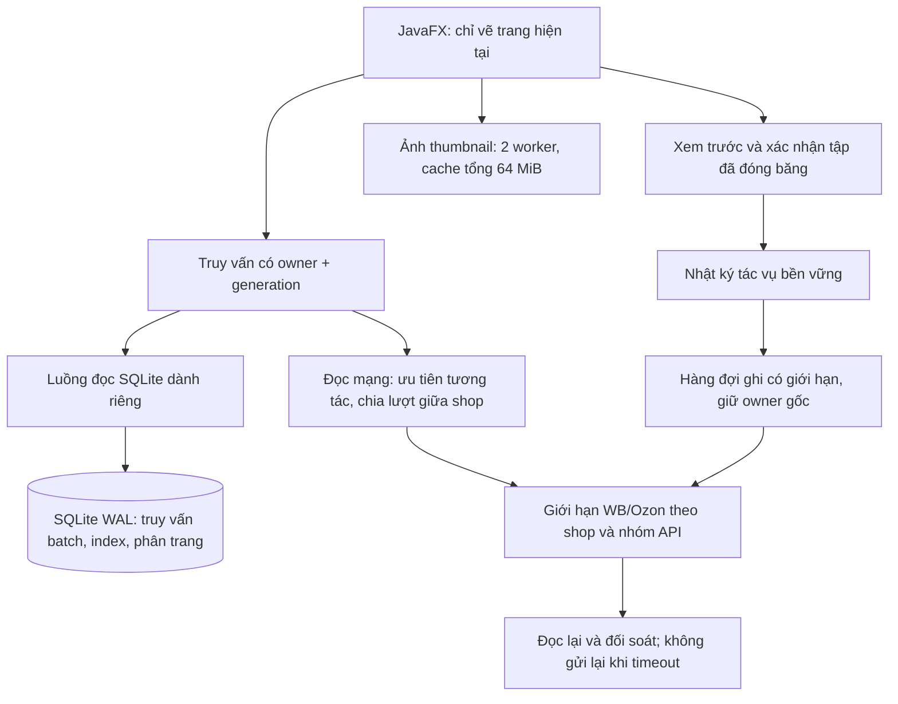

# VN code — thiết kế vận hành 10 cửa hàng trong cùng bản cập nhật

Yêu cầu bổ sung ngày 11/10/2026: sau khi hoàn thiện các chức năng đã duyệt, tổ chức lại phần vận hành để 10 cửa hàng WB/Ozon dùng ổn định trên Windows, ưu tiên xử lý Ozon hay đơ. Cùng VN code 1.4.0, giữ dữ liệu và bộ cài nâng cấp. Tài liệu này bổ sung thiết kế Sản phẩm/GS1/sao chép/FBS đã duyệt.

## Mục tiêu và giả định

- Quản lý 10 cửa hàng đã cấu hình; không đồng bộ toàn bộ 10 catalog chỉ vì mở ứng dụng hoặc đổi shop.
- Máy mục tiêu: Windows 10/11 x64, 2 lõi CPU, RAM 4 GB, SSD. Đây là giả định kiểm thử; máy chậm hơn vẫn dùng phân trang nhưng chưa có cam kết độ trễ.
- Dữ liệu thử: 6 WB + 4 Ozon, 10.000 sản phẩm và 1.000 đơn hoạt động mỗi shop; thêm thử 10 shop Ozon để kiểm tra điểm nghẽn riêng.
- Cached thao tác/tab/shop p95 ≤ 300 ms; trang đầu dữ liệu cục bộ ≤ 1 s. Đo thực tế, không ghi đạt nếu chưa chạy. Không thể bảo đảm mọi thao tác mạng, thiết bị ký số hoặc in luôn tức thời.

## Ba hướng và lựa chọn đề xuất

| Hướng | Chi phí và ảnh hưởng | Lựa chọn |
|---|---|---|
| Tổ chức lại nội bộ JavaFX, dùng hàng đợi có giới hạn và đọc SQLite phân trang | Giữ app, dữ liệu, API và triển khai desktop; kiểm thử hồi quy từng luồng | Đề xuất |
| Mỗi shop một tiến trình | Cách ly lỗi tốt hơn nhưng tăng RAM và phức tạp đồng bộ/in/ký số trên máy 4 GB | Không chọn |
| Chuyển backend lên dịch vụ web | Cần server, mạng và vận hành lâu dài; thay đổi mô hình ứng dụng | Không chọn |

## Cấu trúc vận hành

Các lớp vận hành dùng chung thay cho thread/pool riêng theo màn hình. Số shop không làm tăng worker tuyến tính. Có ít nhất một luồng dành cho đọc dữ liệu cục bộ để một request Ozon chậm không giữ toàn bộ hàng đợi. Đọc mạng tối đa hai tác vụ cùng lúc; tác vụ nền theo lượt shop, kết hợp quota hiện có và Retry-After. Hàng đợi đọc/ảnh tối đa 64; thao tác ghi mới tối đa 32 chờ, không bỏ tác vụ đã gửi hoặc đã nhận vào nhật ký. Nếu đầy, UI báo bận và giữ trạng thái chưa gửi.

## Những đường gây đơ cần sửa

1. Ozon `loadLocal`: bỏ đọc DB trên FX, bỏ catalog.findAll và truy vấn mỗi SKU; count/sort đầy đủ trước trang 100 đơn; chỉ enrich SKU trên trang. Chuyển tab/đổi shop hiển thị cache, không tự sync cả catalog/GS1.
2. FBS WB/FBO, GS1, Znack và lịch sử: rà soát điểm gọi DB/mạng/giải mã ảnh trên FX; đưa công việc dài sang bộ điều phối. Không đổi logic nghiệp vụ ký số, KIZ, giấy tờ hoặc trạng thái sàn.
3. Khởi động và shop picker: chỉ dựng màn đang dùng; refresh shop list và trạng thái token không thực hiện đồng bộ lớn; UI callbacks gom theo lô thay vì mỗi sản phẩm.
4. Sao chép/cập nhật hàng loạt: lịch sử dùng tóm tắt nhẹ; chỉ đọc payload đầy đủ cho tác vụ đang xem. Không nạp hàng trăm file Base64 vào bộ nhớ để vẽ danh sách.
5. Shop switch: bỏ kết quả đọc cũ bằng generation và owner; hủy đọc không còn cần; tác vụ ghi đang gửi tiếp tục theo shop gốc và có thể mở lại nhật ký.
6. Đóng màn hình/app: bỏ listeners/timer/read callback và cache không còn dùng; không chạy vòng polling tốc độ cao hoặc thread mới theo mỗi shop.

## Dữ liệu và nâng cấp

Giữ schema 5 additive, bảng nghiệp vụ và appdata. Index/tables hỗ trợ truy vấn và nhật ký được thêm tương thích; không xoá lịch sử hoặc thay API token. Snapshot sao lưu nhất quán trước migration; giữ UpgradeCode 8CBBA0E2-6E73-4F56-9101-6BC0948D3C72. Không sửa các bộ cài/tag cũ.

## Kiểm tra và điều kiện phát hành

- RED → GREEN cho UI bị chặn bởi request chậm, stale shop callback, hàng đợi đầy, phân trang hơn 500 đơn và nhật ký nhẹ với giấy tờ lớn.
- 20 vòng × 10 shop, có HTTP chậm/429/timeout; số worker không tăng theo shop, queue giảm về 0, thumbnail không vượt 64 MiB, payload/listener/view không tăng qua các vòng.
- Hai dataset 6 WB/4 Ozon và 10 Ozon. Tất cả là dữ liệu giả, không gửi request ghi lên seller thật.
- Maven clean verify + Node contracts + bốn ngôn ngữ/hai kích thước cửa sổ.
- Native Windows app-image/installer, nâng cấp 1.3.0→1.4.0, DPI/DPAPI và screenshot. Benchmark máy 2 lõi/4 GB phải có phần cứng và số đo riêng; Linux hoặc Windows CI mạnh hơn không được trình bày là đã đạt trên máy yếu.
- Reviewer độc lập cuối nhánh, xử lý lỗi quan trọng rồi mới phát hành. Release mô tả đúng các phần đã kiểm tra và các hạn chế thiết bị/tài khoản thật.

## Phạm vi bảo toàn

Các chức năng đã duyệt tiếp tục hoàn thiện trong lúc rà soát thiết kế bổ sung. Việc tổ chức vận hành thay đổi cách lập lịch và nạp dữ liệu; giữ hành vi kinh doanh và các cổng xác nhận ghi. Không thêm server, giấy phép mới hoặc ứng dụng thứ hai.
