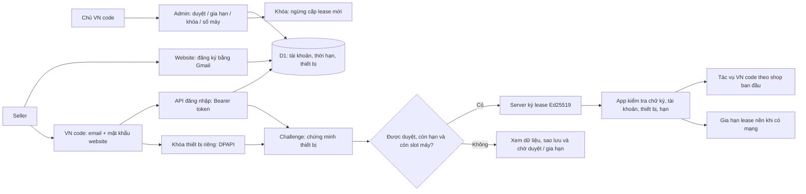

# VN code — tài khoản website, quyền offline và giới hạn thiết bị

**Trạng thái: thiết kế B đã được người sở hữu duyệt, chưa triển khai.** Ngày 12/10/2026. Bổ sung vào cùng bản cập nhật VN code 1.4.0. Người sở hữu đã yêu cầu đổi phương án online đơn thuần sang offline + giới hạn máy, đồng thời xác nhận dùng tài khoản Gmail đã đăng ký trên website; admin có quyền duyệt, gia hạn và khóa tài khoản. [Kế hoạch client đang chờ rà soát](../plans/2026-10-12-vn-code-account-license-client.md); [hợp đồng API bổ sung đề xuất](../../research/2026-10-12-vn-code-account-license-contract.md).

[Bằng chứng API hiện có](../../research/2026-10-12-vn-code-license-api.md) chỉ là README và kiểm tra GET không đăng nhập. Chưa có mã Worker/schema/test backend trong tệp đã nhận. Các endpoint ký quyền và quản lý thiết bị bên dưới là **đề xuất mới**, chưa tồn tại theo bằng chứng hiện có.

## Mục tiêu và tương thích

Gmail đã đăng ký là tên đăng nhập VN code; mật khẩu là mật khẩu đã tạo trên website. Thiết kế không cần truy cập hộp thư Gmail hoặc tích hợp Google OAuth. Website là nguồn quyết định duyệt, thời hạn và khóa; không dùng role hiển thị trên app làm quyền. Mã VNC đang có trên website có thể tiếp tục gia hạn tài khoản theo backend hiện có; khách không cần nhập mã riêng vào desktop.

Giữ cùng Java 25/JavaFX Windows app, AppData, dữ liệu, template, lịch sử và UpgradeCode `8CBBA0E2-6E73-4F56-9101-6BC0948D3C72`. Áp dụng từ bản cập nhật mới; không sửa bộ cài/tag hay quyền miễn phí của các bản đã phát hành. Không tạo một seller app khác.

Mục tiêu hiệu năng 10 shop đã duyệt giữ nguyên. Giới hạn thiết bị và hiệu năng cửa hàng là hai chính sách khác nhau; không tự tạo bảng giá hoặc hạn mức shop thương mại.

## Hai phương án và lựa chọn

| Phương án | Khả năng | Điều kiện |
|---|---|---|
| A. Chỉ dùng login/me | Duyệt/gia hạn/khóa tài khoản online | Không có chứng cứ quyền offline hoặc giới hạn thiết bị; người sở hữu đã yêu cầu thay đổi |
| **B. Tài khoản + lease ký số + thiết bị — đã duyệt** | Đăng nhập bằng email website, hạn quyền do admin quản lý, offline có thời hạn, giới hạn máy trên server | Cần thêm API/schema backend và khóa ký riêng của người sở hữu; client chỉ giữ public key |

Chọn B. Dùng Ed25519 tiêu chuẩn với JDK/Web Crypto, không thuê SDK cấp phép thương mại. Khóa ký này là riêng của VN code; không dùng key hoặc dịch vụ cấp phép của bên khác. IP không dùng làm định danh máy vì NAT, VPN và địa chỉ thay đổi.

## Luồng tài khoản

Đăng ký/xác minh email và quản lý mã giữ trên website. App đăng nhập, kích hoạt thiết bị, kiểm tra quyền và mở dashboard khi khách cần gia hạn. Pending/suspended/expired không được nhận lease sử dụng mới.

## Chính sách đã được duyệt

- **Mặc định một máy/tài khoản**, admin chỉnh 1–10 máy theo từng tài khoản; có màn danh sách máy, lần kiểm tra gần nhất và thu hồi máy. Tài khoản mới không tự được trial chỉ nhờ đăng ký.
- **Mặc định tối đa 72 giờ khi không liên lạc được license server**, admin có thể chọn 6–168 giờ. Lease không vượt hạn sử dụng tài khoản. Lần đăng nhập/kích hoạt đầu tiên bắt buộc online; không tự cấp lease từ cache.
- App thử xác thực khi khởi động, làm mới nền mỗi 6 giờ có jitter và cho phép Kiểm tra lại. Khi license server trả khóa/thu hồi/hết hạn rõ ràng, app ngừng mở tác vụ mới ngay khi nhận kết quả, không quay về lease cũ.
- Khi server mất kết nối, chỉ dùng lease chữ ký hợp lệ còn thời hạn và đúng máy. Máy chưa biết tài khoản đã bị khóa có thể dùng đến khi lease offline hết hạn, tối đa 72 giờ theo mặc định. Không hứa khóa tức thì một máy đang offline.
- Giải phóng slot do admin thu hồi cho phép máy mới đăng ký, nhưng lease cũ chưa kết nối vẫn có thể còn hạn offline; giao diện admin phải chỉ rõ độ trễ này. Thời lượng offline ký trong lease đã cấp không thể rút ngắn khi máy không kết nối.
- Hết quyền vẫn xem dữ liệu đã lưu, lịch sử, xem trước bản in cũ, xuất dữ liệu/sao lưu, đăng nhập/gia hạn và đối soát tác vụ đã gửi. Không xóa shop, template hoặc journal.

Các mặc định đã được duyệt cho bản cập nhật, chưa được công bố là cấu hình backend hiện tại. Admin quản lý quyền tài khoản của chính mình theo cùng dữ liệu server; app không có mật khẩu/key chủ ẩn để bỏ kiểm tra.

## Thiết bị và lease

Mỗi cài đặt tạo cặp khóa Ed25519 thiết bị. Private key lưu bằng DPAPI current-user; device ID là hash public key. Server đăng ký public key và yêu cầu chữ ký challenge một lần khi activate/renew/deactivate. Có account ID, device ID, mục đích, hạn challenge và nonce trong dữ liệu chứng minh; không dùng chữ ký chung cho nhiều tác vụ. Không gửi MachineGuid, địa chỉ MAC hoặc thông tin hộp thư thô lên website.

Giới hạn máy được thực thi bằng giao dịch server: hai activate đồng thời không được nhận cùng slot cuối; re-activate đúng public key không tăng số máy. Nonce chỉ dùng một lần và quota kiểm tra lại trong cùng thao tác nguyên tử. D1/schema hiện có phải được đọc trước khi chọn SQL/migration cụ thể; không giả dùng transaction API không được Workers hỗ trợ.

Lease gồm `formatVersion`, `product=vncode`, `accountId`, `devicePublicKeyHash`, `licenseRevision`, `issuedAt`, `notBefore`, `expiresAt`, `subscriptionExpiresAt`, `maxDevices`, `offlineHours` và danh sách quyền. Thời gian là Unix giây UTC. `expiresAt` không vượt `subscriptionExpiresAt` hoặc `issuedAt + offlineHours`. Bearer token 7 ngày theo README không tự tạo bảy ngày sử dụng.

Envelope gồm `keyId`, `payload` Base64URL và `signature` Base64URL. Server ký chính xác byte payload UTF-8, app xác minh các byte đó trước parse; không ký lại JSON bằng thứ tự trường khác nhau. Public key tin cậy pin trong bản dựng, không chấp nhận public key tùy ý đi kèm response. Nếu cần xoay khóa, danh sách public key mới phải được root đã tin cậy ký hoặc đi qua bản cập nhật đã kiểm tra.

App giải mã private key thiết bị để chứng minh đúng máy; lease sao chép sang Windows user/máy khác không đủ mở quyền. DPAPI và chữ ký bảo vệ luồng thông thường; không quảng cáo khả năng chống mọi can thiệp vào binary hoặc clone toàn bộ hệ điều hành.

## Hợp đồng API và phạm vi backend

Giữ `POST /api/client/login` và `GET /api/client/me` tương thích. Hợp đồng bổ sung đề xuất:

| Endpoint mới | Nội dung |
|---|---|
| `POST /api/client/device/challenge` | Bearer, public key/hash, mục đích; trả challenge ID, nonce, thời hạn và thời gian server |
| `POST /api/client/device/activate` | Bearer, public key, challenge ID, chữ ký; đăng ký slot nguyên tử và trả lease |
| `POST /api/client/license/renew` | Bearer, device ID, challenge ID, chữ ký; kiểm tra lại tài khoản/thiết bị rồi cấp lease |
| `GET /api/client/devices` | Chỉ danh sách thiết bị của tài khoản đang xác thực |
| `POST /api/client/device/deactivate` | Proof của chính thiết bị và xác nhận giải phóng slot; server thu hồi thiết bị đó |
| `POST /api/admin/users/:id/license-policy` | Admin sửa `max_devices`/`offline_hours`, có audit |
| `GET /api/admin/users/:id/devices` | Admin xem thiết bị, lần kiểm tra gần nhất và hạn offline đã cấp |
| `POST /api/admin/users/:id/devices/:deviceId/revoke` | Admin thu hồi đúng thiết bị, có audit |

Response quyền có lease ký số và metadata hiển thị. Response lỗi dùng mã phân biệt pending, suspended, expired, device limit, bad proof, expired session và retryable server/network error. Endpoint đề xuất không được coi là đang tồn tại. Sau khi đọc Worker, nếu đã có hợp đồng tương đương thì adapter dùng hợp đồng đó và cập nhật tài liệu trước triển khai; không tạo endpoint cạnh tranh cho cùng quyền.

Admin dùng cơ chế auth hiện có, thêm `maxDevices`/`offlineHours` và quản lý thiết bị. Duyệt/gia hạn/khóa tăng `licenseRevision`; thu hồi phải vô hiệu hóa phiên/challenge phù hợp và từ chối cấp lease mới cho quyền/thiết bị bị khóa. Không chặn kiểm tra đọc trạng thái chỉ vì account không active: client cần biết lý do và hiển thị cách xử lý.

Migration additive, giữ users, thời hạn, mã VNC và lịch sử cũ. Signing private key nằm trong Worker secret; desktop/repository chỉ có public key. Không yêu cầu người sở hữu gửi admin password, Cloudflare token hoặc private key trong chat. Không deploy Worker hoặc chạy migration D1 thật chỉ để viết/test client.

## Tổ chức trong app và hiệu năng

Một `LicenseService`/session toàn ứng dụng; snapshot trạng thái bất biến, một timer, hàng đợi giới hạn và đồng gộp renew đang chạy. Không nhân session/request/timer theo mười shop. Token và khóa thiết bị/lease lưu qua DPAPI; nếu DPAPI lỗi thì không fallback plaintext. Đăng xuất tăng generation và xóa phiên cục bộ, response cũ không khôi phục quyền. Việc giải phóng slot máy phải có xác nhận và gọi server; mất mạng không báo đã giải phóng.

HTTPS origin cố định `vncode.id.vn`, response tối đa 64 KiB, timeout hữu hạn và không redirect chứa token. Chạy mạng, mật mã và file ngoài JavaFX. Không log token, mật khẩu, PII, body upstream hoặc private key. Một request license treo không chiếm luồng đọc SQLite hoặc khóa điều hướng shop.

Gate đặt tại service trước tác vụ mới cần quyền: đồng bộ API, thêm/sửa shop, đăng ký GTIN/KIZ, copy/sửa bài, đóng gói và tạo/in tem mới. Lease kiểm tra lại ngay khi tác vụ rời hàng đợi; chỉ disable nút là chưa đủ. Tác vụ giữ owner của shop gốc. Request đã gửi tiếp tục ghi checkpoint; không hủy kết quả hoặc tự gửi lại. Card chưa gửi trong batch dừng khi đã biết quyền hết hạn/thu hồi. Đối soát và các bước hoàn thiện request đã được sàn nhận tuân theo checkpoint, không nhận job mới.

## Đồng hồ, trạng thái và UI

Ghi mốc giờ server/giờ đã quan sát được cùng trạng thái bảo vệ; chạy trong process dùng thời gian monotonic để không kéo dài quyền bằng chỉnh giờ. Sau restart, phát hiện đồng hồ lùi bất thường thì yêu cầu xác minh online. Cho dung sai 5 phút; không dùng đồng hồ cục bộ làm chứng cứ gia hạn. Khi dữ liệu bảo vệ bị xóa/hỏng, không tự tạo quyền offline mới. Chống quay lại toàn bộ snapshot máy vẫn có giới hạn của desktop offline và phải nói đúng khi nghiệm thu.

Cài đặt → Tài khoản VN code: email website, trạng thái, hạn tài khoản, hạn offline, số máy đang dùng/hạn mức; Đăng nhập, Kiểm tra lại, Gia hạn trên website, Quản lý thiết bị và Đăng xuất. Hiển thị Pending/Đang chờ duyệt, Active, Offline còn hạn, Expired, Suspended, Device limit, và Chưa kiểm tra được riêng nhau. Không còn yêu cầu nhập mã của dịch vụ khác; không gọi việc mất mạng là bị khóa. Đồng bộ copy VI/RU/EN/ZH, logo VN trắng nền đen và layout hiện tại giữ nguyên.

## Kiểm thử và cổng phát hành

Client: response auth/missing fields/epoch giây; lease đúng và chữ ký/payload/account/device/product/key ID bị sửa; lease chưa có hiệu lực/hết hạn, rollback giờ, dữ liệu hỏng; active/admin không thay chữ ký; đăng xuất trong request; timeout/401/429/5xx; redirect/body quá lớn; mười shop dùng một session, UI phản hồi và queue hữu hạn. Test service chứng minh ngăn tác vụ mới nhưng giữ journal/owner/checkpoint của request đã gửi.

Backend: giữ dữ liệu migration, bearer/cookie scope, admin authorization, activate cạnh tranh slot cuối, challenge replay/expiry, cùng thiết bị activate lại, account pending/suspended/expired, gia hạn/thu hồi revision, thu hồi token cũ, giới hạn máy, thời hạn lease đúng policy và key lưu server-only. Dùng SQLite/D1 runtime test phù hợp; Node mocks không thay nghiệm thu Workers.

Windows CI: DPAPI current-user, lease/khóa không plaintext, nâng cấp cùng identity và dữ liệu, bốn locale/DPI. Người sở hữu dùng tài khoản thử riêng để nghiệm thu website đã deploy: duyệt → đăng nhập → hết hạn/gia hạn → khóa → hết offline → thu hồi máy. Không dùng key/account seller thật trong CI.

Phần nghiên cứu có thể hoàn thành từ README, nhưng tích hợp offline/giới hạn máy production cần Worker/schema/migration/test thực tế và public signing key do chủ phần mềm thiết lập. Không phát hành installer với public key thử hoặc cho phép tự chọn server để bỏ kiểm tra. Review Products/10-shop đã có không bao phủ phần license mới. Bản 1.4.0 chỉ đóng gói/publish sau các cổng kiểm tra của mọi phần đã được đưa vào.
