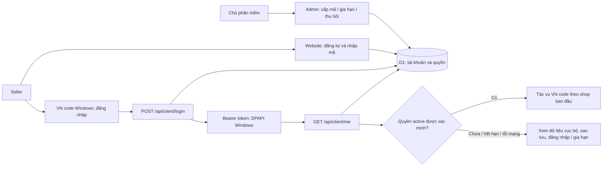

# VN code — thiết kế đề xuất kết nối website cấp key

**Trạng thái: đề xuất để người sở hữu duyệt; chưa triển khai.** Phần này bổ sung vào bản cập nhật VN code 1.4.0 hiện tại. Các thiết kế Products/Copy/GS1/FBS và 10 shop đã duyệt tiếp tục giữ hiệu lực. [Bằng chứng API](../../research/2026-10-12-vn-code-license-api.md) phân biệt tài liệu với kiểm tra thực tế.

## Mục tiêu và phạm vi

Người sở hữu quản lý tài khoản, mã và thời hạn trên `vncode.id.vn/admin`. Seller dùng cùng VN code Windows, đăng nhập bằng tài khoản website và nhận quyền theo server. Không tạo ứng dụng seller thứ hai, không sửa bộ cài/tag đã phát hành, không đổi thư mục dữ liệu hoặc UpgradeCode `8CBBA0E2-6E73-4F56-9101-6BC0948D3C72`.

Áp dụng kiểm tra quyền từ bản cập nhật mới. Các bản cá nhân đã phát hành vẫn giữ hành vi hiện tại; việc hạ cấp vẫn tuân theo kiểm tra schema để bảo vệ dữ liệu. Chính sách thương mại này không được trình bày như cách vô hiệu hóa các bản cũ.

## Hai phương án

| Phương án | Được gì | Chi phí và điều kiện |
|---|---|---|
| **A. API tài khoản hiện có — đề xuất** | Dùng `/api/client/login` và `/api/client/me`, gia hạn/thu hồi qua website, không thêm cơ sở dữ liệu cấp key | Cần mạng khi xác minh quyền; chưa có giới hạn máy hoặc lease offline đã xác minh |
| B. Bổ sung lease ký số và quản lý thiết bị | Có thể cấp quyền tạm khi license server mất kết nối, quản lý số máy | Cần mã backend, migration, khóa ký riêng của người sở hữu và chính sách thiết bị; lớn hơn yêu cầu liên kết hiện tại |

Thiết kế bên dưới chọn A. Số cửa hàng phục vụ mục tiêu hiệu năng 10 shop; không tự biến thành hạn mức bán hàng. IP không là định danh license vì NAT, VPN và địa chỉ thay đổi. Quản lý thiết bị/lease ký số cần thiết kế bổ sung khi có backend, không hứa hỗ trợ trong A.

## Luồng sử dụng

Seller nhập mã trên dashboard website. Màn Cài đặt → Tài khoản VN code có email, trạng thái, ngày hết hạn, Đăng nhập, Kiểm tra lại, Mở trang nhập mã/gia hạn và Đăng xuất. Không lưu hoặc hiển thị mật khẩu sau đăng nhập. Logo VN trắng nền đen và bố cục hiện tại giữ nguyên. Text đồng bộ VI/RU/EN/ZH.

## Thành phần và quyền

- Một `LicenseApiClient` cho origin HTTPS cố định `vncode.id.vn`. Không redirect mang token, không chuyển mật khẩu/token sang host khác, response giới hạn 64 KiB. Timeout mạng hữu hạn; không log body upstream, email, token hoặc mật khẩu.
- Một `LicenseSession` toàn ứng dụng, snapshot trạng thái bất biến, đồng gộp yêu cầu đang chạy; không tạo session/timer theo shop. Đăng xuất/đăng nhập mới tăng generation để response cũ không khôi phục tài khoản trước.
- Kho token dùng `WindowsSecretProtector`/DPAPI current-user hiện có. Không lưu plaintext khi DPAPI lỗi hoặc chạy trên OS không hỗ trợ. Token bị hỏng/hết phiên đưa về đăng nhập; không xóa dữ liệu shop, mẫu hoặc lịch sử.
- Quyền nghiệp vụ được kiểm tra tại service, không chỉ disable nút. Server phải trả `user.active` là boolean `true`; `role=admin`, trạng thái UI hoặc token còn hạn không tự chứng minh quyền.
- Khi khởi động, ứng dụng vẫn mở dữ liệu cục bộ rồi xác minh nền. Trước tác vụ mới cần quyền — đồng bộ API, thêm/sửa shop, đăng ký GTIN/KIZ, copy/sửa bài, đóng gói, tạo/in tem mới — lấy kết quả server cho hành động đó. Các yêu cầu đồng thời dùng cùng request đang chạy, không dùng cache đã lưu để mở khóa offline. Nếu tác vụ chờ lâu trong hàng đợi, xác minh lại trước lần ghi đầu tiên.
- Xem dữ liệu đã lưu, lịch sử, xem trước bản in đã lưu, xuất dữ liệu/sao lưu, cấu hình đăng nhập và mở website vẫn dùng được khi quyền chưa xác minh/hết hạn. Đối soát tác vụ đã gửi tiếp tục đọc trạng thái theo owner/checkpoint; không tự gửi lại hay nhận tác vụ ghi mới.
- Thu hồi/hết hạn không cắt request đang gửi hoặc xóa journal. Hoàn tất checkpoint của kết quả đã nhận, không bắt đầu card chưa gửi trong một batch sau khi biết quyền không còn hiệu lực. Các bước hoàn thiện tác vụ đã được sàn nhận chỉ chạy theo checkpoint và chính sách xác nhận hiện có.

## Thời hạn và lỗi

`expires_at` chuyển từ Unix giây sang UTC; màn hình hiển thị giờ địa phương. Hạn Bearer 7 ngày và hạn license xử lý riêng. Mọi quyết định mở quyền xuất phát từ response server; dữ liệu hiển thị còn lại trong cache không là chứng cứ cấp quyền.

HTTP 401 yêu cầu đăng nhập lại. `active=false` hiển thị quyền chưa có/hết hạn/khóa theo dữ liệu được server trả, không đoán lý do chưa xác minh. HTTP 429 hiện cần chờ và tôn trọng `Retry-After` có giới hạn; 5xx/timeout báo chưa kiểm tra được, không báo thu hồi. Response thiếu trường/sai kiểu/timestamp vô lý không mở quyền. Kiểm tra mạng và DPAPI chạy ngoài JavaFX; UI luôn có phản hồi, một yêu cầu pending không làm đơ mười shop.

Đăng xuất trước mắt xóa token cục bộ. README chưa mô tả endpoint logout desktop; không công bố thu hồi token server khi chưa có hợp đồng. Admin thu hồi chỉ được nghiệm thu sau khi xác minh server từ chối token cũ. Không khẳng định thu hồi tức thì trong lúc app không có kết nối.

## Kiểm thử và nghiệm thu

Mock HTTP kiểm tra đúng endpoint/headers, `active` đúng kiểu, expired/401/403/429/5xx/timeout, epoch giây, giới hạn body, redirect không lộ token và response cũ sau đăng xuất. Test service chứng minh không có tác vụ mới khi quyền chưa xác minh, không hủy request đã gửi và không mất journal. Test mười shop chứng minh một session, pending có giới hạn và FX vẫn xử lý thao tác.

Windows CI kiểm tra lưu/đọc token bằng DPAPI không có plaintext và giữ schema/dữ liệu/identity khi nâng cấp. Kiểm thử web thực tế do người sở hữu dùng tài khoản thử riêng: đăng nhập có quyền, nhập mã/gia hạn, hết hạn và thu hồi token cũ. Không dùng tài khoản hoặc key seller thật trong CI.

Chưa có mã backend hoặc response đăng nhập đã xác minh. Vì vậy có thể duyệt thiết kế A và lập kế hoạch client theo hợp đồng tài liệu, nhưng chưa công bố liên kết production hoàn tất, chống chia sẻ thiết bị, bảo mật redeem hay thu hồi phiên. Nếu backend không trả hợp đồng này, sửa adapter/hợp đồng đã xác minh; không thêm fallback cho phép dùng app chỉ từ cache.

## Ranh giới phát hành

License client phải qua kiểm tra riêng trước khi đưa vào installer 1.4.0; kết quả review Products/10-shop trước đó không bao phủ license. Chỉ build/publish installer sau khi các phần được thêm vào cùng bản cập nhật đã qua cổng kiểm tra tương ứng. Không triển khai Worker, tạo/sửa tài khoản, phát hành mã hoặc sửa D1 thật chỉ bằng thao tác viết mã client.
