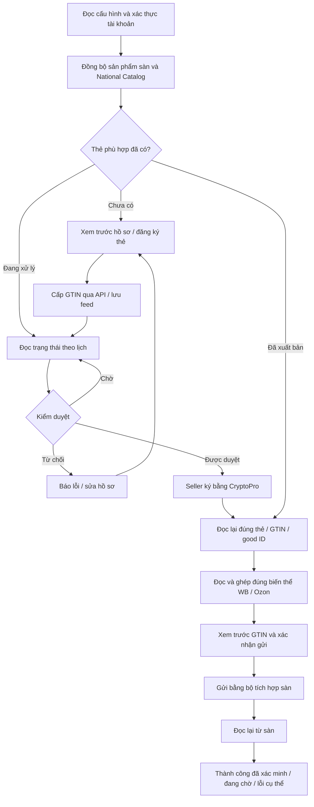

# Mục 1 đã duyệt: đăng ký thẻ Znack và xác minh đồng bộ GTIN

Ngày thực hiện: 16/10/2026 (giờ Moskva).

## Phạm vi được duyệt

Người dùng duyệt sơ đồ đã bổ sung nhánh tạo/đăng ký thẻ: đồng bộ sản phẩm sàn
và National Catalog → dùng thẻ có sẵn hoặc đăng ký thẻ còn thiếu → theo dõi
kiểm duyệt → ký CryptoPro → xác minh thẻ → xem trước và xác nhận GTIN lên
WB/Ozon → đọc lại từ sàn và báo cáo. Các mục 2–7 cần sơ đồ/phê duyệt riêng.

## Thay đổi mã

| Bước | Hành vi sau sửa |
| --- | --- |
| Kết nối Catalog | Luồng đăng ký dùng `CatalogConnectionService.apiForRead`, hỗ trợ lấy khóa Catalog trên máy mới qua chứng thư đã cấu hình, giữ kiểm tra chủ tài khoản và bảo vệ khóa theo máy. |
| Tạo/đăng ký thẻ | Giữ hồ sơ, GTIN và feed đã cấp; không lặp POST khi kết quả chưa rõ. Không tự tạo GTIN cục bộ. |
| Theo dõi duyệt | `ZnackRegistrationMonitor` đọc tối đa 3 thẻ mỗi lượt trong worker Znack hiện có. Không thêm scheduler/pool. Thẻ chờ duyệt không giữ worker ngủ 10 phút; thẻ đủ điều kiện chờ thao tác ký riêng. |
| Ký | WB đọc lại đúng feed/GTIN/good ID sau POST chữ ký. Nhận chữ ký chưa đủ để báo xuất bản. Lỗi từng dòng hoặc good ID thay đổi không được xác nhận thành công. Ozon giữ cơ chế đọc lại và thêm kiểm tra good ID. |
| Mở đồng bộ GTIN | Nút WB và Ozon mở luồng đọc mới, đối chiếu và xem trước; sửa đường dẫn trước đây chỉ mở báo cáo hoặc quay lại màn đăng ký. |
| Chọn sản phẩm | Đọc lại sản phẩm sàn và Znack; chỉ dòng ghép được GTIN đã xuất bản mới được chọn. Ozon kiểm tra lại product ID/offer ID, SKU, tên sản phẩm và biến thể so với dữ liệu đã xem. |
| Xác nhận | Mặc định chỉ chọn trường GTIN; các thay đổi giấy tờ/thuộc tính không tự được chọn. Seller xem trước và xác nhận trước khi ghi. Đọc Znack tự động không đồng nghĩa đồng ý ghi GTIN lên sàn. |
| Đọc lại | Bộ tích hợp WB/Ozon kiểm tra GTIN trên đúng đích và giữ barcode cũ. Ozon bổ sung tên sản phẩm vào fingerprint trước gửi và đọc lại. |
| Tiếp tục sau gián đoạn | Chỉ tiếp tục child job đã xác nhận; dòng cũ chưa có xác nhận trở về chờ duyệt. Kết quả không rõ được đọc lại, không tự gửi POST lần nữa. |
| Báo cáo | Có trạng thái chờ xác nhận, mã lý do từng dòng và liên kết child job. Bước kích hoạt mapping đăng ký được chạy sau kết quả xác minh của child. Ghi báo cáo theo lô thay vì một transaction cho từng GTIN. |

## Luồng triển khai



## Kiểm thử và giới hạn

- Lượt kiểm thử tập trung sau thêm luồng xuyên suốt: 116 bài qua, 0 lỗi,
  trước khi bổ sung bộ theo dõi duyệt. Kiểm thử hồi quy cuối sẽ được ghi bên dưới.
- Hai kiểm thử xuyên suốt dùng workflow đăng ký thật trong mã, parser Catalog,
  bộ tích hợp WB/Ozon, hàng đợi và SQLite thật; HTTP và chữ ký dùng fixture.
  Kiểm tra thẻ draft bị chặn, thẻ xuất bản được gửi một lần, đọc lại đúng
  GTIN và giữ barcode cũ. Ozon kiểm tra thêm bước kích hoạt mapping gốc.
- Có kiểm thử chữ ký đã nhận nhưng chưa xuất bản, phản hồi sai GTIN, lỗi
  từng dòng không có message, đổi SKU/tên, mất kết nối khi đọc lại và luồng
  đọc trạng thái không phát sinh cấp mã/gửi hồ sơ/ký mới.
- Không có binding tài khoản WB/Ozon/Znack hoặc CryptoPro thật trong môi
  trường này. **Chưa nghiệm thu đọc/ghi GTIN trên sàn thật hoặc máy seller thứ hai.**
- WBCode Latest đối chiếu lại là `v1.3.9`, phát hành 15/10/2026; tài sản công
  khai có EXE/DMG/manifest/checksum. Mã nội bộ phiên bản đó không công khai.
  Mã WCode công khai cũ và dữ liệu đối chiếu nằm trong `docs/research/`.
- Build Windows run `38893594183` dùng nguồn cũ `1940c0b…`; dù thành công
  cũng không chứng minh các thay đổi mục 1 trong tài liệu này đã qua native test.
- Không phát hành Release, đổi Latest hoặc thực hiện giao dịch seller.

## Kiểm tra API thật theo danh mục bộ quần áo

Người dùng chọn nhóm **bộ quần áo** cho dữ liệu thử. Công cụ chỉ đọc:

```bash
node tools/check-marketplace-gtin-readonly.mjs --category sets --output /tmp/vncode-live-sets.json
```

Nhập thông tin qua Secrets của môi trường, không truyền qua tham số lệnh
hoặc chat: `VNCODE_WB_TEST_API_KEY`, `VNCODE_OZON_TEST_CLIENT_ID`,
`VNCODE_OZON_TEST_API_KEY`; tùy chọn khóa đọc Catalog
`VNCODE_CATALOG_TEST_API_KEY`. Các yêu cầu Secret đã lưu vào bản nháp cấu
hình; chưa có giá trị được cấp vào tiến trình đang chạy. Cần lưu/Publish
môi trường để áp dụng. Không thay mạng unrestricted hoặc xóa cấu hình cũ.

Công cụ quét tối đa 1.000 sản phẩm mỗi sàn và trả tối đa 20 biến thể gợi ý
từ tên/nhóm bộ quần áo (tiếng Việt/Nga/Anh), với mã WB hoặc native Ozon
product/offer/SKU. Gợi ý vẫn cần đối chiếu với thẻ đã xuất bản và xem trước
trước khi ghi. Nó chỉ gọi các endpoint đọc danh mục/chi tiết; giữ xác minh
TLS, không chuyển credential theo redirect, không ghi dữ liệu lên sàn,
không ghi API key/header/URL có key vào báo cáo. Đọc product-list Catalog
không được coi là bằng chứng thẻ đã xuất bản.

7 kiểm thử Node của công cụ đã qua: thiếu cấu hình không gửi request;
đúng endpoint và header; native Ozon SKU/offer; từ chối detail ngoại lai;
không lộ thông tin từ lỗi HTTP; phân biệt list với xác minh xuất bản; lọc
nhóm bộ mà không tự chọn sản phẩm không liên quan.

## Nghiệm thu trên tài khoản thật còn cần

1. Trên một máy có CryptoPro/chứng thư đã kiểm tra, chọn một sản phẩm thử của
   mỗi sàn; xác nhận đã đọc được cả sản phẩm sàn và Catalog.
2. Với sản phẩm chưa có thẻ, xem trước hồ sơ và đăng ký; lưu feed/GTIN, theo
   dõi duyệt, ký khi được duyệt. Với thẻ đã có, dùng đúng thẻ đó.
3. Bấm đồng bộ GTIN, chọn đúng sản phẩm/biến thể, kiểm tra tên/SKU của Ozon,
   xem trước và xác nhận gửi.
4. Đối chiếu báo cáo với trang sản phẩm thật trên sàn: đúng GTIN, đúng biến
   thể, barcode cũ còn đủ. Thử đóng/mở lại app khi đang chờ để kiểm tra tiếp tục.
5. Lặp lại bước đọc và một sản phẩm thử đã chọn trên máy thứ hai. Không gửi
   private key, API key, token hoặc license vào hội thoại/báo cáo.

## Kết quả hồi quy cuối

- Source kiểm thử: `bf6fa35f4eefcd2687fd24b32f730fc4eda70e76`; mã ứng dụng ở `9c48480077c72c881d51e2e18c60c5de8c48989c`.
- Java: **1425 bài, 1423 qua, 0 failure/error, 2 skip**; hoàn tất `2026-10-16T12:06:57Z`. Hai skip thuộc `Gs1PrefixTemplateStoreTest` và `WindowsSecretProtectorTest` theo điều kiện nền tảng.
- Công cụ API chỉ đọc: **7/7 bài qua**. Chạy readiness hiện trả exit 2 vì chưa có bốn binding API, không có request sàn hay mutation nào.
- Lượt hồi quy trước phát hiện fixture 300 thẻ trả cùng good ID 91 trong khi mỗi thẻ đã lưu ID khác. Sửa fixture trả đúng ID tương ứng, giữ nguyên kiểm tra định danh chặt và toàn bộ assertion; lượt cuối toàn bộ suite qua.
- Native Windows build nguồn cũ đã thành công; chưa build/nghiệm thu native cho mã mục 1.
- Các mục 2–7 vẫn chờ sơ đồ và phê duyệt riêng.
- [Bằng chứng dạng JSON](2026-10-16-approved-item-1-checks.json).
