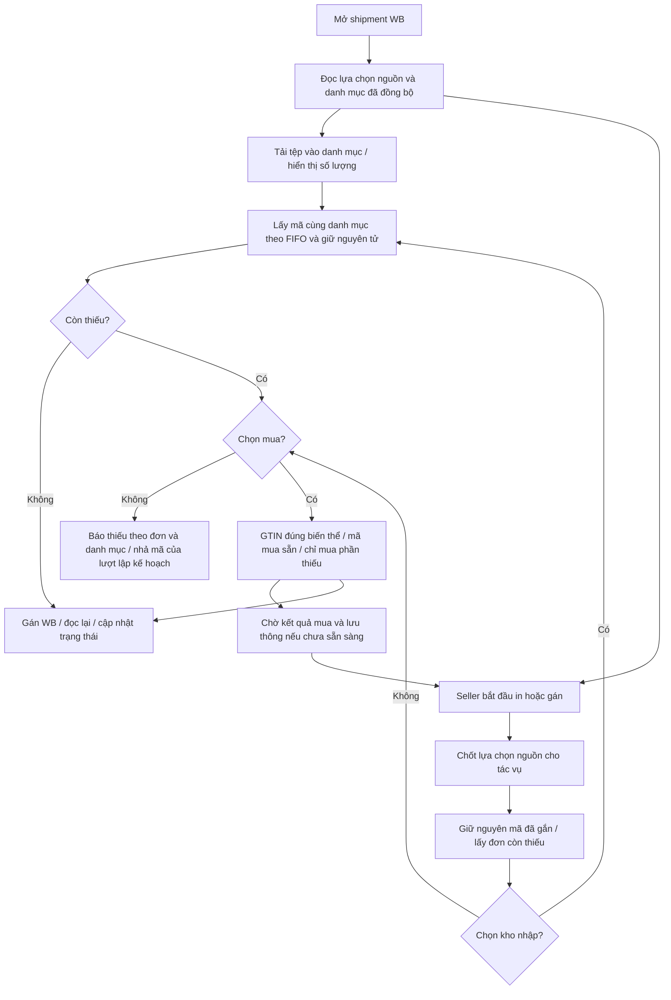
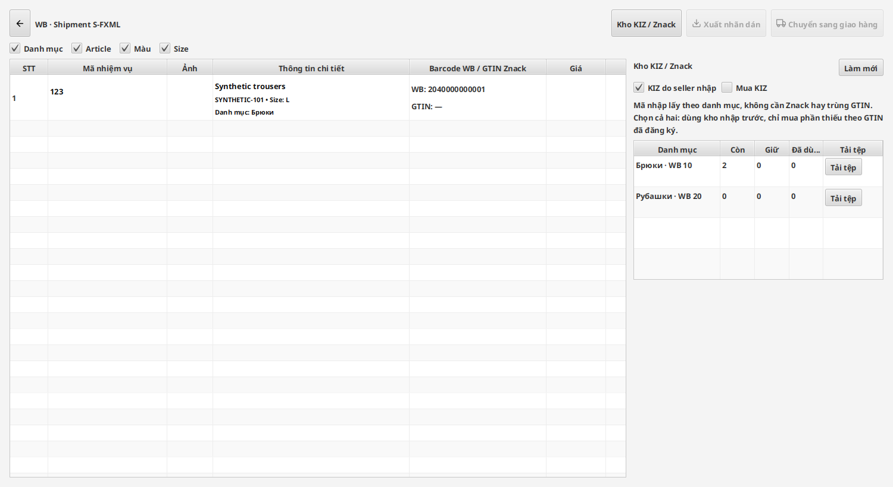

# Mục 2 — nguồn KIZ trong shipment WB

Người dùng đã duyệt sơ đồ và quy tắc nguồn trước khi triển khai. Phạm vi
này là shipment FBS của WB; giao diện/luồng Ozon ở mục 3 vẫn chờ sơ đồ riêng.
Chưa phát hành bộ cài hoặc thay Latest.

Theo bổ sung của người dùng: **giữ nguyên pipeline mua KIZ hiện tại**.
Không sửa các bước đặt mua, ký, tải mã, đưa vào lưu thông và đối soát trong
`ZnackPurchaseCoordinator`. Mục này thêm lựa chọn nguồn và tính phần thiếu
đưa vào pipeline đó; nguồn mua vẫn kiểm tra GTIN như trước.

## Kết quả triển khai

| Phần | Hành vi |
| --- | --- |
| Kho KIZ / Znack trong shipment | Hai ô tích **KIZ do seller nhập** và **Mua KIZ**. Mặc định chỉ kho nhập. Lưu riêng theo cửa hàng, chủ cấu hình và shipment. |
| Danh mục | Tự đọc native subject ID từ sản phẩm WB đã đồng bộ. Có hàng riêng và nút tải tệp cho mỗi danh mục, kể cả tồn 0; cùng tên nhưng khác ID không trộn. Giữ nhóm và liên kết thủ công cũ. |
| Số lượng | Hiển thị còn dùng được, đang giữ và đã dùng theo danh mục. Đọc tổng hợp trong worker; bảng dùng ô tái sử dụng. Danh sách GTIN của nguồn mua cũng chỉ dựng thẻ đang nhìn thấy, không tạo hàng nghìn node cùng lúc. |
| Nhập tệp | Dùng bộ đọc định dạng KIZ hiện có. Xem trước số mã/lỗi/trùng; ghi mã và danh mục trong cùng transaction. Không gọi Znack hoặc đối chiếu GTIN của sản phẩm. Nhập lại cùng tệp không chuyển kho cũ sang danh mục khác. |
| Chỉ kho seller | Lấy FIFO trong đúng danh mục và giữ mã nguyên tử. Không đọc mapping Catalog cho bước cấp mã; thiếu thì báo các đơn/danh mục và nhả mã vừa giữ. Không gọi nguồn mua. |
| Chỉ mua | Không đếm hoặc cấp mã seller nhập, kể cả mã nhập đã được kiểm tra trước đó. Dùng mã mua đang sẵn sàng đúng GTIN; có thiếu mới đi qua kiểm tra mapping và hàng đợi mua Znack. |
| Cả hai | Kho nhập trước; chỉ phần còn thiếu đi vào nguồn mua đúng GTIN. Giao dịch mua đang dở/đưa vào lưu thông đang chờ được đối soát, tránh mua lặp. |
| Không chọn | Chặn bắt đầu cấp mã mới với thông báo chọn nguồn. |
| Tác vụ đang chạy | Cùng một bản chụp lựa chọn nguồn được truyền vào bước kiểm tra trước in và lần xuất/gán thật. Đổi cửa hàng không nhận kết quả đọc của cửa hàng cũ. |
| Gán/đọc lại WB | Giữ bộ gán và checkpoint hiện có; không thay mã đã gắn trong lượt chỉ bổ sung đơn thiếu. Phản hồi chưa rõ không được coi là thành công hoặc tự cấp lại mã cho đơn khác. |

Danh mục mới phát hiện nhưng chưa có mã nhập **không tự buộc hàng không
đánh dấu phải có KIZ**. Cờ yêu cầu KIZ của sản phẩm/đơn và thông tin WB vẫn
được giữ; nhóm kho nhập được kích hoạt khi có mã nhập, hoặc là nhóm do seller
đã liên kết thủ công trước đó.

## Luồng đã áp dụng

## Nguồn đối chiếu

- [Kho WCode 1.0.27](https://github.com/rupphi/test-wcode/tree/457a6113301978454f244248956962ab1fcdeb7e):
  `KizInventoryWorkflow` nhập theo shop/category;
  `KizService` lấy `ORDER BY id LIMIT`, lưu nhóm và gửi `sgtins` lên WB.
- [WBCode Latest v1.3.9](https://github.com/rupphi/relatest-wcode/releases/tag/v1.3.9)
  được kiểm tra lại ngày 16/10/2026. Bản này không công khai mã nội bộ;
  không coi việc đối chiếu ghi chú/bố cục là đã sao chép mã mua KIZ mới nhất.
- Pipeline mua/đưa vào lưu thông, giữ mã, gán và đọc lại dùng nền VNCode/WCode
  công khai đã đối chiếu trước, với kiểm tra nguồn tách rõ trong mục này.

## Kiểm thử và giới hạn

Các bài mới kiểm tra lựa chọn bốn trạng thái, thiếu kho không mua, chỉ mua
không dùng mã nhập, loại mã nhập khỏi số lượng nguồn mua, nguồn mua không
chờ kiểm tra mã nhập, chỉ truyền phần thiếu sang mua, giữ mã đã gắn, nguồn
theo shipment/chủ cấu hình, cùng tên danh mục khác ID, đổi tên danh mục,
nhập lại tệp, giao dịch nhập lỗi không để lại mã và bỏ kết quả UI cũ.
Kiểm tra FXML thật có nút tải tệp từng dòng, số lượng sau nhập, ẩn/hiện kho
mua theo ô tích. Với 2.000 GTIN, kiểm tra cuộn tới mã cuối và số thẻ được
dựng dưới 60, thay vì 2.000. Dữ liệu thử là dữ liệu tổng hợp.

Kết quả cuối trên source `453c7bf`:

- Java toàn bộ: **1.439 bài, 1.437 qua, 0 failure/error, 2 skip**,
  `BUILD SUCCESS`, hoàn tất `2026-10-16T13:30:37Z`.
- Hai skip theo nền tảng: `Gs1PrefixTemplateStoreTest` và
  `WindowsSecretProtectorTest`.
- Lượt tập trung cuối về nguồn/UI/ngữ cảnh in: **19/19 bài qua**.
- Ba file `ZnackPurchaseCoordinator`, `ZnackKizOrderService`,
  `ZnackKizCodeService` được đối chiếu byte/hash với nền trước mục 2 và giữ
  nguyên. Thay đổi tính thiếu/lọc nguồn nằm ở bộ cấp kho và đường gọi vào
  pipeline hiện có.

[Bằng chứng JSON](2026-10-16-item-2-wb-shipment-kiz-checks.json).

Không gửi mã thật của seller lên sàn, không tạo giao dịch mua thật, không
gán đơn thật hoặc chạy CryptoPro/Windows native trong lượt này. Kiểm thử
cục bộ có lô 1.000 mã đồng thời và 10 cửa hàng/10.000 mã không thay thế đo
hiệu năng trên máy Windows của seller. Kho vẫn cục bộ trên từng máy.

[Báo cáo API thật của mục 1](2026-10-16-item-1-live-api-report.md) là bằng
chứng riêng cho source của mục 1; không coi đó là lần gán KIZ thật của mục 2.
