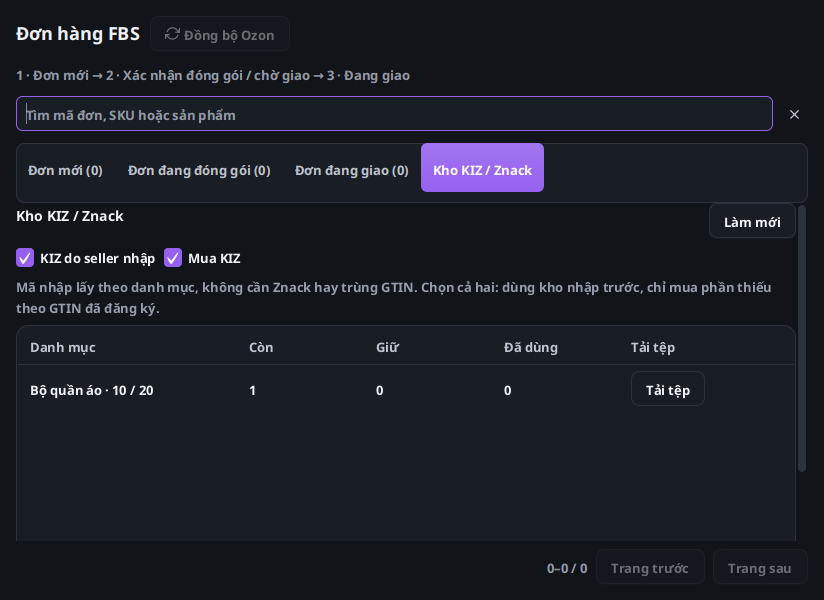

# Mục 3 — FBS Ozon và nguồn KIZ

Đã triển khai theo [sơ đồ được duyệt](../architecture/2026-10-16-item-3-ozon-fbs-proposed-flow.md).
Mục 7 được duyệt riêng và thực hiện sau mục này. Đây là kiểm thử cục bộ;
chưa đổi Latest hoặc phát hành bộ cài.

| Phần | Kết quả |
| --- | --- |
| Tab Kho KIZ / Znack | Hai nguồn seller/mua; mặc định kho seller; lưu theo shop/chủ cấu hình/ngữ cảnh FBS. Chốt posting và nguồn cho cả lượt kiểm tra/in. |
| Kho theo danh mục | Giữ category ID/type ID gốc trong DTO/SQLite và transaction đồng bộ trang; migration bổ sung cột, yêu cầu đồng bộ lại catalog. Danh mục trùng tên khác ID tách kho, đổi tên giữ ID; không đoán ID từ tên. |
| Nhập tệp | Dùng cùng bộ đọc/UI với WB; upload mỗi hàng, số còn/giữ/đã dùng. Không kiểm tra Znack hoặc ép GTIN sản phẩm; nhập trùng không chuyển mã sang nhóm khác. |
| Phân bổ | Seller FIFO theo danh mục; chỉ mua loại mọi mã nhập; cả hai ưu tiên seller và chỉ mua thiếu. Không chọn nguồn chặn cấp mới; giữ mã cũ khi in lại, rollback thiếu trong một đơn. |
| Mua | Giữ nguyên ba file pipeline mua, ký, tải và lưu thông; dùng kiểm tra product/offer/SKU/GTIN cho phần mua thiếu. Checkbox nguồn là bản chụp chung cho readiness và allocation. |
| Ảnh | Đọc primary_image dạng string/array/object, fallback ảnh đầu; không chọn tùy tiện khi SKU trùng; kiểm tra offer của posting. |
| Hiệu năng UI | Bảng danh mục và kho mua dùng cell tái sử dụng; I/O ngoài JavaFX, callback kiểm tra shop/thế hệ; nguồn khóa trong tác vụ. |
| Báo cáo | Readiness từng đơn ngay trong FBS; report bền trong trung tâm Tác vụ, có trạng thái, bước, số mã nhập/mua/đã in. PDF chưa xong báo cần xử lý, không suy diễn ACCEPTED nội bộ thành KIZ đã được sàn xác nhận. |

Ozon production hiện gắn/giữ mã cục bộ khi in; không bật lại endpoint exemplar
legacy và không thay hợp đồng đóng đơn hiện tại. Báo cáo tách local KIZ, PDF,
trạng thái đơn trên Ozon và xác nhận KIZ từ sàn.

Đối chiếu dựa trên mục 2 đã duyệt, mã WCode công khai 1.0.27 và bằng chứng
WBCode Latest 1.3.9 đã ghi trong sơ đồ. Mã nội bộ WBCode 1.3.9 không công khai;
không tuyên bố đã chép hoặc chạy engine đã đăng nhập của bản đó.

Kiểm thử tập trung nguồn/UI đã có lượt 49/49, tiếp theo 20/20; lượt chốt
sau bổ sung báo cáo và lô lớn **12/12**, không lỗi/skip. Không cộng các lượt
trùng nhau thành số bài riêng. Lượt 10 shop × 1.000 đơn giữ 10.000 KIZ khác
nhau, không gán chéo shop; in lại giữ reservation, transaction in lô lỗi
rollback, integrity database qua.

Đo riêng đường giữ mã cục bộ với nguồn mua có tồn, dữ liệu tổng hợp:

| Số đơn | Thời gian giữ mã |
| --- | ---: |
| 100 | 519 ms |
| 500 | 1.662 ms |
| 1.000 | 3.056 ms |

Đây là toàn tác vụ worker SQLite trên máy cloud, không phải độ trễ giao diện,
API Ozon hoặc tốc độ Windows seller. Không tạo giao dịch mua/gán thật.
Bài kiểm thử báo cáo mới ban đầu có fixture thiếu posting cha; đã sửa dữ
liệu thử và chạy lại thành công, không tắt khóa ngoại. Màn hình ảo cần được
khởi động lại trước lượt UI, không bỏ qua kiểm thử giao diện.

Ba file mua `ZnackPurchaseCoordinator`, `ZnackKizOrderService`,
`ZnackKizCodeService` giữ nguyên hash như mục 2. Hồi quy toàn bộ sẽ chạy
sau mục 7, các lượt tập trung này không thay cho lần chạy đó.

[Bằng chứng JSON](2026-10-16-item-3-ozon-fbs-checks.json).

