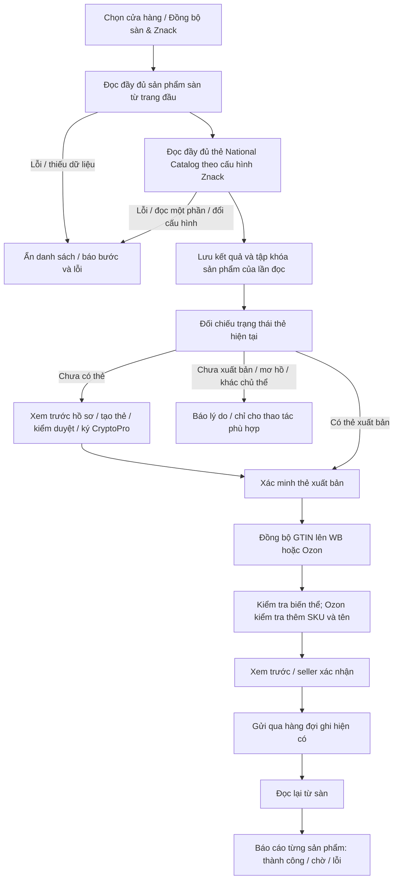

# Mục 4: danh sách đăng ký Znack, trạng thái thẻ và đồng bộ GTIN

Phạm vi: sơ đồ mục 4 đã được người dùng phê duyệt ngày 16/10/2026. Mục 3 chưa được triển khai trong lượt này; mục 5–7 cần sơ đồ/phê duyệt riêng. Đây là mã cho bản ứng viên 1.4.13, chưa phải bản phát hành seller.

## Hành vi đã sửa

| Đầu mục | Kết quả |
| --- | --- |
| Điều kiện mở danh sách | Nút **Đồng bộ sàn & Znack** đọc đầy đủ sản phẩm sàn từ trang đầu, rồi đọc Catalog. Chỉ mở danh sách sau khi cả hai hoàn tất. HTTP lỗi, dữ liệu thiếu, Catalog đọc một phần hoặc tác vụ còn chạy đều không được coi là đồng bộ thành công. |
| Đúng cửa hàng/tài khoản | Kết quả đọc lưu trong `sync_runs`, gắn fingerprint tài khoản, chủ thể/chứng thư/môi trường Znack và thời hạn 24 giờ. Đổi cấu hình hoặc lần đọc mới thất bại sẽ yêu cầu đồng bộ lại. Không dùng số dòng cache làm bằng chứng. |
| Đúng sản phẩm trong lần đọc | Lưu tập khóa sản phẩm/biến thể đã đọc vào `sync_run_items`; WB dùng nmID/chrtID, Ozon dùng product_id/offer_id. Cache cũ của sản phẩm không được trả về trong lần đọc hiện tại không mở thao tác đăng ký. |
| Thẻ đã có | Đối chiếu Catalog theo GTIN hoặc article/màu/size; hiện đúng thẻ đã xuất bản dù chưa có checkpoint đăng ký trên máy này. Thẻ chưa xuất bản, kết quả ghép mơ hồ, sai biến thể hoặc checkpoint thuộc cấu hình khác có lý do riêng; không tự tạo trùng thẻ. |
| Thẻ còn thiếu | Giữ luồng tạo/đăng ký, kiểm duyệt, tiếp tục feed, ký CryptoPro và xác minh của mục 1. Thẻ đã tồn tại trong Catalog không bị biến thành checkpoint/feed giả. |
| Trạng thái/thao tác | WB có cột lý do hiển thị trực tiếp, bộ lọc và tổng hợp theo trạng thái đã đối chiếu. Ozon thêm SKU, giới tính, ảnh và chi tiết trạng thái; thao tác đăng ký lại một thẻ có feed đang xử lý chuyển sang tiếp tục feed, không tạo hồ sơ mới. Trạng thái gửi/ký feed không thay cho quan sát xuất bản của Catalog trên danh sách. |
| GTIN lên WB/Ozon | Hai nút riêng mở luồng xem trước và xác nhận hiện có. Làm mới hai nguồn trước khi chuẩn bị báo cáo; chỉ xét tập sản phẩm đã đọc, kiểm tra lại cấu hình và biến thể trước khi chọn. Ozon giữ kiểm tra product_id/offer_id, SKU, tên, màu, size. Chỉ ghi sau xác nhận; đọc lại sàn và theo dõi kết quả qua tác vụ con. |
| Báo cáo | Nút **Báo cáo đồng bộ** mở tác vụ đọc hai nguồn, đọc Catalog hoặc đồng bộ GTIN; hiện trạng thái, bước, mã lỗi an toàn, từng sản phẩm/biến thể, SKU, GTIN, màu/size và sự kiện gần nhất. Phân trang 300 dòng; tự làm mới khi cửa sổ báo cáo mở, dừng khi đóng. |
| Độ đáp ứng | Đọc API/SQL chạy nền qua executor có giới hạn hiện có; không thêm thread pool. Có giới hạn trang, phát hiện cursor WB lặp và ngăn hai lần đọc hai nguồn trùng nhau cho một cửa hàng. Dùng lại kết quả Catalog vừa đọc khi chuẩn bị xem trước GTIN để tránh quét lặp. |
| Mua KIZ | Không sửa `ZnackPurchaseCoordinator`, `ZnackKizOrderService`, `ZnackKizCodeService`. Có đối chiếu byte và SHA-256 với HEAD trước thay đổi. |

## Luồng đã triển khai

## Đối chiếu WBCode/WCode

Đã kiểm tra lại [WBCode Latest v1.3.9](https://github.com/rupphi/relatest-wcode/releases/tag/v1.3.9), phát hành `2026-10-15T16:56:43Z`. Ghi chú mới liên quan là Ozon đăng ký lại thẻ đang chờ duyệt, hiển thị kiểm duyệt/từ chối và WB tiếp tục đăng ký dang dở sau khi mở lại. VNCode giữ engine tiếp tục/kiểm duyệt từ mục 1, nối giao diện Ozon vào thao tác tiếp tục khi có feed và bổ sung bằng chứng đọc đủ hai nguồn/trạng thái rõ ràng.

Dữ liệu giao diện công khai đã lưu trong `docs/research/vncode-wbcode-2026-10-14/`; mã WCode công khai cũ đã đối chiếu ở các mục trước. Mã nội bộ WBCode 1.3.9 không được cung cấp trong repo phát hành, nên không coi việc đọc ghi chú/ảnh là đã sao chép hoặc chạy engine nội bộ mới nhất.

## Kiểm thử và giới hạn

Kết quả máy đọc được và các hash nằm ở [tệp kiểm chứng mục 4](2026-10-16-item-4-checks.json). Kiểm thử bao gồm:

- Chỉ mở sau khi cả hai nguồn hoàn tất, kể cả trường hợp hai nguồn rỗng hợp lệ; lỗi đọc sàn không gọi tiếp Catalog.
- Catalog đọc một phần, lỗi mạng, thay chứng thư/tài khoản, kết quả quá cũ hoặc tương lai, khóa biến thể trùng và sản phẩm không thuộc tập đã đọc.
- WB đọc lại từ trang đầu dù có cursor cũ, chặn phản hồi thiếu/cursor lặp; Ozon chặn danh sách không hợp lệ và chi tiết thiếu thay vì lưu placeholder rồi báo thành công.
- Nhận diện thẻ đã xuất bản, draft, thẻ vắng, sai màu/size, ghép nhiều thẻ, checkpoint khác cấu hình; không tự tạo checkpoint đăng ký khi chỉ xem dữ liệu.
- Hai màn WB/Ozon: ẩn cache khi kết quả thất bại, giữ nút cấu hình/đồng bộ khả dụng, phân trang 1.000+ sản phẩm và bộ lọc trạng thái WB nhất quán với Catalog.
- Luồng GTIN hiện có: yêu cầu xác nhận trước ghi, đọc lại kết quả, giữ barcode cũ, chặn đổi SKU/tên/biến thể, báo lỗi đọc lại mà không gửi lặp giao dịch.
- Cửa sổ báo cáo: đọc trạng thái/lỗi mới nhất, trang 300/300/50 và quay lại trang trước.

Lượt này không tạo thẻ, ký, sửa GTIN, mua KIZ hoặc gán mã trên tài khoản seller thật. Không có môi trường Windows/CryptoPro thật hoặc máy seller thứ hai để nghiệm thu các thao tác đó. Kết quả API thật trước đó ở [báo cáo mục 1](2026-10-16-item-1-live-api-report.md) chỉ chứng minh các lượt đọc đã mô tả, không thay cho nghiệm thu ghi mới.

Không build bộ cài, tạo Release, đổi Published/Latest hoặc triển khai website trong lượt này.

## Kết quả cuối

- Mã engine/danh sách/báo cáo được kiểm thử hồi quy: `4a02d2b54d5d2b8cfeb8d6aac01f68a8e6a27573`. Java: **1.471 bài, 1.469 qua, 0 failure/error, 2 skip**.
- Sau khi xem ảnh, sửa riêng tiêu đề Ozon, chiều rộng nút và cách xuống dòng lý do: `54dff46b684dc41ac8807a9a394148d460e0625b`. Kiểm tra lại FXML, WB/Ozon registration, truy vấn và báo cáo: **75/75 qua**. Không sửa engine sau lượt hồi quy.
- Đã xem ảnh dưới đây; toàn bộ dữ liệu trong ảnh là giả, không có thông tin xác thực seller.

| Ảnh kiểm tra | Nội dung |
| --- | --- |
| [WB](images/2026-10-16-item4-wb-registration.png) | Thẻ đã xuất bản từ Catalog, tiến trình đang xử lý, cột lý do rõ ràng |
| [Ozon](images/2026-10-16-item4-ozon-registration.png) | Đúng tiêu đề sàn, native ID/SKU, 300/1.000 dòng, nút thao tác và lý do |
| [Báo cáo](images/2026-10-16-item4-registration-report.png) | Trạng thái/bước/kết quả từng dòng và phân trang |

## Các đầu mục còn lại

| Mục | Trạng thái |
| --- | --- |
| 1 — Tạo thẻ/GTIN | Đã có mã và kiểm tra đọc API thật; ghi mới/ký native còn cần nghiệm thu |
| 2 — Nguồn kho KIZ trong shipment WB | Đã triển khai và kiểm thử; giữ luồng mua hiện có |
| 3 — Kho KIZ/giao diện/ảnh đơn FBS Ozon | Chờ sơ đồ/phê duyệt riêng |
| 4 — Đăng ký Znack và GTIN WB/Ozon | Đã triển khai và kiểm thử như báo cáo này |
| 5 — GS1 qua cấu hình Znack/API | Chờ sơ đồ/phê duyệt riêng |
| 6 — Sao chép đầy đủ bài đăng | Chờ sơ đồ/phê duyệt riêng |
| 7 — Toàn bộ giao diện/đồng bộ liên tục | Chờ sơ đồ/phê duyệt riêng; lượt này không thay kiến trúc FBS |
