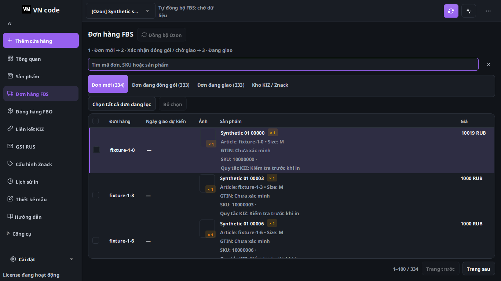
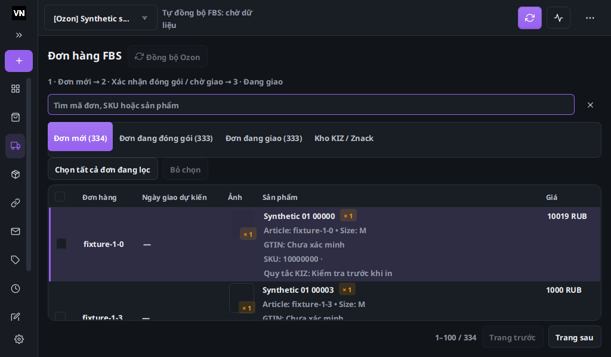

# Mục 7 — giao diện chung và cập nhật FBS

Đã triển khai theo [sơ đồ được duyệt](../architecture/2026-10-16-item-7-workspace-ui-proposed-flow.md),
sau khi hoàn tất mục 3 tại `0d0b41b`. Đã phát hành bộ cài/Latest 1.4.13
theo yêu cầu người dùng; [bằng chứng Windows và phát hành](2026-10-16-vncode-1413-windows-release-checks.json).
Hồi quy toàn bộ và đóng gói Java đã qua tại `040172d`; xem
[bằng chứng cuối](2026-10-16-items-3-7-final-checks.json).

## Thay đổi

- Header giữ cửa hàng, sức khỏe FBS, đồng bộ, tác vụ và nút cập nhật.
  Các thao tác phụ, số dư, sửa/xóa shop, tin tức và hỗ trợ vào menu khi
  không đủ chỗ. Tái sử dụng đúng các control/callback hiện có; ô cửa hàng
  hiện nhãn sàn/tên, không dùng chuỗi debug `Shop{...}`.
- Sidebar tự thu gọn theo cửa sổ, có nút ghim mở/thu và menu trở về tự động;
  icon có tooltip/tên truy cập. Badge GS1 đổi không làm bung tên ở chế độ
  icon. Chọn trang và điều kiện truy cập cũ giữ nguyên.
- Khung `app-page` áp dụng cho mọi route, 16 màn FXML nghiệp vụ và các
  pane dựng bằng Java: cỡ chữ, khoảng cách, nút, bảng, tab, thẻ và màu trạng
  thái theo cùng theme. Tên mục Tổng quan/liên kết KIZ được bản địa hóa.
- Bảng FBS WB/Ozon, shipment WB và danh sách sản phẩm cập nhật theo key;
  dữ liệu không đổi không xóa/nạp lại cả bảng. Giữ chọn/lọc/cuộn. WB có
  ảnh chụp giá trị đã render để phát hiện cả model bị sửa tại chỗ; Ozon
  theo dõi cả thay đổi dữ liệu sản phẩm/GTIN dù bản thân đơn không đổi.
- Callback ảnh Ozon kiểm tra chủ shop, ô ảnh và đơn hiện tại; không bỏ ảnh
  đang tải chỉ vì một lượt đồng bộ không đổi đã xảy ra. Nguồn mua/nhập và
  điều kiện API không thay đổi.
- Trạng thái FBS tách đang chạy, mới xong một phần, đã hoàn tất, quá hạn
  kiểm tra và lỗi; tooltip có nguồn, lần hoàn tất, lần kiểm tra tiếp và mã
  lỗi. Không dùng một request thành công làm bằng chứng cả luồng xong.
- Dialog giới hạn theo cửa sổ chủ trước khi mở, giữ nội dung và vùng nút.
  Màn xem trước GTIN nội bộ có phần chi tiết thu gọn/vùng cuộn và footer
  luôn tiếp cận được; không đưa công cụ GTIN độc lập trở lại sidebar.
- Tác vụ có bộ lọc trạng thái/tên bước dễ đọc, tên in FBS Ozon và thời gian
  Moscow. Danh sách tác vụ không dựng lại các hàng không đổi. Thư GS1
  cuộn tới tin mới sau khi skin hoàn tất layout, có giới hạn số pulse và
  dừng timer khi đóng pane.

## Kiến trúc và đối chiếu

Giữ `SyncRuntime`, `SyncCoordinator`, executor/quota/Retry-After, journal
và cache ảnh hiện có. Không thêm server, vòng polling theo view, framework
hoặc pool mới. Bộ nhớ bổ sung chỉ là ảnh chụp giá trị của trang đang render;
đổi shop xóa snapshot đó. Thêm index category/type cho catalog Ozon để
refresh danh mục kho không quét lại toàn bảng cho từng nhóm.

FBS tiếp tục polling nền khi đổi trang. Nhịp đang có là queue 10/45 giây,
trạng thái 15/60 giây, nội dung shipment 10/45 giây ở shop đang chọn/shop
khác; vẫn theo hạn mức API. Đây không phải push tức thời. Phép đo UI dưới
đây bắt đầu sau lúc dữ liệu cục bộ đã được ghi, không đo thời gian sàn cập
nhật hoặc thời gian chờ quota/mạng.

Đối chiếu dùng bằng chứng trong sơ đồ: WBCode Latest 1.3.9, ảnh chính thức
1.3.8 và ảnh người dùng. Mã nội bộ/luồng đã đăng nhập của 1.3.9 không công
khai; không tuyên bố sao chép hoặc chạy phần đó.

## Kiểm chứng cục bộ trước hồi quy toàn bộ

- 16 FXML × 4 ngôn ngữ × 2 theme × 2 vùng nội dung: 960 lượt kiểm tra
  control; không có control cố định bị cắt hoặc control trong vùng cuộn
  không có cuộn ngang bị tràn ngang.
- 9 pane Java và các tab cấu hình Znack: 864 lượt kiểm tra control; qua.
- Khung chung ở cửa sổ 1024×600, 1366×768, 1600×900, 4 ngôn ngữ và 2
  theme; kiểm tra menu overflow, nút cập nhật, manual/auto sidebar và dialog.
- Lượt smoke cuối 64/64 qua; kiểm thử riêng ảnh chậm và màu sản phẩm mới
  được xác nhận trên cell thật. Các lượt tập trung có bài trùng nhau,
  không cộng chúng thành tổng số bài riêng.
- Tải tổng hợp 10 shop, 10.000 đơn, 100.000 sản phẩm; mỗi lần ghi đổi 9.001
  dòng, trang đang mở 100 đơn. 20 mẫu: p95 commit → hiển thị khoảng 93 ms,
  p95 đợi JavaFX khoảng 6,5 ms; không ghi nhận khoảng đứng >500 ms.
  Đây là máy cloud 4 logical CPU, JavaFX software rendering, không phải
  máy Windows yếu hoặc ảnh/API thật. Lượt hồi quy cuối ghi kết quả mới riêng.

Các lỗi test ban đầu được xử lý bằng sửa đúng nguyên nhân: kỳ vọng Ozon
cũ chỉ có ba tab, fixture dialog thiếu thư mục dữ liệu, và thư GS1 đặt vị trí
cuộn trước khi skin ổn định. Không tắt assertion hay bỏ bài kiểm thử.

## Hồi quy cuối trên toàn bộ mã nguồn

`mvn verify` tại `040172d66b1a40978bef9a5e7f7e8147b401ec1b`
hoàn tất lúc 23:22:25 ngày 16.10.2026, giờ Moscow: **BUILD SUCCESS**.
Tổng 1.535 bài trong 266 suite: 1.533 qua, 0 failure/error, 2 skip dành
riêng cho NTFS junction và Windows DPAPI. JAR được đóng gói thành công;
đây chưa phải bộ cài Windows.

Lượt toàn bộ trước đó phát hiện ba lỗi mở màn GTIN bằng `FXMLLoader`
không có ResourceBundle. Đã sửa tiêu đề có giá trị mặc định trong FXML,
dịch bằng controller; giữ nguyên đường mở và assertion kiểm thử cũ.
Lượt riêng 4/4 qua trước khi chạy lại toàn bộ thành công.

Trong chính lượt cuối, ma trận bố cục 960 + 864 control qua, không bị cắt.
Phép đo tổng hợp FBS có p95 ghi cục bộ → hiển thị **89,1 ms**, p95 đợi
JavaFX **1,4 ms**, không ghi nhận khoảng pulse đứng trên 500 ms; khoảng
trống pulse lớn nhất 55,3 ms. Đây vẫn là 20 mẫu trên máy cloud, không bao
gồm mạng/quota hoặc dữ liệu ảnh thật. Không dùng số này để bảo đảm tốc độ
trên mọi máy seller.

Bộ kiểm tra hợp đồng phát hành 60/60 và kiểm thử Portal 60/60 qua;
kiểm tra cú pháp Portal qua. Không thay mã hoặc triển khai website ở mục
3/7. Hash log, commit và danh sách bài Windows bị skip có trong JSON trên.

## Giới hạn

Windows build `38962251398` đã qua cùng 1.535 bài (1.533 qua, 2 bài không
áp dụng cho Windows được skip), khởi động native, DPAPI, 6 lượt kiểm tra
workspace/DPI và 272 bố cục không cắt nút. Nâng cấp giữ dữ liệu từ 1.4.10,
1.4.11 và 1.4.12 đã qua. EXE đã được tải lại từ đường công khai, khớp hash
và kích thước; parser updater trong chính JAR Windows đọc đúng Latest,
ghi chú và EXE. Chưa quan sát popup cập nhật trên máy seller thực tế.

Chưa thử driver/in trên máy seller, CryptoPro thật, API mua/gán KIZ thật
hoặc seller đồng thời trên máy riêng. Mô hình vẫn là mỗi seller chạy VNCode trên máy của mình;
website dùng chung cho đăng ký/license. Không triển khai dịch vụ cloud mới.

