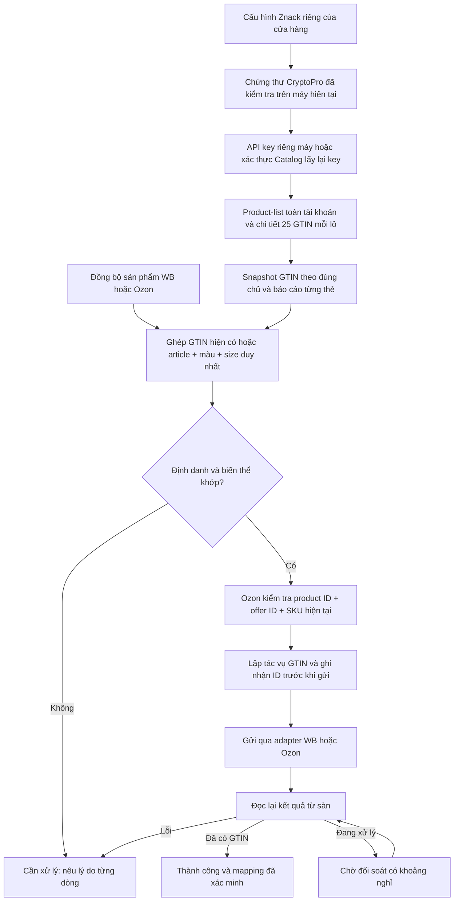
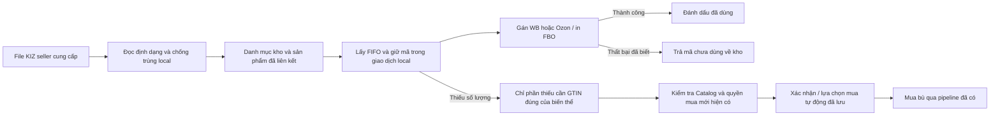

# VNCode 1.4.13 — báo cáo các đầu mục được giao ngày 16/10/2026

Bản sửa kế tiếp 1.4.12. Mã ứng dụng cố định tại `c25e971d6babd0e87e6a0acf045d045754b30462`; kết quả kiểm thử cuối và bộ cài được cập nhật ở cuối báo cáo. Chưa dùng tài khoản seller để gửi dữ liệu thật.

## 1. Đối chiếu WBCode mới nhất và WCode cũ

Đã kiểm tra lại GitHub: [WBCode Latest 1.3.9](https://github.com/rupphi/relatest-wcode/releases/tag/v1.3.9). Repo này công khai bộ cài và ghi chú; không có mã nguồn nội bộ 1.3.9. Không khẳng định đã sao chép hoặc chạy nghiệm thu luồng có đăng nhập của bản này.

Đã đọc trực tiếp mã nguồn WCode công khai tại [`8f7c3d1`](https://github.com/rupphi/test-wcode/tree/8f7c3d1ac8598158029b8d037e2d3c128e240727): `ZnackApiClient`, `ZnackAuthService`, `ZnackProductService`, `WbSyncWorkflow`, `OzonCatalogSyncService`. [Manifest URL/SHA-256](../research/vncode-1413-public-wcode-sources.json). Kho nhập theo danh mục đối chiếu thêm nguồn WCode cũ [`457a6113`](https://github.com/rupphi/test-wcode/tree/457a6113301978454f244248956962ab1fcdeb7e), đã lưu bằng chứng ở đợt 1.4.12.

| Đối chiếu | Kết quả áp dụng / khác biệt được giữ rõ |
|---|---|
| WCode đọc GTIN True API, làm giàu thẻ theo lô 25 | Giữ kích thước lô; nguồn mặc định mới lấy product-list của tài khoản Catalog đã xác thực, không chỉ `pg=lp` của True API. |
| WCode nguồn công khai có nhánh tự ẩn sản phẩm thiếu giấy tờ | Không sao chép hành vi này vào nguồn mới: đọc GTIN và kiểm tra giấy tờ để mua/đưa vào lưu thông là hai bước khác nhau. |
| WCode phân trang WB/Ozon và định danh riêng từng sàn | Giữ adapter Seller API hiện có; điều phối sản phẩm xong sẽ yêu cầu lại Znack → GTIN. Ozon giữ riêng native product ID, offer ID, SKU. |
| WCode cũ lấy KIZ FIFO theo category | Mã seller nhập đã phân danh mục dùng ngay qua luồng local, không kiểm tra Znack/INN/chứng thư hoặc buộc GTIN trùng sản phẩm. |
| Ghi chú WBCode 1.3.9: khôi phục đăng ký dở / thẻ Ozon chờ kiểm duyệt | Dùng để đối chiếu yêu cầu; không coi ghi chú là bằng chứng đã biết toàn bộ triển khai nội bộ. Không mở rộng đợt này thành sửa mọi quy trình đăng ký thẻ mới. |

## 2. Luồng đồng bộ sản phẩm và GTIN đã viết lại

- Tạo `ZnackCatalogSyncService` làm nguồn chung cho Cấu hình Znack, KIZ Mapping, trang chủ, màn shipment WB, Ozon và tác vụ Znack nền. Những điểm gọi production không còn tạo các lượt `ZnackProductService` riêng lẻ với `new ZnackApiClient()` bỏ qua API Catalog đã cấu hình.
- Xác minh scope của cửa hàng/doanh nghiệp/chứng thư; lấy API key Catalog từ cấu hình của chính máy đang dùng. Máy mới có thể lấy key của tài khoản qua CryptoPro → Catalog bootstrap, không phải đăng nhập trình duyệt hoặc có sẵn cache đăng ký từ máy thứ nhất.
- Nếu bản sao lưu mang ciphertext DPAPI từ Windows khác, xác thực lại bằng chứng thư của máy hiện tại rồi lưu bản mã hóa riêng của máy đó. Không giải mã vòng qua DPAPI, không lưu plaintext, không gửi key qua website license. Nếu shop/certificate scope đã đổi, yêu cầu kiểm tra lại cấu hình thay vì dùng nhầm key cũ.
- Khi có Catalog key, danh sách lấy từ `/v4/product-list`, phân trang theo offset, không bị giới hạn vào nhóm `lp`. Chi tiết đọc qua `/v3/feed-product`, 25 GTIN/lô. Chuẩn hóa 13/14 chữ số về 14 để ghép cùng một GTIN.
- Kiểm tra tổng số, trang thiếu/trùng và phản hồi sai; lỗi không được ghi thành đồng bộ thành công. Trong cùng lượt đọc, một lô lỗi không bị gọi lại cho từng GTIN của lô đó. Snapshot mới mới được thử lại lô.
- Thẻ đã published, đúng đơn vị hàng, được giữ hiển thị dù nguồn chưa trả metadata giấy tờ. Thiếu giấy tờ vẫn chặn đúng bước mua/đưa mã vào lưu thông khi hợp đồng yêu cầu, không làm mất GTIN khỏi danh sách đồng bộ.
- Dùng chỉ mục GTIN và article/màu/size, không quét toàn bộ Catalog lại cho từng biến thể. Chuẩn hóa Unicode/khoảng trắng; không tự quy đổi size, bỏ dấu câu article hoặc chọn đại khi có nhiều ứng viên.
- Đồng bộ GTIN riêng không gọi API giá hoặc từ điển thuộc tính không liên quan. Luồng sao chép bài vẫn giữ phần đọc giá của nó.
- Khi có dữ liệu sản phẩm mới từ sàn, lên lịch Znack lại. Nếu chưa có sản phẩm, báo `PRODUCT_CATALOG_EMPTY`, không báo đã đồng bộ GTIN lên sàn thành công.

## 3. Máy thứ hai đứng ở “Đang đồng bộ”

Các nguyên nhân cụ thể tìm thấy trong mã và đã sửa:

| Nguyên nhân | Thay đổi |
|---|---|
| Nhiều luồng dùng chung một worker nền | Tách 2 registry workers cho Znack/GS1 khỏi catalog/finance/FBO; giữ riêng 2 worker FBS. Không để hai GS1 cùng giữ hết registry workers. |
| UI chỉ chờ tác vụ, không có bước chạy hoặc cleanup rõ | Tách 2 worker đọc Catalog khỏi pool tác vụ UI; hiển thị xác thực → danh sách → chi tiết, số đã đọc/tổng, hoàn tất/một phần/lỗi. |
| Một lô Catalog lỗi bị gọi lại cho từng mã | Ghi nhớ lỗi lô trong snapshot hiện tại, không lặp 25 yêu cầu lỗi giống nhau. |
| Network/worker chờ kéo dài | Task UI có deadline 180 giây gồm cả lúc xếp hàng, có hủy và dọn trạng thái trên FX thread; nguồn đọc có kiểm tra interrupt và thời gian; rate limit dài trả worker về scheduler. |
| Đọc lại GTIN lỗi lặp mãi | Sau 3 lỗi của cùng dòng, chuyển sang Cần xử lý, giữ mã lỗi thật và ID tác vụ con; không tự gửi lại ghi mới. |
| Máy mới không có cache / key Windows của máy cũ | Tự lấy key bằng chứng thư trên máy hiện tại; có kiểm thử hai thư mục dữ liệu độc lập và ciphertext không đọc được trên danh tính Windows khác. |

Đây là nguyên nhân đã xác minh trong mã/kiểm thử. Chưa có log hoặc quyền truy cập trực tiếp máy thứ hai của seller, nên chưa khẳng định đó là toàn bộ nguyên nhân trên máy thật. Mỗi máy cần CryptoPro, khóa riêng/chứng thư khả dụng và cấu hình đúng; quyền license cho hai máy không tự cài chứng thư hoặc chuyển khóa riêng sang máy còn lại.

## 4. Kho KIZ seller nhập: bỏ kiểm tra Znack theo yêu cầu

- Nhập file chỉ kiểm tra định dạng, GS/chuỗi mã và mã trùng. Không cần `RegisteredGtinProof`, chứng thư, True API hay INN để nhập vào kho.
- UI yêu cầu chọn/tạo danh mục trước khi nhập; bỏ nút “Kiểm tra mã trên Znack”. Dữ liệu nhập cũ có thể chọn dòng → phân danh mục → liên kết sản phẩm để dùng, không cần xác minh lại Znack.
- Category allocator kiểm tra đúng shop/chủ của kho và lấy FIFO; bỏ điều kiện `legal_status=IN_CIRCULATION` và điều kiện INN của Znack đối với kho phân danh mục. Không sửa giả `legal_status` thành đã lưu thông.
- Áp dụng đường cấp mã category cho WB FBS, Ozon FBS và FBO. Sửa cả UPDATE giữ mã trong Ozon để không chặn mã category có trạng thái pháp lý chưa tra cứu.
- Giữ chống dùng trùng, reservation token, proof gắn đúng category/product/order, chống lấy sang danh mục khác, chống cấp cùng mã cho hai tác vụ 1.000 đơn.
- Khôi phục mã nhập đã lưu trữ về category không đòi kiểm tra Znack. Mã reserved/consumed không bị lưu trữ hoặc phân nhóm lại.
- GTIN đã bị ẩn bởi đồng bộ cũ không chặn nhập local; nhập file không tự khôi phục thẻ Catalog hoặc tạo quyền mua KIZ.
- Kho vẫn riêng từng máy. Không có cơ sở dữ liệu KIZ dùng chung giữa hai máy trong đợt này; không được nhập cùng một tập mã để cấp phát song song trên hai kho độc lập nếu muốn tránh trùng giữa máy.

Không có cuộc gọi Znack trong nhánh từ file đến cấp phát category. Khi thực sự gửi KIZ lên WB/Ozon, sàn vẫn có thể từ chối mã theo quy tắc của sàn; ứng dụng báo kết quả, không thể bảo đảm sàn chấp nhận mọi mã hoặc tự sửa GTIN trong nội dung mã.

## 5. Báo cáo tác vụ

Nguồn Catalog ghi từng GTIN thành công, bỏ qua/thẻ chưa đủ điều kiện hoặc lỗi; tổng số và bước chạy lưu bằng transaction theo lô. Luồng lên sàn lưu riêng product/variant/SKU, GTIN, trạng thái, lý do lỗi và ID tác vụ con. Dòng lỗi không bị gộp thành thông báo “đang đồng bộ” vô hạn. Giữ CSV/JSON của Trung tâm tác vụ; không ghi API key, token, khóa license hoặc KIZ đầy đủ vào báo cáo.

## 6. Kiểm thử và trạng thái phát hành

Kiểm thử local cuối đã đạt: **1408 trường hợp**, **1406 đạt**, **0 thất bại**, **0 lỗi**, **2 bỏ qua theo nền tảng**. Release contracts Node: **53/53 đạt**. Các kiểm thử deadline tác vụ Catalog thực sự giữ worker bận rồi kiểm tra luồng khác vẫn chạy, và hủy một tác vụ đang chờ để xác minh cleanup trên FX thread. [Bằng chứng local](2026-10-16-vncode-1413-local-checks.json).

Đã thêm kiểm tra nâng cấp Windows giữ dữ liệu từ 1.4.12, pin đúng SHA-256 bộ cài đã phát hành. Đang chuẩn bị workflow Windows; chưa có kết quả native cho bản này. Không có thao tác mua KIZ, gán mã thật, gửi GTIN thật hay gửi email GS1 trong lần kiểm thử này. Published/Latest của seller vẫn là 1.4.12; mã 1.4.13 không tự trở thành cập nhật công khai chỉ vì đã commit hoặc tạo artifact kiểm thử.
