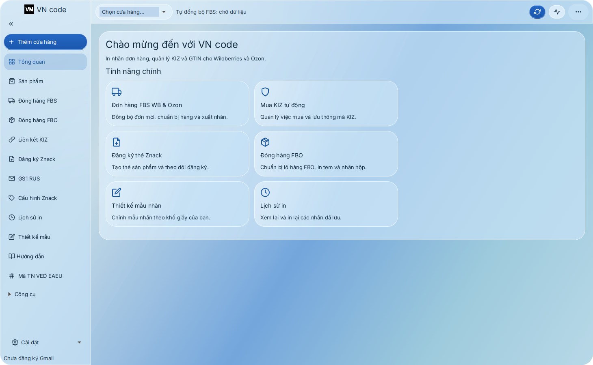
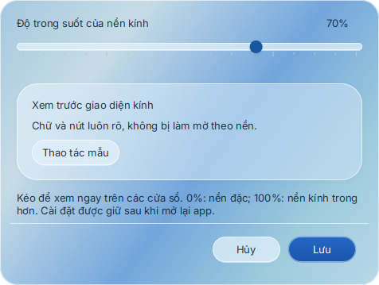
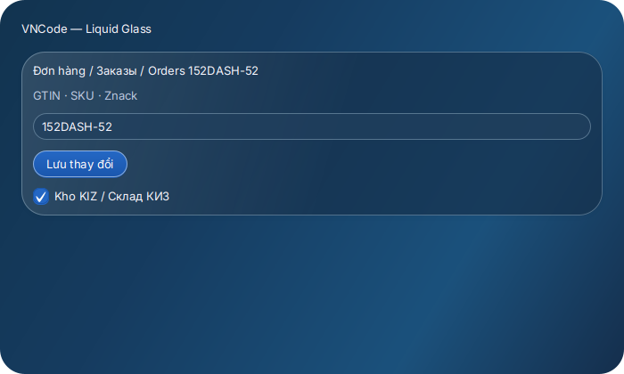
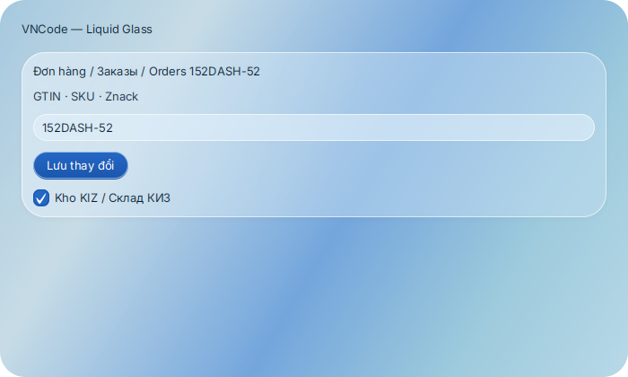
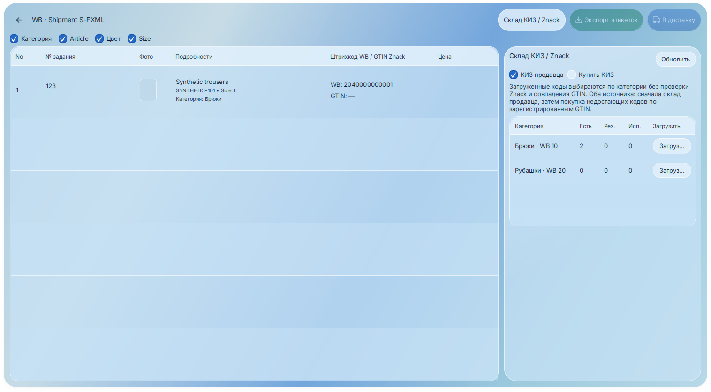

# VNCode 1.4.14 — Liquid Glass, article và SKU Ozon

Mã ứng dụng: `788267089291ad2adff023cfd60a4575147d12dd`.
Bổ sung trên nhánh `update/vncode-approved-upgrades`, giữ nền nâng cấp 1.4.13.

## Kết quả công việc

| Yêu cầu | Thay đổi |
| --- | --- |
| Bỏ khoảng trắng đầu/cuối | Chuẩn hóa Unicode whitespace khi gửi article WB và khi tạo article sao chép WB/Ozon. Giữ khoảng trắng giữa các từ và dấu phân cách của model. Trước sửa article cũ, đọc kiểm tra tên sau chuẩn hóa có trùng bài khác không; trùng sẽ chặn ghi. |
| Liquid Glass toàn app | Theo ảnh tham chiếu mới: kính xanh nhạt, nền xanh chuyển sắc mềm, viền sáng mảnh, panel bo 26px và nút dạng viên thuốc. Dùng chung cho trang, bảng, danh sách, thanh bên, tab, hộp thoại và popup. Chỉ lấy phong cách, không lấy nội dung Mac Control Center. Khi nâng cấp áp dụng sáng một lần; sau đó giữ lựa chọn sáng/tối của seller. |
| Điều chỉnh độ trong suốt | **Cài đặt → Liquid Glass**: thanh 0–100, xem trước trên các cửa sổ; Lưu giữ qua lần mở lại, Hủy phục hồi mức trước. Chỉ nền đổi alpha, chữ và nút không bị giảm opacity theo nền. |
| Chữ dễ đọc | Màu chữ/nhấn đổi theo sáng/tối. Kiểm tra độ tương phản chính ≥7:1, phụ ≥4,5:1 trên nền thử ở 0/55/100, cả chữ đặt trực tiếp trên đoạn nền xanh mạnh nhất ≥4,5:1; nút cảnh báo, lỗi và thành công có màu riêng đủ tương phản. |
| GTIN Ozon qua SKU seller | Đọc `offer_id` (mã seller như `152DASH-52`) riêng với SKU số của Ozon. Ghép model, màu và đúng hệ size của thẻ. Bỏ hậu tố size khỏi mã chỉ khi khớp một trường size thực của Ozon. Cùng quy tắc được dùng trong đồng bộ và màn đăng ký Znack. |
| Kiểm tra trước xác nhận | Lưu quy tắc ghép trong báo cáo; đọc mới lại SKU, tên, màu, size và thương hiệu trước xác nhận/chạy tác vụ. Có xung đột hoặc nhiều thẻ phù hợp thì không chọn tùy ý. |
| Danh sách KIZ khi tự làm mới | Dữ liệu không đổi không thay cả danh sách; dữ liệu cùng khóa chỉ cập nhật dòng thay đổi. Giữ vị trí cuộn và cơ chế ảo hóa với 2.000 GTIN; chiều rộng card lấy từ ô đang hiển thị, không dùng phần trừ scrollbar cố định. |

Hiệu ứng kính được dựng giữa các lớp giao diện JavaFX bằng màu/gradient tĩnh;
không đặt blur/effect riêng lên hàng nghìn dòng FBS. Cài đặt 100% là mức kính
trong nhất của bộ giao diện, vẫn giữ màu nền đệm cho độ tương phản.

### Quy tắc ghép

| Ví dụ | Điều kiện/kết quả |
| --- | --- |
| `152DASH-52` ↔ article `152DASHOA` hoặc `152 nau dashoa`, nâu, size Nga 52 | Dạng DASH/DASHOA theo ví dụ seller; cần màu và size thực khớp, thẻ trade-unit đã xuất bản và kết quả duy nhất. |
| `152NAU-2XL` ↔ article `152 nau`, nâu, size Nga 52 | Chỉ dùng 52 khi API Ozon thực sự có `russianSize=52`, `manufacturerSize=2XL`; không tự quy đổi 2XL thành 52. Đã thử API thật thành công. |
| Khác model/số model, màu hoặc size; hai thẻ cùng phù hợp | Không gán tự động; báo thiếu liên kết hoặc mơ hồ. |
| Thẻ nháp | Có thể nhận diện là thẻ có sẵn trên màn đăng ký; không được đưa vào nguồn ghi GTIN lên sàn. |

Mẫu article `số model + từ chỉ màu + nhánh hàng` chỉ được rút gọn khi từ chỉ
màu khớp trường màu thực của thẻ; DASH/DASHOA là cách viết theo ví dụ seller.
Không áp dụng so khớp tiền tố tùy ý. Không xóa dấu phân cách của model WB.
Trong quy tắc Ozon, chỉ nối các token model rõ dạng mã và hậu tố chữ, không ghép
hai nhóm số tùy ý thành một mã khác.

Trang chào mừng chỉ thay cây bố cục khi qua ngưỡng một/hai cột hoặc rộng/gọn;
không xóa và dựng lại toàn bộ nội dung theo từng thay đổi chiều rộng.

## Kiểm tra bằng API thật

Ảnh dữ liệu kiểm tra ngày 17/10/2026, dùng các binding trong môi trường:

- WB: đọc đủ **388 bài, 1.982 biến thể**.
- Ozon: đủ **175 thông tin + 175 bộ thuộc tính**, cùng từ điển của 5 loại hàng.
- Catalog: API hiện liệt kê **1.276 thẻ**; đọc đủ **1.276 chi tiết** qua 52 lô,
  parser nhận 1.237 published, 39 draft; không thiếu thẻ/lỗi chi tiết ở lượt cuối.
  Đây là số liệu phản hồi hiện tại, không dùng số 1.962 của lượt kiểm tra cũ thay thế.
- Quy tắc native mới tìm được **10 cặp Ozon duy nhất**, 0 cặp mơ hồ; quy tắc
  article nguyên chuỗi trước đó tìm được 0. 165 sản phẩm còn lại không bị gán ép.
- **Ozon `152NAU-2XL`, nâu, size Nga 52**: đọc mới lại thẻ signed/published,
  kiểm tra xung đột trên 175 sản phẩm; gửi đúng **1 POST barcode-add**. Đọc lại
  thấy GTIN mới ngay lần đầu, giữ SKU, tên và toàn bộ barcode cũ. Bộ xác minh
  `OzonGtinAdapter.verify` thực tế cũng trả APPLIED khi đọc hai phản hồi thật
  trước/sau trong DB kiểm tra cô lập, không gửi thêm request. Không gửi lặp.
- **WB `bo polo den `**: đúng mẫu trước đó đã được duyệt. Đọc kiểm tra article
  không trùng rồi gửi đúng **1 POST chỉ bỏ khoảng trắng cuối**, không thêm GTIN.
  GET độc lập xác nhận thành `bo polo den`; payload native đối soát giữ đủ mọi
  trường được phép ghi và barcode của cả 5 size. WB sắp lại thứ tự mảng size;
  lần đối soát sau so theo `chrtID`, không gửi lại yêu cầu. Các metadata tính
  toán như verdict giấy tờ do WB trả lại không được coi là trường ghi bảo toàn.
- Thẻ GTIN WB mẫu cũ trả HTTP 403 ở Catalog trong lượt này, dù các thẻ khác
  đọc được và người dùng xác nhận vẫn cùng tài khoản. Chưa xác định nguyên
  nhân quyền truy cập của riêng thẻ đó. Khóa môi trường không bị thay lại.
- Có 20 đề xuất WB còn thiếu barcode cùng model/màu/size/thương hiệu trong
  dữ liệu hiện tại. Mẫu bộ nâu size 52 có TN VED WB `6112120000` khác Catalog
  `6103109000`; phép thử chỉ ghi GTIN chưa được gửi cho mẫu này. Cần xem trước
  và xử lý khác biệt thuộc tính theo luồng đồng bộ Catalog trước khi nghiệm thu.

Các phép ghi trên là thử giao thức API thật với parser/bộ ghép/payload native;
không phải phiên Windows seller đã kích hoạt. Không giả lập chứng thư để vượt
quyền ghi production. Chưa nghiệm thu CryptoPro hoặc ký/xuất bản thẻ mới trong
lần này. Không cấp GTIN mới, mua/gán KIZ hoặc gửi thư ở lần kiểm tra này.

## Kiểm thử

- Hồi quy toàn bộ `8a51b72`: **1.621 kiểm thử, 0 thất bại, 0 lỗi, 2 bỏ qua trên
  Linux vì dành riêng cho Windows**; BUILD SUCCESS sau 10:46.
- Mã cuối `7882670` chỉ đổi hai màu chữ phụ và thêm kiểm tra tương phản trực
  tiếp trên canvas. **13 kiểm thử giao diện cuối qua**: ThemeService, 26 màn hình
  × 4 ngôn ngữ × 2 theme × 2 kích thước và kho 2.000 GTIN. Đủ 1.934 kiểm tra
  vị trí thao tác, 0 nút khuất; không có cảnh báo kiểu màu CSS.
- Kiểm tra màu gồm 0/55/100, chữ trong thẻ và trực tiếp trên đoạn nền xanh mạnh
  nhất, chữ nút chính, checkbox đã chọn, Lưu/Hủy và giữ lựa chọn theme sau nâng cấp.
- Kiểm tra kho dùng thanh cuộn thực tới cuối: GTIN cuối phải giao với khung nhìn,
  vẫn hiện sau làm mới, dưới 60 card giao diện cho 2.000 mục. Hai lượt trước còn
  lỗi ở `VirtualFlow.scrollTo(lastIndex)` ước lượng dừng trước cuối một ô; không
  bỏ kiểm tra cuối danh sách hoặc thay bằng kiểm tra số phần tử trong bộ nhớ.
- Chạy lại parser/bộ ghép native của mã cuối trên phản hồi API thật đã lưu:
  vẫn 10 cặp Ozon duy nhất, 0 mơ hồ, không gửi thêm request.
- 60/60 kiểm tra công cụ phát hành qua.
- Windows mã `7882670`: [run 39007018087](https://github.com/ntccong2468-lab/Bancapnhat/actions/runs/39007018087)
  đang kiểm thử/tạo bộ cài. Không dùng kết quả Windows mã cũ thay kết quả mã này.

## Ảnh kiểm tra

Ảnh dưới dùng dữ liệu mô phỏng, không chứa API key, license hoặc mã KIZ thật.

Chưa thay Latest; seller vẫn nhận 1.4.13. Bản 1.4.14 chưa được công bố là đã
nghiệm thu toàn bộ ghi GTIN WB/Windows/CryptoPro.
