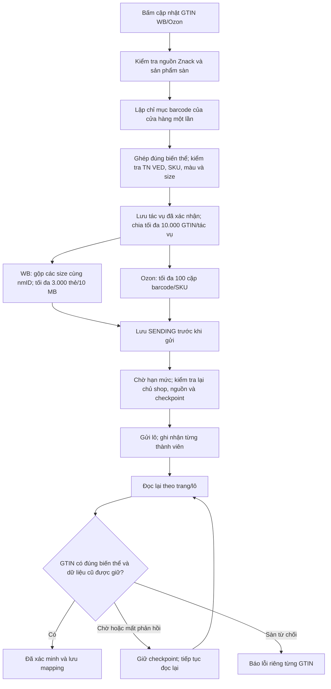

# Tăng tốc cập nhật GTIN WB/Ozon từ bản nền 1.5.0

Phạm vi: nút cập nhật GTIN trong đăng ký Znack và tiếp tục các tác vụ đã xác nhận. Dữ liệu đăng ký, màu, size, SKU, quyền shop và kết quả đọc lại vẫn được kiểm tra. Chỉ thêm barcode; không thay hoặc xóa barcode cũ. Đây là thay đổi mã nguồn sau bản 1.5.0 đã phát hành; không thay nội dung tag/bộ cài 1.5.0.

## Giao thức chính thức đã đối chiếu ngày 19.10.2026

| Sàn | Ghi | Giới hạn | Đọc đối soát |
| --- | --- | --- | --- |
| WB | `POST content/v2/cards/update` | Tối đa 3.000 nmID và 10 MB/yêu cầu; 10 yêu cầu/phút, nạp một lượt/6 giây, burst 5 | `content/v2/get/cards/list`: 100 thẻ/trang; Content 100 lượt/phút, một lượt/600 ms, burst 5. Theo cursor tăng dần `updatedAt,nmID`; thùng rác theo `trashedAt,nmID`. |
| Ozon | `POST v1/barcode/add` | Tối đa 100 cặp barcode/SKU; 20 lượt/phút/tài khoản; tối đa 100 barcode/sản phẩm | `v3/product/info/list` tối đa 1.000 ID/lượt; thuộc tính qua `v4/product/info/attributes`. |

Nguồn trực tiếp:

- [WB OpenAPI](https://dev.wildberries.ru/api/swagger/yaml/en/02-items.yaml), SHA-256 `2020b0cc3b33322a8ed34312749964a705b573ecf7275bd89bef7c95511d52db`.
- [Ozon Seller OpenAPI](https://docs.ozon.ru/api/seller/swagger.json), SHA-256 `4c5756ae6b68177eae367786656f1b4ebdc00f2ca76c0311cf312a011ad1f9e4`.

WB yêu cầu gửi nguyên các trường được phép ghi và toàn bộ giấy tờ cần giữ lại vì cập nhật sẽ ghi đè thẻ/giấy tờ. Không gửi giá mới, ảnh/video/tag. WB công bố việc đồng bộ phía dịch vụ có thể mất tới 30 phút. HTTP 200 chỉ là tiếp nhận, chưa chứng minh đã áp dụng.

Ozon dùng API thêm barcode riêng, không nhập lại sản phẩm hoặc đọc chứng nhận/giá cho từng mã. Hàng đợi barcode dùng chung theo Client-Id, kể cả nhiều shop hoặc API key trong cùng tài khoản.

## Luồng thực hiện

Checkpoint SENDING được lưu **trước** bước chờ/gửi; bước kiểm tra cuối ở sau thời gian chờ và trước HTTP. Timeout, 5xx hoặc phản hồi không rõ chỉ dẫn tới đọc lại, không tự gửi lại. HTTP 429 được nhận dạng riêng vì yêu cầu bị từ chối; tuân thủ Retry-After/X-Ratelimit-Reset trước khi thử lại.

## Các điểm chậm đã sửa

- Bỏ chuỗi một GTIN → quét cả cửa hàng → ghi → chờ → quét lại, vốn làm số lượt đọc tăng theo số sản phẩm nhân số GTIN.
- Chia gửi theo kích thước thực bằng UTF-8 và số nmID/cặp SKU. Một lỗi kiểm tra trước khi gửi được tách để các mã hợp lệ tiếp tục; không tách rồi gửi lại lô có kết quả chưa rõ.
- Đọc lại chung theo trang/lô. WB lấy danh sách lỗi một lần mỗi lượt đối soát, không một lần mỗi SKU. Cursor WB giữ cập nhật của cả những lô đã gửi trước đó.
- Chỉ mục barcode và đặt chỗ theo GTIN chuẩn hóa giữ kiểm tra mã đã thuộc sản phẩm khác. Ozon giữ fingerprint thuộc tính để thay màu/size/SKU sau khi xác nhận không bị ghép nhầm.
- Ghi SQLite theo lô, tái dùng câu truy vấn kiểm tra chủ shop, kiểm tra lại dữ liệu thật mỗi lần; không giữ khóa đọc hoặc giao dịch trong lúc gọi API/chờ hạn mức.
- Giữ dữ liệu thẻ trong tối đa 64 MiB RAM; phần bị đẩy ra được giữ trong tệp tạm riêng của tác vụ và xóa khi kết thúc, tránh mất thẻ khi quét tăng dần cửa hàng lớn. Snapshot sản phẩm có cache riêng tối đa khoảng 16 MiB.
- Một tác vụ có thể chứa nhiều size của một thẻ; trigger SQLite vẫn chặn tác vụ khác cùng lúc ghi thẻ đó. Giữ cơ chế commit/rollback và phục hồi trạng thái đã gửi.
- Tác vụ nền vẫn chỉ dùng một suất HTTP; suất còn lại dành cho FBS liên tục. Chờ hạn mức ở ngoài suất HTTP.
- Viên thuốc dưới giữa bảng hiển thị số đã gửi/đang đối soát và số đã đọc lại xác nhận. Thành viên bị từ chối có kết quả riêng, không làm các mã đã xác minh thành lỗi.

## Phạm vi kiểm chứng

**164 kiểm thử liên quan đạt, không lỗi và không bỏ qua**; đã build JAR cục bộ thành công. Các nhóm chạy gồm backend, giới hạn API, pipeline 10.000 GTIN, tiếp tục tác vụ, JavaFX dưới Xvfb và FBS UI. Đây chưa phải nghiệm thu bộ cài Windows hoặc ghi 20.000 GTIN trên shop thật.

Bằng chứng máy đọc nằm trong thư mục [evidence/2026-10-19-gtin-bulk](evidence/2026-10-19-gtin-bulk/).

Hai bộ dữ liệu 10.000 GTIN chạy planner, adapter WB/Ozon, hàng đợi, checkpoint và SQLite thật của app, nhưng **API ghi là giả lập**. Thời gian đo trong JSON là xử lý cục bộ với phản hồi tức thời, bỏ thời gian mạng/hạn mức; không phải thời gian hoàn tất trên sàn thật.

| Kịch bản | GTIN đã đọc lại xác nhận | Lượt ghi | Lượt đọc |
| --- | --- | --- | --- |
| WB: 10.000 thẻ khác nhau | 10.000 | 4 | 214 |
| Ozon: 10.000 SKU | 10.000 | 100 | 272 |

Mô hình đồng hồ kiểm chứng riêng: 100 yêu cầu Ozon cách nhau 3 giây, từ yêu cầu đầu đến yêu cầu cuối là 297 giây, chưa gồm chuẩn bị/mạng/đối soát. Bốn yêu cầu WB nhỏ nằm trong burst 5; thẻ lớn có thể cần nhiều hơn bốn lô. Không cam kết toàn bộ 10.000 mã hoàn tất trong các khoảng này.

API thật: chạy chính lớp `GtinBatchTransport` và `ListingHttpClient`, chỉ cho phép các yêu cầu đọc, với thông tin môi trường. Chỉ mục đọc được 406 thẻ WB gồm thùng rác và 175 sản phẩm Ozon; prepare/refresh cho một sản phẩm mẫu mỗi sàn thành công. Không gửi GTIN mới lên shop thật trong lượt đo này.

Các kiểm thử bao gồm giữ toàn bộ size/giấy tờ/barcode cũ, mất phản hồi sau khi sàn đã nhận, đối soát sau khởi động lại, từ chối riêng một SKU, 429, thay màu trước khi gửi, khóa chéo giữa tác vụ, đổi token lúc chờ suất HTTP, cache đẩy ra tệp, thao tác nút trên 10.001 dòng và kết quả từng thành viên của tác vụ dùng chung.
