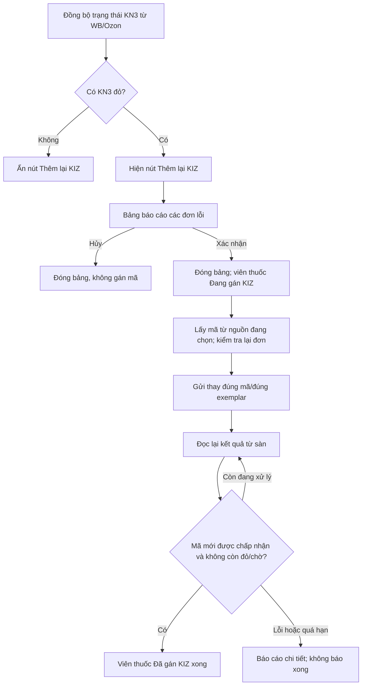

# KN3 trong shipment WB/Ozon và nút «Thêm lại KIZ»

Phạm vi: thay đổi tiếp theo trên nền VNCode 1.5.0; không ghi đè tag/bộ cài 1.5.0 đã phát hành.

## Hành vi đã triển khai

- KN3 xanh chỉ dựa trên kết quả đọc từ sàn. Gán mã vào kho cục bộ hoặc HTTP 200/204 chưa đủ để báo xanh.
- KN3 đỏ khi WB trả quyết định từ chối, hoặc Ozon trả lỗi kiểm tra ở đúng mã/đúng exemplar. Mã đang kiểm tra hiển thị màu chờ. Riêng Ozon `check_status=failed` mà không có `error_codes` là lỗi xử lý/chưa có kết luận, không tự đánh dấu mã hỏng.
- Trạng thái đi theo các lượt FBS hiện có. WB đọc metadata theo lô tối đa 100 đơn, ưu tiên shipment đang mở; lỗi đọc KN3 không làm mất con trỏ đồng bộ đơn. Ozon kiểm tra số exemplar bắt buộc, không báo xanh nếu mới có kết quả cho một phần số lượng.
- Nút **Thêm lại KIZ** chỉ hiện khi phạm vi đang mở có KN3 đỏ. WB dùng shipment hiện tại; Ozon dùng tab và bộ lọc hiện tại, gồm đơn ngoài trang 100 dòng (giới hạn thao tác 10.000 đơn).
- Bấm nút mở bảng đơn lỗi với mã đơn, article/SKU và lý do. Góc phải bên dưới có **Xác nhận** và **Hủy**. Mở bảng/Hủy không giữ kho và không gọi API ghi.
- Xác nhận đóng bảng trước, chạy nền, lấy KIZ từ nguồn đã chọn: kho seller theo danh mục trước; nguồn mua dùng GTIN đã được xác minh cho đúng biến thể và luồng mua hiện tại. Kho seller không buộc có GTIN hoặc xác thực Znack.
- Viên thuốc ở giữa phía dưới bảng đơn chỉ có **Đang gán KIZ** và **Đã gán KIZ xong**. Chỉ chuyển sang xong khi đọc lại đúng mã mới đã được sàn chấp nhận, kiểm tra lại các thẻ đích và không còn đỏ/chờ/chưa đọc được trong phạm vi đã xác nhận. Nếu còn lỗi/thiếu kho/chờ quá hạn thì báo chi tiết riêng, không báo xong giả.
- Thất bại ở một đơn không bỏ qua việc thử các đơn lỗi còn lại. Không tự mua/gửi lặp vô hạn khi mã thay thế lại bị từ chối.
- Mỗi mã thay giữ kho bằng ID và reservation token. Đã gửi nhưng chưa rõ kết quả thì giữ riêng, không cấp lại cho đơn khác. Kết quả đọc lại chấp nhận/từ chối sẽ chốt tiêu thụ đúng occurrence. Khi khởi động lại, chỉ mã chắc chắn chưa bắt đầu gửi (`PREPARED`) được trả kho; `SENDING`/`AWAITING`/`RECONCILE` tiếp tục chờ đối soát.
- Trước khi thay, kiểm tra lại mã cũ còn đỏ và khớp giá trị đã xác nhận. Mã đã xanh hoặc bị người khác đổi trong lúc chờ không bị ghi đè.
- WB thay bằng PUT trực tiếp, không xóa mã cũ trước. Ozon giữ các exemplar khác, IMEI/UIN, GTD/RNPT, trọng lượng và thông tin kiện; không gọi giao hàng. Nhãn KIZ Ozon dùng mã thay đã xác nhận, giữ nguyên lịch sử kho/in gốc; chặn in mã đỏ hoặc khi ánh xạ exemplar không rõ.
- Đổi shop/tab/bộ lọc không để kết quả tác vụ cũ ghi vào màn hình mới. Giữ nền Liquid Glass; header WB xuống dòng khi cửa sổ nhỏ để nút không bị cắt.

## Đối chiếu API

- WB: https://dev.wildberries.ru/api/swagger/yaml/en/03-orders-fbs.yaml — `POST /api/marketplace/v3/orders/meta`, `metaDetails.value/decision`, PUT `/api/v3/orders/{orderId}/meta/sgtin`. Tách hạn mức đọc/xóa 300/phút và thêm 1.000/phút; tuân thủ cooldown/Retry-After. SHA-256 tài liệu: `2f85fa11e45040bfb1f54e0c07d25060463b9bf0ee7b3a4b3d12d9e34187fc77`.
- Ozon: https://docs.ozon.ru/api/seller/swagger.json — đọc `/v5/fbs/posting/product/exemplar/status`, ghi `/v6/fbs/posting/product/exemplar/set`. SHA-256: `4c5756ae6b68177eae367786656f1b4ebdc00f2ca76c0311cf312a011ad1f9e4`.

## Kiểm thử và giới hạn nghiệm thu

Các kiểm thử dùng JavaFX thật trên Xvfb/Linux, SQLite thật và API giả lập MockWebServer: quyết định KN3, payload Ozon giữ nguyên mã khác, race mã cũ đã xanh, HTTP nhận yêu cầu/chưa chấp nhận, lỗi 4xx/5xx, chống gửi lặp, đúng exemplar, giữ kho và phục hồi, nhãn thay thế, nút Xác nhận/Hủy, hai trạng thái viên thuốc, cửa sổ nhỏ và 121 đơn Ozon vượt một trang. Các kiểm thử kho/phân bổ/mua hiện có, xuất nhãn, lịch sử in và FBS cũng được chạy lại ở phạm vi liên quan.

Bài tải giao diện có 10 shop × 1.000 đơn và 100.000 sản phẩm giả lập: p95 từ commit đến hiển thị là **151 ms**, không có nhịp FX bị đứng quá 500 ms. Đây là số đo Linux giả lập, không phải cam kết trên máy Windows seller hoặc độ trễ xử lý của sàn.

Đọc thử API Ozon thật lúc **12:56:34 ngày 19.10.2026 (Moscow)**: API danh sách FBS trả **HTTP 429**; chưa đọc được đơn để nghiệm thu KN3 thật. Secret WB hiện chỉ được cấp cho `content-api.wildberries.ru`, chưa được cấp cho `marketplace-api.wildberries.ru` dùng bởi FBS/KN3. Không dùng token trong hội thoại để vượt ràng buộc đó. Chưa gửi thay KIZ thật lên tài khoản seller, vì vậy không coi kiểm thử giả lập là bằng chứng sàn đã chấp nhận giao dịch thật.

Kết quả số lượng kiểm thử và checksum bản build cục bộ được lưu kèm trong `2026-10-19-kn3-evidence.json`.
