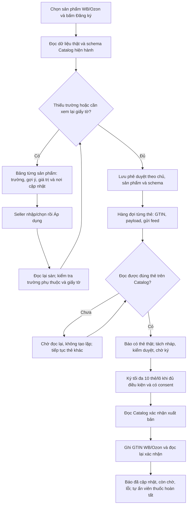

# Áp dụng sơ đồ đăng ký Znack vào VNCode

Đợt sửa sau source `7170411`, ngày 20.10.2026. Phạm vi: các phần còn thiếu được ghi trong [đối chiếu Wbcode 1.3.11](../research/2026-10-20-wbcode-1311-znack-comparison.md). Mẫu đăng ký, dữ liệu seller và quy tắc TN VED/giấy tờ được giữ; không đưa số giấy tờ hay dữ liệu riêng của seller vào mặc định ứng dụng.

## Đường đăng ký và thông báo

Việc nhận `feed_id` không chứng minh thẻ đã tồn tại. Bộ đếm “đã xác nhận có trên Catalog” dùng kết quả đọc đúng GTIN/goodId; kết quả gửi/ký chưa xác định chỉ được đối soát, không gửi lặp tự động.

## Những phần được triển khai

- `RegistrationDynamicPreflight`, `RegistrationBatchPreflight` và `RegistrationReviewedValues`: kiểm tra trước đăng ký theo schema hiện hành, đọc cả sản phẩm chưa có snapshot, hiển thị giá trị/loại giá trị cần bổ sung, kiểm tra thuộc tính phụ thuộc. Dữ liệu nhập cho Catalog được giữ theo đúng chủ, phạm vi chữ ký, biến thể, phiên bản dữ liệu sản phẩm và schema; thay đổi dữ liệu làm phê duyệt cũ mất hiệu lực.
- WB/Ozon dùng cùng đường kiểm tra trước khi cấp GTIN. Giá trị sửa trên sàn được đọc lại; giá trị chỉ phục vụ Catalog được đánh dấu rõ. Cảnh báo phạm vi giấy tờ không bị thay bằng việc ép TN VED sang nhóm khác.
- `sendReviewedSigningBatch` và hai workflow: tối đa 10 XML trong một POST, giữ consent/checkpoint/hash riêng từng thẻ, đối soát từng thẻ sau gửi. Thẻ không tìm thấy không làm mất các thẻ độc lập đủ điều kiện; lỗi 429 giữ thời gian chờ API trả về.
- Monitor đọc một lượt có giới hạn 30 thẻ, gom các thẻ đã có consent để ký theo lô và giữ lịch đối soát; không thay luồng ưu tiên FBS. Cooldown ký được giới hạn theo profile/chủ tài khoản.
- `OzonCatalogMappingService`: nút Đồng bộ & map GTIN đọc sản phẩm và Catalog, xác minh barcode/biến thể/chủ/giấy tờ, lưu mapping đúng SKU và liệt kê lỗi từng sản phẩm. Thao tác này không tự sửa bài đăng trên sàn.
- `SignatureTestFailure`: phân biệt lỗi ký cục bộ, lỗi xác thực/mạng CRPT và lỗi lưu kết quả; giữ mã CryptoPro thực khi CryptoPro là nguyên nhân. Nhật ký không lưu nội dung phản hồi chứa thông tin riêng.
- Trang đăng ký Ozon có lọc danh mục; thông báo giới hạn lựa chọn và lý do lỗi được diễn giải bằng bốn ngôn ngữ.

## Kết quả API thật và phần cần seller bổ sung

Đọc đủ **1.277 thẻ: 1.241 published, 34 lỗi, 2 nháp**. Chưa có bằng chứng thêm thẻ trong lần đọc này. API danh sách/chi tiết không trả nguyên văn lý do kiểm duyệt hoặc feed ID của 34 lượt lỗi. Phát hiện sau là đối chiếu độc lập, không phải trích nguyên văn thông báo từ chối.

34 thẻ lỗi dùng giấy tờ cũ có phạm vi 6101/6201/6202/6211. Mã thực trên thẻ là 6106909000 (7), 6110209100 (24), 6103420001 (3). Giấy tờ thay thế seller cung cấp ngày 28.05.2026 đã được registry xác minh số/ngày khớp, đang hiệu lực đến 26.05.2031, bao phủ 6103/6104/6105/6106/6110/6112. Các mã của 34 thẻ nằm trong phạm vi mới; vẫn cần bảo đảm giấy tờ đúng hàng thực tế trước khi áp dụng. Chưa thay giấy tờ trên các thẻ thật.

Hai nháp đều thiếu tám trường: TN VED, màu, thành phần, model/article, giới tính, size/chuẩn size, quy chuẩn kỹ thuật, loại hàng. Sản phẩm nguồn seller chỉ định được WB trả HTTP 200, có sáu size và đủ màu/chất liệu/TN VED nhưng thiếu giới tính. Seller đã xác nhận giới tính Nam. TN VED nguồn **6109100000** không thuộc giấy tờ thay thế nói trên. Hai nháp cũng chưa có article/size và thương hiệu khác nguồn; chưa tự ghép chúng thành cùng sản phẩm.

Bằng chứng đã loại số giấy tờ, GTIN/barcode, API key và mã định danh sản phẩm: [Catalog/schema](2026-10-20-znack-diagram-evidence/catalog-required-fields-readonly.json), [giấy tờ thay thế](2026-10-20-znack-diagram-evidence/replacement-permit-readonly.json), [nguồn WB](2026-10-20-znack-diagram-evidence/selected-product-readonly.json).

Seller cũng cung cấp số giấy tờ thứ hai. Số này trùng giấy tờ cũ trong các thẻ nên đọc được ngày cấp thật 07.06.2026; API xác nhận đang hiệu lực đến 03.06.2031 nhưng phạm vi vẫn là 6101/6201/6202/6211, không có 6109. Không cần hỏi lại ngày cấp. [Bằng chứng kiểm tra giấy tờ thứ hai](2026-10-20-znack-diagram-evidence/second-permit-readonly.json).

Thông tin còn cần seller nhập cho sản phẩm nguồn đã chọn: giấy tờ thực sự bao phủ 6109 (số và ngày cấp), xác nhận liên kết/thương hiệu và size tương ứng của hai nháp nếu muốn sửa hai nháp này. Giới tính Nam đã được ghi nhận trong trao đổi, chưa ghi lên WB. Không tự đổi mã 6109100000 thành nhóm khác để ép khớp giấy tờ.

## Kiểm thử và phát hành

Kết quả cuối: **881 kiểm thử Java đạt**, không lỗi/không bỏ qua, cùng **10 kiểm tra Node entrypoint đạt**. Bao gồm 826 ca liên quan trong 97 lớp và 55 ca FXML chạy JVM riêng. Đây là kết quả cuối từng lớp sau lượt hồi quy rộng và chạy lại phần bị ảnh hưởng, không phải tuyên bố toàn repository được chạy một lượt đều đạt. [Kết quả máy đọc được](2026-10-20-znack-diagram-evidence/regression.json).

Lượt rộng đã phát hiện fixture HTTP Ozon cũ chỉ chờ POST mà không phục vụ bước đọc lại. Fixture đã được sửa để buộc đọc đúng feed, GTIN và goodId thật của máy chủ localhost, giữ kiểm tra một POST và đúng kiểu thuộc tính. Kiểm thử khôi phục cửa sổ JavaFX cũng được kiểm tra lại trong JVM tập trung; observer chờ đúng completion phụ để tránh thread đợi lấy mất callback từ thread FX. Không bỏ các xác nhận cửa sổ thực sự đã hiện/bỏ thu nhỏ hoặc xác nhận khởi động không mở SQL.

`mvn -o -DskipTests package` đã đóng gói Java thành công sau các lượt test; đây không phải bộ cài Windows mới. Các kiểm thử HTTP localhost không phải nghiệm thu API production, chữ ký CryptoPro Windows hoặc thao tác ghi lên sàn thật.

Đợt đọc API này không cấp GTIN mới, gửi feed, ký hoặc ghi dữ liệu sàn. Bản Windows Latest 1.5.4 hiện có chưa được thay thế trong đợt sửa này.
